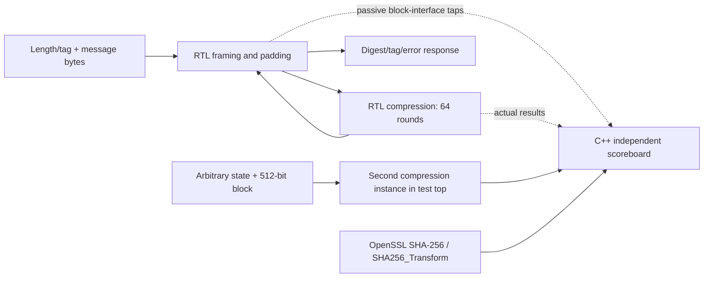
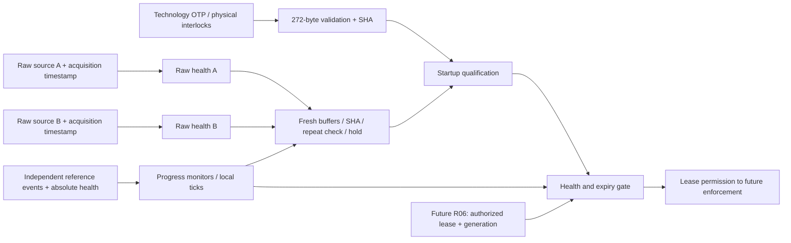
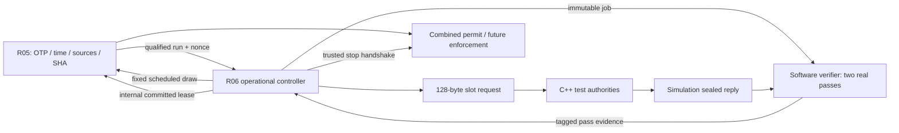
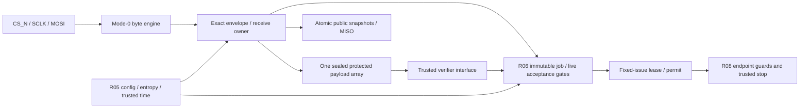
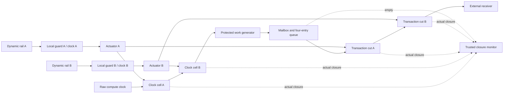
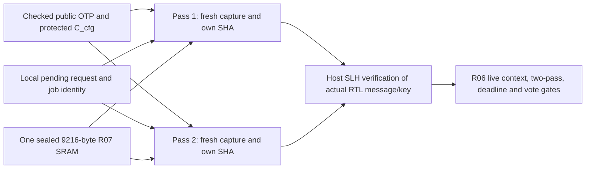
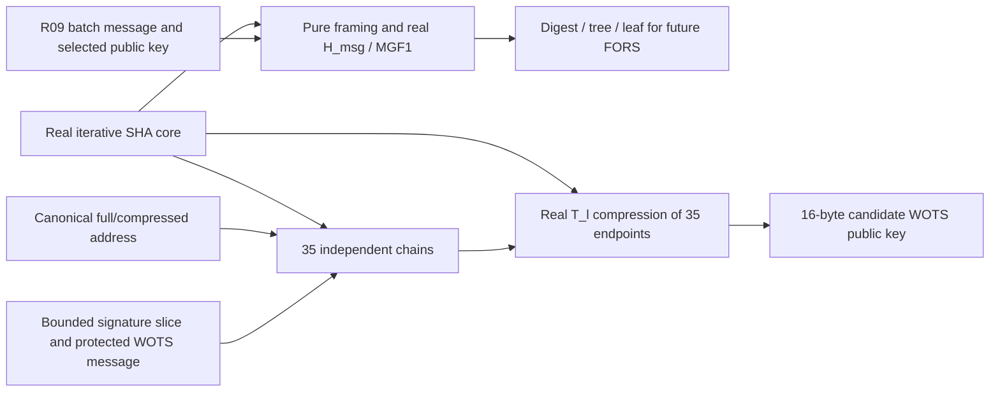
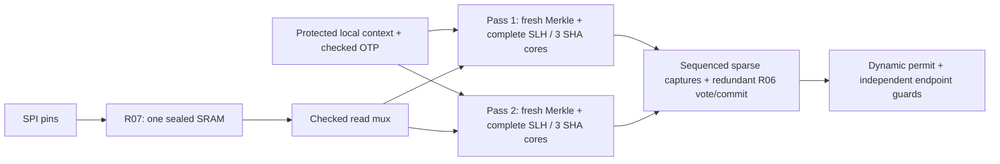

# Build notes and development history

This file preserves the documentation from the staged development of REINS.
The snapshots below are **verbatim**, from commit `0fd5fc7` before the documentation
and test-name cleanup. They include intermediate designs, old commands, tool
versions, test counts, measurements and limitations as they were recorded.

Use [README.md](README.md) for the current build workflow,
[docs/TESTING.md](docs/TESTING.md) for the current test names and evidence rules,
and [docs/REMAINING_WORK.md](docs/REMAINING_WORK.md) for outstanding work.
Historical passing results establish only the source/version named in that record.
Old test-result directories and pinned input bytes have not been rewritten.

## Test name migration

The current names identify the unit under test. The test bodies, corpus and
required directed case counts are retained. Existing stage-named Make targets
remain [compatibility aliases](tools/legacy_test_names.mk); old filters and
historical report layouts belong to their recorded version.

| Previous stage | Current subject and primary target |
|---|---|
| R02 | C++ reference model: `software-tests` |
| R03 | Protected storage/control and fault accounting: `protected-state-tests` |
| R04 | SHA-256 compression and framing: `sha256-unit-tests` |
| R05 | OTP, reset, trusted time and entropy: `platform-unit-tests` |
| R06 | Lease, rounds, requests and quorum: `controller-unit-tests` |
| R07 | SPI transport and protected reception: `spi-tests`, `receive-memory-unit-tests` |
| R08 | Permit, local guards and endpoint containment: `enforcement-tests` |
| R09 | Expected grants and Merkle proofs: `merkle-tests` |
| R10a | SLH addressing, message hashing and WOTS+: `slh-components-unit-tests` |
| R10b | Complete single-pass SLH verification: `slh-verify-unit-tests` |
| R10c | Independent passes and device integration: `verification-tests` |
| R11 | Directed SPI, fuzz/fault and release campaigns: `spi-regression-tests`, `release-check` |

Public `r02` fixture filenames/generator identifiers and the stable fault catalog's
legacy target identifiers remain unchanged to preserve provenance and replay hashes.
The current generator translates descriptive platform/verifier names at that boundary.

## Documentation and test-name cleanup — October 24, 2026

The current guides were rewritten around the complete design and hardware units.
The 21 snapshots below preserve the previous documents verbatim from `0fd5fc7`.
All 199 registered C++ cases remain across the 16 RTL executables and the software
test executable. Existing stage-named Make targets remain compatibility aliases.
Pinned specification/validation inputs, public signed corpus, stable fault catalog
and SPI regression bytes remain unchanged. Device RTL changes are comments and
three assertion diagnostic strings; device logic is unchanged.

Validation used Verilator **5.008 only**, GCC 14.2, Python 3.12.14 and OpenSSL 3.5.7.
The executable-source digest is
`3ae7edd67b8319fb9b83c28197d8362c51434add97b13524d16002e92b71754b`.
Markdown history/review notes are outside that inventory.

| Check | Observed outcome |
|---|---|
| `make test-inventory JOBS=2` | All executables built; 199 compiled registrations match their source and default release counts. Listing executes no test bodies and earns no functional acceptance credit. |
| `make software-tests JOBS=2` and `make baseline-tests` | 33 C++ cases, 55 Python regressions, source pins, supplied/reference corpus, report/CLI and current documentation links passed. |
| `make unit-tests JOBS=2` | All 148 unit cases passed. The two-pass bank completed its 18 cases in 1,193.57 seconds: 88 jobs (48 completed, 40 canceled), 90 returned pass completions and 69 fully checked passes; saved-input/work/stage evidence checks passed. |
| `make controller-integration-tests spi-integration-tests enforcement-integration-tests merkle-integration-tests JOBS=2` | All nine connected-subsystem cases passed with their declared software-signature boundaries. |
| `make production-tests JOBS=2` | Bare-device/harness source/flag audits and slots 0/1 ARM+RENEW passed: four jobs and eight independently checked real RTL passes; 327.44 seconds test wall time. |
| `make fuzz-smoke CAMPAIGN_SEEDS=2 CAMPAIGN_ITERATIONS=128 JOBS=2` | Both requested budgets completed, 256 actions total; exact replay traces and selected-campaign report passed. |
| `make fault-replay REPLAY=.../site-525-bench-10/manifest.json` | A public manifest saved before renaming replayed without private keys: applied/effect/detection/release all confirmed. |
| `make replay REPLAY=.../spi-fuzz-0/fuzz.trace` | The saved 128-action trace replayed through the actual SPI RTL; the explicit replay case passed in 10.89 seconds. |
| Legacy target and seed controls | `make r11-tests` passed the minimized SPI regression. A selected platform case accepted legacy seed 12345 and then preferred descriptive seed 54321 when both were set. |
| `make rtl-lint` | Assertion and `SYNTHESIS` component/complete-device lint passed. |
| `make formal-checks synthesis-checks reset-checks cdc-review JOBS=2` | Scoped formal, generic component synthesis and local Icarus four-state reset passed; CDC inventory remains `manual_review_required`. |

The production run measured 537,938–570,708 monitor clocks per two-pass vote
(134.484–142.677 ms at 4 MHz), 1,002,475–1,011,527 trusted ticks of job ownership
against a 5,000,000-tick budget, and ARM commit/all-guards-open at
2,236,585/2,237,588 ticks before W=2,500,000. Exact compression counts were
2,231–2,379 per checked pass. Actual host signing took 0.270–0.287 seconds per
reply, separately from the assumed 100,000-tick service delay. These measurements
and their margins were printed to the console and retained on disk.

Retained local result directories (ignored by Git; fresh commands create new runs):

- `test-results/20261024T215551.369215Z-inventory-release-m2r31mtk/`
- `test-results/20261024T213032.254342Z-software-release-nfnmvluk/`
- `test-results/20261024T221358.676611Z-baseline-release-hqzqj0pd/`
- `test-results/20261024T214402.446714Z-unit-release-g6ip3pll/`
- `test-results/20261024T213603.444462Z-controller-integration-release-18raolxn/`
- `test-results/20261024T213609.526752Z-spi-integration-release-vhu2m3zy/`
- `test-results/20261024T213722.016768Z-enforcement-integration-release-ez9n23_1/`
- `test-results/20261024T213956.034403Z-merkle-integration-release-e0w240qs/`
- `test-results/20261024T213537.374461Z-campaign-production-release-iv8xnrmv/`
- `test-results/20261024T214008.315542Z-campaign-fuzz-release-t5zi0_9i/`
- `test-results/20261024T214009.532222Z-fault-replay-release-l813i_34/`
- `test-results/20261024T221155.297133Z-campaign-replay-release-68_tyl7q/`
- `test-results/20261024T214706.940824Z-campaign-directed-release-ubcsyiq4/`
- `test-results/20261024T214610.365570Z-platform-unit-release-8q77qxdn/`
- `test-results/20261024T214610.771336Z-platform-unit-release-p1n06bqh/`
- `test-results/20261024T213411.623742Z-campaign-formal-release-g93ble_y/`
- `test-results/20261024T213527.434558Z-campaign-synthesis-release-9rcinvjv/`
- `test-results/20261024T213530.895468Z-campaign-reset-release-d65vk2mm/`
- `test-results/20261024T213531.088101Z-campaign-cdc-release-7w2t3uq9/`
- `test-results/approachable-docs-audit/`: preservation audit and lint transcript.

During migration, an early check ran before Verilator selection, a temporary
common-header dependency in the isolated SHA harness caused a compile error,
and three old documentation links failed the new link check. The SHA harness
keeps its independent build, the links were corrected, and the subsequent builds
and checks above passed. Failed/intermediate logs remain on disk.

The complete monolithic `release-check`, all-pair instrumented full-device SPI
scenarios and sanitizer rebuilds were not rerun for this nomenclature change.
Existing explicit service/physical qualification gaps remain. Source coverage,
scoped proofs and a passing digital timing profile do not establish silicon
qualification.

## Archived documentation

Each folded section contains the complete original Markdown, including its
original relative links. Resolve those links in the original file's directory at
commit `0fd5fc7`; they are preserved as historical text rather than current links.
The SHA-256 beside each snapshot identifies its original bytes. Each snapshot
also links to its original rendered GitHub document at that commit.

## Snapshot: README.md

<details>
<summary>Original README.md — SHA-256 c37a280cbaff78e04e6a67aea44ab93a559615c06b177ee48d04cc9cf8a3ebfa</summary>

[View the original rendered document](https://github.com/toddmaustin/REINS/blob/0fd5fc7/README.md)

``````markdown
# REINS

REINS stands for **Revocable Execution through Independent Networked Supervision**.
The intended hardware lets protected computation run while **two of three
independent authorities** approve a current lease. If two authorities stop approving
renewals, the lease expires and local hardware stops execution. There is no remote
"kill now" message: stopping depends on a bounded local timeout.

Copyright (c) 2026 Todd Austin. Available under the
[PolyForm Noncommercial License 1.0.0](LICENSE); see
[copyright and license](#copyright-and-license) for scope and required notices.

This repository now contains the **R02 event-driven C++ device reference model**:
provisioning, reset, entropy events, ARM/RENEW rounds, two-of-three voting, execution
leases, receive jobs, stopping, test authorities and an untrusted relay. It uses
real host signature verification. **R04 adds iterative SHA-256 SystemVerilog RTL
and a C++ Verilator harness** with message padding, directed tests, seeded fuzz,
interface-corruption checks and measured cycles/throughput. **R05 adds configuration,
reset, timing and entropy-control RTL**: physically interlocked public OTP,
permanent closure, startup qualification, fresh two-source SHA conditioning,
retained nonce-repeat checks and sticky entropy hold. **R06 adds the operational
RTL controller**: exact slot requests, scheduled ARM/RENEW rounds, distinct votes,
fixed-issue leases, independent age/remaining checks, cancellation and trusted
completed-stop restart. Tests compare against C++ using two real host verification
passes; integration tests connect the actual R05/R06 hardware. **R07 adds pin-level
mode-0 SPI and one sealed receive memory**: exact envelopes, atomic public reads,
powered-context tokens, sequential reception, native time budgets and ECC/address/
owner checks. Both software verification passes read the actual sealed RTL memory.
**R08 adds dynamic permit rails and local endpoint enforcement**: three representative
compute/outbound endpoints, six independent local guard clocks, serial isolation
cells, queue containment and internally certified stop completion. SPI management
remains live while protected work is stopped. **R09 adds expected-grant and Merkle
RTL**: each pass independently constructs its local grant, hashes all public OTP,
reads the sealed proof and reconstructs its root with its own real SHA-256 core.
Tests verify the actual RTL message/key using host SLH-DSA. **R10a adds real
SLH-DSA components**: canonical addresses, pure/empty-context message hashing,
MGF1 and WOTS+ reconstruction with independent intermediate checks. **R10b completes single-pass signature
verification RTL**: FORS, all seven hypertree layers, exact parsing and reconstructed
public-key root comparison using real SHA. **R10c integrates two complete independent
passes and the full RTL device**: real SPI-to-lease authorization, six separate SHA
datapaths, protected read/capture paths, dissimilar comparisons and redundant vote/commit
checks. Physical qualification remains later work. These tests do not
prove physical clock, randomness, isolation or fault-resistance properties.
**R03 now adds protected state, independent capture/update paths and a general
simulation fault catalog**, including confirmed applications, retained outcomes
and public replay without private keys. See the [R03 guide](docs/R03_PROTECTED_PRIMITIVES.md).

See the [RTL guide](rtl/README.md) for interfaces and hashing tests.
Device sources are in [`rtl/device/`](rtl/device), and simulation/formal RTL is
in [`rtl/test/`](rtl/test/README.md). The
[specification review and remaining work](docs/IMPLEMENTATION_REVIEW.md) separates
implemented digital behavior from unfinished model, service and platform work.
The [R05 platform profile](docs/R05_PLATFORM_PROFILE.md) explains which digital
checks are implemented and which timing/entropy inputs need physical evidence.
The [R06 controller guide](docs/R06_CONTROLLER.md) explains state ownership,
the verification boundary, timing priority and stateful fuzzing.
The [R07 SPI/receive guide](docs/R07_SPI_RECEIVE.md) documents the transport,
memory protection, result codes, pin drivers, fault tests and retained evidence.
The [R08 enforcement guide](docs/R08_ENDPOINT_ENFORCEMENT.md) explains the dual
guards, queue/stop ordering, 1.1 ms modeled bound and required physical assumptions.
The [R09 Merkle guide](docs/R09_MERKLE.md) explains exact framing, per-pass state,
last-leaf padding, independent byte/block checks and the remaining signature boundary.
The [R10a component guide](docs/R10A_SLH_COMPONENTS.md) explains the SHA prefix
state, addresses, framing, exact work counts, WOTS signature slices and saved evidence.
The [R10b verifier guide](docs/R10B_SLH_VERIFIER.md) explains complete verification,
strict REINS versus algorithm interfaces, scratch ownership and replayable evidence.
The [R10c full RTL guide](docs/R10C_FULL_RTL.md) explains the production top,
two-pass independence, exact work, fault domains and complete SPI/guard timing.

## Start here

After checking out this repository (or the PR branch you are reviewing):

```sh
make build
make quick-tests
make tests
```

Each test command prints the directory containing its saved results. You do not
need to add `tee` or redirect output. A failed build or test makes the command fail
and keeps the logs for inspection.

## What do I need installed?

| Tool | Why it is needed |
|---|---|
| GNU Make 4+ | Builds the programs and provides all test/clean targets |
| A C++20 compiler | Builds the simulator and C++ tests; GCC 14.2 was tested |
| Python 3.10+ | Prepares example data and runs checks/report collection; standard library only |
| Trusted CA certificates | Let Python verify HTTPS when downloading the test dependency |
| pkg-config | Finds the installed OpenSSL headers and library |
| OpenSSL **3.5 or newer development package** | Independent SHA-256 / FIPS 205 SLH-DSA backend, with the default provider's SLH-DSA support |
| Verilator **5.008** | Active local and CI baseline for SHA-256 and R05–R11 component/integration RTL |
| Yosys and Icarus Verilog (`iverilog`, `vvp`) | Additional tools for `release-check`, formal/component synthesis and separate four-state/reset checks; Yosys 0.52 and Icarus 12.0 tested |

OpenSSL's development package includes headers and `libcrypto`, not just the
`openssl` executable. Many older systems supply OpenSSL 3.0 or 3.4, which do not
provide the required signature algorithm. Make and C++ require **3.5.0 or newer**
headers and runtime library; EVP calls check that the required signing and
verification APIs and default-provider algorithm are available. Compatible header
and runtime versions can differ. OpenSSL **3.5.7** and its
[upstream source commit](third_party/crypto-backend.json) remain the tested reference
baseline, rather than an exact installation requirement. Reports record the actual
runtime version, and the tests check its cryptographic behavior.
Check what pkg-config finds:

```sh
pkg-config --modversion libcrypto
```

For a custom OpenSSL installation, point `PKG_CONFIG_PATH` at its pkg-config files
before running Make. For example, if installed under `/opt/openssl`:

```sh
export PKG_CONFIG_PATH=/opt/openssl/lib/pkgconfig
make build
```

Some installations use `lib64/pkgconfig`; use the directory that actually contains
`libcrypto.pc`. Make checks the minimum version, links against that installation
and records its library directory in the executables' runtime search path.

On macOS, a candidate setup is:

```sh
brew install make pkg-config python openssl@3 verilator
# Check that Homebrew's current OpenSSL is at least 3.5:
export PKG_CONFIG_PATH="$(brew --prefix openssl@3)/lib/pkgconfig"
pkg-config --modversion libcrypto
gmake build
gmake tests
```

Use `gmake` when your system's `make` is an older version. Linux/WSL2 is the tested
path: Debian 13, GCC 14.2, GNU Make 4.4.1, Python 3.12.14 and OpenSSL 3.5.7.
The full suite also passes with a source-built OpenSSL 3.5.0.
macOS has not yet been validated here. Check `verilator --version` reports
**5.008**. An existing 5.008 installation needs no replacement. Set
`VERILATOR=/path/to/verilator` for a custom installation. CI uses the same single
version; additional versions will be considered when a concrete problem requires
them. Verilator is
required for normal builds/tests; `make software-build` and `make baseline-tests`
provide software-only entry points.

If your package manager supplies a different version, an optional source setup
downloads the pinned 5.008 archive and checks its SHA-256. It requires a C++
compiler, Autoconf, Flex, Bison, Perl, `libfl` development files and zlib development
files. The build and its setup report are retained on disk:

```sh
make setup-verilator JOBS=2
export VERILATOR_ROOT="$PWD/.deps/verilator-5.008"
export VERILATOR="$VERILATOR_ROOT/bin/verilator"
make quick-tests
```

The optional setup reuses an existing version-checked tool in that directory.
It does not change your system installation. The source pin is recorded in
[verilator-tool.json](third_party/verilator-tool.json).

The first build downloads a small, pinned C++ testing dependency called **doctest**.
The downloader verifies HTTPS certificates and both archive and file SHA-256
hashes. Downloads are cached in `.deps/`; subsequent builds/tests work offline.
No Python packages or private signing keys are needed.
See [dependency versions and licenses](third_party/README.md).

### If the doctest download reports `CERTIFICATE_VERIFY_FAILED`

This error means Python cannot verify the HTTPS server's certificate chain. It
occurs before the C++ build and is separate from the OpenSSL development-package
version check. Common causes are a missing system CA bundle or a network proxy
that uses your organization's CA.

For the system Python on Debian/Ubuntu, repair the trusted certificate store:

```sh
sudo apt-get install --reinstall ca-certificates
sudo update-ca-certificates
make build
```

If that bundle already exists but Python looks elsewhere (for example, after a
custom OpenSSL installation), explicitly select it:

```sh
SSL_CERT_FILE=/etc/ssl/certs/ca-certificates.crt make build
```

If it still fails, or your network uses a university/company HTTPS proxy, obtain
the trusted PEM CA bundle from your administrator. Point Python to that file:

```sh
export SSL_CERT_FILE=/absolute/path/to/trusted-ca-bundle.pem
make build
make tests
```

The path is a placeholder for a real, trusted file. `SSL_CERT_FILE` is used by
Python's TLS library even when Python runs with `-E`; that option ignores
`PYTHON*` environment variables. Set it in the shell where you run Make.
`REQUESTS_CA_BUNDLE` and `CURL_CA_BUNDLE` do not configure this Python urllib
downloader. Use a CA bundle that includes the issuers you need; do not disable
certificate verification.

To see which CA paths your selected Python uses:

```sh
python3 -E -s -B -c 'import ssl; print(ssl.get_default_verify_paths())'
```

For a machine without network access, copy a previously verified
`doctest-v2.4.12.tar.gz` into `.deps/downloads/` from a trusted machine and retry
`make build`. The downloader checks the pinned archive and member hashes before
installing cached files too. A failed download requires no `make clean`.

## Build and test targets

| Command | What it does |
|---|---|
| `make build` | Builds the C++ simulators/tests, verified inputs and all sixteen Verilator component/integration test executables |
| `make software-tests` | Runs the independent C++ model, corpus/CLI cross-checks and Python tooling without building RTL |
| `make software-build` | Builds only the independent C++ simulators/tests and input data |
| `make rtl-build` | Builds all assertion/coverage-enabled RTL test executables and required C++ oracle objects |
| `make rtl-lint` | Checks production RTL with assertions and with `SYNTHESIS` defined, independently of the simulation top |
| `make quick-tests` | Builds as needed and runs bounded directed checks, including R05 signed-lease examples; skips extended fuzz and the larger software host-signing cases |
| `make tests` | Builds as needed and runs all current software, RTL component/integration, stateful fuzz and infrastructure checks |
| `make release-check` | Runs the complete local digital release workflow, normal non-instrumented timing, separate formal/synthesis/reset/CDC records and requirement/coverage reports |
| `make r11-tests` | Replays small hole, partial-transaction and stale-token regressions through actual SPI pins |
| `make fuzz-smoke` | Runs two saved seeds and 128 generated actions per seed by default; saves exact replay traces |
| `make fault` | Runs nine repeated/persistent fault attempts against the real two-pass bank |
| `make nightly` | Runs the full release workflow; set `CAMPAIGN_SEEDS` and `CAMPAIGN_ITERATIONS` for larger budgets |
| `make production-tests` | Builds the bare production top and tests full SPI ARM/RENEW with RTL assertions/coverage/tracing and sanitizers disabled |
| `make formal-checks` / `synthesis-checks` / `reset-checks` / `cdc-review` | Produces separate scoped proof, generic component synthesis, four-state reset and manual CDC inventory records |
| `make replay REPLAY=path` | Replays exact saved byte/partial-bit actions against RTL and the C++ byte model |
| `make minimize REPLAY=path FINGERPRINT='CHECK( expression )'` | Minimizes a reproducible assertion failure, retaining every candidate and child log |
| `make campaign-report RESULTS=test-results/<run>` | Checks current-source evidence and generates requirement, execution-budget, critical-state and uncovered-source-point reports |
| `make r07-tests` | Builds/runs just the SPI/controller, full R05/R06/R07 integration and protected-memory tests, retaining all outputs |
| `make r08-tests` | Builds/runs local multi-clock enforcement and full-device signed-quorum/expiry/management tests, retaining all outputs |
| `make r08-unit-tests` | Runs local guard, clock, queue, fault and seeded fuzz tests; useful for focused sanitizer checks |
| `make r09-tests` | Runs real-SHA local grant/Merkle tests and signed SPI/full-device integration, retaining all outputs |
| `make r09-unit-tests` | Runs grant/proof vectors, both-lane construction/hand-off faults and seeded fuzz without long SPI transfers |
| `make r10c-tests` | Runs real two-pass controller and complete production-top SPI ARM/RENEW, withholding/expiry and stall tests |
| `make r10c-unit-tests` | Runs independent-pass, all-quorum, mutation, shared-path/final-commit fault and seeded unit tests |
| `make r10c-integration-tests` | Runs only full RTL pin-level tests; `TEST_FILTER` selects individual scenarios |
| `make r10b-tests` | Runs all 28 official outcomes, real REINS signatures, FORS/hypertree mutations, fault/backpressure tests and saved-evidence validation |
| `make r10a-tests` | Runs FIPS addresses, framing, MGF1, all WOTS layers/intermediates, fault tests and seeded fuzz; validates and retains the actual evidence files |
| `make baseline-tests` | Runs source/fixture/tool checks using only Python; no C++ build or OpenSSL package needed |
| `make sanitize-tests` | Builds/runs the full suite with C++ address/undefined-behavior sanitizers |
| `make regenerate-reference-fixtures` | Explicitly generates new public R02 keys/signatures and provenance; changes tracked fixtures |
| `make clean-results` | Deletes all retained test results, leaving builds and dependencies intact |
| `make clean` | Deletes builds and all test results; keeps the downloaded dependency cache |
| `make clean-deps` | Deletes only the dependency cache; the next build needs network access |
| `make help` | Prints the target list |

Builds are incremental: unchanged sources are not recompiled. To build in parallel:

```sh
make -j4 build
```

Test targets build with four jobs by default; change that with `JOBS`:

```sh
make JOBS=8 tests
```

To focus the C++ portion on an existing test name while still collecting results:

```sh
make tests TEST_FILTER='*cancellation*'
```

Other groups still run. A filter that selects zero C++ tests fails instead of
reporting success. Use the Make test targets so output is always retained.

For SPI development, filter the R07 controller cases independently; its integration
and memory groups still run:

```sh
make r07-tests TEST_FILTER='*atomic*,*budget*'
REINS_R07_SEED=12345 make r07-tests
REINS_R07_TRACE=1 make RTL_TRACE=1 r07-tests
```

For endpoint enforcement development:

```sh
make r08-tests
make r08-unit-tests TEST_FILTER='*permissive*,*clock corners*'
REINS_R08_SEED=12345 make r08-unit-tests
make SANITIZE=1 r08-unit-tests
REINS_R08_TRACE=1 make RTL_TRACE=1 r08-tests
```

`r08-unit-tests` avoids long signature transfers; its independent clocks, route
jitter, stateful fuzz and final receiver observations still exercise actual RTL.
`r08-tests` additionally runs the real OTP/time/entropy/SPI/controller composition
and real software verification over sealed RTL memory. Test inputs and timing
measurements are saved with the results. See the [R08 guide](docs/R08_ENDPOINT_ENFORCEMENT.md).

For expected-grant and Merkle hardware development:

```sh
make r09-tests
REINS_R09_SEED=12345 make r09-unit-tests
make SANITIZE=1 r09-unit-tests
REINS_R09_TRACE=1 make RTL_TRACE=1 r09-unit-tests
```

The reply contains a signature, index and siblings. R09 constructs the grant
locally; it receives no grant body. Its root is a candidate until the signature
verifies. The C++ harness checks every actual SHA block/chaining state and uses
host SLH-DSA to check the actual RTL-produced message and selected key. See the
[R09 guide](docs/R09_MERKLE.md) for interfaces, rejection cases and saved evidence.

For SLH-DSA addressing, message hashing and WOTS+:

```sh
make r10a-tests
REINS_R10A_SEED=12345 make r10a-tests
make SANITIZE=1 r10a-tests
REINS_R10A_TRACE=1 make RTL_TRACE=1 r10a-tests
```

These tests compare 42 WOTS layer intermediates from supplied and official
signatures with the unchanged Python verifier and an independent C++/OpenSSL
oracle. They check actual compression blocks, states, chain endpoints and counts.
Run complete single-pass verification with:

```sh
make r10b-tests
REINS_R10B_SEED=12345 make r10b-tests
make SANITIZE=1 r10b-tests
REINS_R10B_TRACE=1 make RTL_TRACE=1 r10b-tests
```

This performs every hash in RTL, checks all 28 official outcomes through their
proper algorithm interfaces, and verifies both actual empty-context REINS
signatures through the strict production gate and sealed SRAM. The C++ harness
compares every SHA block/state and 29 stage values; fault and mutation cases
must fail. Exact replay bytes and per-pass measurements stay in `r10b-rtl/`.
Run complete two-pass authorization with:

```sh
make r10c-tests
make r10c-integration-tests TEST_FILTER='*pair 0 1*'
REINS_R10C_SEED=12345 make r10c-unit-tests
make SANITIZE=1 r10c-unit-tests TEST_FILTER='*complete independent*,*abort reset*'
```

The production top is `rtl/device/reins_device.sv`. C++ signs authority replies and drives
SPI; every verification hash, both accept codes, quorum/lease update and endpoint
guard runs in RTL. Each pass freshly reconstructs the expected grant and batch
root. `r10c-rtl/` and `r10c-integration/` retain the exact public inputs, actual SHA
blocks/states, stages, counts and latency measurements. `timing-summary.json`
collects per-pass/job/ARM measurements and budget margins for inspection. All three pairs perform
full pin-level ARM and RENEW in the full suite. Quick tests retain pair 0/1;
full-device runs can take several minutes per scenario and allow two hours per
group. The [R10c guide](docs/R10C_FULL_RTL.md) states the clock profile and signing/
relay assumptions; measured simulation wall time is separate from device time.

For local release review:

```sh
make fuzz-smoke CAMPAIGN_SEEDS=2 CAMPAIGN_ITERATIONS=128
make fault
make release-check JOBS=2
```

Start with the resulting `campaign-report/campaign.md`. It links actual executed
tests to requirements and records fuzz/fault budgets, critical state observations,
uncovered source points and explicit gaps. `release-check` also tests a separate
normal build and records formal, component synthesis, four-state/reset and CDC
inventory results separately. Missing tools, zero work and stale-source evidence
cannot pass. CDC inventory requires manual review; it is not signoff.
The [R11 workflow guide](docs/R11_LOCAL_RELEASE.md) explains prerequisites, exact
replay/minimization, CI and every report. The current authority model has no
aggregate four-candidate rolling admission ledger; the requirement report keeps
that gap explicit alongside bounded R03 fault coverage and platform/service qualification.
The [5.008 validation record](docs/R11_VALIDATION.md) lists this implementation's
executed counts, timings, investigated gaps and retained run IDs.

R07 tests clock every SPI bit and transfer complete signatures, so even directed
tests can take several minutes. `quick-tests` excludes extended fuzzing, while
keeping the pin-level directed, integration and exhaustive ECC checks. The
collector allows twenty minutes for the build and each release R07 controller/
integration group. Sanitizers also instrument generated RTL, so those groups
and the sanitizer build allow two hours; use `make SANITIZE=1 r07-tests TEST_FILTER='*atomic*,*signed*'`
for focused controller checks. Integration/memory groups still run in full.
Timeout diagnostics are retained too.

Sanitizers check this project's C++ for memory errors and undefined behavior. They
do not instrument the installed OpenSSL library or simulate physical faults.
Release binaries go in `build/release/`; sanitizer binaries use `build/sanitize/`.

## Where are armed state and the execution lease?

The stateful model is [`reference::Device`](sim/include/reins/reference.h), with
its state in [`Device::Impl`](sim/src/reference_device.cc). `snapshot()` exposes
the controller state, modeled execution permit, pending round/vote bitmap,
committed issue tick, lease expiry, remaining ticks and receive status. State is
volatile host memory; a JSON report is an observation, not a saved authorization
that can be restored after reset.

| Program | Purpose |
|---|---|
| `reins-reference` | Full R02 software device model with ARM/RENEW, vote/lease gates and semantic scenario replay |
| `reins-sim` | Original cryptographic verification/job-timing harness for the supplied round-3 replies |

`make tests` exercises both and retains their JSON reports. The stateful replay's
`arm-pair-01-0.json` shows `state=RUNNING`, `permit=true`, `committed_issue=0`, and
`lease_expiry=300000000` after a valid pair. The withholding scenario renews twice,
then stops at tick 360000000 even though the third authority continues supplying
fresh signatures. See [sim/README.md](sim/README.md) for a complete replay command,
the script language, architecture and state/lease field definitions.

The R05 RTL stores configuration, startup state, local time and entropy history
in the registers described in [sim/README.md](sim/README.md#r05-platform-control-and-state).
[`reins_controller`](rtl/device/reins_controller.sv) now owns the actual RTL WAIT_ARM/
RUNNING state, pending context/vote bitmap, committed issue/expiry and remaining
down-counter. [`reins_device_control`](rtl/device/reins_device_control.sv) wires that
lease internally to R05's health/time gate. R05 alone still cannot authorize
execution. Predictable test-source bits exercise the digital path without
establishing physical randomness.

R07's [`reins_spi_mailbox`](rtl/device/reins_spi_mailbox.sv) owns receive phase, token,
accepted offset, total length, immutable BEGIN context and absolute job age.
The execution lease remains in R06. The SRAM wrapper owns the write seal and
protected codewords. Its **9,216-byte payload capacity** uses 33,408 bytes of
codeword storage with full row/owner tags and ECC; those bits are additional
protection overhead, with one payload array. See the
[simulator state guide](sim/README.md#r07-spi-and-receive-state).

R08's [`reins_device_enforced`](rtl/device/reins_device_enforced.sv) derives trusted stop
completion from actual modeled isolation-cell readbacks and empty queues; the
host cannot acknowledge stop. Local guard/actuator state lives in six independent
clock domains, while outbound queues and the stop monitor use the always-on
clock. A fresh ARM needs completed closure and two fresh transitions per guard.
See [R08 state and enforcement](sim/README.md#r08-endpoint-enforcement-state).

## What are fixtures?

A **fixture** is a reusable example input with a known expected answer. Here,
fixtures include a public configuration, requests, public keys, signed authority
replies, and the expected verification results. They let us check the same behavior
each time without needing real hardware or a live authority service.

For example, a test can feed a known valid signed reply to the verifier and expect
success. It can then change a signature byte and expect rejection. Rejection in
that second case means the test passed: the verifier caught the tampering.

The supplied fixtures are readable JSON under `docs/validation/`. The build derives
binary copies in `build/<configuration>/fixtures/` for the C++ tests. It leaves the
original files unchanged and checks their hashes against a pinned manifest.

There are three important sets:

- **NIST algorithm cases:** 28 selected official signature-verification examples.
  Four should verify and 24 should be rejected. These check the cryptographic
  implementation against independent answers.
- **REINS protocol examples:** two signed renewal replies for round 3, slots 0 and
  1, with known request/configuration/Merkle values. These check REINS framing and
  binding, not just the signature algorithm in isolation.
- **R02 device corpus:** [25 newly generated public signed replies](sim/fixtures/r02.json)
  for initial ARM in every slot, successive RENEW rounds, depths 0/1/2/17/20 and
  three-leaf Merkle batching. [Pinned scenario scripts](sim/fixtures/) exercise
  every quorum pair, fresh third-signer withholding, adversarial relay traffic and
  same-tick faults. The [manifest](sim/fixtures/r02-manifest.json) records generator
  version, generating-source hashes, the original backend commit and artifact hashes.
  Future regeneration records the actual OpenSSL runtime separately from the
  tested reference commit, so a newer installation does not claim that source pin.

The C++ tests also generate temporary host authority keys and sign fresh ARM
(startup) replies for all three slots, at Merkle proof depths 0 and 20. These check
signing and verification together. The keys are test material, never deployment
keys. Additional authority tests exercise independent ARM/RENEW policy, withholding,
batch/signing delays, actual canonical batching and malicious relay mutations.
Existing renewal signatures cannot be reused for a different request. Private
keys for the original signed examples are neither available nor assumed.

Ordinary builds replay committed public inputs and require no private keys or
signing service. `make regenerate-reference-fixtures` intentionally generates new
independent test keys, discards private material, cross-checks the signatures with
the supplied Python verifier and updates public fixtures/hashes. Regeneration is
not byte-identical: fresh keys/signatures change. Replaying a committed corpus is
deterministic. It never changes the pinned original files under `docs/validation/`.

A **Merkle proof** shows that a particular grant belongs to an authority's signed
batch. A **nonce** is a per-round challenge intended to be freshly random, binding
approval to that round. The current deterministic test data does not establish
physical randomness.

## What are the tests checking?

| Saved group | Questions it checks |
|---|---|
| `build` | Can the selected compiler/OpenSSL build the actual programs and prepare verified inputs? |
| `sim-directed` | Do known signatures verify, tampered data fail, configuration/request/key bindings hold, and simulated jobs obey timing, cancellation and immutable-input rules? |
| `sha256-rtl` | Do actual clocked compression and message-padding RTL match published answers and OpenSSL, including arbitrary states, boundaries, seeded fuzz, backpressure, cancellation and interface corruption? |
| `r05-rtl` | Do OTP validation/closure, cold/warm resets, independent time, raw health, fresh conditioned nonces and retained repeat checks behave correctly? Does hold preserve an already authorized lease to its original expiry while general alarms withdraw it immediately? |
| `r06-rtl` | Does the real controller match the C++ model for exact requests, every quorum pair, wrong contexts, fixed timing, cancellation/stop priority, identity limits and seeded stateful traffic? Signature verification uses real host software. |
| `r06-integration` | Does actual R05 OTP/source/SHA/time startup connect to R06 ARM/RENEW leases, preserve old expiry on hold, stop before restart, and recover from general faults only through cold qualification? |
| `r07-rtl` | Do GPIO-only SPI exchanges match the independent C++ mailbox, including atomic reads, exact lengths/zeros/tokens/offsets, all quorum pairs, both memory-backed verification passes, timeouts, cancellation races and seeded byte fuzzing? |
| `r07-integration` | Do actual R05/R06/R07 components perform pin-level ARM/RENEW using real conditioned nonces, preserve closed OTP through reset, reject old tokens and withdraw permit during an active SPI transaction on a sensor alarm? |
| `r07-memory` | Do all 116 single-bit and 6,670 distinct two-bit codeword faults fail, together with wrong-row/stale-owner substitution, bounds/address/control corruption and sealed write attempts? |
| `rtl-lint` | Do the standalone production modules pass fatal-warning lint/elaboration with assertions and with simulation assertions excluded for synthesis? |
| `r08-rtl` | Do actual protected clocks and final outbound effects stop within the real-time bound across clock corners, jitter, static ties, frozen source, permissive guard/control faults and stateful fuzz? |
| `r08-integration` | Does a real signed quorum enable work, expire into trusted physical stop, preserve live SPI management and permit fresh ARM only after closure? Are unsupported OTP delay promises rejected? |
| `r09-rtl` | Do independently constructed grants/configuration hashes and every physical SHA block match software, for the supplied/R02 corpus, depths 0–20, last-leaf padding, malformed proofs, construction/hand-off faults and seeded fuzz? |
| `r09-integration` | Do signed ARM/RENEW quorums work through actual R05–R09 hardware, with host SLH verification of the actual RTL message/key, rejection of wrong paths and cancellation during reconstruction? |
| `r10a-rtl` | Do canonical FIPS addresses, pure framing, message hashing/MGF1, checksum/chain boundaries and all 42 independently expected WOTS layers match? Do malformed slices and framing/count/address/hand-off faults fail off? |
| `r10b-rtl` | Do complete FORS/seven-layer reconstruction, all official outcomes and real REINS signatures match? Do section mutations, gates, faults, cancellation and scratch lifetime behave correctly? |
| `r10c-rtl` | Do both fresh real-SHA passes, all quorum pairs, exact counts/addresses/stages, mutations, shared-path and final-commit faults behave correctly? |
| `r10c-integration` | Does the production top complete full SPI ARM/RENEW for every pair, expire when two authorities withhold, cancel stalled/late work and enforce local stop? |
| `r10c-evidence` | Do actual public replay hashes, physical work records, sparse authorizing codes and job budgets agree? |
| `r10b-evidence` | Do retained full-pass traces, exact replay inputs and independent oracle hashes agree? |
| `r10a-evidence` | Do the actual saved JSONL, operation/result records, measurements and independent oracle provenance parse and meet their declared formats? |
| `baseline` | Are the normative source files unchanged, the implementation fixed at 3/2, and the fixture OTP header supported? The full suite also runs the original Python review validation. |
| `tool-regressions` | Do unsupported profiles and source changes fail? In the full suite, do TLS trust, download diagnostics, logging, failure status, timeouts, empty selection, retention and clean behavior work? |
| `sim-report` | Does the actual CLI produce correct JSON and deterministic event times, reject invalid inputs/modes, and return the right exit status? |
| `reference-fixtures` | Do all R02 artifact hashes, public input bindings and Merkle roots match? The full suite cross-checks every new signature with the supplied Python verifier. |
| `reference-report` | Do all six stateful scenarios replay identically, expose real state/lease decisions, reject false expectations, and retain request traces even for invalid evidence? |

Currently the full suite contains 33 software C++ cases, 9 SHA-256 and 18 R05 RTL
C++ cases, 21 R06 controller cases, 3 R05/R06 integration cases, 30 R07 pin/controller
cases, 2 R07 integration cases, 4 memory cases, 13 R08 enforcement cases,
2 R08 integration cases, 9 R09 Merkle cases, 2 R09 integration cases,
12 R10a component cases, 9 R10b complete-verifier cases, 14 R10c/R11 two-pass cases,
5 R10c full-device cases, 2 R11 SPI cases and 38 Python tool regressions,
in addition to review/corpus/CLI checks.
The quick suite runs 29 software, 8 SHA-256, 17 R05, 20 R06 controller and 3
R05/R06 integration cases, 29 R07 pin/controller cases, both R07 integration cases,
all 4 memory cases, 12 R08 enforcement cases, both R08 integration cases,
8 R09 Merkle cases, both R09 integration cases, 11 R10a component cases and
8 R10b complete-verifier cases, 10 R10c two-pass cases, 1 R10c full-device case and 1 R11 SPI corpus case,
plus 12 source/profile regressions. It still
checks all 28 NIST outcomes, but skips
the slower fresh-key signing case and the second Python cryptographic cross-check.
Counts will grow as implementation progresses; saved logs record what executed.

The sixteen RTL groups exercise **actual hardware on Verilator**. R06 controller
tests use actual independently computed host signature verification and compare
semantic outcomes to the C++ model. Integration additionally exercises real R05
configuration hashing, source conditioning and trusted time. R07 adds actual
mode-0 pins, transaction handling and sealed receive-memory accesses. R10c integrates full RTL
whole-device verification; physical guard qualification remains later work.
R08 now models separate local guards/cells and observes actual outbound effects;
its delay assumptions still require platform evidence. Mirrored/sparse digital
checks do not establish R03's physical fault protections.
R09 adds real configuration/leaf/node hashing independently in each pass. R10a
adds actual SLH addresses/framing/WOTS+, with direct independent intermediate
checks. R10b completes real SLH single-pass verification. R10c now connects two
independent real passes to SPI, protected acceptance and endpoint enforcement.
The [implementation plan](docs/IMPLEMENTATION_PLAN.md) describes those next steps.

## Where are my results?

Every test invocation creates a new, uniquely named directory under `test-results/`.
The UTC timestamp, suite and configuration are included in the name. A later test
run never replaces or automatically deletes earlier runs, including failed runs.

```text
test-results/<timestamp>-full-release-<unique>/
  runner.log                        Overall progress and result paths
  summary.json                      Commands, statuses, timing, exit codes and revision
  junit.xml                         Machine-readable results, one entry per group
  build/output.log                  Compiler/linker output, including build failures
  build/build-config.json           Compiler and flags used for this build
  r10c-rtl/                        Two-pass unit faults, public replay inputs and physical traces
  r10c-integration/                Full RTL SPI/lease/guard cases and measured latency
  r10c-evidence/                   Checks of the actual saved input/work/authorization records
  sim-directed/output.log           C++ test names, assertions and results
  sha256-rtl/output.log             Actual RTL directed/fuzz/interface-corruption checks
  sha256-rtl/performance.json       Actual cycles/compression and simulator throughput
  sha256-rtl/transactions.jsonl     Public hash inputs, results and observed latencies
  sha256-rtl/coverage/              Per-model line coverage; optional sha256.fst alongside
  r05-rtl/output.log               OTP/reset/time/entropy tests and signed-lease examples
  r05-rtl/conditioner-events.jsonl  Actual public source frames and conditioned nonces
  r05-rtl/performance.json         Profile/seed, SHA ownership, clocks and throughput
  r05-rtl/coverage/                Per-model line coverage; optional r05.fst alongside
  r06-rtl/output.log               Controller directed/stateful-fuzz checks and requests
  r06-rtl/events.jsonl             Public jobs, latencies, RTL/comparison/fuzz events
  r06-rtl/performance.json         Fast-control mode, real pass counts, seed and ownership
  r06-rtl/coverage/                Per-model coverage; optional r06.fst alongside
  r06-integration/                 Actual R05/R06 integration logs/events/performance/coverage
  r07-rtl/                         Pin transcripts, public corpus, directed/fuzz/race results
  r07-rtl/events.jsonl             Every SPI exchange and public fuzz inputs/seed/summary
  r07-rtl/performance.json         Actual clocks, real passes, ownership, versions and throughput
  r07-integration/                 Actual R05/R06/R07 logs/events/performance/coverage
  r08-rtl/                         Independent clock/route/fault actions, work/effects and coverage
  r08-integration/                 Signed quorum, stop latency, live management and fresh ARM
  r09-rtl/                         Local grant/configuration/proof inputs, actual SHA events and fault/fuzz evidence
  r09-rtl/events.jsonl             Public replies, physical starts and per-result leaf/root/cycle/read counts
  r09-rtl/performance.json         Seed, actual clocks and simulator throughput; coverage and optional FST alongside
  r09-integration/                 Actual R05–R09 signed ARM/RENEW, host SLH over RTL outputs and cancellation
  r10a-rtl/                        FIPS/WOTS logs, actual SHA blocks/states/endpoints/results and coverage
  r10a-rtl/oracle-provenance.json   Version and source/artifact hashes for independent Python intermediates
  r10b-rtl/                        Complete-pass logs, SHA/stage traces, measurements, coverage and replay inputs
  r10b-rtl/oracle-provenance.json   All 28 official and two supplied outcomes, source/artifact hashes
  r10b-evidence/output.log         Validation of actual complete-pass evidence
  r10a-evidence/output.log         Validation of actual retained JSONL, measurements and provenance
  r07-memory/                      Exhaustive ECC and address/seal/control fault evidence
  rtl-lint/output.log               Standalone production/assertion/synthesis-path lint
  baseline/output.log               Source/profile and review checks
  baseline/review-package/          Retained generated review records (full suite)
  tool-regressions/output.log        Python test results
  tool-regressions/collector-regressions/
  sim-report/output.log              CLI test summary
  sim-report/cli-artifacts/          Each CLI stdout/stderr, commands and JSON reports
  reference-fixtures/output.log      R02 public corpus and Python crypto cross-check
  reference-report/output.log        Stateful CLI scenario results and artifact paths
  reference-report/reference-replays-*/  State/lease/event JSON and each replay's streams
```

Start with `runner.log` or `summary.json`, then inspect the failed group's
`output.log`. Test stdout and stderr are both saved. The JSON records executed,
failed, timed-out and unrun groups separately. The JUnit file includes group output;
individual C++ assertions are in the detailed C++ log.

R10c runs also print a compact timing summary to the console after validating the
saved evidence: actual SHA work, two-pass computation, receive-job time and budget
margin, each ARM's commit/guard latency and response-window margin, signing/relay
assumptions, measured host signing time, and simulator throughput. This same summary
is retained in `runner.log` and `r10c-evidence/output.log`; detailed measurements
remain in each R10c group's `timing-summary.json`.

### Reading the examples in a test log

Before each signed REINS response check, `sim-directed/output.log` prints a
`[REINS INPUT]` block, including cases that should be rejected. It shows:

- The scenario and expected outcome, followed by the actual verdict.
- Every request byte in an offset-labelled hex dump, plus decoded type, slot,
  device, policy, round, nonce and reserved fields. Short requests are marked
  truncated and still printed before they are rejected.
- The captured job identity, configuration digest, selected public key, reply
  length, leaf index and Merkle proof depth.

For example, a changed request nonce leaves the old reply bound to the original
request. The log shows the changed nonce before the check and the resulting
rejection afterwards. An expected rejection means the test passed.

Other examples include expected/actual NIST outcomes, independently supplied and
computed Merkle roots, and `[TIMELINE]` / `[CANCEL]` entries. Timeline entries show
event ticks, job tokens, run/round/slot identity, pass number, verdict, cancellation,
ownership and verification-call counts. This makes it possible to follow how an
old cancelled result arrives while a newer job stays busy.

The CLI checks save the same request/event trace in each replay's
`sim-report/cli-artifacts/*.stderr.log`. To see one directly after building:

```sh
build/release/reins-sim --fixtures build/release/fixtures --trace-inputs
```

With `--trace-inputs`, readable details go to stderr and the JSON report stays on
stdout. Without that flag the CLI keeps its existing JSON-only behavior. These
traces describe public test material and cryptographic evidence; they do not show
an RTL vote or permit decision.

Collector regression tests deliberately create failures/timeouts to verify the
reporting system. Their nested reports under `collector-regressions/` are expected
negative cases; the enclosing `tool-regressions` result says whether those checks
passed. Scratch input copies may be removed, but retained logs and reports stay.

Results are local and ignored by Git; they are not automatically uploaded to GitHub.
Delete them only when you choose `make clean-results` or `make clean`. The test
runner never calls either target on your checkout. Clean-target tests use an
isolated scratch directory.

## Reading the simulation reports

`reins-reference` emits `mode=reference-device`, the actual controller state and
modeled permit, pending context, committed issue/expiry, remaining lease ticks,
receive outcome and ordered semantic events. `authorization_checked=true` means
the **software** device's final gates ran; it is not RTL or physical evidence.
Device reset withdraws permission, and entropy hold preserves only an already
healthy lease until its original expiry. No incoming message is a KILL command.

The original `reins-sim` CLI test saves `reference-report.json` under `cli-artifacts/`.
It reports four software verification calls for the two supplied renewal replies.
With pass delays of 7 and 11 ticks, completion times are `[7, 18, 25, 36]`.

**Simulated ticks are configured delays; host time is elapsed computer time.**
Neither is a measured hardware cycle count. RTL metrics are `null` and
`authorization_checked` is false because this program only verifies cryptographic
evidence and schedules results; it grants no vote, lease or execution permit.
See [simulation design and APIs](docs/SIMULATION_STRATEGY.md) for details.
The [simulator source guide](sim/README.md) explains each source file, the
architecture, job lifecycle, verification steps and CLI operation.

## Sources and layout

The [v0.3 PDF](docs/REINS-Hardware-Specification-v0.3.pdf) is the normative source.
The [fixed scope](docs/IMPLEMENTATION_SCOPE.md), [readable specification](docs/REINS_Hardware_Specification.md)
and [review notes](docs/REINS_design_review_notes.md) explain its selected 3/2 profile.

```text
Makefile                   Build, test and clean entry points
sim/include/reins/         C++ interfaces (.h)
sim/src/                   Software implementation (.cc)
sim/tests/                 Directed C++ tests (.cc)
sim/fixtures/              New pinned public R02 inputs, manifest and semantic scripts
tools/                     Dependency/input preparation and retained test runner
tools/tests/               Source/profile/collector regression tests
docs/validation/           Original public fixtures and review code
.deps/                     Download cache; generated, not committed
build/                     Programs, objects and derived inputs; generated
test-results/              Retained logs/reports; generated
```

Use `.cc` and `.h` for first-party C++ files. Further conventions are in
[AGENTS.md](AGENTS.md).

## Copyright and license

Copyright (c) 2026 Todd Austin.

Except where otherwise indicated, first-party REINS materials are licensed under
the [PolyForm Noncommercial License 1.0.0](LICENSE).
SPDX identifier: `PolyForm-Noncommercial-1.0.0`.

Use, modification, and redistribution are permitted only for purposes allowed by
that license. Its permitted purposes include use by educational institutions,
public research organizations, and other organizations listed in the license,
regardless of their funding. Commercial uses outside its permitted purposes
require separate permission from Todd Austin.

REINS is source-available. PolyForm Noncommercial is not an OSI-approved
open-source license.

Redistributions must preserve the required notices. Include [LICENSE](LICENSE)
and [NOTICE](NOTICE) with source and binary releases. First-party source files
carry copyright and SPDX headers; the repository notice also covers first-party
documentation and files that cannot contain comments. Pinned specification and
fixture files retain their original bytes and provenance.

Third-party components and externally sourced materials retain their respective
terms and applicable public-domain status. See
[third_party/README.md](third_party/README.md) for dependency information and
redistribution considerations.

## Protected state and fault replay

```sh
make r03-tests JOBS=2
make fault-replay REPLAY=test-results/<run>/public-replays/<site-and-bench>/manifest.json
```

The first command tests actual platform/controller/verifier hardware with bit
flips, register replacements, control glitches and persistent stuck values. It
checks that each required fault triggers, changes its RTL target and is released;
missed triggers and no-effect attempts are reported separately. Tests also check
invalid state encodings, coherent lease corruption, two-pass root capture and
recovery after fault removal.

Each run prints its retained `test-results/<run>/` directory. Inspect
`protected-report.json`, per-group logs/events and `public-replays/`. A public
replay contains only OTP, request and signed reply bytes plus their hashes, so it
does not need the original signing keys. See the [R03 guide](docs/R03_PROTECTED_PRIMITIVES.md)
for operation semantics, supported replay contexts and physical qualification gaps.
``````

</details>

## Snapshot: sim/README.md

<details>
<summary>Original sim/README.md — SHA-256 6d688ef9a8c0fba469c326a0960d7ac7d84a6ae3ccf31e55b9e757f38caee0ce</summary>

[View the original rendered document](https://github.com/toddmaustin/REINS/blob/0fd5fc7/sim/README.md)

``````markdown
# Simulator source guide

SystemVerilog test tops, the OTP model, fault declarations and formal harnesses
live in [`rtl/test/`](../rtl/test/README.md); hardware implementation files live
in [`rtl/device/`](../rtl/device). This directory holds the C++ model, drivers,
oracles, tests and fixtures. See the
[specification review](../docs/IMPLEMENTATION_REVIEW.md) for outstanding work,
including the authority admission ledger and broader fault replay.

The REINS simulator provides executable software evidence for the fixed **N=3,
Q=2** implementation. Its current **reference mode** performs real cryptographic
verification on the host computer and models provisioning, reset, entropy events,
rounds, votes, leases, receive jobs and stopping. The C++ reference model is the
semantic oracle for current Verilator controller/transport tests and later integration.
R04 also adds an independent **real RTL SHA-256** test executable on Verilator.
It does not replace the reference model's software crypto backend. The
[RTL guide](../rtl/README.md) explains the hardware interfaces, C++ oracle,
handshake scoreboard, tests and measured performance. R03 adds protected storage/capture/update paths and a general simulation-only
fault catalog; see [R03_PROTECTED_PRIMITIVES.md](../docs/R03_PROTECTED_PRIMITIVES.md).
R05 adds a second Verilator executable for actual configuration/reset/time/entropy
RTL. Its [platform profile](../docs/R05_PLATFORM_PROFILE.md) documents every
technology boundary and the predictable digital source settings.
R06 now adds the real operational controller and its actual R05 composition.
Fast controller tests use two real host verification passes and compare semantic
requests/votes/leases with the independent C++ device. The
[R06 guide](../docs/R06_CONTROLLER.md) specifies the boundary, priorities and
stateful fuzzing; it does not claim full RTL signature verification or R03 physical
fault protections.
R07 adds GPIO-level mode-0 SPI, an independent C++ byte-transaction oracle,
protected receive SRAM and an actual R05/R06/R07 composition. Each host signature
pass reads the sealed RTL array afresh. The [R07 guide](../docs/R07_SPI_RECEIVE.md)
describes envelopes, state ownership, memory overhead, native budgets and fault
tests. R08 adds independently clocked local guards and protected compute/outbound
generators, with actual clock/receiver observation and trusted stop completion.
Its [enforcement guide](../docs/R08_ENDPOINT_ENFORCEMENT.md) specifies timing,
queue containment and management operation. These are digital simulation results,
not electrical or physical qualification.
R09 adds independent local expected-grant/configuration/Merkle RTL for both passes.
Its C++ harness checks every actual SHA block/chaining state and verifies the
actual RTL-produced root message/key using host SLH-DSA. The
[R09 guide](../docs/R09_MERKLE.md) describes exact framing, last-leaf padding,
construction/hand-off fault tests and the remaining signature hardware work.
R10a supplies real SLH addressing, pure framing, message hashing/MGF1 and WOTS+
components. Its [component guide](../docs/R10A_SLH_COMPONENTS.md) explains exact
signature slices, fresh prefix-state ownership, independent intermediate oracles
and per-stage counts. R10b adds complete single-pass real-SHA verification and a
strict REINS gate; its [verifier guide](../docs/R10B_SLH_VERIFIER.md) documents
FORS, seven hypertree layers, algorithm interfaces and retained replay evidence.
R10c now supplies independent two-pass acceptance and full production-top SPI/lease/guard integration.

This directory contains the simulator: `src/` holds implementation files,
`include/reins/` holds interfaces, and `tests/` holds C++ tests. All commands below
run from the **repository root**.

For installation prerequisites and certificate troubleshooting, start with the
[root README](../README.md). The [v0.3 PDF](../docs/REINS-Hardware-Specification-v0.3.pdf)
is the normative protocol source; this guide describes the code's current behavior.

## Goals and current scope

The simulator has four immediate goals:

1. Check REINS request binding, Merkle proofs and actual SLH-DSA signatures against
   independently expected results.
2. Model when verification evidence becomes available, including two passes,
   cancellation, stalls and late results.
3. Model two-of-three authorization independently of future RTL microstates, with
   independent test authorities, withholding, batching and an untrusted relay.
4. Produce inspectable inputs, outcomes and timing reports for local PR review.

The REINS path uses **SLH-DSA-SHA2-128s, pure mode, empty context**, through OpenSSL
**3.5 or newer**, default provider; 3.5.7 remains the tested reference baseline.
The build checks the minimum version and EVP operations check algorithm/API support.
Reports record the actual runtime version. Software hashing and signature
verification execute directly on the host CPU. Configured event delays control simulated completion times; the program
does not simulate each instruction or hardware clock cycle of that computation.

`reins-reference` runs the full R02 software device model and replays public
scenarios. `reins-sim` preserves the original low-level verification harness for
the two supplied RENEW round-3 replies. A verified signature becomes a vote only
after the device model checks its current context, deadlines, hold and distinct
slot. The modeled permit is a software result. R07 now supplies a GPIO-only SPI
driver and actual SPI/receive RTL. R08 now supplies dynamic rails and independently
clocked local endpoint guards with actual work/outbound observation.
R06 now supplies the real quorum/lease controller and connects the R05 startup,
configuration, trusted time and entropy components to it.
See the [implementation plan](../docs/IMPLEMENTATION_PLAN.md) and
[simulation strategy](../docs/SIMULATION_STRATEGY.md).

## Source map

These are the C++ source/header files in `sim/`:

| File | Responsibility | Main entry points |
|---|---|---|
| [`sim/include/reins/simulation.h`](include/reins/simulation.h) | Public data types and APIs shared by the CLI, tests and future simulation drivers | `VerificationInput`, `JobTag`, `Verdict`, `Latency`, `Completion`, `VerifierService`, `TestAuthority` |
| [`sim/src/crypto.cc`](src/crypto.cc) | Fixed-profile framing, grant construction, SHA-256, Merkle reconstruction, host SLH-DSA verification and test signing | `verify_reply`, `expected_batch_root`, `root_message`, `sha256`, `backend_version`, `TestAuthority`, `algorithm_test::verify` |
| [`sim/include/reins/r09_test_support.h`](include/reins/r09_test_support.h) | Independent OpenSSL frame/block/state oracle and exact production memory driver | `Bench`, expected leaf/blocks, per-pass provenance/count/address checks, public evidence and real signature validation |
| [`sim/include/reins/slh_test_oracle.h`](include/reins/slh_test_oracle.h) | Independent reusable FIPS byte/block/stage reconstruction | R10b/R10c SHA queues, WOTS digits/chains, FORS and seven-layer expected intermediates |
| [`sim/include/reins/verifier_test_oracle.h`](include/reins/verifier_test_oracle.h) | Complete independent job oracle | Local grant/config/Merkle framing plus signature work for each lane |
| [`sim/include/reins/r10c_test_support.h`](include/reins/r10c_test_support.h) | Actual controller/verifier/sealed SRAM harness | Per-lane addresses/blocks/states/stages, semantic replay, fault triggers and exact public inputs |
| [`sim/include/reins/r10c_integration_support.h`](include/reins/r10c_integration_support.h) | Exact production-top SPI and guard harness | Authority signing, every real clock, semantic comparison and receive/crypto/ARM measurements |
| [`sim/tests/r10c_rtl_tests.cc`](tests/r10c_rtl_tests.cc) | Eleven independent two-pass cases | Every quorum pair, duplicates/mutations, shared/lane/join/commit faults, reset/abort/stall and seeded fuzz |
| [`sim/tests/r10c_integration_tests.cc`](tests/r10c_integration_tests.cc) | Five full RTL scenarios | ARM/RENEW for all three pairs, two withholding authorities and stalled second-pass expiry with actual guards |
| [`rtl/test/r10c_test_top.sv`](../rtl/test/r10c_test_top.sv) | Component boundary and declared fault probes | Exact R06 controller, both complete lanes and sole R07 SRAM; passive physical observations |
| [`rtl/test/r10c_integration_top.sv`](../rtl/test/r10c_integration_top.sv) | Exact production top with public OTP model and external sinks | Actual pin-to-permit path, independent guard clocks, effect accounting and simulation-only stall probes |
| [`sim/include/reins/r10b_test_support.h`](include/reins/r10b_test_support.h) | Independent complete-signature oracle and memory driver | Every real SHA block/state, 29 stages, sequential reads, exact replay inputs and per-pass timing |
| [`sim/tests/r10b_rtl_tests.cc`](tests/r10b_rtl_tests.cc) | Nine complete-verifier cases | All 28 official outcomes, supplied REINS signatures, R/FORS/all-layer mutations, strict gates, faults, cancellation, scratch and seeded backpressure fuzz |
| [`rtl/test/r10b_test_top.sv`](../rtl/test/r10b_test_top.sv) | Algorithm/production instances with one shared actual R07 SRAM | Passive physical SHA and scratch observations, twelve explicit digital fault sites |
| [`sim/include/reins/r10a_test_support.h`](include/reins/r10a_test_support.h) | Independent FIPS byte/block/state oracle and bounded signature-memory driver | Canonical software addresses/digits/chains, actual SHA/state/endpoint scoreboard, public inputs/results, coverage and FST |
| [`sim/tests/r10a_rtl_tests.cc`](tests/r10a_rtl_tests.cc) | Twelve real SLH component cases | SHA prefix/padding, H_msg/MGF1, all legal chain intervals, 42 supplied/official WOTS layers, malformed slices, fourteen faults and seeded fuzz |
| [`rtl/test/r10a_test_top.sv`](../rtl/test/r10a_test_top.sv) | Exact production SLH components and a standalone SHA backend | Passive physical block/state observations and simulation-only semantic-stage fault sites |
| [`sim/tests/r09_rtl_tests.cc`](tests/r09_rtl_tests.cc) | Nine real-SHA grant/Merkle directed/fault/fuzz cases | Supplied/R02 corpus, all depths, last-leaf batches, malformed proofs/context, thirty construction/transfer faults and 160-action seeded replay |
| [`sim/tests/r09_integration_tests.cc`](tests/r09_integration_tests.cc) | Actual R05–R09 composition with host SLH verification of actual RTL message/key | Signed ARM/RENEW, wrong proof rejection, cancellation during reconstruction and local endpoint enforcement |
| [`rtl/test/r09_test_top.sv`](../rtl/test/r09_test_top.sv) | Exact production Merkle pair and sealed SRAM | Passive physical SHA requests/completions, address observations and simulation-only constructor/hand-off faults |
| [`rtl/test/r09_integration_top.sv`](../rtl/test/r09_integration_top.sv) | Complete device plus fresh OTP/context-fed Merkle pair | Shared actual sealed memory, protected R06 provenance, R05 integrity alarms and no manual stop acknowledgement |
| [`sim/src/verifier_service.cc`](src/verifier_service.cc) | Immutable job capture, single live ownership, scheduled passes, cancellation and event delivery | `submit`, `advance_to`, `cancel`, `busy`, `now`, `verification_calls` |
| [`sim/src/main.cc`](src/main.cc) | Command-line parsing, sequential fixture replay, optional diagnostics, JSON reporting and exit status | `main`; local tick parser and JSON string helper |
| [`sim/include/reins/fixture_io.h`](include/reins/fixture_io.h) | Bounded binary fixture loading and per-slot request/tag preparation | `fixture::read`, `fixture::load` |
| [`sim/include/reins/diagnostics.h`](include/reins/diagnostics.h) | Readable request dumps, cryptographic verdict names and completion timelines | `diagnostic::write_input`, `write_completions`, `verdict_name`, `hex` |
| [`sim/tests/verifier_tests.cc`](tests/verifier_tests.cc) | Directed C++ checks and illustrative test logging, using doctest | NIST, REINS proof/signature, mutation, scheduling, cancellation, stall, overflow and host-signing cases |
| [`sim/include/reins/reference.h`](include/reins/reference.h) | Stateful model types and public APIs | `Configuration`, `Device`, `Snapshot`, `EntropyEvent`, `SemanticEvent`, `Authority`, `Relay`, scenario/report functions |
| [`sim/src/reference_device.cc`](src/reference_device.cc) | Digital provisioning, reset/entropy semantics, scheduled rounds, final vote gates, lease expiry, receive ownership and stop | `Device::Impl`, configuration/request helpers and `Device` methods |
| [`sim/src/reference_authority.cc`](src/reference_authority.cc) | Independent host keys/policies, approved-leaf batching, delay and untrusted packet delivery | `Authority::batch`, `depth_fixture`, `Relay` |
| [`sim/src/reference_scenario.cc`](src/reference_scenario.cc) | Timestamped script replay, equal-tick priority and canonical semantic JSON | `replay`, `report_json` |
| [`sim/src/reference_main.cc`](src/reference_main.cc) | Stateful reference CLI | `main` for `reins-reference` |
| [`sim/src/reference_fixture_generator.cc`](src/reference_fixture_generator.cc) | Explicit generation of new public keys, ARM/RENEW signatures and proof-depth records | `main` for `reins-generate-fixtures`; private keys never serialized |
| [`sim/tests/reference_tests.cc`](tests/reference_tests.cc) | R02 completion and boundary regressions | Every quorum pair, withholding, duplicate/mixed contexts, reset/entropy, receive races, expiry and deterministic long timelines |
| [`sim/tests/sha256_rtl_tests.cc`](tests/sha256_rtl_tests.cc) | Clocked R04 Verilator driver and independent OpenSSL scoreboard | Compression/padding known answers, arbitrary states, directed/fuzz/interface-corruption checks, measurements and retained artifacts |
| [`sim/tests/r05_rtl_tests.cc`](tests/r05_rtl_tests.cc) | Clocked R05 platform-control driver, independent configuration/raw-health/conditioner oracles and signed reference leases | OTP closure and invalid fields, cold/warm/power history, fresh samples, hold/expiry/fault boundaries, cancellation, seeded timelines, retained evidence |
| [`sim/include/reins/r06_test_support.h`](include/reins/r06_test_support.h) | Shared test-only real verifier adapter, public batched authorities and evidence collector | `Corpus`, `Backend`, immutable job capture, independent per-pass verification, stale results and retained replay inputs |
| [`sim/tests/r06_rtl_tests.cc`](tests/r06_rtl_tests.cc) | Real controller with qualified platform inputs and C++ semantic oracle | Exact requests, all quorum pairs, fixed leases, wrong contexts, deadline/stop/cancellation priority, identity limits and stateful fuzz |
| [`sim/tests/r06_integration_tests.cc`](tests/r06_integration_tests.cc) | Actual production R05/R06 composition with host signature verification | Real OTP/source/SHA/time startup, ARM/RENEW, hold/expiry, trusted stop and cold fault recovery |
| [`sim/include/reins/spi.h`](include/reins/spi.h) | Independent byte-level SPI oracle on the software device | `SpiMailbox`, `SpiResult`, exact `spi_frame` and command lengths |
| [`sim/src/reference_spi.cc`](src/reference_spi.cc) | Envelope validation, atomic public/result snapshots, receive-token namespace and semantic command commits | `begin`, `byte`, `finish`, `receive_state`, `status`, `reset` |
| [`sim/include/reins/spi_driver.h`](include/reins/spi_driver.h) | Mode-0 MSB-first GPIO driver, including fresh CS gaps after reset | `SpiDriver::select`, `bits`, `deselect`, `exchange` |
| [`sim/include/reins/r07_test_support.h`](include/reins/r07_test_support.h) | Shared isolated/full-device harness and actual-memory verification adapter | `PinBench`, clock/reference/source driving, byte scoreboard, upload, fresh per-pass SRAM reads, race injection and comparisons |
| [`sim/tests/r07_rtl_tests.cc`](tests/r07_rtl_tests.cc) | Basic pin protocol and signed response tests; controller test entry point | Complete public reads, transaction boundaries and one distinct vote |
| [`sim/tests/r07_receive_tests.cc`](tests/r07_receive_tests.cc) | Detailed receive/quorum/proof checks | All quorum pairs, duplicates, withholding, canonical lengths, offsets/padding, two-pass sealing, rejected signatures/proofs |
| [`sim/tests/r07_lifecycle_tests.cc`](tests/r07_lifecycle_tests.cc) | Native timeout and lifecycle boundaries | Five-million-tick budget, exact transaction limit, abort/expiry/reset/stale-result races and control faults |
| [`sim/tests/r07_snapshot_tests.cc`](tests/r07_snapshot_tests.cc) | Public read coherence | Snapshots spanning rollover/quorum/entropy hold; all 248 unsupported opcodes |
| [`sim/tests/r07_fuzz_tests.cc`](tests/r07_fuzz_tests.cc) | Seeded byte-level stateful fuzzing over signed public data | 1,000 actions, accepted/rejected chunk tracking, complete memory-backed verification and retained replay inputs |
| [`sim/tests/r07_integration_tests.cc`](tests/r07_integration_tests.cc) | Actual R05/R06/R07 pin-level device | Real conditioned nonces, ARM/RENEW, closed OTP, warm requalification, stale tokens and a sensor alarm during SPI |
| [`sim/tests/r07_memory_tests.cc`](tests/r07_memory_tests.cc) | Isolated exact-production memory-wrapper fault tests | Exhaustive single/double codeword errors, wrong-row/stale-owner tags, bounds/address/code/seal corruption and write inhibition |
| [`sim/include/reins/enforcement.h`](include/reins/enforcement.h) | Independent event/time enforcement oracle | Semantic ARM, withdrawal, local isolation, work/effect observation and trusted completed stop |
| [`sim/src/reference_enforcement.cc`](src/reference_enforcement.cc) | Real-time contract and timing inequalities independent of RTL counters | Immutable per-endpoint deadlines, generation/sequence rejection, checker negative cases |
| [`sim/include/reins/r08_test_support.h`](include/reins/r08_test_support.h) | Eleven-clock event-driven physical endpoint bench | Nanosecond event queue, independent routed fan-out delays, clock jitter, actual receiver/clock scoreboard, deterministic evidence |
| [`sim/include/reins/local_clock_driver.h`](include/reins/local_clock_driver.h) | Six independent clocks for complete-device tests | Actual off-monitor-boundary local edges with independent phases |
| [`sim/tests/r08_rtl_tests.cc`](tests/r08_rtl_tests.cc) | Local directed/fault tests and 96-episode stateful fuzz | Clock corners, source freeze, static/fast rails, permissive guard/control faults, queue containment and rearm ordering |
| [`sim/tests/r08_integration_tests.cc`](tests/r08_integration_tests.cc) | Actual complete R05/R06/R07/R08 composition | Signed quorum, lease expiry, physical stop, live SPI management, fresh ARM, sensor withdrawal and unsupported OTP promises |
| [`rtl/test/r08_test_top.sv`](../rtl/test/r08_test_top.sv) | Exact production enforcement bank plus simulation-only fault sites/sinks | Persistent checker faults, common control ties and independently counted final receiver effects |
| [`rtl/test/r08_integration_top.sv`](../rtl/test/r08_integration_top.sv) | Enforced device with retained OTP and external receiver accounting | No manual stop acknowledgement; actual internal closure and sealed-memory host verification |

[`rtl/test/sha256_test_top.sv`](../rtl/test/sha256_test_top.sv) is the simulation-only top
for [`rtl/device/sha256_compress.sv`](../rtl/device/sha256_compress.sv) and
[`rtl/device/sha256_message.sv`](../rtl/device/sha256_message.sv). It exposes direct compression,
message hashing and passive internal block-interface observations. The production
modules have no test fault ports or software result bypass.

[`rtl/test/r05_test_top.sv`](../rtl/test/r05_test_top.sv) connects production
[`reins_platform_control.sv`](../rtl/device/reins_platform_control.sv) to
[`rtl/test/reins_otp_model.sv`](../rtl/test/reins_otp_model.sv). The latter represents
nonvolatile public storage and irreversible lifecycle, with first-clock-only
factory fixtures and partial-closure stimuli. It has no reset input. The R05 top
also exposes passive actual-SHA observations and separate reduced-width time/raw
health probes for exact boundary tests. Those probes cannot feed a production
nonce or permission result.

[`rtl/test/r06_test_top.sv`](../rtl/test/r06_test_top.sv) exposes the controller's trusted
qualified-platform and verifier boundary **only for simulation**. It also has a
separate reduced-limit instance and independent schedule/lease-check probes.
[`rtl/test/r06_integration_top.sv`](../rtl/test/r06_integration_top.sv) instead instantiates
actual [`reins_device_control`](../rtl/device/reins_device_control.sv) and retained OTP.
That production component wires the committed lease internally to R05; no host
lease input or software SHA bypass is introduced.

The common crypto, verifier, device, authority and scenario objects are linked
into these programs:

```text
build/<configuration>/reins-sim         CLI, with main.cc
build/<configuration>/reins-reference   Device CLI, with reference_main.cc
build/<configuration>/reins-sim-tests   verifier_tests.cc + reference_tests.cc
build/<configuration>/reins-generate-fixtures  Explicit generator target only
build/<configuration>/sha256-rtl/reins-sha256-tests  Actual clocked SHA hardware tests
build/<configuration>/r05-rtl/reins-r05-tests        Actual platform-control hardware tests
build/<configuration>/r06-rtl/reins-r06-tests        Real controller / host crypto / C++ oracle
build/<configuration>/r06-integration/reins-r06-integration-tests  Actual R05/R06 hardware / host crypto
build/<configuration>/r07-rtl/reins-r07-tests        Actual SPI/controller/SRAM; independent byte oracle
build/<configuration>/r07-integration/reins-r07-integration-tests  Actual R05/R06/R07; memory-backed host crypto
build/<configuration>/r07-memory/reins-r07-memory-tests  Exact production memory wrapper; exhaustive ECC/control faults
build/<configuration>/r08-rtl/reins-r08-tests           Independent-clock local guards/queues/effects and fault fuzz
build/<configuration>/r08-integration/reins-r08-integration-tests  Signed quorum through actual dynamic endpoint isolation
build/<configuration>/r09-rtl/reins-r09-tests           Independent local grants/configuration/proofs with real SHA
build/<configuration>/r09-integration/reins-r09-integration-tests  Signed SPI ARM/RENEW with real Merkle and host SLH
build/<configuration>/r10c-rtl/reins-r10c-tests         Actual controller, independent verifier bank and sealed SRAM
build/<configuration>/r10c-integration/reins-r10c-integration-tests  Exact production top: SPI through both passes to lease and guards
build/<configuration>/r10b-rtl/reins-r10b-tests         Complete single-pass RTL verifier and strict REINS gate
build/<configuration>/r10a-rtl/reins-r10a-tests         Real SLH addressing/framing/MGF1/WOTS components
```

The configuration is `release` or `sanitize`. The two small I/O/diagnostic headers
contain inline helpers. Neither the cryptographic verifier nor the event service
depends on doctest; doctest is the C++ test framework used by the test executable.

### R05 platform control and state

`r05_rtl_tests.cc` creates a separate `VerilatedContext`/DUT per bench and advances
the independent monitor clock. Synthetic A/B reference edges normally occur every
four/five monitor clocks. Startup raw events qualify the source monitors; each
nonce then consumes a separate fresh 384-bit buffer from each source through
real RTL SHA-256. C++ independently reconstructs the full 124-byte conditioner
frame and checks the resulting digest with OpenSSL. Predictable balanced raw
bytes pass digital health tests but provide **no assessed entropy**.

| Hardware state | Where it lives |
|---|---|
| Public OTP bytes, written-byte bitmap, permanent lifecycle | Simulation wrapper `reins_otp_model` registers modeling retained technology storage; survive all reset inputs |
| Checked configuration/digest and decoded timing | `reins_config` snapshot/output registers; re-read after reset/startup |
| Startup phase, first-nonce qualification, generation, sticky general fault | `reins_platform_control` registers |
| Run-relative ticks and reference qualification/watchdogs | `reins_trusted_time` registers |
| Per-source health/startup counters and failure | Two `reins_source_health` instances |
| Fresh raw buffers, active draw/deadline, conditioned nonce | `reins_entropy` registers |
| Previous sampled nonce, history-valid, sticky hold | `reins_entropy`; retained across warm and recognized cold events, lost on actual power loss |
| Armed/vote/committed lease state | Independent `reference::Device` in software and now `reins_controller` registers in RTL |

For the signed-lease examples, the harness takes the **actual RTL nonce**, asks
two independently keyed C++ authorities to sign its requests, and sends both real
verification passes through `reference::Device`. It then supplies the reference's
committed expiry at the trusted internal R06 lease boundary. The RTL independently
checks startup/general health, generation and current time. Permission must match
the reference through an entropy hold and the original expiry. This checks the
R05 gate without claiming an implemented RTL quorum/lease controller. All signed
requests are printed before verification, including rejected checks.

R06 has its own controller tests and production composition. Its `state_q`
distinguishes WAIT_ARM from RUNNING; `context_q` holds one round/nonce/I/B/E/kind,
`votes_q` counts distinct authority slots, and `issue_q`/`expiry_q`/`remaining_q`
store the committed lease. Complemented mirrors are checked digitally. A separate
lease checker compares issue age against the saturating remaining counter.
Run/token/job identities persist through logic resets, and old completions must
match the full immutable request/context before voting. These checks are not a
substitute for physical capture/replica/fan-out qualification.

The R06 adapter captures actual RTL job pins and the actual untrusted reply,
then performs two complete host verifications. The RTL separately owns live
acceptance, deadlines, bitmap and commit. `r06_rtl_tests.cc` compares settled
requests, votes, permit and issue/expiry/remaining against the C++ device after
each meaningful tick; it does not match microstates or internal generation
numbers. Seeded traffic exercises delayed/invalid/duplicate jobs, cancellation,
rollover, holds and resets. The integration executable includes real R05 SHA
hashing and raw-source conditioning instead of abstracting those inputs.

### R08 endpoint enforcement state

The execution lease still lives in `reins_controller`; local enforcement never
extends it. `reins_device_enforced` derives two independent authorizations and
feeds `reins_enforcement_bank`'s dynamic source. Rail level/counter state lives in
`reins_permit_source`; fresh-ARM epoch, actual closure history, quiet-sample count
and sticky enforcement fault live in the bank. Every endpoint has its own A/B
guard synchronizers/watchdogs/qualification and separate actuator OPEN/CLOSING/
CLOSED state. Each actuator drives a distinct clock cell and final outbound cut.
The producer's work/mailbox state uses the actual gated compute clock, while its
four-entry queue and the stop monitor use always-on clocks.

The stop certificate comes from actual modeled closed-cell readbacks and empty
queues, then crosses into R06 as a trusted acknowledgement. `r08_integration_top`
has no host ACK input. Ordinary SPI reads continue after protected clocks stop.
The relay here is external C++ host logic; no new on-die management CPU or
protected outbound bypass is modeled.

`EnforcementOracle` keeps only semantic run identity, immutable real-time stop
bounds, observed work/effect counts and last outbound sequence, in host memory.
`r08_test_support.h` drives eleven independent clocks and per-branch routed
transitions. It observes actual protected clock edges and final sink handshakes,
not RTL guard counters. The six-clock `LocalClockDriver` extends the existing
pin bench for complete-device integration. See the
[R08 guide](../docs/R08_ENDPOINT_ENFORCEMENT.md) for the real-time inequalities,
reset/power distinctions, interface list and physical assumptions.

```sh
make r08-tests
make r08-unit-tests
REINS_R08_SEED=12345 make r08-unit-tests
make SANITIZE=1 r08-unit-tests
REINS_R08_TRACE=1 make RTL_TRACE=1 r08-tests
```

All runs retain `events.jsonl` (clock profiles, seeds, ties, withdrawal/closure,
work/effect totals), `performance.json`, coverage, logs and optional bounded FST.
The full-device cases print every signed request before its response upload.
Normal `quick-tests` includes directed and integration cases; `tests` also runs
the extended 96-episode fault/clock stream. Tests do not establish physical
clock floors, metastability coverage, cell mapping or a silicon stop bound.

### R09 local grants and Merkle state

The RTL Merkle engines store their working state in each instance of
[`reins_merkle_pass`](../rtl/device/reins_merkle_pass.sv): fresh OTP/request/provenance
captures; configuration hash; constructed grant; leaf/current parent/sibling;
index, level and stream/read positions; complementary metadata; physical SHA
operation counts; and the held message/key evidence. There are two distinct
instances, each with its own real SHA wrapper/core. Cancellation, reset and result
consumption erase the scratch. No lease or vote is stored here: R06 still owns
the armed state, pending round, bitmap and committed execution lease.

[`Bench`](include/reins/r09_test_support.h) loads complete replies through the
actual sole R07 SRAM write port and seals them before processing. It independently
pads each expected configuration/leaf/node message with OpenSSL compression state,
then compares every physical core block and input chaining state. It checks exact
read addresses, fresh per-pass inputs, start/completion counts and provenance.
All depths 0–20 and non-power-of-two last-leaf padding are exercised. A root from
a changed but canonical proof is tested against the original signature, rather
than rejected by an invented expected-root input.

For integration, [`PinBench::merkle_pass`](include/reins/r07_test_support.h)
starts the selected lane and captures its **actual** root message/key. It then
reads the sealed signature afresh and calls `verify_root_signature`, which
performs pure/empty-context host SLH verification without reconstructing a
software replacement root. Both completions still pass through R06's live
context/deadline gates. The integration top supplies current R05 OTP, protected
R06 job fields and actual sealed-memory reads; integrity alarms feed R05.

```sh
make r09-unit-tests
make r09-tests
REINS_R09_SEED=12345 make r09-unit-tests
make SANITIZE=1 r09-unit-tests
REINS_R09_TRACE=1 make RTL_TRACE=1 r09-unit-tests
```

Both suites retain request dumps, public input/events, measurements and per-model
coverage. The thirty fault cases target grant construction and Merkle transfers
in both lanes, including coherent value/complement changes. Optional FST is
bounded. Complete single-pass SLH hardware is in R10b; protected two-pass acceptance is integrated in R10c;
see the [R09 guide](../docs/R09_MERKLE.md) for interface/error codes and limits.

### R10c full RTL device state and operation

`rtl/device/reins_device.sv` is the production top. Its inputs are platform technology,
commissioning and untrusted SPI pins. It connects actual R05 startup/time/entropy,
R06 round/lease/quorum, R07 SPI/sealed SRAM, two complete cryptographic passes and
R08 endpoint guards. No host Boolean, SHA result or stop acknowledgement can
create permission through this top.

The verifier bank's `state_q/state_inv_q` selects lane 1 then lane 2;
`context_q/context_inv_q` holds provenance, and `capture_q/capture_inv_q` holds a
sparse result checked against the originating lane's still-held response. Each
`reins_verifier_pass` owns its `identity_q/identity_inv_q` and `e/ei` evidence,
independent Merkle/SLH scratch and three SHA datapaths. It reconstructs its own
configuration digest, expected grant, leaf and batch root from the original
checked context and sealed bytes. It then verifies the complete signature.
Neither pass consumes the other's root, digest, control, scratch or success flag.

R06 remains the owner of armed/lease/round state. Its protected pass-one code and
independent per-slot sparse certificates/tokens supplement the primary vote
bitmap. A separate identity/deadline/quorum calculation checks final commit.
The lease still stores fixed issue/expiry and redundant remaining/age evidence;
crypto and SPI never move `I`, `B` or `E`. Local R08 guards own actual endpoint
permission and trusted stop completion. C++ cannot acknowledge stop.

`r10c_test::Bench` runs the actual controller/bank/SRAM at a declared platform
component boundary. `r10c_integration::Bench` drives full pin-level replies and
independent clocks through the exact production top. Test authorities generate
signatures off device. The harness reconstructs both lanes independently with
`verifier_test_oracle.h` and `slh_test_oracle.h`, compares every physical SHA
block/state and 29 stages, and replays measured completion times into the C++
`Device` for semantic request/vote/permit/lease comparisons. Oracle outputs never
drive an acceptance input. Fresh signing wall time is recorded separately from
the declared simulated authority/relay delay.

```sh
make software-tests
make r10c-tests
make r10c-unit-tests TEST_FILTER='*capture*,*redundant*'
make r10c-integration-tests TEST_FILTER='*pair 0 1*'
REINS_R10C_SEED=0xc10c make r10c-unit-tests
REINS_R10C_TRACE=1 make RTL_TRACE=1 r10c-unit-tests TEST_FILTER='*complete independent*'
```

Both test groups retain complete public OTP/request/reply binaries, hashes,
physical block/state/stage JSONL, sparse completions, compact `timing-summary.json`
budget/latency records, performance reports,
coverage and optional bounded FST. A fresh-key rerun uses the same selected
scenario but need not produce the same signature bytes. See the
[R10c guide](../docs/R10C_FULL_RTL.md) for exact work formulas, fault domains,
production ports, measured timing and remaining qualification assumptions.

### R11 campaigns, replay and release review

R11 adds repeatable release review around the existing model and RTL. The SPI
campaign uses the same mode-0 pin driver and independent byte/state model as R07;
it does not substitute model results for an RTL verdict. The two-pass fault cases
retain legitimate prior authority credit and check that repeated rejected attempts
cannot accumulate authorization.

| Source | Purpose and operation |
|---|---|
| [`r11_spi_tests.cc`](tests/r11_spi_tests.cc) | Small boundary corpus, bounded deterministic byte fuzz and explicit trace replay; saves actions before execution |
| [`r11_fault_tests.cc`](tests/r11_fault_tests.cc) | Three attempts each for persistent shared read corruption, repeated permissive comparison and sticky coherent identity glitches; records actual permit/votes/expiry |
| [`reference_tests.cc`](tests/reference_tests.cc) | Expected violated-assumption example showing why predictable future nonces permit stockpiled valid grants |
| [`fixtures/r11`](fixtures/r11) | Short hole, partial-BEGIN and stale-token traces |
| [`rtl/test/formal`](../rtl/test/formal) | Actual-RTL arithmetic, seal and controller wrappers; `FORMAL` monitors add no hardware interface |
| [`r11_reset_tb.sv`](../rtl/test/r11_reset_tb.sv) | Separate Icarus four-state local guard/actuator reset, X/Z and static-rail checks |
| [`run_campaigns.py`](../tools/run_campaigns.py) | Finite budgets and Make builds/test groups through the normal timestamped result collector |
| [`minimize_replay.py`](../tools/minimize_replay.py) | Reproduces the same failed assertion twice, deletes action chunks, verifies one-minimality and retains every candidate/log |
| [`campaign_report.py`](../tools/campaign_report.py) | Actual execution/event/coverage results, source identity, budgets and requirement/state reports |
| [`qualification_checks.py`](../tools/qualification_checks.py) | Separate formal, generic component synthesis, four-state reset and structural CDC inventory with explicit limits |
| [`tool_versions.py`](../tools/tool_versions.py) | Actual host versions and generated non-instrumented command/flag and executable hashes |
| [`RELEASE_REQUIREMENTS.json`](../docs/RELEASE_REQUIREMENTS.json) | Required groups/case counts, requirement witnesses, sparse states and remaining gaps |

```sh
make r11-tests
make fuzz-smoke CAMPAIGN_SEEDS=2 CAMPAIGN_ITERATIONS=128
make replay REPLAY=sim/fixtures/r11/hole.trace
make fault
make production-tests
make release-check JOBS=2
```

The full suite includes the R11 SPI cases and repeated faults; quick tests keep
the small SPI corpus and omit extended campaigns. `release-check` additionally
runs independently seeded campaigns, builds `reins_device` itself and executes
SPI ARM/RENEW with `INSTRUMENT=0 SANITIZE=0 RTL_TRACE=0`. The audit reads actual
generated settings; C++ scoreboards and functional RTL protection remain enabled.

Start with `campaign-report/campaign.md`. JSON reports keep actual counts,
timings, fault durations/outcomes, critical-state witnesses and requirement gaps.
`coverage.json` retains every uncovered source point; a hit or entered state alone
earns no safety acceptance credit. CDC inventory requires manual review, and the
four-state check covers local guards/actuators rather than physical power behavior.
See [R11_LOCAL_RELEASE.md](../docs/R11_LOCAL_RELEASE.md) for grammar, minimization,
budgets, proof assumptions, CI and remaining gaps. Current test authorities have
no aggregate four-candidate rolling admission ledger.

### R10b complete-verifier state

`slh_verify.context_q/context_inv_q` hold the immutable key, interface, lengths and
tag. `w/wi` hold complementary sparse sequencer state, absolute cursor, FORS
indices, remaining tree/leaf address, layer/height, exact operation counts and
bounded scratch. Scratch contains R, one node/sibling, fourteen FORS roots,
H_msg digest, fresh public-seed state and checked digest handoff. WOTS retains
its existing bounded endpoint workspace. The production `slh_verify_reins` wrapper
separately captures the exact 46-byte batch message and descriptor with integrity
copies. No second receive SRAM or private key is introduced.

The C++ `r10b_test::Bench` stores public replay bytes, independent expected blocks,
stages and reconstructed root. It drives actual signature addresses; the production
positive cases use the real R07 sealed SRAM. Its oracle computes SHA using OpenSSL
and is anchored to the unchanged Python verifier's 29 stage values for every
well-sized original case. Every actual physical SHA block/state, stage, sequential
read and operation count is checked. Algorithm tests preserve internal/external
FIPS interfaces; the production wrapper permits only pure/empty-context profile 2.
Cancellation and consumed responses erase scratch; a new request recomputes its
prefix state. A component pass does not create a controller vote or lease.

```sh
make r10b-tests
REINS_R10B_SEED=12345 make r10b-tests
make SANITIZE=1 r10b-tests
REINS_R10B_TRACE=1 make RTL_TRACE=1 r10b-tests
```

`r10b-rtl/inputs/` retains every actual public input, including mutations;
`events.jsonl` records gate descriptors, physical operations, stages, roots and
per-pass cycles/wall time. `r10b-evidence` validates the saved files and provenance.
See the [R10b guide](../docs/R10B_SLH_VERIFIER.md) for the parser layout, work
formula, source map, trust boundaries and complete test inventory.

### R10a SLH component state

[`slh_message_hash`](../rtl/device/slh_message_hash.sv) captures the public key, R,
46-byte application message, production-gate fields and tag. Its complementary
metadata, inner digest and mask stay local to that request. The actual pure
framing is `00 || 00 || REINS-BATCH-v2 || batch_root`. A separate bounded MGF1
entry exercises the algorithm without broadening the production protocol gate.

[`slh_wots`](../rtl/device/slh_wots.sv) stores an immutable protected context, fresh
public-seed compression state, current chain value/position, the 560-byte endpoint
workspace, read position/sample and independently checked work counts. It reads
only the canonical WOTS slice for the requested layer, checks row/column and
address/complement, and samples each byte twice. Every request recomputes the
prefix and erases it on cancellation/reset/consumption. These components store
no armed state, quorum bitmap or lease; those remain in R06.

The C++ harness compares every actual compression input/state and chain endpoint
with independently constructed OpenSSL results. Build-only expected values come
from observing the unchanged pinned Python verifier over two supplied and four
valid official signatures: all seven WOTS layers, 42 in total. The reports keep
generator/source/artifact hashes. Nonempty-context/internal official cases supply
WOTS component values only; production H_msg still rejects those interfaces.

```sh
make r10a-tests
REINS_R10A_SEED=12345 make r10a-tests
make SANITIZE=1 r10a-tests
REINS_R10A_TRACE=1 make RTL_TRACE=1 r10a-tests
```

`r10a-evidence` parses actual saved JSONL, measurements and oracle provenance.
The [R10a guide](../docs/R10A_SLH_COMPONENTS.md) gives exact count formulas,
framing, slice bounds and fault coverage. A candidate WOTS key or message digest
does not establish a signature verdict by itself; R10b completes that single-pass computation.

### R07 SPI and receive state

The execution lease stays in R06's `issue_q`, `expiry_q` and `remaining_q`.
R07 stores its independent receive state in `reins_spi_mailbox.owner_q` and a
checked complemented copy. That snapshot includes the phase, SPI token, slot,
total, accepted offset, request, run/round/job context, configuration digest and
completed outcome. `age_q`/`age_inverse_q` count trusted ticks since BEGIN.
`next_token_q` and its complement survive warm and retained cold resets; real
power loss starts a new powered context.

`reins_receive_sram` stores exactly one 9,216-byte **payload**, with address,
owner and SECDED information inside the same protected array. The portable
implementation uses 33,408 codeword bytes including protection overhead; it is
not a qualified SRAM macro. Its sparse state/complement lock independently
inhibits the sole write port across both passes. There is no SPI raw-memory
read/write command or signature-verdict command.

`SpiDriver` changes only CS_N, SCLK and MOSI and samples MISO. The byte oracle
receives the independently observed transactions and compares the complete MISO
transcript, then applies valid commands to `reference::Device`. It does not
reproduce RTL microstates. After FINISH, `PinBench::pass` reads every byte through
the actual checked SRAM port and runs `verify_reply`; it repeats that process
independently for pass two. The R06 controller still checks full live context,
time and distinct slots before voting. Comparing settled semantic outcomes allows
the reference verifier's event delays to differ from the RTL adapter's read cycles.

The fast simulation top abstracts R05's qualified inputs. The integration top
uses actual OTP, configuration SHA, raw-source health, conditioning and trusted
time. A third top isolates the exact memory wrapper for exhaustive fault checks;
that test probe is not a second buffer in the device.

Run `make r07-tests` for these three groups. `TEST_FILTER='*atomic*'` selects
controller cases while retaining the integration and memory checks.
`REINS_R07_SEED=12345` changes the fuzz stream. For optional bounded waveforms,
run `REINS_R07_TRACE=1 make RTL_TRACE=1 r07-tests`; the first controller and
integration models retain their first 16,384 monitor clocks. See the
[R07 guide](../docs/R07_SPI_RECEIVE.md) for exact interfaces and limitations.

Cold recognition and retention loss are deliberately separate: a cold event
keeps previous-nonce history if power survives, while `por_ni=0` discards it.
The R02 reference `Reset::cold` models the latter. Full reset semantics, exact
conditioner bytes, inclusive health cutoffs and technology replacement obligations
are in [R05_PLATFORM_PROFILE.md](../docs/R05_PLATFORM_PROFILE.md).

### Supporting repository files

| File or directory | How it supports the simulator |
|---|---|
| [`Makefile`](../Makefile) | Compiles C++20 sources, finds OpenSSL through pkg-config, prepares fixtures and invokes logged test suites |
| [`tools/prepare_sim_fixtures.py`](../tools/prepare_sim_fixtures.py) | Verifies baseline pins and converts public JSON fixtures into binary test inputs |
| [`tools/check_baseline.py`](../tools/check_baseline.py) | Checks source hashes and the fixed profile; optionally runs the supplied review validator on isolated copies |
| [`tools/check_two_pass_report.py`](../tools/check_two_pass_report.py) | Validates actual R10c public input hashes, observed work/stages, sparse code evidence, ownership, budgets and production ports |
| [`tools/run_tests.py`](../tools/run_tests.py) | Runs build/test groups and retains raw output, statuses, revision/build settings, JSON and JUnit reports |
| [`tools/test_sim_report.py`](../tools/test_sim_report.py) | Exercises the actual CLI, JSON reports, request traces, deterministic event times and failure statuses |
| [`tools/fetch_doctest.py`](../tools/fetch_doctest.py) | Downloads or reuses the pinned C++ test dependency with TLS and SHA-256 checks |
| [`tools/write_build_config.py`](../tools/write_build_config.py) | Records compiler/flag settings and triggers rebuilding when they change |
| [`tools/reference_fixtures.py`](../tools/reference_fixtures.py) | Independent Python hashing, root reconstruction, artifact pin checks and optional supplied-verifier cross-check |
| [`tools/generate_reference_fixtures.py`](../tools/generate_reference_fixtures.py) | Runs the generator explicitly, preserves its output, checks signatures and records source/artifact hashes |
| [`tools/check_reference_fixtures.py`](../tools/check_reference_fixtures.py) | Exposes R02 corpus checks to the retained Make test runner |
| [`tools/test_reference_report.py`](../tools/test_reference_report.py) | Checks six public scenarios, deterministic JSON, actual controller/lease state and CLI failure status |
| [`sim/fixtures/`](fixtures/) | Public R02 corpus, manifest and replay scripts; no private keys |
| [`tools/tests/`](../tools/tests/) | Python regressions for the baseline checker, result collector and HTTPS dependency download |
| [`docs/validation/`](../docs/validation/) | Original public REINS fixtures, selected official NIST cases and supplied Python review code |
| [`docs/implementation_baseline.json`](../docs/implementation_baseline.json) | Pinned source hashes and implementation profile |
| [`third_party/README.md`](../third_party/README.md) | Dependency versions, integrity checks and license information |

## Architecture


The responsibilities are separate: the driver supplies bytes and advances time,
the service owns job identity and scheduling, and the cryptographic code checks
the captured bytes. Diagnostic decoding describes input without accepting,
repairing or substituting it.

### Data passed between components

| Type | Meaning |
|---|---|
| `Bytes` | Variable-length byte buffer used for OTP, requests, replies and messages |
| `Hash` / `PublicKey` | Fixed 32-byte SHA-256 digest / SLH-DSA public key |
| `Tick` | Unsigned 64-bit simulated time; no fixed mapping to host CPU cycles |
| `JobTag` | Captured local `run_generation`, `round` and `slot`; generation is simulator metadata, not a wire session field |
| `VerificationInput` | Tag plus the complete OTP, request and reply byte buffers |
| `Latency` | Delay to pass 1, additional delay to pass 2, and a test-only never-complete option; defaults are 100/100 ticks |
| `Verdict` | `verified`, `format_error` or `signature_error` |
| `Completion` | Token, captured tag, pass number, finish tick, verdict, cancellation diagnostic and measured host verification time |
| `Configuration` | Validated 272-byte OTP, configuration digest, fixed timings and three distinct public keys |
| `EntropyEvent` | Captured generation/round, absolute sample-start tick, supplied nonce and health outcome |
| `Snapshot` | Inspectable controller/permit, pending context, vote bitmap, committed issue/expiry, remaining time and receive outcome |
| `SemanticEvent` | Deterministic absolute/run tick, generation/round/slot/token, event kind and detail |
| `AuthorityPolicy` | Independent ARM/RENEW permissions, withholding, batch delay and signing delay |
| `SignedReply`, `RelayPacket` | Approved public bytes/readiness versus arbitrary transport bytes/destination/delivery time |

## Where requests are constructed and delivered

Request construction lives in [`reference_device.cc`](src/reference_device.cc).
The device publishes a coherent request through `Device::request(slot)`; the test
harness reads that API and delivers the bytes to the selected authority:

1. **Establish the round.** `Device::Impl::start_round(r)` records the round
   number, request kind, issue tick, response deadline and proposed lease expiry.
   WAIT_ARM rounds request ARM; RUNNING rounds request RENEW.
2. **Publish after entropy qualification.** `Device::entropy(event)` checks the
   event's generation, round, health, sample timing and nonce freshness. On
   success it stores `pending->nonce` and emits `request_published`.
3. **Read the slot's request.** `Device::request(slot)` returns `std::nullopt`
   unless that slot has a live published round. Otherwise it calls
   `make_request(config, kind, slot, round, nonce)`, which builds the canonical
   128-byte message: header/type/slot, provisioned device and policy identifiers,
   round number, nonce and zeroed reserved fields. Reading a request does not
   transmit it or advance time.
4. **Ask the authority.** The harness passes the bytes to
   [`Authority::batch(requests, now)`](src/reference_authority.cc). Each authority
   applies its own registration and ARM/RENEW/withholding policy before approving
   leaves and signing a batch root.
5. **Deliver and verify the reply.** The harness can enqueue `SignedReply::reply`
   in `Relay`, respecting `SignedReply::ready_at` for an honest delivery, or call
   `Device::upload` directly. The reply then follows the device's receive,
   two-pass verification and final voting rules.

The live-authority tests show the request-to-authority handoff in
[`LiveRig::approve(slot)`](tests/reference_tests.cc):

```cc
const auto request = device.request(slot);
if (!request) return {};
return authorities[slot].batch({*request}, device.snapshot().tick);
```

This excerpt is the body of that helper; `slot` selects authority 0, 1 or 2, and
the return value contains its approved signed replies. The relay models reply
delivery; request delivery is an explicit harness operation. That R02 CLI path
does not implement network or SPI transport. R07 separately supplies the pin
driver and independent SPI oracle described above.

The scenario CLI takes a different input path: its `reply` command loads an
already signed public fixture and calls `Device::upload`. It still exercises the
device's current request binding and lease gates, but does not contact a live
authority or sign a new response during replay. The explicit
[`reference_fixture_generator.cc`](src/reference_fixture_generator.cc) program
constructs requests with `make_request` and signs them with test authorities when
creating that public corpus.

## Where device state and lease information live

Each [`reference::Device`](include/reins/reference.h) owns a private
`std::unique_ptr<Impl>`. Its [`Device::Impl`](src/reference_device.cc) stores the
simulated hardware state in that instance's C++ host memory:

| Information | Fields in `Device::Impl` |
|---|---|
| Operational state | `state`, the device's finite-state machine |
| Active execution lease | `committed_issue` and `expiry` |
| Provisioned lease duration, round period and response window | `config->timing.lease`, `.period` and `.window`, decoded from OTP |
| Pending round and proposed lease | `pending->round`, `kind`, `nonce`, `issue`, `deadline` and `expiry` |
| Distinct authority votes | `pending->votes`, a three-bit slot bitmap |
| Entropy qualification and history | `hold`, `cold_pending` and `last_nonce` |
| Provisioned configuration and lifecycle closure | `config` and `closure`; these model OTP and remain across resets of the same device object |
| Absolute and local run time | `tick`, `origin` and `run_started`; local `now()` is `tick-origin` during a run |
| Round schedule and identities | `next_round`, `generation`, `round` and `next_token` |
| Receive job and captured reply bytes | `receive`, including its token, start tick, captured `VerificationInput`, buffer offset, verifier token and first-pass result |
| Verification scheduling | `verifier`, the device's `VerifierService` instance |
| Inspectable evidence | `log`, the ordered semantic events; `outcome` and `last_token` retain receive status after a job finishes |

The states are UNPROVISIONED, CLOSED_INIT, WAIT_ARM, RUNNING, STOPPING, STOPPED and
FAULT. Only a two-slot ARM quorum enters RUNNING. There is no separate `armed`
Boolean: `Snapshot::permit` is true only when `state == State::running`, an active
`expiry` exists and `now() < expiry`. The lower-level verifier's `busy()` instead
reports job ownership.

The model stores the committed issue and expiry, rather than decrementing a lease
counter every simulated tick. `Snapshot::remaining` is computed as `expiry-now()`
while the lease is live, and is zero otherwise. `pending->expiry` is only a
proposal; it cannot replace the active `expiry` until a quorum passes the gates
described below.

`Device::snapshot()` returns a value copy of the current state, permit, pending
context, lease values, remaining ticks and receive status. Changing that copy does
not change the device. [`report_json(device)`](src/reference_scenario.cc) serializes
the snapshot and semantic events for inspection. Saved JSON reports are
observations, not the live state store or a checkpoint that restores permission.
Destroying a device object releases its in-memory state; scenario replay
reconstructs a run from provisioning inputs and timestamped events.

### Provisioning, reset and entropy

`program(image, physical_enable, physically_stopped)` accepts an entire valid OTP
image only while open. `close` permanently fixes it with both physical interlocks.
The digital simulation platform identifier is 1; N/Q must be exactly 3/2, timing
must satisfy `0 < W <= P < L`, and IDs/keys and reserved fields are checked.
Ambiguous closure fails off. These APIs model trusted commissioning inputs, not
new SPI opcodes or physical OTP macros.

Cold/warm reset immediately withdraws authorization and cancels pending jobs.
`startup(healthy)` then establishes a new local run at tick zero while permit is
off. An entropy event must belong to the captured run/round, report healthy
sampling started at or after issue, and differ from retained previous nonce history.
`test_nonce` supplies deterministic public bytes for tests; it is not a TRNG.

Entropy failure latches a hold, cancels pending grants/jobs and stops publication.
An existing healthy lease may reach its old expiry. Warm reset preserves the
hold/history and cannot finish an interrupted cold-qualification attempt. Cold
reset loses volatile history and keeps an effective hold until healthy startup
and a fresh first-round nonce complete qualification. Physical cross-power-cycle
freshness remains a platform assumption, not something test bytes establish.
Cold reset discards volatile run/receive-token counters too. Their values may
repeat in a new powered context; fresh nonces provide cross-reset replay protection.
Sealing events map the receive token to the separate host verifier token used in
completion events, so a reader can follow both identities without conflating them.

### Scheduled rounds, votes and leases

Rounds use local run ticks: `I=(r-1)*P`, `B=I+W`, `E=I+L`, all checked for overflow.
The model advances to meaningful events, not every idle tick. Entropy delay cannot
move these boundaries. After a quorum closes its round, the next round still
starts at its fixed scheduled issue tick. WAIT_ARM requests are ARM; RUNNING
requests are RENEW. All slots share one nonce and differ only in their slot byte.

The device counts a slot only after both complete verification passes and another
live-context check: generation, round/kind/nonce, selected slot, hold, state,
`now < B`, and `now < current_expiry` when already RUNNING. Duplicates do not add
votes. The second distinct vote commits `committed_issue=I`, `expiry=E` and
`remaining=E-now`. Incoming traffic and partial votes cannot extend that lease.
This update occurs in `Device::Impl::completed()` after the distinct-slot bitmap
reaches quorum. Thus expiry is anchored to the round's issue tick, not the arrival
time of the second signature. `Device::apply_at()` processes expiry while advancing
time; `advance_to()` calls it without an external input at the target tick.

Expiry withdraws permit at the boundary and enters STOPPING, invalidating jobs
and the run. `complete_stop(true)` represents trusted physical acknowledgement and
enters STOPPED. Healthy startup plus new entropy is required before another ARM
attempt. The relay cannot issue a trusted stop acknowledgement, reset, monitor
alarm or an execution-enable command.

`apply_at(tick, input)` schedules a high-priority external reset/fault/hold/abort
before equal-tick verifier completion. Internal expiry, receive timeout and round
window cancellation are also processed before a vote. Ordinary relay traffic is
delivered after already-due verification, allowing a released buffer to be reused.
The replay driver groups equal-timestamp commands according to this priority.

## Authorities and the untrusted relay

Each `Authority` generates its own independent host key and registers the exact
configuration/key slot. Its policy allows ARM/RENEW separately and can withhold
or impose batch/signing delay. Policy state survives device resets because it
belongs to the authority object. It does not recall signatures already issued.

`batch` validates and approves every candidate before constructing the tree.
Rejected candidates never enter a signed root. Approved leaves retain order; the
last approved leaf pads a non-power-of-two batch. One signature is shared by all
proofs from that batch. `depth_fixture` efficiently models a full tree of duplicate
approved leaves for synthetic depth-17/20 cases without allocating a million nodes.

`Relay` queues arbitrary reply bytes, delivery times and destination slots. It can
drop by never enqueueing, delay, duplicate, reorder, misroute or corrupt packets;
it holds no authority key. The device always reconstructs its own expected grant
and applies the normal receive/verification gates. Authority policies are software
test state, not a production durable admission/HSM implementation.
`SignedReply::ready_at` models logical publication readiness; the honest driver
respects it when enqueueing a response. Verification `Latency` in relay/script
examples is trusted test-harness configuration, not a field accepted from a wire
packet. It abstracts the backend's timing without replacing either actual pass.

## How cryptographic verification works

`verify_reply(input)` follows this path:

1. **Check framing and captured context.** OTP must be 272 bytes with the supported
   header, including N=3/Q=2. The request must be 128 bytes, wire version 2, with a
   supported ARM/RENEW request type, slot and reserved zeros. Device/policy must
   match OTP, and the captured round/slot must match the request.
2. **Check reply shape.** The reply is
   `signature[7856] || BE32(leaf_index) || siblings[32 * depth]`. Its length must be
   exactly `7860 + 32 * depth`, with depth 0 through 20 and index below `2^depth`.
   The largest supported reply is 8,500 bytes.
3. **Construct the expected grant locally.** Copy the captured request and change
   only its type: ARM_REQUEST to ARM_GRANT, or RENEW_REQUEST to RENEW_GRANT. The
   reply contains no returned request/grant body.
4. **Bind the grant to the configuration.** Calculate `C_cfg = SHA256(OTP)`, then
   the leaf:

   ```text
   SHA256(0x00 || "REINS-AUTH-v2" || expected_grant[128] || C_cfg[32])
   ```

5. **Reconstruct the batch root.** Walk the supplied sibling path. Each level
   hashes `0x01 || left[32] || right[32]`; successive leaf-index bits determine
   which side contains the current node.
6. **Verify the root signature.** Select the captured slot's public key from OTP
   and verify the signature over `"REINS-BATCH-v2" || root[32]`, using pure
   SLH-DSA-SHA2-128s with an empty context.

`||` means byte concatenation; the quoted domain strings do not include a NUL
terminator. A framing failure returns `format_error`; a well-framed signature
that does not verify returns `signature_error`. Unexpected crypto-library failures
raise exceptions rather than being reported as successful evidence.

`expected_batch_root` exposes the same grant/Merkle construction for independent
root comparisons and test signing. It throws on invalid framing.

`verify_root_signature(message, signature, public_key)` instead verifies an actual
46-byte root message and 32-byte key through the same fixed pure/empty-context
gate. It checks the application label and lengths, and performs no Merkle work.
R09 tests use this API for actual RTL outputs; software root reconstruction is a
separate comparison oracle and cannot supply the primary signature verdict.

This low-level function does not authorize a lease. `Configuration::parse` and
`Device` add digital provisioning, round, hold and live authorization checks.
Physical integrity, sensors and clock/entropy qualification remain platform work.

`TestAuthority` generates ephemeral host keypairs and signs roots for tests.
Private keys remain in host memory and are not serialized or printed. The separate
`algorithm_test::verify` API supports the official NIST vectors' internal-interface
and nonempty-context cases; those settings do not extend the REINS verifier's
accepted profile.

## How the event service operates

`VerifierService` allows one live job at a time. This models the ownership
boundary for the single-buffer backend; its C++ snapshots and event queue are
ordinary host memory. R07's separate Verilator tests implement the actual receive
array and read its sealed bytes for every host verification pass.

### Submit and deliver a job

1. `submit(input, latency)` checks ownership and scheduling overflow, copies the
   entire input, assigns a token unique within this service instance, and queues
   pass 1 at `now + first_pass_ticks` and pass 2 at that tick plus
   `second_pass_ticks`. It performs no signature verification at submission.
2. Caller changes to the original buffers cannot change the captured job.
3. `advance_to(target)` processes due events in tick/token/pass order, performing
   a complete host verification at each delivered pass. There is no cached-success
   shortcut between passes. An ordinary invalid verdict does not skip pass 2.
4. The method returns the due `Completion` records and sets simulated time to
   `target`. Advancing through idle time requires no per-tick loop.
5. Pass 1 leaves ownership live. Pass 2 releases ownership if that same job is
   still the owner. `verification_calls()` counts actual pass evaluations.

`advance_before(target)` moves the verifier clock but defers equal-tick results;
the device uses it to settle high-priority inputs before `advance_to(target)`.

Zero-delay passes are delivered in pass order at the same tick. Backwards time
raises an error. A `never_complete` job retains ownership without queuing pass
events; time can still advance and the job can be cancelled.

For a job submitted at tick 0 with delays 7 and 11:

| Advance to tick | Delivered evidence | Ownership |
|---:|---|---|
| 6 | None | Busy |
| 7 | Pass 1 | Busy |
| 17 | None | Busy |
| 18 | Pass 2 | Released |

These times describe when evidence becomes visible to the simulation. Actual
cryptography runs on the host during `advance_to`; its measured duration does not
add simulated ticks.

### Cancellation and stale evidence

`cancel(token)` succeeds only for the live owner's token. It marks that job
cancelled and releases live ownership, allowing another job to be submitted.
Queued events can still hold references to the old snapshot.

The default `CancelledDelivery::drop` policy discards cancelled events without
verifying them. The explicit `deliver_for_stale_testing` policy instead evaluates
and delivers them with their old token/tag and `cancelled=true`. An old event can
never release a new job's ownership.

This test policy supports a future controller's independent identity checks. A
consumer must check its own live state, round, nonce, generation, deadline and
lease conditions before counting evidence. The service can deliver valid
cryptographic evidence exactly at or after a deadline; it does not authorize that
late result.

## Fixtures and the CLI replay

A **fixture** is a reusable input with a known expected answer.
`tools/prepare_sim_fixtures.py` checks baseline hashes before producing:

| Generated input | Used for |
|---|---|
| `otp.bin` | Public provisioned configuration and authority keys |
| `request.bin` | Supplied round-3 RENEW request |
| `reply-0.bin`, `reply-1.bin` | Signed replies for the two supplied slots |
| `root-0.bin`, `root-1.bin` | Independently expected roots for directed comparisons |
| `nist-index.txt`, `nist-*-*.bin` | Expected outcomes, interfaces and inputs for the 28 selected NIST algorithm cases |
| `ready.stamp` | Make's fixture-preparation completion marker |
| `r02-otp.bin`, `r02-*-request/reply/root.bin`, `r02-index.txt` | Derived public R02 inputs for the stateful tests and scenario replay |

The inputs live under `build/<configuration>/fixtures/`; original JSON and source
pins remain unchanged. `fixture::load(directory, slot)` selects that slot's reply,
sets the request's slot byte, decodes the request round and captures generation 1.
It requires a corresponding reply file: the supplied corpus has slots 0 and 1;
the C++ host-signing tests construct slot-2 evidence separately.

The legacy `main.cc` loads and submits slot 0, advances through its two passes, then repeats
for slot 1. With delays 7/11, the completion ticks are `[7, 18, 25, 36]`. The two
replies are checked cryptographically. The separate `reference_main.cc` uses the
stateful model and its actual quorum/lease decisions.

The new corpus in [`fixtures/r02.json`](fixtures/r02.json) contains 25 independently
keyed public replies: ARM for all slots, RENEW rounds 2/3 for all slots, fresh
slot-2 renewals through round 12, proof depths 0/1/2/17/20 and three-leaf proofs.
The [manifest](fixtures/r02-manifest.json) pins artifacts and records generator
version, generating-source hashes and the original backend commit. Future manifest
version 2 records the actual signing runtime separately from the tested reference
version/commit; version 1 preserves the original 3.5.7 provenance. The supplied Python
verifier checks every signature in the full suite. No original fixture private
keys are assumed to exist.

Ordinary builds only derive binary copies. Explicit `make regenerate-reference-fixtures`
creates new test keys/signatures, verifies public results and updates the new
corpus/manifest, retaining generator output. Private keys are discarded. Regenerated
bytes change; replaying one committed corpus remains deterministic. Generating-source
hashes record provenance at generation time, rather than requiring every later
implementation/comment change to regenerate keys.

## Build and run

Use the root Makefile and the prerequisites in the [root README](../README.md):

```sh
make build
make quick-tests
make tests
make sanitize-tests
```

There is no simulator-local Makefile. Normal builds and tests use Verilator
5.008, the single active local and CI baseline. `make software-build` builds only the
independent C++ simulator without Verilator. Address/undefined-behavior sanitizers
instrument this project's C++ and the generated simulator, not installed OpenSSL.
For the SHA harness, `REINS_SHA_SEED=12345 make tests` replays a chosen fuzz seed;
`REINS_SHA_TRACE=1 make RTL_TRACE=1 quick-tests` saves a bounded FST waveform.
For R05, use `REINS_R05_SEED=12345 make tests` and
`REINS_R05_TRACE=1 make RTL_TRACE=1 quick-tests` respectively.
For R06, use `REINS_R06_SEED=12345 make tests` and
`REINS_R06_TRACE=1 make RTL_TRACE=1 quick-tests`. Both R06 executables retain
their own mode, public input/event log, coverage and measurements. First sanitizer
builds can take several minutes; every build/test stream remains on disk.

To run a CLI replay while retaining both output streams in a new directory:

```sh
mkdir -p test-results
reins_replay_dir=$(mktemp -d test-results/manual-replay.XXXXXXXX)
build/release/reins-reference \
  --fixtures build/release/fixtures \
  --scenario sim/fixtures/renew-withholding.trace \
  --trace-inputs \
  --output "$reins_replay_dir/report.json" \
  >"$reins_replay_dir/stdout.log" 2>"$reins_replay_dir/stderr.log"
reins_replay_status=$?
printf 'Exit status: %s\nResults: %s\n' "$reins_replay_status" "$reins_replay_dir"
```

`report.json` and `stdout.log` contain the same JSON. `stderr.log` contains the
request/event trace and any error diagnostics. The output directory must already
exist when using `--output`.

The stateful `reins-reference` options are:

| CLI option | Behavior |
|---|---|
| `--fixtures DIR` | Required derived binary input directory |
| `--scenario FILE` | Required timestamped public scenario script |
| `--trace-inputs` | Request dumps, completions and scenario commands on stderr |
| `--output FILE` | Also save canonical state/lease/event JSON to FILE |
| `--help` | Print usage and exit successfully |

Exit 0 means all scenario expectations passed, including an expected expiry or
rejected attack. Exit 1 means a failed expectation or runtime failure. Exit 2
means invalid CLI/scenario syntax. Process success does not mean permit is on.

### Scenario script language

Each line is `ABSOLUTE_TICK COMMAND ARGUMENTS`; `#` starts a comment. Times must
be monotonic. Reset/fault/hold inputs at a timestamp precede verification finishing
there; ordinary traffic follows already-due results, and `expect` observes the
settled state. Every run's local clock begins at qualified startup, so a later
run can have local tick zero at a nonzero absolute simulation timestamp.

| Command | Meaning |
|---|---|
| `provision`, `close` | Trusted physical commissioning using `r02-otp.bin` |
| `cold`, `warm`, `startup` | Reset or healthy startup qualification |
| `entropy ROUND DOMAIN` | Complete a healthy draw at this timestamp using `test_nonce(ROUND, DOMAIN)` |
| `reply NAME SLOT FIRST SECOND` | Untrusted delivery of named public reply to SLOT; FIRST/SECOND are the two simulated pass delays |
| `entropy_fail`, `alarm` | Trusted entropy failure or immediate general monitor alarm |
| `stop_ack` | Trusted physical stop completion |
| `advance` | Advance time without external input |
| `expect STATE PERMIT EXPIRY` | Require controller state, permit 0/1 and local-run lease expiry, or `none` |

Start with [`arm-pair-01.trace`](fixtures/arm-pair-01.trace), then
[`renew-withholding.trace`](fixtures/renew-withholding.trace),
[`adversarial-relay.trace`](fixtures/adversarial-relay.trace), and
[`same-tick-fault.trace`](fixtures/same-tick-fault.trace). Script commands are
trusted test-harness inputs, not newly defined wire or management commands.

### Legacy verification CLI

The original `reins-sim` options remain available for low-level corpus replay:

| CLI option | Behavior |
|---|---|
| `--fixtures DIR` | Required directory containing the generated public inputs |
| `--mode reference` | The only implemented mode; other modes fail explicitly |
| `--first-pass-ticks N` | Unsigned delay to pass 1; default 100 |
| `--second-pass-ticks N` | Additional unsigned delay to pass 2; default 100 |
| `--trace-inputs` | Flush readable requests before verification, then print completions, on stderr |
| `--output FILE` | Also write the JSON report to FILE |
| `--help` | Print usage and exit successfully |

For this legacy program, exit 0 means the replay verified both passes for both jobs, or help was requested.
Exit 1 means invalid evidence or a runtime failure such as unreadable fixtures,
scheduling overflow or a crypto-library error. Exit 2 means invalid CLI
configuration, including unsupported modes or invalid tick arguments.

### Reading the JSON report

`reins-reference` emits report version 2, mode `reference-device`:

| Fields | Interpretation |
|---|---|
| `state`, `permit`, `entropy_hold`, `closed` | Actual software controller and authorization/lifecycle state |
| `tick`, `run_tick`, `generation`, `round` | Absolute simulation time and volatile run-relative identity |
| `request_ready`, `votes`, `issue`, `deadline`, `proposed_expiry` | Pending context; proposals are not active leases |
| `committed_issue`, `lease_expiry`, `remaining` | Active lease in **local run ticks**; issue/expiry are null when absent, and remaining is zero without a live lease |
| `receive_token`, `receive_outcome`, `receive_offset` | One receive job and its retained completed status |
| `events` | Ordered semantic transitions with time, identity, kind and detail; no host timing noise |
| `authorization_checked`, `rtl_cycles` | True for software final gates, null for unimplemented RTL measurements |

For an active lease, absolute expiry is `tick - run_tick + lease_expiry`.
`Device::snapshot()` supplies the same information programmatically. A JSON report
cannot be restored as permission after reset.

The original `reins-sim` report remains version 1, mode `reference`:

| Fields | Interpretation |
|---|---|
| `report_version`, `mode`, `scenario`, `backend` | Report format, reference mode, supplied renewal scenario and runtime OpenSSL version |
| `jobs`, `verification_calls`, `completion_ticks` | Two jobs, four actual pass evaluations and their simulated finish ticks |
| `simulated_elapsed_ticks` | Final simulated time; 36 for the 7/11 example |
| `host_wall_ns` | Measured host replay time, including fixture I/O and optional trace output |
| `host_verification_ns` | Sum of measured host pass-evaluation times |
| `all_verified` | All four completions verified and were not cancelled |
| `authorization_checked` | Always false in the current CLI |
| `rtl_cycles`, `rtl_cycles_per_second`, `peak_rss_bytes` | Currently unmeasured and reported as null |

Simulated ticks are configured delays. Host nanoseconds measure software work.
Neither value is a measured RTL cycle count.

## Tests and saved evidence

`verifier_tests.cc` covers these behaviors:

- All 28 selected NIST outcomes: four acceptances and 24 expected rejections.
- Supplied REINS roots/signatures, signature and proof mutations, request/OTP/key
  binding, wrong captured identity, malformed request/reply lengths and indices.
- Immutable capture, two-pass timing, single ownership, cancellation, stale
  delivery, stalls, zero-delay ordering, deadline-boundary delivery and time errors.
- Fresh host-signed ARM replies for slots 0, 1 and 2 at proof depths 0 and 20.

`reference_tests.cc` adds all R02 completion criteria: the public corpus matches;
every quorum pair authorizes; one signer, duplicates and mixed contexts cannot;
two withholding authorities force expiry while the third signs fresh renewals;
and 1,000-round timelines replay deterministically. Boundary cases cover cold/warm
reset, entropy timing/repeats/hold, fixed-issue leases, complete receive/seal/abort,
absolute job timeout, stale job ownership, same-tick external faults, B/current-expiry
equality, overflow, policy delay and actual three-leaf batching.

Before each signed-response check, diagnostic helpers print the complete request,
decoded fields, scenario and expectation, including cases expected to fail.
Actual verdicts follow. Truncated fields are marked unavailable. Timeline and
cancellation messages show how evidence and ownership evolve. A rejection is a
passing result when the test deliberately supplies invalid evidence.

Every Make test invocation creates a unique directory under `test-results/`.
For the full `make tests` suite, the main paths are:

| Result path within that directory | Contents |
|---|---|
| `summary.json`, `runner.log`, `junit.xml` | Group status, commands, timing, revision and aggregate evidence |
| `build/output.log`, `build/build-config.json` | Build diagnostics and compiler settings |
| `sim-directed/output.log` | C++ assertions, complete requests and illustrative timelines |
| `sha256-rtl/` | Actual RTL test output, public transaction JSONL, performance JSON, per-model line coverage and optional bounded FST |
| `r05-rtl/` | OTP/reset/time/entropy RTL logs, actual conditioner-frame/nonces JSONL, profile/seed/SHA ownership/performance JSON, per-model coverage and optional bounded FST |
| `r06-rtl/` | Fast-control logs, public OTP/request/reply/latency events, semantic comparisons, fuzz actions, real software pass counts, seed/ownership/performance, coverage and optional FST |
| `r06-integration/` | Actual R05/R06 platform/controller logs, host verification jobs, mode/measurements, coverage and optional FST |
| `r07-rtl/` | GPIO transcript for every exchange, public fuzz corpus/seed/actions, native-budget/race results, actual memory-backed pass counts, coverage and optional FST |
| `r07-integration/` | Actual R05/R06/R07 pin-level ARM/RENEW, reset/OTP/sensor cases, public events, real pass counts, coverage and optional FST |
| `r07-memory/` | Exhaustive ECC bit-case counts, row/owner/control/seal results, actual clock counts and per-model coverage |
| `r08-rtl/` | Independent clock/route profiles, fault actions, work/effect observations, actual closure and optional bounded FST |
| `r08-integration/` | Complete-device signed inputs, actual stop latency, live management/fresh ARM, coverage and real verification counts |
| `r09-rtl/` | Public OTP/request/reply inputs, physical compression events, leaf/root/cycle/read counts, seed/throughput, per-model coverage and optional FST |
| `r09-integration/` | Actual R05–R09 signed inputs, host signatures over RTL outputs, cancellation/stop results, performance and coverage |
| `r10a-rtl/` | Actual SHA blocks/states, chain endpoints, public inputs/results, clocks/counts, oracle index/provenance, per-model coverage and optional FST |
| `r10b-rtl/` | Complete real-pass measurements, SHA blocks/states and stages, gate records, exact input binaries, independent oracle hashes, coverage and optional FST |
| `r10c-rtl/` | Both complete real passes, shared-path/final-commit faults, seeded actions, exact public replay bytes, SHA/stage/read evidence and coverage |
| `r10c-integration/` | Full production-top SPI ARM/RENEW for all pairs, withholding/stall expiry, actual guard operation and end-to-end timing |
| `r10c-evidence/` | Validation of saved public inputs/hashes, physical work, sparse authorizing codes and job budgets |
| `r10b-evidence/` | Validation of actual complete-pass traces, replay inputs and oracle provenance |
| `r10a-evidence/` | Validation of the actual retained JSONL, measurements and independent oracle provenance |
| `rtl-lint/output.log` | Standalone production-module checks with assertions and with `SYNTHESIS` defined |
| `sim-report/output.log` | CLI scenario expectations and observed status |
| `sim-report/cli-artifacts/` | Individual CLI stdout/stderr, command records, JSON and negative-case inputs |
| `reference-fixtures/output.log` | Pinned new corpus and optional supplied-Python signature cross-check |
| `reference-report/reference-replays-*/` | All six stateful scenarios, duplicate semantic reports, input traces and negative-case diagnostics |
| `baseline/`, `tool-regressions/` | Source/fixture review and test-infrastructure results |

R10c's evidence check prints a compact console timing summary after the test
groups finish. It includes actual SHA work, two-pass computation, receive-job
time and budget margins, ARM/guard timing and response-window margins, assumed
authority/relay delay versus measured host signing time, and simulator throughput.
The same text remains in `runner.log` and `r10c-evidence/output.log`; individual
measurements remain in each R10c group's `timing-summary.json`.

The quick suite skips the larger software host-signing cases, extended RTL fuzz
and some slower infrastructure checks; it still runs R05's bounded signed-lease
examples. The full suite includes all of them. To select one software C++ example while retaining the other
full-suite groups, use `make tests TEST_FILTER='*cancellation*'`. A zero-match C++
selection fails.

Saved results remain until explicit `make clean-results` or `make clean`.
`make clean` also removes build outputs but keeps the `.deps/` download cache;
`make clean-deps` removes only that cache. No test target automatically removes
previous runs. Repository-wide test coverage is documented in the
[root README](../README.md#what-are-the-tests-checking).

## Extending the simulator

Start with `reference.h` / `reference_device.cc` for controller and lease state,
`reference_scenario.cc` / `reference_main.cc` for replay, and `simulation.h` /
`verifier_service.cc` for the asynchronous crypto boundary. `crypto.cc` contains
byte-level verification. Use the existing directed cases as examples of valid
and deliberately invalid inputs. Model choices and requirement evidence are in
[the R02 design record](../docs/R02_REFERENCE_MODEL.md).

A future Verilator driver can submit the captured job and consume completions
while advancing the RTL simulation and compare semantic events with `Device`.
The RTL must independently enforce the live acceptance conditions before voting;
the reference does not dictate RTL microstates. R04 supplies the functional SHA
primitive and bounded message wrapper with actual RTL fuzz/interface checks.
R05 builds on it with digital startup, configuration, timing and fresh entropy
control and a documented trusted internal lease gate. R06 implements the quorum/
lease controller and actual R05 composition with software-backed verification.
R07 adds pin-level SPI and protected sealed-memory reception, including actual
fresh memory reads in each host pass. R08 supplies dynamic permit, dual local
guards, queue containment and actual stop completion. R09 implements independent
local grants/configuration/Merkle hashing in each pass. R10a adds real SLH
addresses, framing, H_msg/MGF1 and WOTS+ with independent intermediate checks.
R10b completes FORS/hypertree and single-pass verification. R10c integrates two
complete independent passes into the production SPI/lease/enforcement top.
R03 adds bounded general fault campaigns; physical qualification remains separate work. Passing SHA tests does not establish safe
sharing between verification passes. The software mutation/stale/stall cases
establish only their declared software behaviors.

Follow [AGENTS.md](../AGENTS.md): use `.cc`/`.h`, give each new or modified
function a short purpose/parameter comment, use the Make test interface and retain
outputs. Add new generated evidence outside the pinned validation sources.

## R03 protected-state campaign architecture

`sim/include/reins/fault_driver.h` is the shared C++ fault driver. It arms a
stable catalog ID, observes the actual RTL application/readback, records its
initial effect, and observes release. `tools/generate_fault_sites.py` generates
the simulation-only hierarchy access for R05 and R10c from
`tools/fault_sites.json`. The production top has no injection controls.

`sim/tests/r05_rtl_tests.cc` now includes platform storage, fresh entropy,
conditioner, permissive-enable and injector-accounting cases.
`sim/tests/r03_fault_tests.cc` adds independent controller/verification update
faults, coherent lease replacement, reconstructed-root capture, bounded
admission stalls and public manifest replay. The repeated campaigns remain in
`sim/tests/r11_fault_tests.cc`; a local permissive comparison is now detected
inside its lane and stays denied after force removal.

The R10c `Bench` has two constructors. The normal constructor uses independent
test authorities to produce new signatures. The public constructor takes a
parsed `Configuration` and nonce and creates no signing keys. `start_input()`
checks the saved OTP/request against locally constructed hardware context, loads
the public reply into the sole SRAM, seals it and starts actual RTL verification.
It saves the inputs before execution. Result observations are retained across
clocks so a replay duration cannot lose a one-cycle completion.

```sh
make r03-tests JOBS=2
make fault-replay REPLAY=test-results/<run>/public-replays/<site-and-bench>/manifest.json
```

Look at `protected-report.json` for executed sites, confirmed activation counts,
missed/no-effect attempts and unexecuted catalog sites. Each actual RTL application
has its before/observed value in the JSONL stream. The replay manifest binds the
catalog and every public input by SHA-256. Only initial ARM round 1 job sequences
are supported by this adapter; platform and post-commit lease faults use directed
campaigns. See the [R03 guide](../docs/R03_PROTECTED_PRIMITIVES.md) for exact
operation/duration semantics and remaining qualification work.
``````

</details>

## Snapshot: rtl/README.md

<details>
<summary>Original rtl/README.md — SHA-256 99e118716730b99e09977b55697ca889dea3212691f4d654730f337547e3fa58</summary>

[View the original rendered document](https://github.com/toddmaustin/REINS/blob/0fd5fc7/rtl/README.md)

``````markdown
# REINS RTL

[`device/`](device) contains the device implementation and reusable hardware
components; [`test/`](test/README.md) contains all simulation tops, the behavioral
OTP model, fault declarations, reset testbench and formal harnesses. C++ drivers
and independent oracles remain under [`sim/`](../sim/README.md).

The designated complete production top is
[`reins_device.sv`](device/reins_device.sv). Bare-device lint/build consume the
explicit [`device/files.f`](device/files.f) source list, whose paths are relative
to the repository root. Intermediate composition modules expose component
interfaces and are not complete deployment boundaries. `make baseline-tests`
and `make rtl-lint` check source separation; coverage reports count only device
sources. See the [implementation review](../docs/IMPLEMENTATION_REVIEW.md) for
remaining work and the distinction between digital and platform evidence.

R04 supplies real SystemVerilog SHA-256 hardware and C++ tests on Verilator.
R03 protected state, independent capture/update paths and the bounded fault
infrastructure are implemented. Physical fault qualification remains separate.
R05 uses that hashing core for public OTP validation and fresh two-source entropy
conditioning, with configuration lifecycle, reset/startup, independent trusted
time and a health/expiry gate. The [R05 profile](../docs/R05_PLATFORM_PROFILE.md)
fully documents its technology interfaces, raw sample counts/cutoffs and framing.
R06 now supplies the actual operational quorum/lease controller and connects that
R05 gate internally. Its [controller guide](../docs/R06_CONTROLLER.md) describes
the exact request/job interfaces, tick priority, mirrored state and independent
age/remaining checks. Signature verification is software-backed in the earlier
component tests; full verifier hardware is integrated in R10c. Physical
qualification of the R03 protections remains later work.
R07 adds [mode-0 SPI and sealed receive memory](../docs/R07_SPI_RECEIVE.md), with
an independent C++ byte oracle, native transaction/job budgets, protected ownership
and memory-backed verification tests. R08 wraps it in the complete current
[`reins_device_enforced.sv`](device/reins_device_enforced.sv), with independently enforcing
local guards, representative work/transaction generators and trusted stop
completion derived from actual modeled cells and queues. See the
[R08 enforcement profile](../docs/R08_ENDPOINT_ENFORCEMENT.md).
R09 adds independent expected-grant/configuration/Merkle stages, each with its own
real SHA core and fresh sealed-memory proof reads. The
[R09 guide](../docs/R09_MERKLE.md) defines exact framing, evidence/provenance,
construction and hand-off checks, and the software SLH signature boundary.
R10a now supplies real SLH addresses, production pure framing, H_msg/MGF1 and
WOTS+ chains/public-key reconstruction. Its [component guide](../docs/R10A_SLH_COMPONENTS.md)
documents interfaces, prefix state, exact counts and independent intermediates.
R10b completes single-pass SLH verification with FORS, all seven hypertree layers
and a strict REINS gate; see the [verifier guide](../docs/R10B_SLH_VERIFIER.md).
R10c's production `reins_device` now includes both complete real-SHA lanes, the
SPI/SRAM/controller path and local enforcement. Older composition tops retain
software boundaries for focused component tests. R11 adds repeated/persistent
campaigns, passive critical-state observations and separate qualification checks;
see the [local release guide](../docs/R11_LOCAL_RELEASE.md).

## R11 build and qualification modes

`make release-check` runs directed groups and normal-build full-RTL timing.
The default Verilator build has assertions and line coverage.
`make production-tests` creates `build/production` with
`INSTRUMENT=0 SANITIZE=0 RTL_TRACE=0`, builds the bare production top and audits
actual generated flags before SPI ARM/RENEW. Functional protected state/checks
remain hardware in both builds; C++ scoreboards remain active in the harness.

`FORMAL` blocks in the controller, SRAM and guards observe actual state/store
logic and add no production ports. Arithmetic uses full 64-bit symbolic inputs.
Controller priority/cancellation is bounded to 16 steps with a reachable commit
witness, qualified constant configuration, abstract echoed verifier results and
reduced ID/time limits. Schedule outputs are unconstrained in this proof;
arithmetic is checked independently. Seal and guard step/safety properties use
induction with explicit wrapper/clock assumptions. Retained `.ys` scripts and
`qualification.json` describe exact scope and results.

`synthesis-checks` runs actual generic component synthesis; Verilator lint with
`SYNTHESIS` defined alone is not synthesis. `reset-checks` runs Icarus four-state
local guard/actuator checks. `cdc-review` emits a hashed clock/reset/synchronizer
inventory marked `manual_review_required`. Whole-device mapping, STA, CDC/RDC,
four-state startup, macros, placement/separation and physical qualification remain open.

## Files and architecture

| File | Purpose |
|---|---|
| [sha256_compress.sv](device/sha256_compress.sv) | One SHA-256 compression from an arbitrary chaining state and one 512-bit block |
| [sha256_message.sv](device/sha256_message.sv) | Bounded byte-stream input, standard IV, block chaining, padding and message completion |
| [sha256_test_top.sv](../rtl/test/sha256_test_top.sv) | Simulation-only top exposing both public interfaces and passive internal block-interface taps |
| [sha256_rtl_tests.cc](../sim/tests/sha256_rtl_tests.cc) | Clock driver, independent pin scoreboard, OpenSSL oracle, directed tests, seeded fuzz, logs and measurements |
| [SHA core selection review](../third_party/sha256-core-review.md) | License, behavior and integration review of a reusable candidate; reason for a first-party implementation |



The production modules implement the equations in
[FIPS 180-4](https://nvlpubs.nist.gov/nistpubs/FIPS/NIST.FIPS.180-4.pdf). No third-party
RTL is imported, and the modules use the repository's [license](../LICENSE).
The host never supplies computed results to the RTL. The message wrapper uses
one compression instance; the test top has another for independent block tests.

## Clock, reset and transfer rules

Both modules use a rising-edge clock and **synchronous active-low reset**. Holding
`rst_ni=0` at a rising edge cancels pending work, discards retained output and
clears volatile data/tag registers. Reset is required before the first request.
Request-ready is low during reset. There is no reset acknowledgement or persistent
job state; the caller must invalidate its own outstanding transaction on reset.

Every transfer requires **valid and ready at the same rising edge**. A producer
holds valid and payload stable until acceptance; a consumer can apply
backpressure by withholding response-ready. Each module admits one outstanding
request. Valid asserted while ready is low does not start extra work. Results and
their metadata remain stable until acknowledged; no new request is accepted on
the edge consuming the old response. Tags are opaque 32-bit caller identities,
not protected generations or REINS wire fields.

### Compression interface

| Ports | Contract |
|---|---|
| `req_valid_i`, `req_ready_o` | Accept one complete state/block/tag atomically |
| `req_state_i[255:0]` | Eight input chaining words: H0 in bits 255:224 through H7 in bits 31:0 |
| `req_block_i[511:0]` | Exactly 64 bytes, first byte in bits 511:504; no automatic padding |
| `req_tag_i[31:0]` | Identity captured with the state and block |
| `rsp_valid_o`, `rsp_ready_i` | Retain and acknowledge one completed compression |
| `rsp_state_o[255:0]`, `rsp_tag_o[31:0]` | Feed-forward result and captured identity |
| `start_o`, `complete_o` | One-cycle diagnostic pulses for acceptance and first result production; not fault protection |

The core captures input on edge 0 and performs rounds 0..63 on edges 1..64.
The first valid result appears just after edge **64**, including feed-forward
addition. With response-ready already high, consumption occurs on edge 65 and
another request can be accepted on edge 66. Backpressure lengthens transaction
occupancy but does not change the 64-cycle computation latency.

`base_q` retains the original eight state words. `work_q` holds a..h, `round_q`
selects the round constant, and `window_q` is a 16-word sliding message schedule.
`rsp_state_o` is retained independently of changes on request pins. The harness
checks arbitrary states through OpenSSL's compression-only `SHA256_Transform`;
it never substitutes a whole-message hash for this operation.

### Message interface and bounds

| Ports / parameters | Contract |
|---|---|
| `req_valid_i`, `req_ready_o` | Capture length and tag before accepting bytes |
| `req_length_i[31:0]`, `req_tag_i[31:0]` | Byte count and response identity; zero length hashes an empty message |
| `byte_valid_i`, `byte_ready_o`, `byte_i[7:0]` | Exactly the declared number of bytes, in order; ready is low while compressing/padding |
| `rsp_valid_o`, `rsp_ready_i` | Retained message completion, including failures |
| `rsp_digest_o[255:0]`, `rsp_tag_o[31:0]` | Big-endian digest and captured tag; digest is zero on an error |
| `rsp_error_o[1:0]` | 0 success; 1 excessive length; 2 missing-byte timeout; 3 invalid control state fallback |
| `compression_start_o`, `compression_complete_o` | Passive physical compression acceptance/completion pulses; R09 audits actual work independently of message completion |
| `MAX_MESSAGE_BYTES` | Default 9,216; a transaction bound, not a receive-SRAM implementation |
| `MAX_INPUT_STALL` | Default 1,024 consecutive clocks awaiting a byte; must be positive |

The wrapper captures length/tag, initializes the SHA-256 IV and receives bytes
into one 512-bit register. It compresses full blocks and chains the results. At
the end it inserts `0x80`, zero filling and a 64-bit big-endian **bit length**.
Remainders 0..55 require one padding block; remainders 56..63 require two.
An exact multiple of 64 still needs a padding block. Length is extended to 64
bits before multiplying by eight. Only byte-aligned SHA-256 messages are supported.

A length above the bound produces an error immediately after header acceptance,
consumes no bytes and starts no compression. Missing-byte timeout counts only
LOAD clocks without an accepted byte. A byte accepted on the 1,024th such edge
takes precedence over timeout; 1,024 consecutive missing-byte edges return error
2. The counter resets after each byte and does not advance during compression.
This bounds active processing when a producer disappears. Output can remain
pending indefinitely under consumer backpressure; no module can force a consumer
to acknowledge. Extra bytes while byte-ready is low are not accepted.

After acknowledging an error, a new message begins with clean IV, block, byte
count and padding state. The wrapper is intended for bounded REINS submessages;
the compression interface remains available for other framing or longer streams.

## Build, tests and retained artifacts

From the repository root, install the prerequisites in the [root README](../README.md),
including **Verilator 5.008**, the single active local and CI baseline. Use GNU Make:

```sh
make build
make quick-tests
make tests
make sanitize-tests JOBS=2
```

`make rtl-build` builds all sixteen SHA and R05–R11 component/integration test executables, including the C++ oracle
objects needed by R05; `make software-build` builds the independent software
simulator. Normal build includes all of them. Builds
enable SystemVerilog assertions, fatal RTL lint warnings and line coverage.
The `rtl-lint` group separately checks production modules with assertions and
with `SYNTHESIS` defined, excluding both the test top and simulation assertions.
This is elaboration/lint evidence, not an area/timing or technology-mapping result.
The Make test collector retains every run, including build failures. The
`sha256-rtl` group contains:

| Artifact | Contents |
|---|---|
| `output.log`, `test-output.log` | doctest cases/assertions, known-answer expectations and actual performance |
| `transactions.jsonl` | Public compression state/block inputs, result/latency records, message inputs and response metadata |
| `performance.json` | `rtl-sha256` mode, tool/oracle versions, seed, actual cycle counts, observed starts/results/consumptions/cancellations, ownership balance, wall time and cycles/second |
| `coverage/bench-*.dat` | Line coverage for each separately constructed Verilated model |
| `sha256.fst` | Optional bounded waveform when explicitly enabled |

No automatic cleanup deletes old runs. Use explicit `make clean-results` or
`make clean` when ready to remove them. Direct executable runs also create a
retained `test-results/manual-sha256-*` directory, but Make is the normal interface.

The default seed is fixed and recorded. Replay another deterministic fuzz stream:

```sh
REINS_SHA_SEED=12345 make tests
```

To save an FST trace of the first model's first 4,096 clocks:

```sh
REINS_SHA_TRACE=1 make RTL_TRACE=1 quick-tests
```

`RTL_TRACE=1` enables trace code at build time; `REINS_SHA_TRACE=1` enables dumping
at runtime. Later models do not open new waveforms. Return to an ordinary build
by running Make without those settings; build configuration changes trigger a
rebuild. A trace request against a non-trace build fails explicitly.

## Evidence and limits

Directed cases check published empty/abc/56-byte/112-byte answers, every length
0..193, longer multi-block messages through 9,216 bytes, fixed and walking-bit
chaining states/blocks, immutable capture, retained output, invalid lengths, exact stall
boundaries, busy/valid glitches and reset in receive/computation/output phases.
The full suite adds 2,048 random state/block cases and 256 random bounded messages
with randomized input gaps and output backpressure. Seeds and inputs are retained.

The C++ scoreboard independently observes valid/ready pin transfers. It checks
every accepted block against the independent oracle and checks first result
visibility at 64 clocks. Separate passive taps observe the wrapper's actual
compression requests, payloads, chaining states and completions; expected padded
blocks are constructed independently in C++. A diagnostic pulse alone cannot
satisfy these checks. Resets cancel observed ownership explicitly.
The report separately counts first results and response consumption; a result
held under backpressure is not a second completion. Across the full run, accepted
starts must equal consumed responses plus reset-cancelled ownership for both
compression and message interfaces, or the harness fails.

Input corruption is compared with both the modified-input oracle and the original
digest. Output corruption changes sampled digest bits, tag and first-result timing
and exercises the same independent validator used by the pin scoreboard,
including its specific rejection outcomes. Control cases perturb actual interface
valid/ready/reset pins. These are interface-corruption tests, not internal
register fault injection or hardware error-detection guarantees: an ordinary
hash core correctly hashes corrupted accepted input. Sparse/redundant encodings,
protected counters/storage, stable internal injection sites and persistent-fault
campaigns now use the R03 catalog. The error-3 fallback is not a complete control
integrity scheme.

The performance report measures real simulated edges, not a configured latency.
Its throughput includes the host oracle, assertions, coverage, test driver and
artifact logging; it is not a silicon frequency or end-to-end SLH-DSA measurement.
R04 alone does not establish safe SHA sharing between verification passes,
independent acceptance paths, a REINS controller, physical enforcement or safe
platform integration.

## R05 configuration, reset, time and entropy control

[`reins_platform_control.sv`](device/reins_platform_control.sv) integrates four component
types. The production port comments specify each input/output; the
[platform profile](../docs/R05_PLATFORM_PROFILE.md) gives the complete schema,
reset matrix, source framing, sample accounting and wrapper obligations.

| Module | State and role |
|---|---|
| [`reins_config.sv`](device/reins_config.sv) | Checked 272-byte snapshot and digest; fixed N=3/Q=2/schema/profile/timing/distinctness checks; physically enabled programming and permanent-close requests |
| [`reins_trusted_time.sv`](device/reins_trusted_time.sv) | Two reference progress monitors, startup qualification and nonwrapping 64-bit local ticks independent of crypto/host |
| [`reins_source_health.sv`](device/reins_source_health.sv) | Per-source startup/availability, binary repetition and proportion tests, required-event timeout |
| [`reins_entropy.sv`](device/reins_entropy.sv) | Per-draw fresh buffers, dedicated SHA conditioning, retained previous nonce and sticky hold |
| [`reins_platform_control.sv`](device/reins_platform_control.sv) | Startup sequencing, generation, immediate general-fault gate and original-expiry gate on R06's trusted internal lease |
| [`reins_otp_model.sv`](../rtl/test/reins_otp_model.sv) | Simulation-only retained logical OTP/lifecycle wrapper |
| [`r05_test_top.sv`](../rtl/test/r05_test_top.sv) | Simulation-only integration and passive actual-SHA observations |
| [`r05_rtl_tests.cc`](../sim/tests/r05_rtl_tests.cc) | Independent parser/health/hash checks, signed reference leases, directed and seeded timeline tests |

The controller starts off and stays off for open/invalid OTP. It checks all bytes
of closed OTP, both timing references and both raw sources before starting local
time and collecting a fresh first nonce. Recognized cold reset only permits this
qualification sequence; it never grants execution by itself. Warm reset cancels
work and removes permission but cannot clear hold or retained repeat history.
Actual power loss loses that volatile history while preserving the modeled OTP.

An **entropy hold** blocks fresh authorization and invalidates pending work while
letting a previously healthy lease expire at its original deadline. General
timing, sensor or integrity alarms withdraw permission immediately. R05's lease
ports are an internal interface connected to the R06 vote/commit controller; they
are not an authorization command or a host bypass. The R05 component cannot
authorize execution on its own.

Tests count real accepted SHA transfers and compare exact conditioner/configuration
bytes and digests against independent host code. `r05-rtl/` retains its own logs,
`conditioner-events.jsonl`, `performance.json`, line coverage and optional FST.
Replay seeded timelines with `REINS_R05_SEED=12345 make tests`; save a bounded
waveform with `REINS_R05_TRACE=1 make RTL_TRACE=1 quick-tests`. Both RTL groups
always run through `make quick-tests`/`make tests`; only extended fuzz is omitted
from quick tests.

Two predictable test sources each contribute 384 raw bits to a documented
124-byte SHA frame. These counts and health thresholds are **unassessed digital
settings**: passing tests supplies no evidence of physical entropy, source
independence, clock floor or actual stop latency. Production integration must
replace/qualify the physical OTP, reset, reference, source, sensor and enforcement
interfaces. R03 now adds protected replicas and confirmed internal fault campaigns.

## R06 operational controller and R05 composition

| Module | State and role |
|---|---|
| [`reins_round_schedule.sv`](device/reins_round_schedule.sv) | Exact checked `(r-1)*P`, I+W, I+L and next issue |
| [`reins_lease_check.sv`](device/reins_lease_check.sv) | Independent age/remaining consistency, complemented values and strict expiry |
| [`reins_controller.sv`](device/reins_controller.sv) | Sparse operational FSM, mirrored pending/job contexts, 128-byte requests, distinct bitmap, fixed-issue commits, down-counter and cancellation |
| [`reins_device_control.sv`](device/reins_device_control.sv) | Production R05/R06 composition with internally owned lease, scheduled draws and trusted completed-stop restart |

The simulation-only [`r06_test_top.sv`](../rtl/test/r06_test_top.sv) drives qualified
platform inputs and the internal software-verifier boundary. The separate
[`r06_integration_top.sv`](../rtl/test/r06_integration_top.sv) exercises real R05
configuration/source/time/SHA startup plus R06. Their C++ drivers submit actual
immutable job bytes to two independently computed software verification passes;
the real controller checks full identity, hold, current deadline/expiry and
distinct votes at the final boundary. Only a valid second distinct vote commits.

An advancing trusted tick is included in the edge's deadline/expiry checks.
Nonce delay, partial votes and verifier backpressure cannot move I/B/E. A completed
trusted stop precedes every fresh run; a host startup request cannot acknowledge
physical stopping. Pending work is canceled before ownership can be reused, and
stale completions cannot release a new job or add votes. Actual power loss may
reuse internal IDs, so fresh nonce qualification remains essential.

Run `make tests` for directed tests plus 24 seeded stateful trials comparing the
real controller to C++ requests/votes/leases. `REINS_R06_SEED=12345 make tests`
replays another stream; `REINS_R06_TRACE=1 make RTL_TRACE=1 quick-tests` saves
bounded FST traces. Both groups retain public job inputs, event/replay records,
coverage, tool/mode/seed and ownership/performance measurements.

The [R06 guide](../docs/R06_CONTROLLER.md) documents all interfaces and evidence
limits. Digital mirrors and sparse encodings do not establish synthesis-preserved
independent replicas, common fan-out fault containment or physical enforcement.
R03 now adds protected state; R10c supplies complete signature hardware and R08 supplies guards.
These production components are not a finished chip top.

## R07 SPI and sealed receive memory

| File | Responsibility |
|---|---|
| [`reins_spi_slave.sv`](device/reins_spi_slave.sv) | Mode-0 synchronized pad sampling, MSB-first bytes, timing/framing checks and the independent 100,000-tick transaction limit |
| [`reins_spi_mailbox.sv`](device/reins_spi_mailbox.sv) | Exact eight-command table, frozen public/result snapshots, BEGIN/token/context ownership, sequential chunks, FINISH/ABORT, asynchronous outcomes and absolute 5,000,000-tick budget |
| [`reins_receive_sram.sv`](device/reins_receive_sram.sv) | One 9,216-byte payload, SECDED-protected row/owner tags, checked address/control interfaces and independent seal/write inhibition |
| [`reins_spi_control.sv`](device/reins_spi_control.sv) | Qualified-platform R06/R07 composition used by isolated pin tests |
| [`reins_device_spi.sv`](device/reins_device_spi.sv) | Actual R05/R06/R07 composition; receive integrity feeds the general fail-off path |

The pad wrapper must use `miso_o` and `miso_oe_o` to drive high impedance whenever
CS_N is high. At the nominal simulation assignment of 4 MHz monitor / 1 MHz
trusted reference, use at least 20 monitor clocks per phase/setup and 40 between
selections. Physical electrical/CDC qualification remains external work.

No SPI command reaches a verifier completion or acknowledges physical stop.
Only a complete, live FINISH seals the entire reply and admits an internal R06
job. Every accepted vote still requires two independently computed verification
passes and R06's live context/time/distinctness checks. The SPI token is a separate
powered-context namespace from R06's internal verifier token. Invalid or partial
transactions cannot advance the committed byte offset; the uncommitted tail is
overwritten on retry. Sealing blocks the sole payload write port between and
during both passes.

The [R07 guide](../docs/R07_SPI_RECEIVE.md) includes every command/result layout,
state and token ownership, the 33,408-byte protected-codeword storage calculation,
native timeout boundaries, error/snapshot decisions and the test evidence.
Run `make r07-tests`; each group retains logs, public replay data, coverage and
measurements. The isolated memory group exhausts all 116 single-bit and 6,670
distinct double-bit codeword faults. GPIO tests add byte fuzzing, cancellation/
reset/rollover races, seal/address/control faults and every quorum pair.
These declared digital checks do not establish deferred R03 physical independence,
synthesis preservation, a qualified SRAM macro or a silicon stopping bound.

## R08 dynamic permit and endpoint enforcement

| File | Interface and state |
|---|---|
| [`reins_permit_source.sv`](device/reins_permit_source.sv) | Two independently qualified 500-tick transition rails; separate up/down counters and complements; withdrawal holds levels |
| [`reins_permit_guard_a.sv`](device/reins_permit_guard_a.sv) | Local two-edge qualification, up-counter missing/fast-edge detector, sparse code 96/69 |
| [`reins_permit_guard_b.sv`](device/reins_permit_guard_b.sv) | Separate synchronizers and down-counter detector on independent local clock; code a5/5a |
| [`reins_endpoint_actuator.sv`](device/reins_endpoint_actuator.sv) | One path's protected OPEN/CLOSING/CLOSED state; isolate/reset before clock clamp; no reopening during closing |
| [`reins_clock_isolation.sv`](device/reins_clock_isolation.sv) | Technology wrapper: fail-off clamp, falling-edge release, actual modeled gate readback; two serial instances per endpoint |
| [`reins_transaction_isolation.sv`](device/reins_transaction_isolation.sv) | One independent final outbound cut and fresh-generation check; no downstream queue storage |
| [`reins_endpoint_queue.sv`](device/reins_endpoint_queue.sv) | One-outstanding bundled mailbox and four-entry always-on queue, complementary metadata, independent purge |
| [`reins_protected_endpoint.sv`](device/reins_protected_endpoint.sv) | Representative CPU/accelerator/DMA generator with two serial clock cells and two final outbound cuts |
| [`reins_enforcement_bank.sv`](device/reins_enforcement_bank.sv) | Three endpoints/six local guards, fresh ARM epochs, synchronized closure/empty readback, four-sample trusted stop certificate and sticky fault |
| [`reins_enforcement_profile.sv`](device/reins_enforcement_profile.sv) | Checked OTP compatibility with actual platform frequency/guard/actuation promises |
| [`reins_device_enforced.sv`](device/reins_device_enforced.sv) | Complete R05/R06/R07/R08 composition; independent secondary expiry authorization; internal stop acknowledgement, live management interfaces |

`guard_clock_a_i[2:0]` and `guard_clock_b_i[2:0]` are six independent protected
always-on clocks; `raw_clock_i[2:0]` are the stoppable compute clocks. Separate
`endpoint_por_ni` supplies asynchronous physical fail-off; `por_ni` resets the
monitor domain. Both assert at actual power loss, while warm/cold logic events
withdraw the source and preserve closure history. Outbound ready inputs may apply
backpressure but cannot extend a lease or bypass either final cut. Production
interfaces have no simulation fault-injection ports or host stop-ACK port.

Run `make r08-tests` for local multi-clock plus full-device tests, or
`make r08-unit-tests` for local directed/fault/fuzz checks. These are also included
in normal builds/tests. The [R08 guide](../docs/R08_ENDPOINT_ENFORCEMENT.md) gives
exact timing inequalities, OTP limitations, reset/rearm ordering, management
boundary, fault scope and physical qualification requirements. The RTL models
local enforcement; it does not establish real oscillator independence, physical
stop delays or synthesis preservation.

## R09 expected-grant and Merkle stages

| Production file | Interface and ownership |
|---|---|
| [`reins_expected_grant.sv`](device/reins_expected_grant.sv) | Combinational 128-byte grant from local typed D/C, request kind, slot, round and nonce; no received-body input |
| [`reins_merkle_pass.sv`](device/reins_merkle_pass.sv) | Fresh OTP/context capture, own real SHA, configuration binding, proof parsing, leaf/node construction and tagged root/message/key evidence |
| [`reins_merkle_pair.sv`](device/reins_merkle_pair.sv) | Two independent engines; protected lane selection and exclusive read ownership over the one R07 sealed SRAM |

Each start captures the current checked 272-byte OTP and local immutable request.
The selected lane recomputes `C_cfg`, constructs the complete local grant and
hashes `00 || REINS-AUTH-v2 || grant || C_cfg`. It reads the four-byte index and
bottom-up siblings at addresses 7856 onward, sampling every byte twice, then
hashes each `01 || left || right` parent. Actual sealed length alone determines
depth 0–20; unused index bits must be zero. Last-leaf padding is an authority-side
tree rule; the wire carries no batch count and padded membership is valid.

Each engine has its own SHA wrapper/core, complementary state/metadata,
independent byte/operation audits and a separately checked SHA-result hand-off.
The output is `REINS-BATCH-v2 || root`, selected OTP public key and full job
provenance. It is **candidate evidence**, not a vote. Cancellation/context change
invalidates held results and scrubs scratch. Integrity alarms are sticky across
cancel; the R05/R06 caller retains system reset, timeout and acceptance ownership.

Run `make r09-unit-tests` for vectors, faults and seeded fuzz; `make r09-tests`
also clocks real signed ARM/RENEW through the complete device. Both are included
in normal builds/tests. The integration adapter verifies actual RTL outputs with
host SLH-DSA. R10b implements complete single-pass signature hardware; R10c
integrates independent two-pass acceptance.
See [R09_MERKLE.md](../docs/R09_MERKLE.md) for every port/code, exact framing,
pass independence, saved reports, timing measurements and remaining limits.

## R10a SLH-DSA components

| File | Interface and ownership |
|---|---|
| [`slh_address.sv`](device/slh_address.sv) | Stateless 32-byte ADRS/22-byte ADRSc construction, canonical unused fields and selected-profile bounds |
| [`slh_wots_digits.sv`](device/slh_wots_digits.sv) | Thirty-two message nibbles and three correctly shifted checksum nibbles |
| [`slh_sha256_stream.sv`](device/slh_sha256_stream.sv) | Standard SHA, continuation after one public-seed block, or raw seed-state compression; one real R04 core |
| [`slh_hash_transaction.sv`](device/slh_hash_transaction.sv) | Independent byte audit, complementary descriptors/counts, physical events, tag and digest hand-off checks |
| [`slh_message_hash.sv`](device/slh_message_hash.sv) | Pure/empty-context H_msg gate, bounded standalone MGF1, actual mask/tree/leaf and separate expected PK.root |
| [`slh_wots.sv`](device/slh_wots.sv) | One bounded chain or 35-chain reconstruction/T_l; fresh prefix, canonical signature read port and endpoint scratch |

H_msg computes the actual `00 || 00 || application_message` framing and uses four
compressions. The WOTS prefix is the raw compression of `PK.seed || zero[48]`;
F uses one further compression per step and T_l uses ten. Full WOTS therefore
requires exactly `11 + sum(15-digit[i])`, checked independently of completion
intent. It reads 560 bytes at `2928+704*layer`, twice per byte, without introducing
a second receive array. Coherent address/complement substitution is checked by
independent row/byte decoding as well as complementary controls.

Ready/valid requests capture immutable metadata. Responses hold candidate values
until consumed; cancel/reset invalidate and erase work. Integrity alarms survive
cancellation. Stage/chain/hash-index and physical start/completion ports permit
independent observation; test tops add passive actual block/state taps and fault
probes. No production module accepts a software SHA result or emits a vote.
The 32-byte batch root in the signed message, expected 16-byte SLH root and
candidate 16-byte WOTS key remain separate objects.

Run `make r10a-tests` for directed/independent-intermediate/fault/fuzz checks and
saved-evidence validation. They also run through normal Make suites, including
fatal-warning assertion/synthesis lint. See the [R10a guide](../docs/R10A_SLH_COMPONENTS.md)
for exact ports, work formulas, trusted memory/reset boundaries and retained
artifacts. Complete single-pass FORS/hypertree verification is now in R10b;
independent two-pass acceptance is integrated in R10c;
R03 general physical fault qualification remains deferred.


## R10b complete single-pass verification

`slh_verify.sv` sequences real H_msg, fourteen FORS trees, FORS_ROOTS, seven
WOTS public-key reconstructions and all 63 XMSS authentication hashes. It parses
exactly 7,856 signature bytes through the sealed-memory read boundary, checks
complementary sequencer/scratch state and independently accounts for actual SHA
starts/completions. Its final 16-byte reconstructed root is compared with the
captured public-key root. A completed mismatch is distinct from a malformed
request or integrity alarm.

`slh_verify_reins.sv` captures and protects the exact public message/key/job.
Its production ports require profile 2, pure mode, empty context, the fixed batch
label, exact signature size and canonical reply extent. It has no internal FIPS
interface selector. The generic algorithm component separately supports bounded
long messages and contexts needed by the selected official cases.

There is one real SHA engine for H_msg/FORS/XMSS and one in WOTS, with exclusive
sequenced ownership. The signature stays in the sole R07 receive SRAM; bounded
FORS/WOTS workspaces are erased at request boundaries. Cancel suppresses reads
and acceptance immediately and preserves sticky failure. A valid single pass
awards no vote or lease by itself; R10c integrates complete independent two-pass acceptance.

Run `make r10b-tests` for all 28 official outcomes, supplied REINS signatures,
29 section mutations, twelve fault sites, gate/lifecycle checks and seeded fuzz.
The C++ harness checks every real core block/state and 29 independent stages;
`r10b-evidence` validates saved traces, hashes and exact replay input binaries.
`make tests` and `make quick-tests` include this group and production lint.
The [R10b guide](../docs/R10B_SLH_VERIFIER.md) supplies detailed ports, parser
ranges, work formulas and measurements.

## R10c production device and two-pass acceptance

`reins_device.sv` is the full production authorization top. Platform/commissioning
and SPI are its inputs; verifier jobs, read state, results, permit and enforcement
are passive outputs. It instantiates R05–R08 internally and supplies all verifier
results from `reins_verifier`, with no simulation result or software hash input.

`reins_verifier.sv` sequences two independent `reins_verifier_pass` engines. Each
owns fresh local configuration/grant/Merkle reconstruction, full SLH work, checked
scratch and three SHA cores. The six cores are initially separate. A protected
exclusive mux checks its physical read address against a lane's independently
observed position. Sparse code captures stay checked against held lane results.
Pass-one full-root equality and pass-two byte/XOR counting are dissimilar.

Each pass independently observes physical starts/completions, 29 stages, 245 WOTS
chains, exact digit-dependent work and all accepted read positions. The expected
count is `339 + 2*depth + sum(15-digit)`, never the 4,100 maximum budget. Captured
Merkle and SLH inputs are audited against independently held sources. The final
R06 path additionally checks complemented identity, sparse pass evidence and
separate slot certificates/unique tokens before a distinct vote or lease commit.

Run `make r10c-tests` for all unit and complete pin-level scenarios, or select
`r10c-unit-tests` / `r10c-integration-tests`. Normal builds/tests include both and
fatal-warning production lint with assertions and `SYNTHESIS`. Full integration
performs ARM/RENEW for every quorum pair and tests withholding/expiry, frozen
verification, stale work and actual local stop. Every hash uses the RTL datapath.
The [R10c guide](../docs/R10C_FULL_RTL.md) documents all new source files,
interfaces, exact work, fault domains, saved artifacts and timing assumptions.
Separate cores and logical redundancy do not establish physical fault coverage.

## R03 protection and simulation boundaries

See [R03_PROTECTED_PRIMITIVES.md](../docs/R03_PROTECTED_PRIMITIVES.md) for the
complete storage/capture/next-state inventory. Configuration, platform, entropy
and SHA framing FSMs now use sparse eight-bit states. The source-derived audit
checks minimum Hamming distance four across 20 actual state/phase groups.

OTP bytes and held digest responses are captured on separate edges. Entropy has
two real SHA conditioners, with the second frame built from encoded sample
stores; `nonce_audit_o` carries the independently captured complemented result
to `reins_controller.nonce_audit_i`. These are trusted internal signals, not
host-authorized simulation results. Controller schedule/request construction and
its final lease certificate have independent audit paths. Verifier bank, pass
and SLH contexts use separate admission decodes/capture phases; pass and SLH
audit next-state logic never consumes the primary next-state bus.

Run `make r03-tests` for actual RTL storage/control/capture faults and application
readback evidence. The generated injection headers and `fault_ports.svh` exist
only in `rtl/test` wrappers. Normal production sources and builds contain no fault
ports or injection controls. Force-related `MULTIDRIVEN` suppression is limited
to those wrappers; production lint retains every warning. Physical preservation
of independent paths and resistance to shared upstream faults require technology
implementation and qualification evidence.
``````

</details>

## Snapshot: rtl/test/README.md

<details>
<summary>Original rtl/test/README.md — SHA-256 cb1dce8ce57fc236cd5d68e3b89847d64f0be6e026f96a4133335f6cdc09e329</summary>

[View the original rendered document](https://github.com/toddmaustin/REINS/blob/0fd5fc7/rtl/test/README.md)

``````markdown
# Test and formal RTL

This directory contains simulation infrastructure rather than device sources.
The device implementation is in [`../device`](../device); its complete top is
[`reins_device`](../device/reins_device.sv). C++ stimulus, independent software
oracles, scoreboards and test cases remain in [`sim/`](../../sim/README.md).

| Sources | Role |
|---|---|
| `sha256_test_top.sv` | Compression/framing tests with passive internal observations |
| `reins_otp_model.sv` | Behavioral public OTP, lifecycle retention and commissioning model |
| `r05_test_top.sv` | Configuration, timing, entropy and platform-control harness |
| `r06_test_top.sv`, `r06_integration_top.sv` | Fast controller boundary and controller plus actual platform RTL |
| `r07_test_top.sv`, `r07_memory_test_top.sv`, `r07_integration_top.sv` | Pin-level transport, protected receive memory and platform integration |
| `r08_test_top.sv`, `r08_integration_top.sv` | Independent guard clocks, endpoint effects and enforcement integration |
| `r09_test_top.sv`, `r09_integration_top.sv` | Expected grants/Merkle paths with sealed-memory and SHA observations |
| `r10a_test_top.sv`, `r10b_test_top.sv` | SLH components and complete single-pass algorithm/production-gate tests |
| `r10c_test_top.sv`, `r10c_integration_top.sv` | Two-pass bank and exact production device with public OTP model, external sinks and fault probes |
| `fault_ports.svh` | Simulation-only stable-site fault-driver port declarations; generated injectors live under `build/<mode>/fault-sites/` |
| `r11_reset_tb.sv` | Icarus local four-state guard/actuator reset and X/Z checks |
| `formal/r11_arithmetic.sv`, `formal/r03_time.sv`, `formal/r11_seal.sv`, `formal/r11_controller.sv` | Scoped symbolic harnesses over actual device arithmetic, protected time, sealing and controller priority/cancellation |

Earlier component harnesses intentionally let C++ perform real signature
verification to test control behavior quickly. Full-device R10c tests perform
signature verification in RTL; the host only signs authority responses and drives
the pins. No test model, fault input, forced result or software-verdict connection
is part of the bare production source list.

Run tests through the root Makefile; no build is invoked from this directory:

```sh
make baseline-tests
make tests
make production-tests
make formal-checks
make reset-checks
```

All test commands retain their output in a fresh `test-results/` run directory.
Formal scopes and technology limitations are documented in
[`R11_LOCAL_RELEASE.md`](../../docs/R11_LOCAL_RELEASE.md). `FORMAL` observations
embedded in device modules remain beside their implementation; this directory
holds the separate harnesses.
``````

</details>

## Snapshot: sim/fixtures/README.md

<details>
<summary>Original sim/fixtures/README.md — SHA-256 923ccfbf11c30053b121910816bc932b3433a6153924829bc839f9dbf296970b</summary>

[View the original rendered document](https://github.com/toddmaustin/REINS/blob/0fd5fc7/sim/fixtures/README.md)

``````markdown
# Public R02 replay corpus

`r02.json` holds 25 public request/reply/root records under three independent new
test keys. It includes the public OTP, generator/backend identifiers, expected
verification results, input hashes and every quorum pair. All material is for
testing; no private key is committed and no original fixture private key is used.

`r02-manifest.json` pins the corpus and six timestamped `.trace` scenarios and
records generator version, generating-source hashes and the original independent
OpenSSL 3.5.7 commit. New generation uses manifest version 2, which records the
actual signing runtime separately from the tested reference version/commit;
OpenSSL 3.5 or newer can generate and consume fixtures. Historical source hashes
describe generation time and need not match later implementation changes.
`tools/prepare_sim_fixtures.py` derives binary copies under
`build/<configuration>/fixtures/`. Normal builds and tests never rewrite these
tracked sources. The full suite additionally verifies all 25 signatures with the
original pinned Python verifier.

| Scenario | Expected semantic result |
|---|---|
| `arm-pair-01.trace`, `arm-pair-02.trace`, `arm-pair-12.trace` | Each distinct pair enters RUNNING with issue 0 / expiry 300000000 |
| `renew-withholding.trace` | Two renewals set expiry to 360000000; fresh third-signer replies cannot extend it after two withhold; stop remains off through tick 10^12 |
| `adversarial-relay.trace` | Duplicates and mixed slot/kind/round/nonce traffic never form a quorum |
| `same-tick-fault.trace` | A monitor fault at the would-be second-vote tick prevents ARM |

The [simulator guide](../README.md) describes script syntax and replay commands.
Run `make tests` for retained outputs. To explicitly replace this corpus, run
`make regenerate-reference-fixtures`: new random keys/signatures will change the
bytes/hashes, private material is discarded, and generator output is preserved
under `test-results/`. Verification/replay of a committed corpus needs no keys.
``````

</details>

## Snapshot: docs/R02_REFERENCE_MODEL.md

<details>
<summary>Original docs/R02_REFERENCE_MODEL.md — SHA-256 084fd9311b31f27a5275dba2b54e12fd31ed3867de7cc47dd9f072bcab6308ce</summary>

[View the original rendered document](https://github.com/toddmaustin/REINS/blob/0fd5fc7/docs/R02_REFERENCE_MODEL.md)

``````markdown
# R02 software reference model and evidence

R02 implements the event-driven C++ device, authority and relay milestone in the
[implementation plan](IMPLEMENTATION_PLAN.md). The [v0.3 PDF](REINS-Hardware-Specification-v0.3.pdf)
remains normative. This record describes semantic model choices and test evidence;
it does not change wire types, add a session field or introduce a runtime KILL.

## Architecture and state ownership

`reference::Device::Impl` owns controller state, absolute simulation time, the
local run origin/generation, closed configuration, sticky entropy hold/history,
one pending round/vote bitmap, one receive job, committed issue and lease expiry.
`Snapshot` derives remaining lease time and the modeled permit from this state.
The reference deliberately avoids reproducing dissimilar RTL counter encodings or
FSM microstates. Future RTL should match semantic events and authorization bounds.

The asynchronous `VerifierService` owns immutable captured bytes and performs a
real complete verification per pass. The device separately applies current-context,
deadline, distinct-slot and hold gates before a vote. Its explicit stale-delivery
policy lets canceled real crypto results reach those gates during tests.

Future RTL comparisons should select externally meaningful request, vote, lease,
stop and fault events. Verification-pass/stale-completion entries and host backend
tokens are diagnostics; hardware may discard canceled work instead of emitting
them. Receive-sealed events map public RX tokens to host backend identities.

Each test `Authority` owns an independent ephemeral key, exact registration and
ARM/RENEW/withholding/delay policy. Policy objects outlive device resets. Each
candidate is individually validated before entering a canonical Merkle batch.
`Relay` owns only arbitrary public packet bytes, delivery times and destinations.
Reset, clock/sensor alarm, startup, entropy qualification and stop acknowledgement
are trusted harness inputs, not capabilities granted to the relay.

## Recorded modeling decisions

1. **Clock domains.** The scenario clock is monotonic absolute `Tick`. Qualified
   startup begins local run tick zero. I/B/E and reported lease issue/expiry use
   local run ticks; events also record absolute timestamps. Absolute and relative
   arithmetic are checked before publication. Device state is volatile; reports
   are observations and cannot restore authorization.
2. **Equal-tick priority.** Expiry, receive-budget timeout and pending-window/round
   cancellation precede evidence. `apply_at` schedules high-priority reset/fault/
   entropy-hold/abort inputs before equal-tick results. Scenario replay groups all
   same-timestamp lines: reset/fault/hold first, then already-due results, ordinary
   inputs/traffic, and settled-state expectations. Normal input source order is
   preserved. This realizes the PDF's fault/expiry/cancellation priority without
   specifying RTL microstates.
3. **Commissioning.** R02 programs a complete logical OTP image atomically, with
   physical-enable and physically-stopped interlocks, then closes permanently.
   Ambiguous closure stays off. Platform identifier 1 denotes this digital model.
   Schema/header/N/Q, reserved fields, identities/keys, timing ordering and numeric
   frequency/delay bounds are checked. Programming pulses, ECC, lock fuses and
   platform qualification belong to later hardware work. No commissioning SPI
   opcode is selected by R02.
4. **Entropy.** Events carry captured run/round, sample-start time, nonce and health.
   Pre-issue or unhealthy samples and retained nonce repeats latch hold. Cold reset
   drops volatile repeat history but keeps effective hold through fresh first-round
   qualification. Warm reset preserves hold/history and cancels an unfinished cold
   qualification attempt. Test nonce derivation supplies repeatable public values;
   it establishes neither assessed min-entropy nor cross-power-cycle freshness.
   Cold reset also discards volatile receive-token/run counters; tokens are unique
   within a powered context, not a persistent replay defense. The host backend's
   separate scheduling IDs are diagnostic metadata and may outlive canceled jobs.
5. **Receive jobs.** One logical buffer accepts exact sequential chunks of 1..64
   bytes at complete transaction boundaries, is sealed at FINISH, and stays owned
   through both passes. The absolute 5,000,000-tick budget includes reception and
   verification and is never extended by progress. R02 treats the budget boundary
   as an expired timeout, before an equal-tick completion. This conservative
   semantic choice is recorded explicitly. SPI envelopes, padding, bit timing,
   the separate physical transaction watchdog and SRAM protection are R07 work.
6. **Stops.** Expiry withdraws modeled permit immediately and enters STOPPING;
   trusted physical acknowledgement enters STOPPED. A separate qualified startup
   and fresh nonce are required before ARM. Faults enter FAULT and warm reset does
   not clear them. Entropy hold alone preserves a healthy old lease to its fixed
   expiry. These events do not simulate endpoint waveforms or physical isolation.
7. **Authorities.** R02 models one registered device per authority object and
   in-process policy lifetime independent of device reset. It is not a durable
   production HSM/admission service. Delays affect publication readiness; an already
   issued signature cannot be recalled by a later hold. Synthetic high-depth
   fixtures use a logical full tree of identical individually approved grants;
   normal `batch` uses exact last-leaf padding for non-power-of-two counts.

## Independent cryptographic backend

[crypto-backend.json](../third_party/crypto-backend.json) pins the tested reference
baseline: OpenSSL 3.5.7 default provider, upstream commit
`8cf17aaeb4599f8af87fefd810b5b5fee90fe69e`, Apache-2.0. The supported minimum is
OpenSSL 3.5.0: Make and C++ check the minimum headers/runtime version; EVP calls
request `provider=default` and check required algorithm/API support. Compatible
headers and runtime need not have identical versions. Reports record the actual
runtime. OpenSSL is independent of both future REINS
RTL and the supplied Python implementation. FIPS 205 names the algorithm standard;
this does not claim use of a FIPS-validated module.

The production protocol gate always uses pure SLH-DSA-SHA2-128s and empty context.
Official internal-interface/nonempty-context cases remain in `algorithm_test` and
cannot select the device's interface. The original 28 NIST outcomes and two REINS
replies are still exercised. Their private keys are not available or assumed.

## New public artifacts and provenance

[`sim/fixtures/r02.json`](../sim/fixtures/r02.json) contains 25 public replies under
three new independent keys: initial ARM for all slots, RENEW rounds 2/3 for all
slots, slot-2 RENEWs 4..12, depths 0/1/2/17/20, and a three-leaf batch's proofs.
Each record includes actual request/reply/root bytes, expected verdict and hashes.
The public OTP captures every configuration input and key; nonce derivation inputs
are recorded in the scripts and generator version.

The [manifest](../sim/fixtures/r02-manifest.json) records artifact hashes,
`reins-r02/1`, generating-source hashes and the original backend commit. New
generation uses manifest version 2, recording `backend_runtime` separately from
the tested `reference_backend` version/commit. Version 1 still requires its
original 3.5.7 generation provenance. Source hashes are
historical generation provenance; an implementation comment change alone does not
invalidate otherwise pinned public test inputs. Ordinary builds verify artifact
pins and derive binary copies. Explicit `make regenerate-reference-fixtures`
generates new keys/signatures, checks every signature with the pinned supplied
Python verifier, records new provenance and discards private keys. Regenerated
bytes differ; replay of the committed public corpus is deterministic.

## Completion and requirement evidence

All named C++ cases are in [reference_tests.cc](../sim/tests/reference_tests.cc).
The root [README](../README.md) and [sim/README](../sim/README.md) describe commands,
state fields, source files and retained evidence.

| Criterion / PDF requirement | Executable evidence |
|---|---|
| Existing corpus matches; SIG-01/BATCH-01 | Existing 28-vector and supplied-reply cases; new 25-record C++ root/signature checks; full-suite supplied-Python cross-check |
| Every pair authorizes; VOTE-01/LEASE-01 | `every distinct pair authorizes`; three pinned ARM-pair scenarios and actual state/lease JSON |
| One signer alone cannot authorize | Each slot repeated alone; fresh third-authority RENEWs while the other two policies withhold |
| Duplicates/mixed contexts cannot combine | Duplicate votes, wrong slot/key, ARM/RENEW/round/nonce changes, new-run replay; adversarial relay script |
| Two withholding authorities force expiry | Live authority policy test and pinned renew/withholding scenario: three commits, no extension from nine fresh third-signer renewals |
| Long timelines replay deterministically | Two 1,000-round public runs compare semantic JSON; public withholding replay advances to 10^12 ticks with identical events |
| CFG-01/PROV-01 digital semantics | Invalid profile/N/Q/reserved/duplicate-key/ID/timing rejection, physical interlocks, permanent and ambiguous closure |
| FRESH-01/02 and ENT-01 semantic inputs | Cold/warm reset, sample-start timing, delayed publication, nonce repeats, sticky hold, interrupted qualification and fresh restart |
| LEASE-01 strict boundaries | I-anchored commits, remaining time, B-1/B equality, current-expiry equality and arithmetic overflow |
| RX-01 semantic ownership | Sequential/complete chunks, short finish, write seal, absolute budget, abort, stale token and newer-job ownership |
| ACCEPT-01 partial software boundary | Two real passes plus live final gates and equal-tick cancellation/fault regressions; protected RTL sequencing/op counts/comparators remain unimplemented |

`make tests` runs the full suite, `make quick-tests` omits live-key signing tests,
and `make sanitize-tests` repeats the full suite with C++ ASan/UBSan. Every run
retains build logs, actual request dumps, verdicts, state/lease/event reports,
commands, exit status, JSON/JUnit and Python cross-check output until explicit clean.
No result is labeled RTL, physical fault, entropy or timing-floor evidence.
``````

</details>

## Snapshot: docs/R03_PROTECTED_PRIMITIVES.md

<details>
<summary>Original docs/R03_PROTECTED_PRIMITIVES.md — SHA-256 c2dfbf07ad5031d8da0bba4ea8644cef15acc56c9a00e34fe55496fa6b56833d</summary>

[View the original rendered document](https://github.com/toddmaustin/REINS/blob/0fd5fc7/docs/R03_PROTECTED_PRIMITIVES.md)

``````markdown
# R03 protected state and fault infrastructure

R03 resumes after R11. Its digital protections and bounded fault campaigns are
implemented against **Verilator 5.008**. The normative v0.3 protocol, public OTP
layout, N=3/Q=2, response sizes and trusted-time budgets are unchanged.

## What changed

| Domain | Protection and independent path |
|---|---|
| Schedule and lease arithmetic | Existing full-width checked multiply/add and independent elapsed/remaining checks; overflows deny permission. |
| Configuration | Sparse phase encoding and independently decoded inverse phase; each OTP byte is read on two different clocks; image/cursor/digest/validity rails are checked. An independent schema/distinctness decoder reads the inverse image. The digest is captured again from the held SHA response on a later edge. |
| Trusted time | Tick, running, startup-edge and missing-reference counters have separate subtracting encoded update paths. Any disagreement alarms immediately. |
| Platform generation | Retained inverse generation decrements independently; sparse inverse platform phase has its own transition decode. |
| Entropy | Raw buffers, sample counts, metadata, flags, framing cursor and retained repeat history have checked encoded stores. A second dedicated SHA conditioner reads an independently assembled frame from the encoded samples. Primary and audit nonce capture occur on separate clocks. |
| Controller | Independently evaluated schedule, inverse-context request construction, delayed nonce audit capture and per-run repeat history. Encoded identifiers decrement independently. An independent sparse lease certificate/issue/expiry ledger checks the primary commit. |
| Verifier bank | Independent inverse phase/admission/capture decode; original job provenance is captured again before the first pass starts. |
| Verification pass | Primary and encoded evidence have separate next-state arithmetic, stage/work accounting, checksum decode and root comparison. Their context captures have separate edges. |
| SLH sequencer | Independent encoded next-state/scratch calculation, admission decode and later context capture; frame/address bytes are independently reconstructed from the audit stores. |
| SHA framing | Former binary message/stream FSMs now use sparse states, independent inverse transition decode and sticky control denial. |
| Receive memory and endpoints | Existing SRAM SECDED/seal/address/owner checks and dissimilar independently enforcing endpoint guards are retained. |

`tools/check_protected_encodings.py` reads the actual RTL declarations and checks
every pair of codewords. The inventory currently contains **20 state/phase groups**
with minimum Hamming distance four. Wire protocol result numbers are not sparse
FSM encodings. SHA round indices and byte positions are counters, not FSM codes.

The independent paths do not encode the primary computed next value into both
copies. In particular, `ei` consumes `audit_next_e`, `wi` consumes `audit_n`, and
controller audit requests come from encoded configuration/context stores. Their
admission logic does not consume the primary `req_ready` enable. Trusted reset
and cancellation deliberately reach both paths to withdraw authorization.

These are internal immutable-context interfaces: callers hold provenance and
algorithm metadata through the later capture edge. Production callers hold them
through the entire job. The algorithm-only test interface also holds its request
metadata through this capture; changing it immediately after the first admission
edge is detected and denied. The external SPI protocol is unchanged.

The independent lease ledger can deny a coherent corruption of primary issue,
expiry and remaining values. A permissive primary commit cannot create its audit
certificate; a permissive audit commit disagrees with the primary lease flag.
Entropy hold preserves a healthy existing lease to its original expiry. Internal
integrity, timing and sensor faults withdraw permission immediately.

## Capture and physical assumptions

OTP reads, conditioner results and verifier context captures use different clock
edges. A primary enable or next-state transient therefore cannot write the
second store through the same enable. Both nonce conditioners have separate SHA
datapaths and build bytes from separate sample stores. Each signature pass still
reconstructs its own expected grant, Merkle root, SLH work and public-key root.

These are RTL mechanisms, not evidence of physical independence. `keep`,
`keep_hierarchy` and `dont_touch` document preservation intent where used. A
technology flow must demonstrate that synthesis, placement, clock/reset routing,
source sampling, memory macros and final gates preserve the intended separation.
A long-lived upstream source fault, shared analog event, coordinated multi-site
fault or common power/reset disturbance may reach both capture phases. No
software campaign establishes resistance to those physical events.

## Running the campaigns

Use the normal prerequisites in the [root README](../README.md). All commands
retain new timestamped output directories beneath `test-results/`.

```sh
make r03-tests JOBS=2
make r10c-unit-tests
make quick-tests JOBS=2
make release-check JOBS=2
```

`r03-tests` builds actual R05/controller/verifier/SRAM RTL and runs:

1. The source-derived sparse encoding audit.
2. Platform storage/sample/count/conditioner faults, invalid-schema enables and
   forged nonce-valid output tests, with same-model power-cycle recovery.
3. Controller context/construction/identifier faults, independently calculated
   next-state corruption, coherent primary lease substitution and root capture.
4. Repeated permissive comparisons, coherent one-clock identity glitches and a
   common read-data fault persisting across three attempts.
5. Evidence validation and public replay manifest generation.

Inspect `runner.log`, `summary.json`, `junit.xml`, each group's `output.log` and
`test-output.log`, `protected-report.json`, and `public-replays/`. R05 writes
`conditioner-events.jsonl`; R10c writes `events.jsonl`. Logs survive failed runs.
Only `make clean`, `make clean-results` or another explicit clean target removes
them. A release run nests the complete protected campaign under its
`r03-protected/runs/` group.

## Stable sites and operation semantics

The reviewed catalog is [tools/fault_sites.json](../tools/fault_sites.json).
IDs 1–24 preserve the earlier R10c site numbers. IDs 256–281 identify platform
sites; IDs 512–526 identify additional controller/verifier sites. Catalog entries
declare the hierarchy, exact width, target and semantic trigger. Generated
`$bits` assertions reject stale widths. Saved manifests bind the catalog SHA-256;
changes require explicit review/revalidation.

The injector exists only in simulation wrappers. The production RTL top has no
fault ports; production lint/synthesis source lists exclude the generated
headers. The test wrapper permits `MULTIDRIVEN` specifically because a force on
an `always_comb` target is an intentional second driver. Normal production lint
retains that warning and all other warnings.

Operations are bounded held-value faults:

| Operation | Meaning |
|---|---|
| Bit flip | Snapshot the selected register/site, XOR its mask, hold for the requested duration. Use one clock for a transient register upset. |
| Replacement | Replace masked initial bits using the supplied value; hold the resulting complete selected site. |
| Control glitch | A replacement lasting exactly one clock. |
| Stuck low/high | Hold the complete selected register or control wire at zero/ones. Persistent single-bit wire sites and whole-register stuck faults are supported. |

The injector holds the **entire selected site** during its duration. A partial
replacement mask does not claim that unmasked bits continue updating normally.
Persistent masked-bit faults with live unmasked bits require a different site or
a future netlist injector. The permanent read-data fault is one physical
activation exposed to three jobs; reports distinguish activations from attempts.

Every activation records arming, trigger, direct target readback, initial effect
and release. Before/observed values are saved in hex. An unreached trigger,
unsupported site or replacement equal to the original value earns no executed
safety-injection credit. Deliberate negative accounting tests check these cases.
Required effectful sites missing from the report fail the campaign.

The forged nonce-valid output case and legacy site 19 (Merkle message output)
intentionally violate source-interface assertions. Those cases temporarily
disable HDL assertions while testing the downstream consumer; C++ enforcement
checks stay active, and HDL assertions are restored immediately after release.
Other campaign cases retain HDL assertions.

## Public replay without private keys

Every signed-job test saves OTP, request and reply bytes before execution,
including failing inputs. The protected report writes self-contained public
manifests for supported initial-ARM job scenarios:

```sh
make fault-replay REPLAY=test-results/<run>/public-replays/<site-and-bench>/manifest.json
```

The manifest supplies a stable site, operation, mask/value, finite trigger budget,
duration, expected outcome, public job paths and SHA-256 hashes. Validation rejects
unknown sites, hash/path changes, oversized payloads/budgets, noncanonical replies
and mixed OTP/request contexts. Input paths must stay under the manifest directory.
The replay constructor provisions the supplied public OTP and nonce and uploads
the saved signed bytes into the real sealed SRAM. It never generates or loads
the original authorities' private keys.

The full instrumented unit bank has a 2,400-second host timeout (7,200 under
sanitizers) because it executes many complete signatures on Verilator 5.008.
This changes no hardware deadline: trusted ticks, the response window and the
5,000,000-tick receive-job budget continue to run throughout verification.

This adapter supports one initial ARM context, round 1, and one to three sequential
public jobs. Post-commit lease-storage faults and platform-only faults are tested
by their directed campaigns; they are not emitted as initial-ARM replay manifests.
Arbitrary RENEW/reset timeline replay remains outside this adapter. The existing
R11 SPI trace replay/minimizer remains available separately.

## Validation limits

`make formal-checks` adds a bounded proof over the actual independently updated
trusted-time stores. Existing full-width schedule/lease arithmetic, seal,
controller priority/cancellation and local guard checks remain separate. Reports
record proof bounds and a reachable controller commit witness. Generic synthesis,
four-state local reset checks and structural CDC inventory retain their own
reports; a CDC inventory is not automated signoff.

The campaign covers its catalog, selected values, durations and combinations. It
does not exhaust every RTL register, multi-bit fault, common input, capture/join
path, synthesized net or safety-critical state. Physical entropy assessment,
absolute clock floors, macro qualification, whole-device X/reset/CDC analysis and
post-layout fault evidence remain required for a qualified implementation.
``````

</details>

## Snapshot: docs/R05_PLATFORM_PROFILE.md

<details>
<summary>Original docs/R05_PLATFORM_PROFILE.md — SHA-256 e30ceec9de1ed2b9633cf5cb1c9c0b6f2635235211752229c0ec50ddc9262644</summary>

[View the original rendered document](https://github.com/toddmaustin/REINS/blob/0fd5fc7/docs/R05_PLATFORM_PROFILE.md)

``````markdown
# R05 digital platform profile and evidence

**R03 update:** protected storage, separate capture/update paths and the general
fault catalog are now implemented. See [R03_PROTECTED_PRIMITIVES.md](R03_PROTECTED_PRIMITIVES.md).
Earlier milestone descriptions below record their original bring-up boundaries;
physical qualification and coverage outside the declared campaigns remain open.

This record describes the configuration, reset, trusted-time and entropy RTL
implemented for **N=3, Q=2**, with simulation platform identifier **1**. The
[v0.3 PDF](REINS-Hardware-Specification-v0.3.pdf), especially sections 5, 8, 11
and 12, remains normative. Profile 1 is the existing public simulation profile
used by `reference::Configuration`; it is not a qualified silicon platform.
The supplied specification, validation files and baseline hashes are unchanged.
R06 now connects this component to an actual RTL operational/lease controller;
see [R06_CONTROLLER.md](R06_CONTROLLER.md). References below to the R06 boundary
describe the R05 component's unit-test contract and original evidence scope.

## Implementation and trust boundary

| File | Responsibility |
|---|---|
| [`reins_config.sv`](../rtl/device/reins_config.sv) | Read/check all logical OTP bytes, validate fixed fields and distinct identities/keys, hash the complete image, admit physically enabled programming/closure |
| [`reins_trusted_time.sv`](../rtl/device/reins_trusted_time.sv) | Independent reference progress, startup qualification, missing-edge alarm and nonwrapping local time |
| [`reins_source_health.sv`](../rtl/device/reins_source_health.sv) | One source's availability, startup samples, repetition-count test, reference-symbol adaptive-proportion test and required-sample gap |
| [`reins_entropy.sv`](../rtl/device/reins_entropy.sv) | Fresh two-source acquisition, fixed conditioner serialization, real SHA-256, retained previous nonce, sticky hold and cancellation |
| [`reins_platform_control.sv`](../rtl/device/reins_platform_control.sv) | Startup sequencing and reset/health/time gates; trusted internal boundary for R06 lease and scheduled-round inputs |
| [`reins_otp_model.sv`](../rtl/test/reins_otp_model.sv) | Simulation-only nonvolatile wrapper model, including incomplete closure |
| [`r05_test_top.sv`](../rtl/test/r05_test_top.sv) | Simulation-only integration, passive SHA pin observations and isolated health/time boundary probes |
| [`r05_rtl_tests.cc`](../sim/tests/r05_rtl_tests.cc) | Clock driver, independent C++ configuration/health/hash oracles, real authority/reference-model lease examples and seeded timelines |



All production modules use the independent always-on monitor clock `clk_i`.
There is no dependency on SPI transfers, host clocks or cryptographic completion
to advance time or remove permission. Configuration and conditioning each own a
separate instance of the R04 SHA message wrapper/core. No shared-hasher arbitration
or independence between signature-verification passes is claimed.

`lease_valid_i`, `lease_expiry_i` and `lease_generation_i` are **trusted internal
inputs for the future R06 controller**, not host/SPI commands. R05 cannot create
an authorized lease. Its test harness obtains one from the independently signed
C++ reference quorum, then applies it at this boundary. R06 must implement the
actual RTL vote/commit state, fixed `I=(r-1)P` scheduling, and clearing committed
authorization on reset/context loss. R05 accepts a subsequent draw only when its
round and issue increase, `W>0`, checked `I+W` does not overflow, and `now<I+W`.
It does not yet check that the caller's issue equals `(r-1)P`.

## Public OTP schema and lifecycle

All integers are unsigned big-endian. There are exactly **272 logical bytes**:

| Offset | Bytes | Meaning / fixed-profile validation |
|---:|---:|---|
| 0 | 4 | ASCII `RNOP` |
| 4 | 2 | Schema version 2 |
| 6 | 1 | Wire version 2 |
| 7 | 1 | Authority profile 2: SLH-DSA-SHA2-128s, pure, empty context |
| 8 | 1 | N=3 |
| 9 | 1 | Q=2 |
| 10 | 2 | Zero |
| 12 | 4 | Simulation platform profile 1 |
| 16 | 16 | Device identifier D |
| 32 | 16 | Policy identifier C |
| 48 | 8 | Lease length L |
| 56 | 8 | Period P |
| 64 | 8 | Window W; require `0<W<=P<L` |
| 72 | 4 | Nominal tick rate |
| 76 | 4 | Declared floor; positive and no greater than nominal |
| 80 | 4 | Declared missing-edge bound in microseconds; 1..1,000 |
| 84 | 4 | Declared actuation bound in microseconds; 1..2,000 |
| 88 | 4 | Quantization allowance, exactly 1 tick |
| 92 | 36 | Reserved zero |
| 128+48s | 16 | Authority identifier, slots s=0,1,2; pairwise distinct |
| 144+48s | 32 | Authority public key; pairwise distinct |

There is no invented prohibition on zero device/policy identifiers or individual
key bytes. Distinctness and the specification's field predicates are checked;
key/signature algorithm validity belongs to verification. `C_cfg` is the real RTL
SHA-256 of **exactly all 272 logical bytes**, including the reserved bytes and
all three authority records; it requires five compressions with SHA padding.

The wrapper supplies logical bytes, completeness and sensing/integrity status.
The checker snapshots bytes sequentially while blocking writes. Programming is
admitted only when the lifecycle is open, actual execution is stopped, physical
enable is asserted, the macro is healthy, validation is idle, and address is
0..271. Writes invalidate an earlier check/hash. Closure additionally requires
a successful complete check, and conflicting write/check/close requests cannot
program the macro.

| Lifecycle | Meaning |
|---|---|
| `00` | Open; never execution-enabled; physically interlocked commissioning allowed |
| `11` | Permanently closed; no further programming or commissioning checks; startup re-reads and re-hashes the image |
| `01`, `10` | Ambiguous/incomplete closure; permanently invalid and off |

The simulation wrapper has **no reset input**: closed/invalid lifecycle and bytes
survive every modeled logic and power reset. A first-clock-only factory preload
lets tests construct already-provisioned devices. Partial-close controls exist
only in this simulation wrapper. It models logical programming/closure, not fuse
polarity, programming pulses, analog sensing or ECC. Destroying the entire DUT
object represents a different modeled device unless its OTP is reloaded.

## Reset, startup and retained state

Reset inputs are trusted technology events, sampled at rising edges. Permission
is also masked immediately while power/reset/run-end inputs are asserted. The
wrapper must hold reset through a monitor edge and synchronize its release.
These signals are not exposed as new runtime protocol commands.

| Event | Runtime state / permission | Entropy hold | Previous nonce |
|---|---|---|---|
| Real power loss (`por_ni=0`) | Cancel jobs, invalidate context, clear generation/time, off | Assert; permit cold qualification | Lost |
| Independently recognized cold reset | Cancel jobs, invalidate context, off; full startup required | Assert; permit cold qualification, never clear immediately | Retained if its power domain survives |
| Warm/logic reset | Cancel jobs, invalidate context, off; recheck configuration/time/sources | Retain; interrupt any in-progress cold clearing | Retained |
| Completed stop / context loss | Cancel pending work, off | Retain; interrupt cold clearing | Retained |
| Entropy failure | Invalidate pending work and block new grants | Sticky | Retained |
| General timing/sensor/integrity failure | Immediate off, sticky general fault | No new authorization | Retained until actual power loss |

The normative PDF explicitly requires a repeat check “where history survives.”
Accordingly, a recognized cold event and actual loss of retention are separate
inputs here. The earlier R02 `Device::reset(Reset::cold)` models power loss and
clears its history; it does not model a retained cold-recognition event. This
distinction refines the platform boundary without changing any wire field.

Startup is `STOPPED -> CHECKING -> RUN`. It requires a closed valid configuration,
healthy macro/environment, both progressing references, and both source startup
tests. Only then does it establish local tick zero, increment the volatile run
generation without wrapping, and start **round 1, I=0**. Entering RUN is not
startup completion: permission/new grants stay off until the complete fresh
first-round nonce passes the conditioner and retained-repeat check. Only this
successful cold sequence clears hold. Failure, warm reset or stop during that
sequence requires a newly recognized cold event. A healthy ordinary warm restart
also needs fresh qualification and a fresh first-round nonce.

Concurrent source failure and warm reset still latch hold. A concurrent general
alarm and warm reset still latch the general fault. Returning health pins to
normal or issuing another startup request cannot clear these stored failures.
Cold reset can initiate general-fault requalification; a still-active alarm
continues to keep permission off.

## Trusted time and technology inputs

The digital profile uses two synchronized one-monitor-cycle reference events.
Each must supply four startup events. A increments the 64-bit local tick counter
after run start; B independently supplies progress evidence. Missing either
reference asserts an alarm within **16 monitor clocks** of its last event.
Attempting to advance past `UINT64_MAX` alarms and leaves time saturated. A
separate 8-bit test instance exercises the identical wrap logic practically.
The harness normally supplies A every four and B every five monitor clocks.

These synthetic ratios exercise digital control; monitor clocks are not claimed
to be physical microseconds, and the short legal test leases are not deployed
lease settings. OTP nominal/floor/latency fields are validated and hash-bound,
but storing them does **not** establish those frequencies or physical bounds.
The selected platform must relate its monitor period/reference rate to the OTP
floor and missing-edge declaration, and provide independently assessed absolute
health via `timing_healthy_i`. Relative progress alone cannot detect common-mode
slowing. This profile does not measure fast/slow oscillator ratios or implement
an analog frequency monitor. `sensor_healthy_i`, `integrity_alarm_i` and the OTP
integrity input are trusted wrapper observations with immediate fail-off gates.

Technology replacement obligations are explicit:

| Wrapper boundary | Inputs the platform must establish |
|---|---|
| OTP and commissioning | Genuine retained storage/lifecycle, irreversible closure, sensing/ECC validity, physical enable and actual stopped state |
| Reset/retention | Independent cold recognition, actual retention-loss indication, synchronized reset release and fail-off during brownout |
| Timing | Always-on independent monitor clock, dissimilar local references, synchronized event transfer, physical absolute-floor/environment monitoring |
| Raw sources | Two independently designed physical sources, fresh event transfer, trustworthy acquisition timestamps, source availability and assessed profiles |
| Sensors/integrity | Real environmental/sensing/integrity alarms and their measured detection latency |
| Enforcement | R06 committed lease/context and later on-die guards/actuation; R05 output alone is not physical enforcement |

The flat production ports are these wrapper interfaces; no unimplemented physical
macro is disguised as synthesizable trusted hardware. The OTP wrapper is the one
explicit behavioral SystemVerilog replacement supplied here. C++ supplies the
deterministic clock, source, reset and sensor stimuli in simulation. CDC,
metastability, four-state startup, physical entropy and absolute timing remain
platform qualification work.

## Source profile, acquisition and conditioner framing

Profile 1's values are **digital research settings**, not SP 800-90B assessed
parameters or an estimate of min-entropy:

| Parameter | Per-source simulation value |
|---|---:|
| Startup valid samples | 64 |
| Repetition-count rejection | Run length >=32 |
| Adaptive-proportion window | 64 valid samples; first sample is the reference symbol |
| Adaptive-proportion rejection | Reference-symbol occurrences >=56, including the first |
| Required-sample absence | Failure within 1,024 monitor clocks |
| Fresh raw bits per nonce | 384 from A **and** 384 from B |
| Assessed joint conditional min-entropy | **Unknown**, reported as JSON `null` |

RCT/APT state advances on raw valid events, including samples observed outside
active nonce acquisition, and resets only for startup/reset qualification.
The APT window restarts after 64 accepted healthy events; cutoffs are inclusive.
Availability failures and offending raw events mask new grants immediately and
latch failure at a monitor edge. Missing-sample checks apply while startup or
fresh acquisition requests that source. Extra healthy samples do not become a
pool or gain entropy credit. Timestamp-rejected samples can still be observed
by raw health tests but cannot increment either nonce buffer's accepted count.

At a draw, both fresh buffers/counts are cleared. The scheduler waits for `now>=I`
and records actual acquisition start. A bit is admitted only while that source
is requested, its count is below 384, and its trusted acquisition tick is within
`[actual_start, now]`. Thus pre-issue/pre-acquisition and future-stamped events
cannot contribute. No startup samples, completed earlier draw, precomputed pool
or DRBG state contributes. Wrappers must not relabel queued samples as fresh;
the timestamps and event pins are trusted physical acquisition interfaces.

Bits enter each buffer MSB first. After both counts equal 384, the conditioner
hashes this exact **124-byte** message, without a NUL terminator:

```text
ASCII("REINS-ENTROPY-v1")[16]
|| BE32(platform_profile=1)
|| BE32(A_raw_bit_count=384)
|| BE32(B_raw_bit_count=384)
|| A_raw_bits[48 bytes]
|| B_raw_bits[48 bytes]
```

R04 adds standard SHA-256 padding, requiring **three compressions**. There is no
host-supplied nonce/digest shortcut. Round, generation and timestamps accompany
the response but are deliberately absent from the hash frame: repeated raw
payloads must produce the same candidate so the retained nonce check can catch
them across rounds and runs. This conditioner framing is a documented local
implementation choice; it changes no REINS request, signature or OTP schema.

Candidate equality with the immediately preceding sampled nonce latches hold.
Retained response-valid supports consumer backpressure; output is invalidated on
reset, cancellation, new draw, hold or the fixed `B=I+W` boundary. A previously
published nonce expiring unused simply loses validity; it does not itself signal
a raw-source failure. This profile conservatively treats a draw still unfinished
at B as acquisition failure and latches hold. It never shifts I/B or permits a
late nonce. A candidate cannot win over a simultaneous source failure/deadline.
Other platforms may select different assessed sample counts/cutoffs only with
matching framing/profile documentation and renewed qualification/tests.

Deterministic test bytes are balanced nibble/complement patterns derived from a
recorded public seed. They deliberately pass these digital tests while being
predictable: **768 raw bits do not imply 768 or 384 bits of entropy**. The
specification's >=384 assessed joint conditional min-entropy requirement remains
unfulfilled by simulation. No physical source independence, prediction resistance,
restart entropy or entropy-credit claim is made.

## Hold versus immediate withdrawal

R05's gate permits an already committed healthy lease while:

```text
startup_complete && !general_fault && lease_valid
&& lease_generation == current_generation && now < original_expiry
```

Entropy hold is deliberately absent from that expression. It disables
`new_grants_o`, suppresses nonce publication, and pulses pending-work invalidation;
it cannot extend expiry. Time continues independently. General clock, sensor,
OTP/integrity alarms, reset or context loss mask permission immediately. These
gates must be integrated with R06 vote/commit acceptance and later enforcement;
there is no R05 armed-state register or host-authorizable lease input in a chip.

## Tests, replay and saved results

Use the root Makefile and the [normal prerequisites](../README.md):

```sh
make build
make quick-tests
make tests
make sanitize-tests JOBS=2
REINS_R05_SEED=12345 make tests
REINS_R05_TRACE=1 make RTL_TRACE=1 quick-tests
```

Normal builds include `build/<configuration>/r05-rtl/reins-r05-tests`. The quick
suite runs bounded directed cases, including real host-signed quorum examples;
the full suite adds 24 seeded acquisition/reset timelines with random channel
gaps and malformed OTP mutations. No physical entropy source or private fixture
keys are needed. The software authority examples generate ephemeral independent
test keys and print complete requests before both verification passes.

The `r05-rtl` result group retains:

| Artifact | Contents |
|---|---|
| `output.log`, `test-output.log` | Test names/assertions, request contents, expected/actual semantic outcomes |
| `conditioner-events.jsonl` | Actual accepted 124-byte hash frames and resulting nonces; independently checked against software SHA-256 |
| `performance.json` | Mode `rtl-r05`, tool/backend versions, profile, seed, actual monitor clocks, independent SHA starts/completions/cancellations, ownership balance, wall time, throughput and unknown assessed entropy |
| `coverage/bench-*.dat` | Per-model Verilator line coverage |
| `r05.fst` | Optional first model's first 4,096 clocks when trace build/runtime flags are both enabled |

Independent passive taps observe real SHA valid/ready transfers and resets;
hash-job starts must balance completions plus reset/model-teardown cancellations.
Configuration hashes match the C++ parser/OpenSSL oracle. Raw health is checked
against a separate scalar oracle, including exact RCT/APT/startup/gap boundaries.
Time progresses while hashing and while entropy hold is active. Signed ARM
examples compare the R05 lease gate against `reference::Device` through original
expiry and after each immediate fault. Full tests also retain the original
Python cryptographic cross-check and baseline validation.

Directed cases cover permanent closure through all reset kinds, every reserved
OTP byte and duplicate key/ID pair, invalid timing/profile fields, missing/stuck
startup sources, fresh-first-nonce qualification, stale/future raw timestamps,
warm/cold/power repeat history, repeated raw payloads across rounds, partial and
in-flight SHA cancellation, simultaneous reset/fault and source/completion races,
both missing timing references, overflow and nonce/deadline boundaries.

Coverage is execution evidence, not an assertion of full coverage or synthesis
qualification. R03 now adds protected encodings, replicas and internal fault
campaigns; R06–R10c supply the controller, SPI, receive SRAM, full verification
and modeled guards. Physical stopping remains a platform qualification item.
The production modules are linted separately with assertions and `SYNTHESIS`;
this is not post-synthesis, CDC, timing, area or fault-resistance evidence.

### Validation record, 2026-10-21

GCC 14.2, OpenSSL 3.5.7 and Verilator 5.032 were used with GNU Make (`JOBS=2`).
Full release and ASan/UBSan suites passed: 32 software cases, 9 SHA-256 RTL cases,
18 R05 RTL cases and 30 Python regressions, plus original-source/corpus/CLI
validation. The full suite also passed with `REINS_R05_SEED=12345`.
The waveform-enabled quick suite passed its 17 R05 cases and produced a nonempty
FST. No check was satisfied by changing a normative source hash.

The final default-seed release R05 run observed 477,990 monitor clocks across
144 model instances, 91 configuration hash starts (90 completions, one reset
cancellation), and 108 conditioner starts (106 completions, two cancellations).
Both ownership balances passed. Its wall time was about 5.18 seconds, approximately
92,256 monitor clocks/second on this host, including signing/oracles/assertions/
coverage/logging. These are simulator measurements, not a silicon clock or an
entropy estimate. Each run's actual versions, counts, inputs and timing remain
in its retained result directory.

### R03 conditioner and capture update

The entropy controller now runs two dedicated SHA-256 message engines. The
primary frame reads primary raw samples; the second independently builds the
same 124-byte frame from complemented raw stores and its own cursor. This does
not double the entropy credit: each source still contributes exactly 384 fresh
samples to the same documented source profile. Both digests must agree.

The first digest is captured before the audit digest, on separate monitor
clocks. `nonce_audit_o` is the complemented independently captured result and
flows internally to R06. Warm/cold history retention and actual-power-loss
history loss are unchanged. Integrity corruption is a general alarm; a genuine
source health/repeat failure remains entropy hold and preserves an existing
healthy lease only to its original expiry. Deterministic sources demonstrate
digital behavior and supply no physical entropy assessment.

Configuration validation similarly rereads each OTP byte on a later edge,
checks a separately decoded inverse-image schema and captures a held digest on
a later clock. Startup takes additional monitor clocks before local issue zero.
``````

</details>

## Snapshot: docs/R06_CONTROLLER.md

<details>
<summary>Original docs/R06_CONTROLLER.md — SHA-256 5ce9e424bf6a02d04b20b6f696aa4fa25553493531c39e343210b4a6df6bd67c</summary>

[View the original rendered document](https://github.com/toddmaustin/REINS/blob/0fd5fc7/docs/R06_CONTROLLER.md)

``````markdown
# R06 lease, round, request and quorum controller

**R03 update:** protected storage, separate capture/update paths and the general
fault catalog are now implemented. See [R03_PROTECTED_PRIMITIVES.md](R03_PROTECTED_PRIMITIVES.md).
Earlier milestone descriptions below record their original bring-up boundaries;
physical qualification and coverage outside the declared campaigns remain open.

R06 implements the digital operational controller for fixed **N=3, Q=2**. The
[v0.3 PDF](REINS-Hardware-Specification-v0.3.pdf), especially sections 8–12,
remains normative. No wire, SPI or OTP encoding changes are introduced. Internal
run/job identities are never a session field or a wire replay credential.

## Components and ownership

| Source | Responsibility |
|---|---|
| [`reins_round_schedule.sv`](../rtl/device/reins_round_schedule.sv) | Full 128-bit product and carry-checked 64-bit I/B/E/next-issue arithmetic |
| [`reins_lease_check.sv`](../rtl/device/reins_lease_check.sv) | Independent age-based remaining time, complemented issue/remaining checks and strict permit predicates |
| [`reins_controller.sv`](../rtl/device/reins_controller.sv) | Operational FSM, one mirrored pending context, exact requests, immutable jobs, distinct votes, committed lease, down-counter and cancellation |
| [`reins_device_control.sv`](../rtl/device/reins_device_control.sv) | Actual R05 configuration/time/entropy plus R06 composition; lease inputs are wired internally, not supplied by a host |
| [`r06_test_top.sv`](../rtl/test/r06_test_top.sv) | Simulation-only qualified-platform and software-verifier boundary; separate narrow overflow instances and arithmetic/checker probes |
| [`r06_integration_top.sv`](../rtl/test/r06_integration_top.sv) | Simulation-only actual R05/R06 composition with retained logical OTP |
| [`r06_test_support.h`](../sim/include/reins/r06_test_support.h) | Public batched test corpus, actual two-pass software verifier adapter, immutable pin capture and retained evidence |
| [`r06_rtl_tests.cc`](../sim/tests/r06_rtl_tests.cc) | Directed fast controller tests, C++ semantic comparisons and seeded stateful traffic |
| [`r06_integration_tests.cc`](../sim/tests/r06_integration_tests.cc) | Real OTP/source/SHA/time startup, ARM/RENEW, hold/expiry, alarms and cold recovery |



`reins_device_control` is an internal production component, not a finished chip
top. Its verifier completion ports must be bound to the future real verifier;
they are not host-accessible authorization inputs. Only separate simulation tops
expose them to C++. No host-computed SHA result bypass is added to R05. Real
configuration hashing and nonce conditioning still execute in RTL during the
integration tests. R07 now supplies SPI and sealed receive SRAM; physical stop
machinery remains R08 work, and SLH-DSA/Merkle hardware remains with its later milestones.

## Operational state machine and stop boundary

State codes have pairwise Hamming distance at least four and a complemented
stored copy. They are diagnostics, not new public status protocol encodings:

| State | Code | Behavior |
|---|---|---|
| UNPROVISIONED | `0x0f` | Off; waiting for retained closed configuration |
| CLOSED_INIT | `0x33` | Off; physical stop acknowledgement required before R05 startup |
| WAIT_ARM | `0x55` | Qualified run; publish fresh ARM rounds and collect distinct votes |
| RUNNING | `0x66` | Healthy committed lease permits execution; scheduled rounds use RENEW |
| STOPPING | `0x99` | Off; discard work and await trusted completed stop |
| STOPPED | `0xaa` | Off; permit a separate qualified restart after stop acknowledgement |
| FAULT | `0xcc` | Off; warm reset cannot clear; trusted cold requalification required |

On actual power reset, pending/runtime authorization is cleared and the physical
stop is initially unacknowledged. `stop_ack_i` belongs to trusted enforcement;
the production composition also requires `stopped_i` when accepting it. An ack
before the stop begins cannot pre-authorize a future restart. Reset, faults and
expiry dominate a simultaneous ack/commit. Repeated `startup_i` requests while
stopping cannot start R05 or publish ARM. Stop completion never grants execution:
R05 rechecks configuration, clocks and sources and produces a fresh first nonce.

R02's software reset abstracts physical isolation and immediately enters its
closed-init state. The comparison driver therefore delays its subsequent startup
until RTL's trusted stop handshake completes; it does not require identical
startup microstates. R05 retained cold recognition versus actual retention loss
continues to follow the [platform profile](R05_PLATFORM_PROFILE.md).

## One pending context and coherent requests

The single packed context stores round, I, B, E, run identity, kind, nonce and
C_cfg. A complemented copy is checked before publication/admission/vote. Pending,
publication and distinct-vote state are cleared on round close. The run also owns
an immutable complete public OTP snapshot and timing values. Changes to checked
configuration/digest/timing while active cause a general fault.

For each scheduled round r:

```text
I = (r - 1) * P
B = I + W
E = I + L
next_issue = I + P
```

Round zero, product overflow, addition carry, invalid `0<W<=P<L` ordering, and
counter exhaustion fail off. Round 1 always has I=0. Traffic, nonce delay, job
backpressure, partial votes and signature processing never change these values.
At each next issue the previous context/job is invalidated. The next kind depends
only on whether an ARM quorum has committed: ARM while WAIT_ARM, RENEW while
RUNNING. A fast quorum closes its round; it cannot start another round early.

Subsequent R05 draw requests use these exact internally computed I/r values. A
conditioned result is captured only when its round, issue and generation match
the live context, it is still before B, and entropy is healthy. All slots read
one nonce/kind/round snapshot:

| Request bytes | Contents |
|---|---|
| 0..3 | ASCII `REIN` |
| 4..7 | Wire 2, type 1 ARM or 3 RENEW, fixed slot 0..2, zero |
| 8..23 / 24..39 | Device D / policy C from checked OTP |
| 40..71 | Reserved zero, no session |
| 72..79 | Big-endian round |
| 80..111 | Fresh conditioned nonce |
| 112..127 | Reserved zero |

`request_o` is one complete 1,024-bit vector; byte zero is most significant.
`request_valid_o` is false for an invalid slot, unqualified/unpublished/closed
context, hold, reset, fault or elapsed window. Invalid output is zero. Atomic
SPI read transactions will snapshot this interface in R07.

## Trusted tick and equal-edge priority

The core receives current `now_i` **before the monitor edge** and `tick_i` saying
whether the independent R05 reference advances it on that edge. It uses checked
`now_i + tick_i` for final admission, nonce publication, cancellation, expiry and
commit. Thus a result at B or the old lease expiry cannot slip through using the
previous tick. The run checks observed time progression and fails off on a jump,
backward step or overflow. Time is never clocked by SPI or verifier progress.

The R05 conditioner now includes this same advancing-edge information when
rejecting an unfinished draw at B. Its existing cold hold cannot clear on a
conditioner result that becomes available exactly at the deadline.

The priority is: recognized cold reset / active general fault / logic reset,
then committed expiry, qualified new run, entropy hold, round/window
cancellation, matching abort, job admission/transfer, and finally matching pass
evidence/vote/commit. Cold recognition only initiates off-state requalification;
a still-active alarm continues to mask permit. Valid cancellation wins over an
equal-edge second pass. Wrong-token abort is ignored.

## Verification boundary and distinct votes

R06 admits a sealed job only for a live published slot with no current owner.
It allocates a nonzero 64-bit token unique within the powered context and advances
a protected internal job epoch. Its immutable job descriptor contains the exact
local request, configuration digest, run, round, epoch and selected slot. Complete
OTP is retained with the run. Job-valid and payload remain stable under verifier
backpressure. The command and response interfaces use valid/ready at rising edges.

The simulation adapter captures **actual job port bytes**, associates the actual
untrusted reply, prints the full request, and submits that immutable input to
`VerifierService`. Each pass independently reconstructs the grant/Merkle root and
performs pure, empty-context SLH-DSA verification under the actual selected key.
It does not use a cached verdict or fixture label as success. Test authorities
batch many individually approved public grants to avoid repeating expensive
signing during fuzzing; every verification pass still runs.

Each returned pass echoes token, run, round, job epoch, slot, request and C_cfg.
These are internal simulation/verifier metadata, not received wire fields.
Pass 1 success is sparse code `0x96`; pass 2 success is `0x69`. Pass 2 cannot vote
without a preceding pass 1 for this job. A failed first pass still requires pass
2 before normal completion. Every other success code is rejected. Stale or
mismatched echoes are drained without releasing a newer owner. Both successful
passes plus current context/hold/deadline/old-expiry checks are required to vote.

Only the selected slot's bit is set. A duplicate successful signer cannot add a
second vote. Any of the three two-slot pairs forms a quorum; votes from different
nonces, kinds, rounds, slots/keys, configurations, runs or epochs cannot combine.
A quorum closes the approval round. Matching abort cancels its uncommitted job
and preserves earlier independent votes. Round/window close, stop, reset and
hold cancel all pending work. Cancellation advances the job epoch before reuse.

R06's sealed-job boundary allocates tokens at admission. R07 must connect token
ownership to RX_BEGIN and preserve it through sealing, with actual SRAM/chunk,
absolute receive-budget and transaction-watchdog enforcement. This PR does not
claim those receive mechanisms already exist.

## Committed lease and redundant checks

The Qth valid grant commits **I_c=I and E_c=I+L**. It initializes the down-counter
as `R=L-(now-I_c)`, including an advancing tick on the commit edge. It never loads
L relative to response arrival. Each qualified tick decrements positive R and
increments its complemented encoding; zero saturates.

A separate combinational checker computes age and age-based remaining time. It
continuously requires `I_c<=now`, carry-free `I_c+L==E_c`, `R<=L`, valid complemented
I_c/R, and agreement of the age and down-counter results within one tick. Both
strict age expiry and positive remaining are required for permission. Mismatch
alarms immediately; ordinary age expiry or zero R withdraws permit and starts
stop. Tests probe the checker independently, including inconsistent inputs and
the allowed one-tick tolerance, without adding production fault-injection ports.

Entropy hold cancels pending work and blocks new grants but leaves a healthy old
lease and its down-counter intact. An integrity/timing/sensor alarm removes permit
immediately. The production permit is the conjunction of R06's lease checks and
R05's configuration/startup/general-health/time gate. Neither can extend expiry.

Run/token/job counters survive warm and recognized cold resets. Actual power loss
clears them. Fresh nonce qualification supplies cross-power replay protection;
internal counters do not. Counter maxima are checked before reuse/wrap, and cannot
be repaired by resetting authorization alone. The normal instances use full
64-bit identities/time; only separate simulation instances reduce limits to
exercise exhaustion practically. Full-width arithmetic boundary tests remain
independent of those reduced instances.

The captured run identity is R05's strictly increasing powered generation. R05
can increment it and then be reset before R06 samples the run-start event; gaps
are therefore allowed, while duplicate/backward/overflow identities fail off.
An integration regression interrupts precisely this one-clock boundary and
requires fresh cold qualification and trusted stop completion before recovery.

## Build, replay and retained evidence

Use the root prerequisites and GNU Make:

```sh
make build
make quick-tests
make tests
make sanitize-tests JOBS=2
REINS_R06_SEED=12345 make tests
REINS_R06_TRACE=1 make RTL_TRACE=1 quick-tests
```

Normal build includes `r06-rtl/reins-r06-tests` and
`r06-integration/reins-r06-integration-tests` under `build/<configuration>/`.
Results identify **fast-control** or **rtl-r06-platform** mode. Both contain real
R06 RTL and software signature verification. Only the latter also contains real
R05 configuration/source/time/SHA startup; fast tests supply qualified platform
inputs. Neither is full RTL cryptographic verification.

The full fast suite adds 24 seeded stateful trials with up to 160 actions each:
real signed jobs, delays, invalid signatures, withholding, duplicates, aborts,
round rollover, holds and resets. The driver compares requests, votes, rounds,
permit, committed issue/expiry and remaining against `reference::Device` after
settling each tick's events. Internal microstates/backend IDs are deliberately
excluded. Directed cases cover every pair, wrong signed contexts and completion
echoes, ordering/backpressure, before/at/after B and old expiry, late nonce
publication, stale results during a newer job, warm/cold/power reset, trusted
stop completion and checked arithmetic/counter limits.

Every run retains `r06-rtl/` and `r06-integration/` groups:

| Artifact | Contents |
|---|---|
| `output.log`, `test-output.log` | Cases/assertions and complete requests before actual verification |
| `events.jsonl` | Exact public OTP/job request/reply bytes and delays, actual RTL transitions, comparison checkpoints and fuzz action stream |
| `performance.json` | Mode, actual tool/backend versions, seed, monitor clocks/models, backend jobs/real pass counts, ownership balance, wall time and throughput |
| `coverage/bench-*.dat` | Per-model Verilator line coverage |
| `r06.fst` / `r06-integration.fst` | Optional bounded first-model waveforms, first 4,096 clocks |

`real_pass_evaluations` counts the RTL adapter's actual software evaluations; the
independent reference comparison performs additional real verification. Completed
and canceled adapter ownership must balance admitted jobs, including explicit
model-teardown cancellation. Canceled events may still compute and return for
stale-result tests. Seeds replay semantic inputs/outcomes; ephemeral test keys
and signatures change between processes. Private keys are never serialized.
Failed runs remain inspectable; only explicit clean targets delete results.

## Evidence limits and subsequent work

Sparse state codes, complemented copies, full-context comparisons and independent
age/remaining arithmetic provide executable digital checks. R03 now adds digital
capture/update and comparator/enable separation. Physical shared fan-out,
synthesis-preserved independent replicas, physical placement, SRAM protection and
internal register/fan-out fault coverage are not established here. The pending
context is digitally mirrored, not a claim that FAULT-02/03 physical protections
are complete. Host-backed two-pass verification does not establish the real
verifier's independent sequencing, operation accounting or protected root paths.

No physical entropy, absolute clock floor, sensor/OTP qualification, four-state
startup, CDC, synthesis timing/area or physical stopping evidence is claimed.
R07 now supplies [receive/SPI integration](R07_SPI_RECEIVE.md). Proceed to R08
endpoint enforcement and subsequent real verifier hardware, and
qualify the R03 implementation before claiming physical hardware fault resistance.

## Validation record, 2026-10-21

GNU Make with GCC 14.2, OpenSSL 3.5.7 and Verilator 5.032 passed the full release
and ASan/UBSan suites: 32 software cases, 9 SHA RTL cases, 18 R05 cases, 21 R06
controller cases, 3 R05/R06 integration cases and 30 Python regressions, plus
original baseline/corpus/CLI checks. The full suite also passed with seed 12345.
Waveform-enabled quick tests passed all 20 directed controller and 3 integration
cases and retained both nonempty FST files. Normative source hashes are unchanged.

The final default-seed controller run observed 69,746 monitor clocks across 72
models, 583 backend jobs, 476 completed ownerships and 107 cancellations, with
1,158 actual backend pass evaluations. The integration run observed 28,595 clocks
across 3 models and 10 completed jobs/20 backend pass evaluations. Both ownership
balances passed. Release group wall times were approximately 6.19 and 6.30 seconds
respectively, including host signing/oracles/assertions/coverage/logging. These
are simulator measurements, not production clock-frequency or full-RTL-verifier
performance claims. The final sanitizer build took approximately 315 seconds;
the ten-minute build timeout accommodates initial instrumented compilation.
Exact inputs, executed counts, versions, times and statuses remain in each run's
retained result directory.

### R03 controller changes

Nonce handoff now has a later audit capture: the primary nonce is captured first;
`nonce_audit_i` is captured on the next monitor edge, and only then is the pending
request published. R05 supplies this input from its second dedicated conditioner.
Component tops explicitly model the qualified R05 boundary. The controller also
checks a per-run repeat history; R05 retains the powered history across resets.

A separate schedule instance reads encoded timing/round stores, audit requests
are serialized from encoded context/configuration, and a separately updated sparse
lease ledger records the independently admitted issue/expiry. A primary coherent
lease substitution or a permissive commit in either path is denied. The existing
high-priority fault, cancellation, expiry and stop behavior is retained.
``````

</details>

## Snapshot: docs/R07_SPI_RECEIVE.md

<details>
<summary>Original docs/R07_SPI_RECEIVE.md — SHA-256 1b06756eb36c4c4cd08a7bef9bf03f3a0eda5c659a6a8d7166485ee5dd0a4a3c</summary>

[View the original rendered document](https://github.com/toddmaustin/REINS/blob/0fd5fc7/docs/R07_SPI_RECEIVE.md)

``````markdown
# R07 SPI mailbox and sealed receive memory

The normative source is the [v0.3 PDF](REINS-Hardware-Specification-v0.3.pdf),
sections 16.1–16.4 (PDF pages 19–21). Wire/SPI/schema identifiers remain 2.
This document records implementation choices where the PDF leaves sequencing
or error precedence unspecified. It does not change the protocol.

## Implementation decisions

- A public read snapshots all its bytes together when the argument byte has been
  received. READ_TX remains a coherent, non-consuming snapshot if its round
  expires during the transaction. Subsequent writes must still pass live-context
  checks. Defined read errors return an all-zero payload.
- Unknown opcodes, including 0x03, use a zero-length data field and BAD_COMMAND:
  their complete envelope is seven bytes. There is no READ_SESSION command.
- The result byte precedes CS deassertion. READY is consequently provisional:
  extra clocks, a nonzero incoming result byte, or an incomplete final byte can
  still invalidate the exchange. Only a valid CS boundary commits receive
  metadata. A malformed transaction never advances the accepted offset.
- The result code is frozen after receiving the data field, before its first
  transmitted bit. Both that reported code and the current CS-boundary checks
  must permit a write. An asynchronous BUSY-to-READY transition cannot tear a
  result byte or admit an operation that reported BUSY. A malformed read can
  already have shifted snapshot bytes before a later invalid MOSI byte is known;
  decode-time read errors return zeros, and later malformed framing never commits.
- Unsealed chunk bytes may be written before that boundary. Invalid/partial
  chunks leave only uncommitted bytes, which a retry overwrites. There is no
  second reply buffer and no consumer backpressure during reception.
- RX_BEGIN owns a transport token and immutable context. FINISH compares that
  context again before admitting a separate internal R06 verifier token. Host
  tokens and internal verifier identities are distinct namespaces. Neither is
  a session or a signed wire field; both invalidate on real power loss, and
  transport tokens survive warm/cold logic resets without reuse.
- Rejection priority is malformed command/argument, lifecycle, existing owner,
  and stale/unavailable context. Wrong owner tokens/slots return STALE_CONTEXT;
  attempting a new upload against a sealed owner returns BUSY. A duplicate
  successful verification reports rejected/duplicate and cannot create a vote.
- A receive job expires at age 5,000,000 trusted ticks, including reception and
  both passes. A transaction of exactly 100,000 ticks is permitted; greater ages
  are invalid. Neither counter depends on SCLK, polling, traffic, or host time.
  Cancellation, reset, integrity failure and deadline loss dominate FINISH and
  completion. Transaction timeout invalidates that exchange; the owned job
  remains retryable until its original job/context deadline.

The simulation platform oversamples pins on the independent monitor clock.
The intended 4 MHz monitor / nominal 1 MHz trusted-reference profile uses at
least 20 monitor clocks per SCLK phase/setup and 40 between selections (100 kHz
maximum). Synchronizers and digital timing checks require subsequent CDC and
electrical qualification. The pad wrapper uses separate MISO data and output
enable; MISO is high impedance whenever CS_N is high.

## Protection boundary

The payload capacity is exactly 9,216 bytes. ECC/address/owner tags are additional
storage, as allowed by the specification. Each 32-bit payload word carries its
12-bit row address and full 64-bit owner token inside a 116-bit extended Hamming
code (108 payload/tag bits, seven Hamming checks and overall parity). The wrapper
detects all single/double codeword errors and rejects them; it never repairs
an input silently. Checking the stored row/owner also detects wrong-row reads
and stale rows from a previous owner. The RTL has one payload array and one write
port, with no host/debug write bypass.

Write enable requires independently checked receiving ownership, an unsealed
memory codeword, matching complemented address/token controls, and a canonical
write-enable code. Both verification passes use the sealed read interface.
Internal state/complement checks and ECC are digital research protections;
deferred R03 independence/placement work and platform memory-macro qualification
remain necessary before any physical fault-resistance claim.

The exact storage calculation is 2,304 × 116 bits = **33,408 codeword bytes**:
9,216 bytes of payload and 24,192 bytes of ECC/address/owner overhead. Full owner
tags deliberately avoid truncated-generation collisions within a powered context.
Replacing the portable array with an efficient technology macro requires an
equivalent, reviewed protection scheme; no area or timing qualification is claimed.

## Files and integration

| Source | Role |
|---|---|
| `rtl/device/reins_spi_slave.sv` | Two-stage pin synchronization, mode-0 sampling, registered MISO bits, phase/setup/gap checks, protected bit/byte/transaction-age counters |
| `rtl/device/reins_spi_mailbox.sv` | Command decoding, atomic public snapshots, frozen result bytes, protected receive context, token/offset/budget ownership, sealing, cancellation and asynchronous outcomes |
| `rtl/device/reins_receive_sram.sv` | One payload array, extended Hamming code, row/full-owner tags, coded controls, checked addresses and independent write seal |
| `rtl/device/reins_spi_control.sv` | Qualified-platform R06/R07 composition for isolated controller testing |
| `rtl/device/reins_device_spi.sv` | Actual R05/R06/R07 composition; receive alarms enter the general fail-off path |
| `sim/include/reins/spi.h`, `sim/src/reference_spi.cc` | Independent C++ byte-transaction oracle using the event-driven software device |
| `sim/include/reins/spi_driver.h` | GPIO-only mode-0 host driver, including fresh deselected gaps after reset |
| `sim/include/reins/r07_test_support.h` | Isolated/full-platform pin harness, transcript scoreboard, actual-memory software verifier adapter and retained evidence |
| `sim/tests/r07_rtl_tests.cc` | Basic public reads, framing and signed-response examples; controller test entry point |
| `sim/tests/r07_receive_tests.cc` | Quorum pairs, duplicates, withholding, canonical lengths, chunks/padding, rejection and both-pass write inhibition |
| `sim/tests/r07_lifecycle_tests.cc` | Native budgets, result/abort/deadline/reset races, old completions, counter/control faults |
| `sim/tests/r07_snapshot_tests.cc` | Atomic reads across state changes, all unsupported opcodes and lifecycle read/write errors |
| `sim/tests/r07_fuzz_tests.cc` | Seeded stateful byte mutations with a real signed corpus and complete receive jobs |
| `sim/tests/r07_integration_tests.cc` | Actual R05 startup/configuration/time/entropy with pin-level ARM/RENEW, OTP/reset and sensor alarm |
| `sim/tests/r07_memory_tests.cc` | Exact production memory wrapper, isolated exhaustive ECC and address/owner/seal/control fault cases |

All RTL is first-party code under the repository license. There is no imported
SPI core, new external cryptographic dependency, second payload buffer or CMake
build. The three new simulation tops isolate the controller, compose the actual
platform, and probe the exact memory wrapper respectively. The isolated memory
probe is not another receive buffer in the device.



`reins_device_spi` remains an internal device component. Physical pads, OTP/SRAM
macros, entropy sources and trusted enforcement are technology boundaries. Its
verifier ports must connect to protected hardware in a deployed design. No SPI
opcode reaches those ports or supplies a signature-verdict code. Only the
simulation tops expose them to the C++ adapter.

## SPI envelopes and public fields

Each transaction is `opcode || argument || zero[4] || data[D] || result` and
contains exactly **D+7 complete MSB-first bytes**. Incoming turnaround and result
bytes are zero. Reads also require zero incoming data bytes. MISO is zero during
the header/turnaround and write data; reads return the frozen payload and result.
CS_N rising is the only metadata commit boundary. A READY result is not a vote,
a grant, or execution permission.

| Opcode | Command | Argument | D |
|---|---|---|---:|
| `01` | READ_STATUS | 0 | 16 |
| `02` | READ_PUBLIC_CONFIG | Chunk 0..16 | 16 |
| `04` | READ_RX_STATE | 0 | 32 |
| `10` | READ_TX | Slot 0..2 | 128 |
| `20` | RX_BEGIN | Slot 0..2 | 4 |
| `21` | RX_CHUNK | Slot 0..2 | 80 |
| `22` | RX_FINISH | Slot 0..2 | 8 |
| `23` | RX_ABORT | Slot 0..2 | 8 |

All numbers in the opcode column are hexadecimal. Every other opcode, including
`03`, is unsupported. A checked public configuration must be available for
READ_PUBLIC_CONFIG; otherwise it returns UNAVAILABLE with a zero payload.

| Result | Code | Meaning |
|---|---:|---|
| READY | 0 | Exchange can complete, subject to its final CS/framing/live checks |
| BUSY | 1 | The one buffer is owned, or a sealed owner cannot accept a chunk/FINISH |
| UNAVAILABLE | 2 | No eligible request/context or checked public image is available |
| BAD_COMMAND | 3 | Unsupported opcode, with D=0 |
| BAD_ARGUMENT | 4 | Invalid argument/length/chunk/zeros/padding |
| LIFECYCLE_DENIED | 5 | Receive/request operation is not available in this lifecycle/configuration view |
| STALE_CONTEXT | 6 | Wrong/no owner, wrong token/slot, canceled or expired context |

READ_STATUS has the exact section-16.4 layout: interface=2, lifecycle 0/1/2,
state 0..6, flags, N/Q, TX-valid and RX-owner bitmaps, then a BE64 pending round.
Flags bit 0 is general fault, bit 1 checked OTP, bit 2 receive ownership and bit 4
entropy hold. **Bit 3 and bits 5–7 are always zero.** N/Q and bitmap bits are
limited to the checked fixed 3/2 profile. Public state uses the specification's
enum, not R06's internal sparse codewords.

READ_RX_STATE returns BE64 token, BE32 accepted offset, BE32 total, owner slot,
phase, outcome, reason, and twelve zero bytes. Public phases are idle=0,
receiving=1, verifying=2 and done=3. Outcome is pending/none=0, accepted vote=1,
rejected=2; reasons are none=0, format=1, signature/proof=2, stale=3, timeout=4,
duplicate=5 and integrity=6. An idle slot is `FF`. DONE retains token/total/offset
and outcome until the next accepted BEGIN or reset; ownership and its bitmap
are cleared. A below-quorum accepted vote still leaves execution disabled.

For example, an argument-1 depth-zero BEGIN sends
`20 01 00 00 00 00 00 00 1e b4 00`: four data bytes encode total 7,860,
not a child key, grant body, signature prefix or session. Poll READ_RX_STATE for
the allocated token. READ_TX does not consume a request; relays must tolerate
a coherent old snapshot and a later STALE_CONTEXT after rollover or expiry.

## Receive state and memory operation

The mailbox owns `owner_q` and its complemented copy: sparse phase, nonzero SPI
token, slot, run/round/job context, exact request, C_cfg, total, accepted offset,
and completed outcome/reason. `next_token_q` and its complement retain powered
identity across logic resets. Zero/exhausted/inconsistent counters fail off;
they never wrap into a reused live token. Age has its own complemented counter.

1. A complete valid BEGIN validates `T=7860+32d`, `0<=d<=20`, captures the live
   context and owns the single buffer. The reply carries signature[7856], BE32
   leaf index, then exactly d proof nodes. T ranges from 7,860 to 8,500 bytes.
2. CHUNK carries BE64 token, BE32 absolute offset, BE16 count, zero[2], data[64].
   Count is 1..64; offset is exactly next; addition must not wrap or exceed T;
   all padding beyond count is zero. Uncommitted bytes can be written as they
   arrive, but only a valid final CS advances the accepted offset. A retry
   preserves the accepted prefix and overwrites its uncommitted suffix.
3. FINISH requires all T bytes and the original live context at the final edge.
   It seals the entire array and admits R06's separately identified internal job.
   The seal remains across and between both complete passes, without streaming
   hashing concurrent with reception.
4. The verifier reads checked byte addresses through `read_valid_i`,
   `read_address_i` and its complement. `read_valid_o`/`read_data_o` form a
   combinational checked response in this portable profile; the adapter consumes
   one byte per monitor clock. Unsealed, out-of-range, corrupt, wrong-row and
   wrong-owner reads yield no valid data and fail off when they reach this port.
   A technology macro with registered reads needs a reviewed bounded adapter.
5. R06 accepts only its own full immutable completion identity, correct pass
   ordering and codes, current context, strict deadline and a previously unvoted
   slot. R07 maps its asynchronous result to the exact public outcome. A valid
   repeated slot reports duplicate instead of a new vote.
6. Abort, expiry, entropy hold, reset, stop and faults invalidate work before
   ownership reuse. R07 drives matching internal cancellation into R06 before
   a competing commit edge. Late old completions cannot release a new owner.

The write port independently requires receiving state, valid complementary
address/owner controls and the exact internal `C3` write code. Its address check
uses separate arithmetic on complemented accepted-offset and captured byte-counter
state. A word's first byte initializes its uncommitted row; later bytes check
and update the existing codeword while preserving accepted bytes. Stored row and
full owner tags reject substituted/stale codewords within the powered context.
Real power loss can reuse volatile identities; fresh R05 nonce qualification and
the full local request remain essential for cross-power replay rejection.

The SRAM is not scrubbed on reset. Data is public, and stale contents cannot
supply a complete new job through the protected receive protocol. Simulation-only
`public_flat_rw` annotations expose selected storage to fault tests, not to any
production pad, host/debug port or synthesizable write bypass.

## Time and reset priority

Transaction age begins at synchronized selection. The 100,000-tick limit is
inclusive; native counter tests place CS completion at that limit and the first
rejected tick. Partial bits, extra/short bytes, wrong zeros, invalid clock polarity
or timing violations prevent commit. After timeout the slave ignores the rest of
that selection until CS returns high.

Job age begins at the accepted BEGIN edge and expires at **5,000,000 ticks**.
Receiving, first pass, second pass, stalls, polls and chunks all consume the same
budget. FINISH, polls and new chunks cannot restart it. Context deadline/rollover
can cancel sooner. The integration supplies trusted reference-A events even when
compute is stopped; SCLK never advances or gates enforcement time.

Fault, cancellation and timeout dominate FINISH and verification. A final good
pass at the job deadline is rejected. Warm/retained cold reset invalidates public
receive state, both pass ownerships and the seal, but retains SPI-token uniqueness.
Warm reset also invalidates R05's cached configuration check until startup
requalification; it does not rewrite closed OTP or clear entropy hold. Only
trusted cold qualification can clear the general integrity latch. There is no
host reset/stop acknowledgement/hold-clear opcode.

An entropy hold cancels receive work and new grants while preserving a previously
healthy R06 lease only to its original expiry. General integrity/timing/sensor
faults withdraw permit immediately. SPI reads remain advisory even when a
coherent status snapshot describes a state that has since changed.

## Build, tests and retained results

Use the prerequisites and Make workflow in the [root README](../README.md):

```sh
make build
make quick-tests
make tests
make r07-tests
make r07-tests TEST_FILTER='*atomic*,*budget*'
REINS_R07_SEED=12345 make r07-tests
REINS_R07_TRACE=1 make RTL_TRACE=1 r07-tests
make sanitize-tests
```

`r07-tests` selects only the three new test groups, with the same disk collector
as normal testing. Its filter affects controller cases; integration and memory
checks still run. Zero selected cases fail. `quick-tests` omits the extended
1,000-action byte fuzz case but retains native budgets, all quorum pairs,
integration and exhaustive ECC. These are actual pin/clock simulations; directed
tests can take several minutes and signature computations run on the host CPU.
The collector allows twenty minutes for a build and each release controller/
integration group. ASan/UBSan also instrument the generated simulator, so those
groups allow two hours under sanitizers. A focused run such as
`make SANITIZE=1 r07-tests TEST_FILTER='*atomic*,*signed*'` limits controller
cases while retaining all integration/memory checks. Hardware tick deadlines
are unchanged. Per-group limits still detect hangs; diagnostics remain on disk.
The mailbox uses clocked immediate assertions to retain its pre-update checks on
Verilator 5.008 without its large packed-struct concurrent-assertion sampling
code-generation defect. No assertions or warning classes are disabled for
compatibility.

| Group | Evidence |
|---|---|
| `r07-rtl` | Public reads/configuration and all seven results; eight legal commands and all 248 unsupported opcodes; full signed uploads and every quorum pair; duplicates/withholding; lengths/chunks/padding; both-pass write inhibition; native budgets and at/after limits; reset/abort/rollover/result races; atomic snapshots; counter/control faults; seeded byte fuzz |
| `r07-integration` | Actual R05 OTP/hash/source-health/conditioning/time connected to R06/R07; pin-level ARM and RENEW; warm requalification preserves closed OTP and rejects old tokens; sensor fault withdraws permit during a selected exchange |
| `r07-memory` | Every one-bit and distinct two-bit codeword corruption; wrong-row and stale-owner substitutions; read/write address complements, bounds and write codes; sealed write inhibition and corrupted seal state |

Each run creates a unique `test-results/<UTC>-<suite>-<configuration>-*/`.
`summary.json` and `junit.xml` retain group commands/counts/status/timing;
`build/output.log` retains compiler output. Each R07 group keeps `output.log`,
`test-output.log`, `performance.json`, `events.jsonl` and coverage files.
The controller/integration trace option writes a bounded first-model `r07.fst`
covering 16,384 monitor clocks. Private test signing keys are never serialized.

SPI JSONL records retain complete MOSI/MISO, partial-bit counts, timestamps and
accepted offsets. The fuzz corpus record includes public OTP/request/reply data,
seed and final action counts, so the exact public mutation input can be replayed
without original private keys. Signed requests are printed before upload and
again before each actual memory-backed verification, including negative cases.
The isolated memory log records 116 single-bit and 6,670 distinct double-bit
cases explicitly. Outputs are removed only by an explicit clean target.

`performance.json` records the actual Verilator/OpenSSL versions, replay seed,
monitor clocks/models, admitted/completed/canceled verifier ownership, adapter
pass evaluations and host wall throughput. The independent software oracle also
performs its own verifications. These measurements do not estimate full-RTL
SLH-DSA timing or a physical clock floor. No signing/verifying private keys for
the supplied original fixtures are assumed or generated into the checkout.

## Recorded validation (2026-10-22)

The review used GCC 14.2 and OpenSSL 3.5.7. The repository still supports
OpenSSL 3.5 or newer with the required default-provider algorithm.

| Build/run | Observed result |
|---|---|
| `make tests`, Verilator 5.032 | All 15 groups passed: 119 C++ cases, 30 Python regressions, original-source validation, independent corpus cross-checks and CLI replays |
| `make r07-tests`, Verilator 5.008 | All 30 pin/controller, 2 actual-platform and 4 memory cases passed, using the native budgets and a pipe-based recursive Make jobserver |
| `REINS_R07_TRACE=1 make RTL_TRACE=1 quick-tests`, Verilator 5.032 | All 15 groups passed, including 29 directed pin/controller cases, both integration cases and all memory cases; nonempty bounded FST files retained |
| `REINS_R07_SEED=12345 REINS_R07_TRACE=1 make RTL_TRACE=1 r07-tests TEST_FILTER='*extended*'`, Verilator 5.032 | All selected groups passed: 1,000 fuzz actions, both actual-platform cases and all memory cases |
| Focused ASan/UBSan `make SANITIZE=1 r07-tests`, Verilator 5.032 | Five selected controller cases, both full-device integration cases and all four memory cases passed, including the LeakSanitizer exit checks |

The default fuzz seed `90457536090887` produced 408 committed chunks, 591
rejected/read actions and one sealed job. Seed `12345` produced 392, 607 and one
respectively. Each job used actual sealed-memory bytes in both software passes.
Both runs retained the exact public mutation inputs and complete transcripts.
Memory runs checked 116 single-bit and 6,670 distinct double-bit codeword faults,
plus valid-ECC row/owner substitution and address/seal/control failures.

The sanitizer controller filter was `*mode-0 public reads*,*incomplete
transactions*,*complete signed response*,*asynchronous BUSY-to-READY*,*abort
dominates*`. It exercised 110,340 assertions and 11,324,539 monitor clocks.
The full instrumented extended suite was not completed during this review;
initial runs reached the former wall-time limits. Those reports are retained,
alongside a sandbox run whose test assertions passed but whose LeakSanitizer
exit check lacked process access. The successful focused run used the required
process access and retained all integration/memory cases.

The full pin/controller run measured 134,692,772 monitor clocks: 234.39 seconds
on 5.032 and 389.41 seconds on 5.008. The actual-platform cases exercised
19,244,757 monitor clocks, four completed jobs and eight adapter pass evaluations.
These are host measurements; they do not estimate full-RTL signature timing.

The optional 5.032 FST runtime emitted GCC's `varType` maybe-uninitialized warning
in upstream `verilated_fst_c.cpp`; that dependency is unmodified. Ordinary release
builds and fatal-warning production RTL lint were clean.

## Remaining work and limits

This PR establishes digital SPI/reception behavior and the declared fault cases.
It does not establish an assessed TRNG, a physical frequency floor, metastability
coverage, electrical pad timing, four-state initialization, synthesis/layout
preservation, resistance to faults in the checker itself or a silicon stopping
bound. Passing two host-backed passes does not qualify safe hardware sharing.

R08 now supplies [local endpoint guards and trusted stop completion](R08_ENDPOINT_ENFORCEMENT.md),
with live pin-level management while protected work is stopped. Continue with
full hardware verification. Resume deferred R03 capture/replica/fan-out/
common-path fault work before claiming protected physical acceptance. SRAM/OTP
macros, clock/entropy/sensor profiles, CDC and physical isolation still require
platform qualification.
``````

</details>

## Snapshot: docs/R08_ENDPOINT_ENFORCEMENT.md

<details>
<summary>Original docs/R08_ENDPOINT_ENFORCEMENT.md — SHA-256 3b0d65dbffd18d604bd6c2d94284ccd858c2ef235fb0cb7c3497345b964fb6d3</summary>

[View the original rendered document](https://github.com/toddmaustin/REINS/blob/0fd5fc7/docs/R08_ENDPOINT_ENFORCEMENT.md)

``````markdown
# R08 dynamic permit and endpoint enforcement

The normative source is the [v0.3 PDF](REINS-Hardware-Specification-v0.3.pdf),
particularly §§12.3 and 13. This is a digital research implementation of its
transition-based permission and local stop behavior. Wire/SPI/schema profile 2,
N=3/Q=2, fixed lease timing, signatures and withholding semantics are unchanged.
The limits below are explicit simulation-platform assumptions requiring physical
qualification. Deterministic Verilator clocks supply no physical evidence.

## Composition and independent paths

[`reins_device_enforced`](../rtl/device/reins_device_enforced.sv) is the complete current
composition. It wraps the actual R05/R06/R07 device and derives its stop
acknowledgement internally. It has **no host stop-acknowledgement input**.
`reins_device_spi` remains a reusable lower-level component with a trusted
acknowledgement interface; instantiate the enforced wrapper for these endpoints.

There are three representative endpoints: CPU (0), accelerator (1), and DMA/bus
master (2). Each counts useful work and generates tagged outbound transactions.
Each has **two independent local guard/actuator paths**, six guard clock branches
in total. Each path owns one serial clock-isolation cell and one serial outbound
transaction cut. Both cuts follow **all** queue storage; nothing is queued between
or after them inside the protected boundary.



The two rails normally transition every **500 qualified trusted ticks**. Source A
uses R06's checked permit. Source B separately checks RUNNING state, health/reset,
checked `committed_issue + L`, the committed expiry, current time and nonzero
remaining time; it does not consume the primary permit. The source uses separate
up/down counters and complements. A shared run-sequencing bit alone cannot
produce either stream without its authorization qualification. Withdrawal freezes
each rail at its last level; it does not create a final reset-to-zero transition.
A new trusted ARM toggles an internal epoch; this is not a wire/session field.

Guard A uses an up-counter and sparse healthy/denied codes `0x96`/`0x69`; guard B
uses a down-counter and different codes `0xa5`/`0x5a`. Each owns its synchronizers,
counters, complements and epoch state. A new epoch needs **two fresh correctly
spaced transitions** before opening. A static high or low level cannot qualify.
Too-fast edges, a missing edge or invalid local state lock that guard off until
a new epoch. A timeout dominates an edge on its exact watchdog boundary.

There is no common final `A && B` enable driving one isolation cell. The shared
producer reset and queue admission controls help containment but are **not** the
final barriers. Tests force them permissive while the independent serial cells
still stop actual protected clocks and outbound handshakes. A stuck-permissive
local guard likewise leaves the other path able to stop its endpoint.

## Real-time simulation profile

All values are real-time bounds, not compiler wall time. Verilator uses a 1 ns
timebase and independently schedules guard edges without rounding them to the
controller clock. The always-on monitor/queue clock is 4 MHz (250 ns period).

| Quantity | Modeled profile |
|---|---|
| Qualified source progress | Nominal 1 MHz, 800 kHz minimum, 1.2 MHz maximum |
| Transition period | 500 ticks: at least 416.25 and at most 625 microseconds, including source quantization |
| Guard A clock period | 900–1,100 ns, watchdog 800 cycles, minimum spacing 320 cycles |
| Guard B clock period | 720–880 ns, watchdog 1,000 cycles, minimum spacing 400 cycles |
| Fan-out route delay | 0–40,000 ns per transition and endpoint; skew/jitter may vary over this range |
| Synchronizer/observation allowance | Three slowest A cycles: 3,300 ns |
| Guard budget | 950 microseconds, including route and observation |
| Actuator clock-clamp delay | 100 A or 125 B cycles, at most about 110 microseconds |
| Actuation/completion budget | 150 microseconds, including closure synchronization and queue containment |
| Overall stop bound | **1,100 microseconds (1.1 ms)** from source withdrawal |

The conservative integer checks are executable in the independent
[`EnforcementProfile`](../sim/src/reference_enforcement.cc):

- Latest observed legal spacing: `625000 + 40000 + 3300 = 668300 ns`.
- Fastest timeout: `800*900 = 1000*720 = 720000 ns`.
  Thus `668300 < 720000` strictly; the availability margin is 51,700 ns.
- Earliest observed spacing: at least `416250 - 40000 - 3300 = 372950 ns`.
  This exceeds the strictest spacing filter, `320*1100 = 400*880 = 352000 ns`.
- Latest guard response: `40000 + 800*1100 + 3300 = 923300 ns < 950000 ns`.
- Actuation plus quiet observation: conservatively
  `101*1100 + 6*250 = 112600 ns < 150000 ns`.

The fast test source uses a 3/3/4 controller-cycle enable pattern (1.2 MHz
average); the minimum-spacing calculation includes a conservative 250 ns source
quantization allowance. Per-cycle jitter must stay within each declared clock-period interval. The route
allowance bounds inter-edge variation as well as absolute delivery delay. It is
not an unbounded transport queue. Metastability is represented by the stated
synchronizer allowance; actual MTBF and CDC implementation require separate work.
An over-fast source fails off rather than creating unbounded authorization.

R05 accepts the broader normative public OTP schema. R08's additional
[`reins_enforcement_profile`](../rtl/device/reins_enforcement_profile.sv) rejects a checked
configuration that this particular platform cannot honor: platform ID must be
1, nominal frequency 1,000,000, minimum 800,000, tick quantum 1, guard promise
950–1,000 microseconds, and actuation promise 150–2,000 microseconds. The existing
1,000/2,000 microsecond fixture promises remain supported. A schema-valid 500
microsecond guard promise fails off. These are platform limitations, not protocol
changes or an assertion that arbitrary physical clocks meet them.

## Queues, stop ordering and rearm

Every generator uses a one-outstanding bundled-data request/acknowledge toggle.
The producer holds its 136-bit bundle (`generation[64] || sequence[64] ||
endpoint[8]`) while the always-on four-entry queue captures it. The queue owns
protected count/head/tail metadata. Backpressure cannot extend permission.
When either local path denies, final outbound effects are immediately blocked
by that path's cut; the queue is purged using its always-on clock, producer reset
is asserted, and the two local actuators independently complete clock clamping.
Both final cuts also check the current run tag using different expressions, so
a shared reset stuck permissive cannot release an old mailbox on a fresh ARM.

Closing cannot be canceled by renewed wire edges or late good codes. The stop
monitor synchronizes **actual modeled cell readbacks**, completed actuation and
empty-queue feedback, then requires four consecutive quiet monitor samples. A separate protected
50 microsecond source-quiet counter must also complete. It runs in parallel
with normal closure and exceeds the 40 microsecond route delay plus local
synchronization/opening and closure-observation delay. This prevents a transition
already in flight from qualifying and opening an initially closed actuator after
an early certificate. It also drains old epoch/transition history before rearm.
A production simulation assertion checks every certificate against actual cells,
queues, clocks and outbound effects. The settling interval does not extend a
lease or increase the declared normal guard/actuation bound.
Only that certificate reaches R06's stop acknowledgement and commissioning
interlock. An attempted authorization before closure latches a fault and does
not advance the epoch. A permissive guard can prevent the certificate forever;
this is loss of availability, not permission to rearm. A queue purge stuck
permissive can likewise withhold the certificate until repair; the final cuts
still contain all outbound effects.

The monitor allows 16 microseconds for old epoch alarms to cross and clear on a
fresh ARM; this diagnostic grace cannot open a guard. All guards must open within
2.048 ms or the bank fails off. Unexpected local guard loss during a licensed run
raises a sticky enforcement integrity alarm. Normal watchdog closure after
withdrawal is part of stopping and does not itself make normal expiry a fault.
For a single fan-out fault the affected endpoint's deadline begins at that
fault; other endpoints remain licensed until trusted revocation/alarm detection.
The oracle tracks these deadlines separately rather than granting an extra
interval to the affected endpoint.

Warm/retained cold reset withdraw source transitions but **preserve the real
closure ledger and epoch**. They cannot synthesize an acknowledgement or erase
an unfinished stop. A trusted cold clear can clear the bank's sticky fault only
at an already completed stop with healthy protected state. Other corrupted
component state may require actual power loss. `por_ni` is the recognized monitor
power reset; separately distributed `endpoint_por_ni` asynchronously clamps the
local paths. Actual power loss asserts both. Unpowered cell indications are never
a valid stop certificate. In a physical platform these resets must not be
controllable by protected software or the external relay.

## Management path and physical boundary

The always-on SPI/configuration/time/entropy/controller logic stays live when
protected clocks stop. The untrusted **external C++ host relay** can still read
status and receive state, then read every public OTP chunk and obtain fresh
requests after trusted startup. Stop invalidates R05's checked configuration
snapshot, so OTP reads return UNAVAILABLE until requalification. The relay can
then upload authority responses while protected work remains stopped. This is an external relay, not a new on-die
management CPU. It cannot drive protected outbound generators, override a local
cut, create a stop certificate, or initiate a runtime KILL command.

The production composition currently shares its 4 MHz source/monitor clock.
Freezing it also stalls management and certificate sampling, but the separately
clocked local guards and actuators still clamp all endpoints. A completed-stop
certificate requires a live qualified monitor; a stalled monitor may withhold it
indefinitely. The isolated tests freeze the source while the monitor continues to
separate missing transitions from stopped clock observation. No CPU cooperation
is required in either case.

The modeled bound assumes independently qualified local oscillators continue at
their stated floors, reset and isolation controls/readbacks are protected,
actuators work within the stated delay, and all protected clocks and effect paths
cross both cells. The two cells and their controls must survive synthesis/layout
as distinct physical paths. `dont_touch`/`keep_hierarchy` attributes express this
intent; they are not evidence of placement, independence or fault resistance.
The technology clock wrapper requires qualified glitch behavior, pulse widths,
asynchronous assertion, falling-edge release, reset-before-gating order and
readback. A real endpoint must contain all pending transactions, including any
bus fabric buffers; this model has no hidden post-cut buffers. An already accepted
external effect cannot be retracted. Shorts bypassing all final on-die isolation,
arbitrary multi-point corruption, four-state behavior, analog timing, physical
entropy and R03's general protected-primitive campaign remain outside this PR's
digital evidence.

## Build, tests and saved evidence

Use the prerequisites in the [root README](../README.md), then:

```sh
make r08-tests
make r08-unit-tests
REINS_R08_SEED=12345 make r08-unit-tests
make SANITIZE=1 r08-unit-tests
REINS_R08_TRACE=1 make RTL_TRACE=1 r08-tests
```

`r08-unit-tests` runs the multi-clock enforcement, fault and 96-episode stateful
fuzz suite. `r08-tests` also runs the actual R05/R06/R07/R08 composition with real
signed responses and two memory-backed host verification passes per vote.
Normal `quick-tests` includes the directed R08 cases and complete-device tests;
`tests` also includes the extended clock/fault fuzz. Signing remains host software,
with no assertion that the future hardware verifier has these timings.

The independent C++ oracle accepts semantic ARM/withdraw/stop events and observes
actual protected clock edges and final receiver handshakes. It rejects activity
at or beyond an immutable stop deadline, stale generation/sequence effects and
unjustified stop completion; negative tests check the checker itself. It does
not reproduce guard counters or RTL microstates.

Each Make run prints its unique `test-results/` directory. `r08-rtl/` and
`r08-integration/` contain logs, `events.jsonl`, `performance.json`, and per-bench
line coverage. Events record clock profiles, seeds, route ties, withdrawals,
actual closure, work/effect totals and full-device stop latency. Signed cases
print the actual request before uploading even intentionally rejected evidence.
Optional FST is bounded to the first fast bench's first 2.6 ms and the first
integration bench's first 16,384 monitor clocks. Keep logs from failed runs too;
only explicit clean targets delete results. None of these tests prove physical
stop timing; they establish the declared digital platform behavior.

## Validation snapshot (2026-10-22)

The local suite contains **13 C++ cases**, 223 independently instantiated
multi-clock models, and a **96-episode** stateful fault/clock stream. It passed on
Verilator **5.032 and 5.008**. The two complete-device cases passed on both
versions, including four actual signed response jobs and eight independently
computed verification passes per integration run. An 82-point cancellation sweep covers both immediate and maximum-delay routes
through initial guard qualification; it reproduced a premature-certificate race
before the settling fix. A separate source-flight cancellation case withdraws
before the final qualifying transition reaches the local guards, checking that
late opening cannot follow a stop certificate. The alternate seed `12345`
passed all local cases with a bounded FST. All 13 local cases also passed
AddressSanitizer, UndefinedBehaviorSanitizer and LeakSanitizer. Production RTL lint passed with fatal
warnings, both with assertions and with `SYNTHESIS` defined, on both versions.

Ordinary corner stop certificates were observed 554.625–785.125 microseconds
after withdrawal. The deliberately late in-flight transition cases observed
854.375, 1,034.375 and **1,034.875 microseconds**, below the declared 1,100
microsecond bound. The signed complete-device expiry case observed completed
stop/restart-readiness propagation in 867.75 microseconds. These are observations
of this model, not a replacement for the conservative inequalities or physical
qualification. An intentionally stuck queue purge may delay the certificate
until the injected fault is removed; activity remains contained by the cuts.

All original ten baseline artifacts remain hash-identical. Test runs retain
versions, seeds, counts and measured throughput; concurrent builds/simulations
make wall-clock throughput machine/load dependent. The optional 5.032 upstream
FST runtime emits GCC's existing `varType` maybe-uninitialized warning in
`verilated_fst_c.cpp`; first-party RTL fatal-warning lint and ordinary builds are
clean. That third-party runtime is unmodified.

The final `make tests` run passed all **134 C++ cases**, **30 Python tool
regressions**, production lint, pinned baseline/corpus cross-checks and CLI
replays. The sanitizer checks cover the local enforcement suite, including the
qualification sweep and source-flight regression; complete-device signature
transfers were validated in release mode on both Verilator versions.
``````

</details>

## Snapshot: docs/R09_MERKLE.md

<details>
<summary>Original docs/R09_MERKLE.md — SHA-256 c0c02e026318c1183724349fb6f72f20e637f556a4d5994a7fc06133103730fa</summary>

[View the original rendered document](https://github.com/toddmaustin/REINS/blob/0fd5fc7/docs/R09_MERKLE.md)

``````markdown
# R09 expected grants and Merkle evidence

R09 implements the v0.3 PDF §§5, 6.1 and 9.2–9.5 in SystemVerilog, using the
real R04 SHA-256 datapath. Each verification pass constructs its own expected
grant, rehashes the complete public OTP and reads the sealed R07 proof afresh.
The source of truth remains the [pinned PDF](REINS-Hardware-Specification-v0.3.pdf).
There are no changes to its wire format or to the supplied validation material.

A successful R09 response means **a candidate root was reconstructed**, not that
the signature is valid or that execution is authorized. R10a/b implement SLH-DSA
hardware; R10c implements the complete protected two-pass acceptance join. For
now, integration tests verify the actual RTL-produced message and selected key
with independent host software before submitting either completion to R06.

## Data flow and ownership



| File | Responsibility |
|---|---|
| [`reins_expected_grant.sv`](../rtl/device/reins_expected_grant.sv) | Complete grant construction from typed local identity, request kind, slot, round and nonce |
| [`reins_merkle_pass.sv`](../rtl/device/reins_merkle_pass.sv) | Fresh capture, configuration binding, canonical parsing, leaf/node hashing, protected intermediate hand-offs and response |
| [`reins_merkle_pair.sv`](../rtl/device/reins_merkle_pair.sv) | Two distinct pass instances and SHA cores; mutually exclusive sealed-memory reader; protected lane selection |
| [`r09_test_top.sv`](../rtl/test/r09_test_top.sv) | Exact production pair/SRAM, passive physical SHA observations and explicit simulation-only fault probes |
| [`r09_integration_top.sv`](../rtl/test/r09_integration_top.sv) | Actual R05–R08 device, retained OTP and the R09 pair on its sealed-memory read port |
| [`r09_test_support.h`](../sim/include/reins/r09_test_support.h) | Independent OpenSSL byte/block oracle, memory driver, provenance/count checks and retained evidence |
| [`r09_rtl_tests.cc`](../sim/tests/r09_rtl_tests.cc) | Nine directed/fault/fuzz cases, supplied/R02 corpus and all proof depths |
| [`r09_integration_tests.cc`](../sim/tests/r09_integration_tests.cc) | Signed ARM/RENEW through SPI, real Merkle hardware, host signatures, local enforcement and cancellation |

The pair serializes the shared memory port, but does not share SHA state, grants,
configuration hashes, intermediate roots or cached success between passes. Each
lane captures the live inputs again on its own request handshake and erases its
scratch on cancellation, reset and response consumption. R05's checked OTP and
R06's protected pending context are trusted inputs to both lanes. This digital
separation does not establish physical independence or replace deferred R03 work.

## Exact construction and framing

All multi-byte integers below are big endian. The 128-byte local request is
validated against fresh OTP identity, protected round/slot and canonical reserved
bytes. A separate constructor builds all 128 grant bytes from typed local fields:

```text
REIN[4] | 02 | grant_kind[1] | slot[1] | 00
D[16] | C[16] | zero[32] | round[8] | nonce[32] | zero[16]
```

Only ARM_REQUEST=1 and RENEW_REQUEST=3 map to grant kinds 2 and 4. Slots are 0–2;
round zero is invalid. The received reply has no grant body, identity, nonce or
configuration to trust. A separate request-based byte audit checks the grant
constructor's output while it enters SHA, including labels, type and nonce.

```text
C_cfg = SHA256(all 272 public OTP bytes)
leaf  = SHA256(00 || ASCII("REINS-AUTH-v2") || grant[128] || C_cfg[32])
node  = SHA256(01 || left[32] || right[32])
message_to_verify = ASCII("REINS-BATCH-v2") || reconstructed_root[32]
```

Labels have no terminating NUL. These are 272-, 174-, 65- and 46-byte values
respectively. The signature interface uses **pure SLH-DSA-SHA2-128s with empty
context**. Its internal FIPS 205 prefix belongs to the signature implementation,
not the R09 application message. The Merkle batch root is separate from the
selected public key's SLH-DSA root.

Each lane compares its freshly calculated `C_cfg` with protected R05 `C_cfg`.
It returns the selected 32-byte public key directly from that same fresh OTP
capture, at byte offset `144 + 48*slot`. Changing even an unselected key changes
the configuration hash and leaf. Full field/key-distinctness provisioning checks
remain R05's responsibility; R09 also checks the supported OTP header.

## Canonical proofs and last-leaf padding

The only reply layout is:

```text
signature[7856] | leaf_index_be32[4] | sibling[32] repeated d times
T = 7860 + 32*d, 0 <= d <= 20, T <= 8500
```

Depth comes only from the actual sealed length. Nonintegral lengths, too few
bytes, depths above 20 and index bits above depth fail format checking. At depth
zero the sole legal index is zero and the leaf is already the root. Proof bytes
are read sequentially from address 7856, with each byte sampled twice before use.
There is no second reply-sized memory and no signature copy in this stage.

Siblings are bottom up. At level `l`, index bit `l` selects whether the current
value is the left or right child. Every parent uses a fresh real SHA message.
For an authority batch of `m` grants, the authority repeats the **last leaf** to
fill `2^ceil(log2(m))` leaves. The reply carries neither `m` nor a padding flag:
membership at a padded index is consequently valid. Changing a low index bit
can remain valid when both branches contain identical leaves.

A missing/extra *whole sibling* can still describe another canonical depth.
A changed/swapped sibling, low index bit or legal context can likewise produce a
well-formed but different root. These cases fail the original root signature;
R09 cannot independently label them invalid without that signature. Tests check
both reconstruction and the real signature outcome. The component has no
received or host-supplied "expected root" acceptance input.

## Interfaces, checks and priority

`req_valid/req_ready` starts lane 1 or 2 with checked OTP, protected configuration
digest, local request, run/round/slot/token/epoch and actual sealed length.
`read_valid`, 14-bit address and its complement drive R07's protected read port.
Only owner-, seal-, ECC- and address-checked return bytes enter the engine.
`rsp_valid/rsp_ready` holds evidence and provenance until consumed:

| Error | Meaning | Local integrity alarm |
|---|---|---|
| 0 | Candidate root/message/key constructed | No; signature still required |
| 1 | Unsupported/malformed length, index or local context | No |
| 2 | Fresh configuration hash differs from protected `C_cfg` | Sticky |
| 3 | Internal/control/read integrity or read-progress failure | Sticky |

These are internal R09 stage codes, not additional SPI result codes.

State/stage, captured context, counters and hash intermediates have complementary
checks. The node framer is audited through independently selected child bytes.
Each hash uses a stage/level/pass tag, accepted-byte counts and independently
observed physical compression starts/completions. Expected counts are five for
OTP, three for a leaf and two for each node: **8 + 2*d per pass**. A separate
commit state compares the captured SHA hand-off with the still-held response
before advancing the Merkle chain. Both lane and shared read router check
address intent, including coherently altered address/complement pairs.

Cancellation, loss/change of live context and reset invalidate a held response
and erase scratch; cancellation dominates a simultaneous response handshake.
The SHA wrapper is held reset outside active work to prevent reuse of residues.
Cancellation does not clear a sticky local integrity alarm. Trusted component
reset clears it; system fault/reset recovery remains subject to R05 qualification.
Response backpressure cannot change its message or provenance.

At most 1,024 consecutive missing read responses are allowed. The caller must
cancel on the independent R06/R07 absolute job/round deadlines: a Merkle start,
read, signature calculation or poll never restarts the 5,000,000-tick job budget.
The standalone engine does not replace that system budget with a hash watchdog.

In the simulation integration top, the current OTP and protected R06 job feed
R09 directly, and R09 alarms feed R05 integrity. A registered context observation
breaks a combinational read/alarm loop; R06's live acceptance gate and cancellation
still dominate any stale completion. Production replacement of the entire host
signature boundary remains R10c. No software verifier bypass is added to
production RTL.

## Running and inspecting the tests

Use the root Makefile and [normal prerequisites](../README.md#what-do-i-need-installed):

```sh
make r09-unit-tests
make r09-tests
REINS_R09_SEED=12345 make r09-unit-tests
make SANITIZE=1 r09-unit-tests
REINS_R09_TRACE=1 make RTL_TRACE=1 r09-unit-tests
make tests
```

`r09-unit-tests` includes extended seeded fuzz; `quick-tests` omits that extended
case and retains all directed/fault cases plus both integration cases. The
integration suite clocks real SPI transfers of complete signatures, so it is
slower. The inherited independent-clock driver still observes actual protected
effects and stop completion. A failed pass is followed by pass 2 before a new
receive, as required by R06 ownership; no test manually releases a failed job.

Directed tests cover supplied leaf/root values and signatures, all committed R02
records in both lanes, signed depths 0–20, batches of 3/5/6/9/17 grants, actual
and padded membership, zero-padding mistakes, canonical-length/index boundaries,
mutated paths, type/label/context/configuration errors and independent-pass
backpressure/cancellation/reset. An additional 160-action seeded campaign
randomizes paths, indices, contexts, read stalls and cancellation timing.

Thirty construction/hand-off fault cases apply fifteen sites in each lane:
grant type/nonce; leaf domain/label; node domain/child; coherently corrupted SHA
capture/complement; stream position; read sample; SHA tag; omitted completion;
extra start; coherent physical address substitution; root-message label; and an
intermediate Merkle value. These are bounded digital tests, not a complete R03
or post-synthesis/physical fault campaign.

Every run retains `summary.json`, JUnit and build/test logs. Under `r09-rtl/`, the
complete actual request is printed **before** every signed candidate, including
expected failures. `events.jsonl` saves public OTP/request/reply inputs, actual
physical starts and per-result cycles/read counts/leaf/root. `performance.json`
records seed, clock count and host throughput; `coverage/` saves each model's
line coverage. Optional `r09.fst` records a bounded first-bench waveform.
`r09-integration/` separately retains signed inputs, real signature calls,
measurements and coverage. No private test key is logged. Earlier and failed
runs remain until an explicit clean target.

## Measured digital timing

With Verilator 5.032, OpenSSL 3.5.7 and an unstalled SRAM, a pass measured:

| Proof depth | Actual compressions | Accepted proof-byte samples | Request-to-result clocks |
|---|---:|---:|---:|
| 0 | 8 | 8 | 993 |
| 1 | 10 | 72 | 1,258 |
| 2 | 12 | 136 | 1,523 |
| 20 | 48 | 1,288 | 6,293 |

These clocks exclude uploading/sealing the reply, consuming the result and host
SLH verification. Random memory stalls add clocks without changing hashes or
accepted-byte/operation counts. One nine-case run simulated 3,382,088 clocks in
20.60 seconds (about 164,000 clocks/second); host load changes throughput. The
per-run JSON, rather than these example measurements, records the actual result.
None of these counts estimates complete SLH hardware timing or a physical stop
bound.
``````

</details>

## Snapshot: docs/R10A_SLH_COMPONENTS.md

<details>
<summary>Original docs/R10A_SLH_COMPONENTS.md — SHA-256 49f2cb1d58bb8aef5142f9ef830aacab3420d3e32df68aa30fa675ac3c61f971</summary>

[View the original rendered document](https://github.com/toddmaustin/REINS/blob/0fd5fc7/docs/R10A_SLH_COMPONENTS.md)

``````markdown
# R10a: SLH-DSA addressing, message hashing and WOTS+

R10a implements real SystemVerilog components for **SLH-DSA-SHA2-128s** using
the iterative R04 compression core. The normative algorithm is
[FIPS 205](https://doi.org/10.6028/NIST.FIPS.205), referenced by the
[v0.3 REINS PDF](REINS-Hardware-Specification-v0.3.pdf). The selected parameters
are `n=16`, `h=63`, `d=7`, `h'=9`, `a=12`, `k=14`, `lg(w)=4`, and WOTS length 35.
The public key has 32 bytes and the signature has exactly 7,856 bytes.

These components return **candidate cryptographic intermediates**. R10b now
implements FORS, all XMSS authentication paths, the hypertree and comparison against
the expected 16-byte public-key root; see the [complete verifier guide](R10B_SLH_VERIFIER.md). R10c owns complete independent two-pass
integration and protected acceptance. No R10a output awards a vote or execution
lease. The existing complete-device tests continue using their explicit host
signature boundary.

## Source map and data flow

| File | Responsibility |
|---|---|
| [`slh_address.sv`](../rtl/device/slh_address.sv) | Full ADRS, compressed ADRSc, selected-profile bounds and canonical unused fields |
| [`slh_wots_digits.sv`](../rtl/device/slh_wots_digits.sv) | All 32 message nibbles, checksum and three checksum nibbles |
| [`slh_sha256_stream.sv`](../rtl/device/slh_sha256_stream.sv) | Bounded real SHA, raw public-seed compression and continuation after that prefix |
| [`slh_hash_transaction.sv`](../rtl/device/slh_hash_transaction.sv) | Independent byte audit, physical operation counts, tags and checked digest hand-off |
| [`slh_message_hash.sv`](../rtl/device/slh_message_hash.sv) | Production pure/empty-context framing, H_msg, bounded standalone MGF1, digest/tree/leaf extraction |
| [`slh_wots.sv`](../rtl/device/slh_wots.sv) | Bounded single chain or all 35 verification chains plus WOTS public-key compression |
| [`r10a_test_top.sv`](../rtl/test/r10a_test_top.sv) | Exact production components, passive physical SHA taps, standalone backend and simulation-only fault probes |
| [`r10a_test_support.h`](../sim/include/reins/r10a_test_support.h) | Independent C++/OpenSSL byte/block/state oracle, memory driver and retained observations |
| [`r10a_rtl_tests.cc`](../sim/tests/r10a_rtl_tests.cc) | Twelve directed, boundary, intermediate, fault and seeded fuzz cases |
| [`prepare_slh_vectors.py`](../tools/prepare_slh_vectors.py) | Build-only expected intermediates observed from the unchanged pinned Python verifier |
| [`check_slh_report.py`](../tools/check_slh_report.py) | Parses actual saved JSONL, measurements and oracle provenance after component tests |



The diagram shows reusable SHA computation, not a shared instance between passes.
Message hashing and WOTS currently each own a real core. Within a WOTS request,
one backend sequences the prefix, all chain steps and final public-key hash.

## Canonical addresses

The 32-byte ADRS is eight big-endian words:

```text
layer[4] | tree[12] | type[4] | keypair[4] | word6[4] | word7[4]
```

For SHA2-128s, the compressed 22-byte representation is:

```text
layer[1] | tree[8] | type[1] | keypair[4] | word6[4] | word7[4]
```

Construction assigns every word on every evaluation. A type change cannot retain
old chain/hash words. `valid_o` rejects high-word truncation aliases, layers above
6, tree bits outside that layer's remaining tree space, invalid keypair/chain/
height/index ranges and nonzero type-specific unused words. Callers must gate
work on `valid_o`; an invalid compressed output is not usable evidence.

Types 0/1/2/3/4 are WOTS_HASH, WOTS_PK, TREE, FORS_TREE and FORS_ROOTS. The
constructor also encodes canonical PRF address types 5/6; this does not add a
private-key input, device signing key or signing implementation. WOTS public-key
compression clears both final words; TREE clears the keypair word. A chain hash
uses hash indices 0–14. Index 15 is a valid terminal chain position and never an
additional F evaluation.

## Pure framing, H_msg and MGF1

The production H_msg entry requires profile 2, pure mode, empty context, exact
signature length and the fixed 46-byte application message. It rejects other
contexts/modes/profiles and a wrong application label before hashing.

```text
M       = ASCII("REINS-BATCH-v2") || batch_root[32]       # 46 bytes
M_prime = 00 || 00 || M                                  # 48 bytes
inner   = SHA256(R[16] || PK.seed[16] || PK.root[16] || M_prime)
seed    = R[16] || PK.seed[16] || inner[32]                # 64 bytes
digest  = MGF1-SHA256(seed, 30)
```

Each MGF1 block hashes `seed || BE32(counter)`. H_msg needs counter zero only.
The bounded standalone MGF1 component entry supports masks of 0–64 bytes,
including the counter-one boundary. It is an algorithm component, not a wider
REINS signature gate. Unused output-mask bytes are zero.

The first 21 digest bytes become the FORS message. The next seven supply the
54-bit tree index; the final two supply the 9-bit leaf index. The extra high bits
are masked as FIPS 205 requires. The module exposes the actual pure framing,
inner digest, mask and separate expected `PK.root` for observation.

The **32-byte Merkle batch root is part of the signed message**. It is distinct
from the **16-byte expected SLH public-key root**, and from each **16-byte WOTS
public key**. R10a never compares these different objects as if they were equal.

## WOTS digits, chains and signature slices

The first 32 digits are the message's high/low nibbles in byte order. The checksum
is `sum(15-digit)`, shifted left four bits and encoded as two big-endian bytes.
Its first three nibbles form digits 32–34. Verification chain `i` starts at
`digit[i]` and performs exactly `15-digit[i]` F evaluations. A zero-length chain
copies its input without evaluating F. Single-chain requests reject starts above
15 or intervals ending above 15.

Full reconstruction reads exactly 560 bytes from:

```text
signature_offset = 16 + 2912 + layer*704 = 2928 + layer*704
704 = 35*16 WOTS bytes + 9*16 XMSS authentication bytes
```

Layers are 0–6. The signature extent must be 7,856, the sealed reply extent must
be canonical `7860+32*depth` with depth 0–20, and the slice must fit without
overflow. The component does not read the 144 authentication bytes after each
WOTS slice; those belong to R10b.

Every byte is read twice before use. Address/complement checks and independent
row/column decoding compare the actual read with the captured slice, chain and
byte position. This catches coherent address/complement substitution even when
all signature bytes happen to be identical. The test memory driver supplies
public bytes; R10b production tests now integrate the protected R07 SRAM.
No additional 9,216-byte receive array is introduced. The 560-byte endpoint
workspace and its integrity copy are cleared on each request boundary.

## SHA state, counts and cancellation

The prefix state is one **raw compression** of `PK.seed || zero[48]` from the
standard IV. It is not the padded SHA digest of that 64-byte string. Continuation
adds the 64 prefix bytes to the final bit length. Each request computes its prefix
afresh, retains complementary integrity state and erases it on reset, cancellation
or response consumption. No prefix or success flag survives for another request.

| Operation | Body supplied after any cached prefix | Exact compressions |
|---|---:|---:|
| Public-seed state | Raw 64-byte block, no padding | 1 |
| H_msg inner | 96 bytes from the standard IV | 2 |
| One MGF1 counter | 68 bytes from the standard IV | 2 |
| F chain step | 22-byte ADRSc + 16-byte value | 1 after cached prefix |
| WOTS T_l | 22-byte ADRSc + 560 endpoint bytes | 10 after cached prefix |

Thus H_msg performs exactly four compressions. One chain performs `1+steps`.
Full WOTS performs `11+sum(15-digit[i])`, with a separately derived checksum/work
budget. The all-zero/all-FF message corners require 521/56 compressions.
The 4,100-per-pass specification ceiling is not an expected-operation count.

The hash adapter audits independently constructed bytes, accepted progress,
physical starts/completions, stage tags and a separate response-capture hand-off.
State, metadata, counters, cache and workspace use complementary checks.
Cancel/reset withdraw output immediately and erase working state; cancellation
dominates a held response. Integrity alarms remain sticky across cancel. A
persistent fault may suppress a response entirely; callers must use the alarm
and independent job deadline, never wait indefinitely for a completion.

Internal stage errors are 0=candidate, 1=malformed request, 2=WOTS read timeout,
3=integrity. These are not new SPI result codes. Consecutive missing WOTS bytes
are bounded at 1,024 clocks. The caller still owns the absolute R06/R07 job and
round deadlines; a read, hash or poll cannot restart them. Trusted reset of a
component does not replace R05 system qualification or clear a retained system
fault. R03 general/post-synthesis/physical fault qualification remains deferred.

## Tests and retained evidence

Run from the repository root with the normal [prerequisites](../README.md):

```sh
make r10a-tests
REINS_R10A_SEED=12345 make r10a-tests
REINS_R10A_TRACE=1 make RTL_TRACE=1 r10a-tests
make SANITIZE=1 r10a-tests
make tests
```

`quick-tests` keeps all directed and fault cases and excludes the extended fuzz
case. The twelve cases cover addresses, all checksum digits, raw/continued SHA
padding boundaries, both supplied H_msg intermediates, MGF1 truncation/counters,
unsupported framing, all 136 legal chain intervals, malformed slices, 42 WOTS
layer intermediates, fourteen semantic-stage fault sites and cancellation/hold/
timeout behavior. Extended fuzz adds 80 seeded WOTS requests, randomized memory
stalls, complete WOTS reconstruction and randomized H_msg inputs. Changing input
ports after capture cannot change an owned request.

The unchanged pinned Python verifier successfully verifies both supplied REINS
signatures and four valid official NIST cases. A wrapper observes their H_msg,
all seven WOTS input messages, every endpoint and compressed WOTS key. The
generator writes these public expected values only under `build/`, with version
and source/artifact hashes. The separate C++ oracle uses OpenSSL SHA operations
and independently constructs addresses, digits, chains and compression frames.
Every physical core input block and chaining state is compared, including
intermediate chain endpoints. No old fixture private key is needed.

Official internal/nonempty-context cases contribute **WOTS component** expected
values through the Python algorithm interface. They do not broaden the RTL
production H_msg gate. R10b now checks all official outcomes and complete
FORS/hypertree single-pass verification. The protected two-pass join remains R10c.

Each run retains `r10a-rtl/output.log`, request diagnostics, `events.jsonl`,
`performance.json`, per-model `coverage/`, `oracle-index.txt` and
`oracle-provenance.json`, plus all public binary oracle inputs/expected values
under `oracle/`. Their hashes are checked against the retained manifest.
Physical compression records include actual blocks,
states and stage identifiers; result records include digests, keys, clocks,
counts and read samples. Supplied signed-response tests print the actual REINS
request before processing, including expected failures. Optional `r10a.fst` is
bounded to a useful first crypto bench. The `r10a-evidence` group parses the
actual saved reports to catch malformed evidence as well as failed hardware.
Results, including failed runs, remain until an explicit clean target.

Fourteen fault sites exercise message-prefix bytes, coherent digest capture,
MGF counter ordering, suppressed completion pulses, coherent work-count changes,
compressed addresses, seed framing, WOTS hand-offs, returned tags, decoded digits,
coherent physical read addresses, chain position and repeated-read samples.
The tests require an alarm and no usable candidate; an alarm by itself is not
reported as a successful cryptographic result.

## Example measured cycles

An unstalled Verilator 5.032 run measured the following request-to-result clocks:

| Request | Actual compressions | Clocks |
|---|---:|---:|
| Production H_msg | 4 | 444 |
| Zero-step chain, including fresh prefix | 1 | 140 |
| Fifteen-step chain, including fresh prefix | 16 | 1,805 |
| Full WOTS, all-FF message | 56 | 7,572 |
| Full WOTS, all-zero message | 521 | 59,187 |

One twelve-case run advanced 1,883,897 clocks in 2.19 host seconds, about 858,000
clocks/second. Actual host load changes throughput; each report records its own
measurements. These are component cycles, not complete signature verification,
physical clock-rate qualification or a whole-device authorization latency.
``````

</details>

## Snapshot: docs/R10B_SLH_VERIFIER.md

<details>
<summary>Original docs/R10B_SLH_VERIFIER.md — SHA-256 78d2888ae60461354e2a2b536ee2676e22b6eedf7c4f30616ee30c6e2d0a5488</summary>

[View the original rendered document](https://github.com/toddmaustin/REINS/blob/0fd5fc7/docs/R10B_SLH_VERIFIER.md)

``````markdown
# R10b: complete single-pass SLH-DSA verification

R10b implements **SLH-DSA-SHA2-128s verification in SystemVerilog**, including
FORS, all seven WOTS+/XMSS layers, and the final comparison against `PK.root`.
Every hash runs through the real iterative R04 SHA-256 datapath on Verilator.
There is no software Boolean or software hash feeding the production gate.

This is a complete **single signature pass**. R10c still owns the independent
two-pass join, dissimilar final comparisons, protected acceptance codewords, and
integration of real SLH verification with R09, SPI, quorum and lease commit.
The existing complete-device harness still uses its documented host SLH boundary.
R03 physical fault qualification remains deferred.

## Source map

| File | Responsibility |
|---|---|
| [`rtl/device/slh_verify.sv`](../rtl/device/slh_verify.sv) | Algorithm-interface H_msg, FORS, seven hypertree layers, bounded signature reads, complementary sequencer/scratch, exact operation accounting and final root comparison |
| [`rtl/device/slh_verify_reins.sv`](../rtl/device/slh_verify_reins.sv) | Strict production profile gate, immutable public message/key/job snapshot and response ownership |
| [`rtl/device/slh_wots.sv`](../rtl/device/slh_wots.sv) | R10a WOTS reconstruction; signature-only extent is enabled explicitly for the algorithm parent |
| [`rtl/device/slh_hash_transaction.sv`](../rtl/device/slh_hash_transaction.sv) | R10a protected hash adapter, now parameterized for bounded long algorithm messages; defaults preserve R10a limits |
| [`rtl/test/r10b_test_top.sv`](../rtl/test/r10b_test_top.sv) | Separate algorithm and production instances, one actual R07 receive SRAM, passive core taps, scratch observations and twelve simulation-only fault sites |
| [`sim/include/reins/r10b_test_support.h`](../sim/include/reins/r10b_test_support.h) | Independent C++/OpenSSL reconstruction, every-block/state and stage scoreboards, memory driver and retained replay inputs |
| [`sim/tests/r10b_rtl_tests.cc`](../sim/tests/r10b_rtl_tests.cc) | Official cases, real REINS signatures, mutations, gates, faults, cancellation, scratch lifetime and seeded backpressure fuzz |
| [`tools/prepare_slh_verifier_vectors.py`](../tools/prepare_slh_verifier_vectors.py) | Observes the unchanged pinned Python verifier and records all 30 public cases and stage/artifact hashes |
| [`tools/check_slh_verifier_report.py`](../tools/check_slh_verifier_report.py) | Checks actual retained provenance, replay inputs, traces and complete-pass accounting |

## Production and algorithm interfaces

Production callers instantiate `slh_verify_reins`. A valid/ready handshake captures
`PK.seed || PK.root`, the locally reconstructed 46-byte message, signature/sealed
lengths and job tag. The gate requires:

- Profile 2, pure mode and an empty context.
- Exactly 7,856 signature bytes.
- A canonical sealed REINS reply length `7860 + 32*depth`, depth 0–20.
- Exactly `ASCII("REINS-BATCH-v2") || batch_root[32]` in the fixed-width message port.

Unsupported inputs return a shape error before signature reads or SHA operations.
Later changes to input pins cannot replace the captured message, key or tag.
There is no production internal-interface selector or received grant body.
The 32-byte signed **batch root** and 16-byte reconstructed **public-key root**
remain different values with different roles.

The separate `slh_verify` algorithm component accepts the selected NIST cases'
external pure interface or internal interface. External messages are framed as
`00 || context_length[1] || context || message`; internal messages are used
unchanged. Messages are bounded at 8,192 bytes and external contexts at 255 bytes.
An internal request with a nonempty context is rejected. The public payload
port addresses `context || message` and must remain stable for the owned request.
Long algorithm messages stream into SHA; no full-message buffer is allocated.
The REINS wrapper replaces that port with its protected 46-byte message snapshot.

Algorithm signatures may have a sealed extent of 7,856 without a REINS index or
proof. The explicit `ALLOW_SIGNATURE_ONLY` WOTS parameter permits that extent;
its default remains false, and the production gate rejects signature-only replies.
This does not expand the wire protocol or production context policy.

## Signature parsing and reconstruction

| Section | Absolute byte range | Interpretation |
|---|---|---|
| R | 0–15 | Signature randomizer, used in real H_msg |
| FORS | 16–2927 | Fourteen trees; each has a 16-byte secret value and twelve 16-byte authentication siblings |
| Layer 0 | 2928–3631 | 560-byte WOTS signature, then nine 16-byte XMSS siblings |
| Layer 1 | 3632–4335 | Same layout |
| Layer 2 | 4336–5039 | Same layout |
| Layer 3 | 5040–5743 | Same layout |
| Layer 4 | 5744–6447 | Same layout |
| Layer 5 | 6448–7151 | Same layout |
| Layer 6 | 7152–7855 | Same layout; final XMSS root is compared with `PK.root` |

H_msg produces 21 FORS digest bytes, a 54-bit tree index and a 9-bit leaf index.
The fourteen FORS indices are 12-bit groups in network bit order. Each leaf is
hashed under FORS_TREE at height zero with absolute index `tree_number*4096+index`.
Twelve bottom-up H evaluations use sibling ordering from that index's bits. The
fourteen roots are compressed under FORS_ROOTS to form the first WOTS message.

Each layer reconstructs all 35 WOTS chains and compresses their endpoints. Nine
TREE hashes reconstruct its XMSS root. The next leaf is the low nine bits of the
current tree index; that index then shifts right by nine. Every address is freshly
constructed with the appropriate domain, layer, tree, keypair, height and index.
The last layer must finish with tree index zero and cursor exactly 7,856.

Every signature byte is sampled twice. A separate section/tree/height-derived
position checks the absolute cursor for R, FORS and XMSS reads; WOTS retains its
independent row/column and slice checks. A normal pass observes exactly 15,712
accepted byte samples. The production test loads the signature and index bytes
into the actual R07 sealed/ECC/address/owner-protected SRAM and reads it normally.
The isolated signature gate tests use a canonical depth-zero receive job
(signature plus a zero index); the signed batch message comes from the pinned
fixture. These tests do not repeat R09 proof reconstruction or claim whole-reply
acceptance. R10c will connect both stages under one owned complete reply.
No second 9,216-byte receive memory is introduced.

## State, scratch and errors

`slh_verify.context_q/context_inv_q` retain the immutable descriptor.
`w/wi` retain complementary encodings of the sequencer, section, cursor, indices,
counters and all algorithm scratch. Major scratch values are R, one current node,
one sibling, the 224-byte FORS-root workspace, public-seed state, H_msg inner
hash, message digest and checked digest handoff. WOTS owns its existing 560-byte
endpoint workspace and integrity copy. These are bounded workspaces, not copies
of the signature. No private key is present.

The production wrapper separately protects its descriptor, 46-byte message and
sparse state. Each digest is captured and compared with the still-held child
response before use. Physical starts and completions feed separately observed
counters; stage launch adds the independently expected work. State validity,
complement checks, position bounds and final exact counts gate completion.
A persistent fault may withdraw a response; callers must observe `fault_o` and
continue enforcing their independent absolute job deadline.

| Internal result | Meaning |
|---|---|
| `error_o=0`, `verified_o=1` | Complete pass reconstructed the expected public-key root |
| `error_o=0`, `verified_o=0` | Well-shaped signature completed but its reconstructed root differs |
| `error_o=1` | Unsupported/malformed descriptor; no cryptographic acceptance |
| `error_o=2` | Consecutive signature-read stall reached 1,024 clocks |
| `error_o=3` or `fault_o` | Local integrity/control/operation failure |

These are component diagnostics, not new SPI result codes. A root output is
available only for a completed error-free comparison, including a cryptographic
mismatch. Cancel immediately suppresses response/read/acceptance, erases scratch
on the next edge and preserves sticky faults. Result consumption erases scratch;
a subsequent request recomputes its prefix states. Trusted component reset clears
local failure but does not replace system startup qualification or retained alarms.
Tests exercise active/held cancellation, reset, stalling and consecutive requests
with different messages and keys. An integrity fault arriving with result
acknowledgement or cancellation remains latched until trusted reset.

Complementary state and the listed fault tests provide evidence for their declared
digital fault sites. They do not establish independent physical fault domains,
safe sharing across verification passes, synthesis preservation or resistance to
coordinated faults. Those remain R03/R10c/platform work.

## Exact work and measurements

One core performs H_msg, FORS and the 63 XMSS authentication hashes. The WOTS
component owns a second real core. The sequencer grants them exclusive work;
tests reject simultaneous physical starts/completions. Both are real RTL cores.

For production messages, H_msg costs four compressions. FORS costs 187:
one fresh seed-prefix compression, 182 leaf/path compressions and four FORS_ROOTS
compressions. The seven XMSS paths cost 63. Each WOTS layer costs
`11 + sum(15-digit[i])`, including its own fresh seed prefix and ten-compression
endpoint hash. Thus a complete production signature pass costs:

```text
4 + 187 + 63 + sum_over_7_layers(11 + sum_over_35_digits(15-digit))
```

Long algorithm messages change the H_msg inner padding count. Expected work is
computed from the captured framing and WOTS message/checksum, rather than treating
the specification's 4,100-compression allowance as an expected count.

Every result in `events.jsonl` records actual cycles, wall seconds, compression
starts/completions, stage count and reconstructed root. `performance.json` reports
the complete run's clocks, host throughput, tool versions and seed. Wall time
includes harness checking and retained trace output and depends on the host.
The measurements below are simulation observations, not a platform clock claim.

An assertion-enabled Verilator 5.032 / GCC 14.2 release run recorded:

| Supplied REINS signature | Actual clocks | SHA starts/completions | Checked stages | Host wall seconds |
|---|---:|---:|---:|---:|
| Slot 0 | 256,049 | 2,116 / 2,116 | 29 | 1.075 |
| Slot 1 | 264,374 | 2,191 / 2,191 | 29 | 1.032 |

These measurements exclude loading/sealing the receive SRAM and include all
signature reads and verification work. The complete nine-case native suite
performed 66 fully checked passes in 17,955,685 monitor clocks (61.6 host seconds,
about 291,548 clocks/second with other validation running). Measurements and exact
roots are retained in
`test-results/20261023T134145.022849Z-r10b-release-yrpm4n7z/r10b-rtl/`.
Verilator 5.008 also passed the same nine-case suite. Optional FST and sanitizer
checks have their own retained run directories; tracing and instrumentation change
host throughput, not hardware work or acceptance rules.

## Run and inspect

Use the normal [root prerequisites](../README.md), then run:

```sh
make r10b-tests
REINS_R10B_SEED=12345 make r10b-tests
make SANITIZE=1 r10b-tests
REINS_R10B_TRACE=1 make RTL_TRACE=1 r10b-tests
make tests
```

The suite includes all 28 selected official outcomes: four valid, 24 invalid,
including eight malformed signature sizes. Their original internal/external
interfaces are preserved. Both supplied empty-context REINS signatures verify.
Twenty-nine directed mutations change R, each FORS tree's secret value, every
layer's WOTS slice and every layer's XMSS path. Twelve seeded fuzz cases change
arbitrary signature bits and add bounded randomized read stalls. Gate tests reject
unsupported modes, contexts, profiles, labels, sizes and extents before SHA.
Twelve fault sites target sparse state, node, cursor, prefix, FORS workspace,
coherent digest capture, physical completion, expected count, tree, WOTS handoff,
phase and FORS absolute index.

The unchanged pinned Python verifier supplies 29 stage values per well-sized
original case: fourteen FORS roots, one FORS key, seven WOTS keys and seven XMSS
roots. The independent C++ implementation must match those values and then checks
every actual physical compression block and incoming chaining state, all stages,
sequential read positions, counts and final root. The real datapath is exercised
for successful and cryptographically invalid well-sized signatures alike.
No supplied fixture private keys are assumed or needed.

Each Make run prints its unique directory under `test-results/` and retains:

- `r10b-rtl/test-output.log`: requests printed before signed REINS tests, including failures, plus illustrative inputs/results.
- `r10b-rtl/events.jsonl`: actual physical blocks/states, stages, gate descriptors and per-pass measurements.
- `r10b-rtl/inputs/`: exact public signature/key/context/message bytes for every request, including mutations.
- `r10b-rtl/oracle/`, `oracle-index.txt`, `oracle-provenance.json`: original public cases, expected stages, generator version, source/artifact hashes and independent outcomes.
- `r10b-rtl/coverage/`: per-model Verilator line coverage; an optional bounded `r10b.fst` trace.
- `r10b-evidence/output.log`: validation of actual saved provenance, replay files and operation records.
- Root `summary.json` and `junit.xml`: collector build/test status.

Results remain on disk until an explicit clean target removes them. The pinned
PDF, JSON and verifier files remain untouched.
``````

</details>

## Snapshot: docs/R10C_FULL_RTL.md

<details>
<summary>Original docs/R10C_FULL_RTL.md — SHA-256 1ab4cc256fb29ad73da1c199c07eeed83508703a22c90ab26cce73d45928debc</summary>

[View the original rendered document](https://github.com/toddmaustin/REINS/blob/0fd5fc7/docs/R10C_FULL_RTL.md)

``````markdown
# R10c: independent two-pass acceptance and the full RTL device

**R03 update:** protected storage, separate capture/update paths and the general
fault catalog are now implemented. See [R03_PROTECTED_PRIMITIVES.md](R03_PROTECTED_PRIMITIVES.md).
Earlier milestone descriptions below record their original bring-up boundaries;
physical qualification and coverage outside the declared campaigns remain open.

`rtl/device/reins_device.sv` is the production authorization top. A signed reply travels
from SPI pins into the sole protected 9,216-byte receive SRAM, through two complete
Merkle/SLH-DSA passes, and into the lease/quorum controller. Local endpoint guards
then enforce the dynamic permit. No host result, hash, accept code, read driver or
stop acknowledgement is an input to this top. C++ creates authority signatures,
drives platform inputs and pins, and observes the hardware.

The target remains N=3, Q=2 and the exact v0.3 profile 2, pure
SLH-DSA-SHA2-128s with empty context. No wire fields, commands or normative
validation files change. R03 general fault campaigns and physical qualification
remain deferred; the fault evidence here covers the declared digital sites.

## Build and run

Install the prerequisites in the [root README](../README.md), then run from the
repository root:

```sh
make build
make software-tests
make r10c-unit-tests
make r10c-integration-tests
make r10c-tests
make quick-tests
make tests
```

`r10c-unit-tests` clocks the actual controller, verifier and sealed SRAM at a
qualified-platform component boundary. `r10c-integration-tests` runs the exact
production top with real R05 startup/entropy/time, pin transport and R08 endpoint
guards. `r10c-tests` runs both. Full integration includes all three quorum pairs,
withholding/expiry and a stalled second pass. Pair 1/2 uses maximum 8,500-byte,
depth-20 replies for its second ARM and RENEW votes. Quick tests retain pair 0/1 and the
unit suite's all-pair coverage; they exclude cases named `extended`.

A focused run still retains every output:

```sh
make r10c-unit-tests TEST_FILTER='*capture*,*redundant*'
make r10c-integration-tests TEST_FILTER='*pair 0 1*'
REINS_R10C_SEED=0xc10c make r10c-unit-tests TEST_FILTER='*extended seeded*'
REINS_R10C_TRACE=1 make RTL_TRACE=1 r10c-unit-tests TEST_FILTER='*complete independent*'
make SANITIZE=1 r10c-unit-tests TEST_FILTER='*complete independent*,*abort reset*'
```

The optional unit FST contains both clock phases for the first 100,000 monitor
clocks of the first model. Integration uses the existing bounded pin/guard trace.
Tracing changes build settings and causes incremental rebuilding. Use a different
`BUILD_DIR` and a matching recursive Make wrapper if running different builds
concurrently; do not let two builds generate the same Verilator output directory.

## Source map and ownership

| File | Purpose |
|---|---|
| [`reins_device.sv`](../rtl/device/reins_device.sv) | Production top; internal verifier wiring, immediate health/deadline gating, and R05–R08 composition |
| [`reins_verifier.sv`](../rtl/device/reins_verifier.sv) | Two-lane sequencer, protected identity/code capture, exclusive physical read mux and final live completion gate |
| [`reins_verifier_pass.sv`](../rtl/device/reins_verifier_pass.sv) | One complete fresh grant/config/Merkle/SLH pass, independent operation/stage/read observations and root comparison |
| [`reins_controller.sv`](../rtl/device/reins_controller.sv) | Existing fixed-issue lease controller, now with protected pass-one evidence, separate per-slot vote certificates/tokens and secondary vote/commit checks |
| [`slh_verify_reins.sv`](../rtl/device/slh_verify_reins.sv) | Strict production SLH gate; optional held-source audit enabled by the full verifier parent |
| [`slh_verify.sv`](../rtl/device/slh_verify.sv) | Complete R10b signature parser; passive chain and physical SHA events added for the independent parent observer |
| [`r10c_test_top.sv`](../rtl/test/r10c_test_top.sv) | Component composition and explicit simulation-only fault probes |
| [`r10c_integration_top.sv`](../rtl/test/r10c_integration_top.sv) | Exact production top, public OTP model, passive SHA taps, external effect sinks and declared simulation-only stall probes |
| [`r10c_test_support.h`](../sim/include/reins/r10c_test_support.h) | Sealed-memory driver, two independent oracle reconstructions, address/block/state/stage checks and semantic replay |
| [`r10c_integration_support.h`](../sim/include/reins/r10c_integration_support.h) | Real SPI/clock driver, test authority signing, all-core observations, semantic replay and end-to-end latency measurements |
| [`slh_test_oracle.h`](../sim/include/reins/slh_test_oracle.h) | R10b's independent C++/OpenSSL block/state/stage oracle, factored for reuse |
| [`verifier_test_oracle.h`](../sim/include/reins/verifier_test_oracle.h) | Independently frames OTP/grant/leaf/proof and combines their SHA expectations with the SLH oracle |
| [`r10c_rtl_tests.cc`](../sim/tests/r10c_rtl_tests.cc), [`r10c_integration_tests.cc`](../sim/tests/r10c_integration_tests.cc) | Directed, mutation, cancellation, stall, fault and seeded unit tests; all-pair full SPI ARM/RENEW and stop tests |
| [`check_two_pass_report.py`](../tools/check_two_pass_report.py) | Validates actual public replay bytes/hashes, physical counts/stages, code evidence, job budgets and the production input boundary |

The older `reins_device_control`, `reins_device_spi` and
`reins_device_enforced` compositions retain their documented internal verifier
boundary for fast controller regression. They are components of the new top,
not alternative production authorization configurations. Simulation fault
selectors and hierarchy probes exist only under `rtl/test`.

## Two complete passes




The bank sequence is `IDLE(0f) → START1(33) → WAIT1(55) → OUT1(69) →
START2(96) → WAIT2(aa) → OUT2(cc)`. Request/response transfers use ready/valid.
A held response is checked against its originating lane before delivery. Sparse
read ownership is lane 1=`3`, lane 2=`c`, idle=`0`.

Each pass independently captures run, round, token, epoch, slot, exact request,
reply length and configuration digest with complementary storage. It obtains the
checked public OTP directly from the platform, recomputes its five-compression
SHA-256 digest, constructs the expected local grant, hashes its leaf, and reads
the index/proof from sealed memory. Each then reads all 7,856 signature bytes and
performs real H_msg, FORS and seven WOTS+/XMSS layers. Both stages sample each
byte twice. The reply contains no grant body.

Each lane has its own Merkle SHA, main SLH SHA and WOTS SHA: **six separate
compression datapaths** in the verifier bank (in addition to R05 hashing). SHA state, digests, scratch, decoded address and
chain controls, leaf/batch root, signature root and success state do not pass
between lanes. The bank shares only protected source provenance and the checked
physical SRAM read port. Consuming a pass invalidates its scratch before a later
job can reuse it. Cancel/reset invalidate both lanes; sticky integrity failure
survives cancellation.

The Merkle result is held throughout SLH work. The pass checks its captured key,
leaf, root and labeled message against that held source. It constructs the SLH
message locally from its own protected batch root. The SLH wrapper's
`CHECK_LIVE_INPUTS=1` additionally checks its snapshot against the parent's held
source throughout the owned job. The default remains snapshot-only for the
standalone R10b component API.

The 32-byte **batch Merkle root**, 16-byte **reconstructed signature root** and
16-byte configured **PK.root** remain separate. Pass one uses full-width root
equality; pass two counts sixteen zero byte-wise XOR differences. A child's
`verified` Boolean is never the parent's acceptance evidence. Only a complete
matching pass emits `96` for lane one or `69` for lane two; a completed mismatch
emits zero. Format rejection cannot become an accepting code.

## Exact work and protected reads

For canonical proof depth `d` and the independently decoded 35 WOTS digits
`digit[layer][chain]` in each of seven layers:

```text
Merkle:                  5 OTP + 3 leaf + 2*d parents = 8 + 2*d
SLH fixed work:          4 H_msg + 187 FORS + 63 XMSS + 77 WOTS overhead = 331
WOTS variable work:      sum(15 - digit[layer][chain])
Complete pass:           339 + 2*d + sum(15 - digit[layer][chain])
```

The 4,100 bound is only a maximum budget. A success requires exact equality of
independently observed starts, completions and the calculated count. Both
physical SLH SHA cores and the Merkle core are observed separately. One-hot
activity and stage ownership are checked; starts/completions under the wrong
owner fail off. The independent stage observer requires fourteen FORS trees,
FORS_ROOTS and seven ordered WOTS/TREE pairs: **29 stage values**, **245 chains**.
It derives its own checksum/digits from protected stage messages and checks chain
index, digit and layer against the decoder's observations.

The lane derives the expected sequential address independently from accepted
samples. The bank compares the actual mux output and inverse against that lane's
intended address, covering coherent corruption after lane selection. Each pass
expects `2*(reply_length-7856)` proof/index samples followed by exactly 15,712
signature samples. R07 checks SRAM owner token, seal, address/control coding,
per-row identity and ECC. All writes remain inhibited during either pass.

The C++ oracle independently reconstructs each lane's entire work list. The
harness compares **every actual SHA block and initial state**, not just output
hashes or totals, and all 29 stage outputs. R10b's 28 official cases and the
supplied Python verifier remain independent algorithm anchors in the full suite.
Ordinary valid/mutation cases check all those values. Internal fault cases may
suspend the C++ equality scoreboard when corruption is intentional; raw events
are still retained and authorization must fail. A completion's `checked` field
distinguishes those records. No oracle value drives an acceptance input.

## Final vote, lease and cancellation

R06 independently checks each returned tuple against the captured job and current
run/context. Its secondary identity path uses XOR reduction of complemented
stores rather than the primary equality chain. Pass-one sparse code and
seen/valid state have independent complementary records.

A distinct slot vote also records a slot-specific sparse certificate and unique
job token with complements. The secondary quorum path reconstructs its bitmap
from those separate records, validates token uniqueness and compares it with the
primary bitmap. A coherent primary bitmap/complement corruption cannot invent a
second signer. Separate slot/count/deadline/issue/expiry checks gate final commit.
Fault, expiry, abort, reset and stop priority remain above completion.

For round `r`, `I=(r-1)*P`, `B=I+W`, `E=I+L` remain immutable. SPI polls, chunks,
partial votes, entropy wait and crypto never extend them. The 5,000,000-tick
receive-job budget starts at RX_BEGIN; the 100,000-tick transaction timeout still
runs through the same controller. An immediate live gate masks a late result;
registered cancellation then clears ownership and all old work. An unexpected
identity mismatch while the original context is still live raises integrity
failure, including a coherent capture/inverse change; legitimate invalidation
cancels without an alarm. Neither a stalled
hash nor downstream backpressure pauses time.

Endpoint permit rails, local guards, queues and trusted stop completion are the
actual R08 implementation. A fresh ARM still requires completed enforcement
stop, and the management path remains available while protected clocks/outbound
traffic are stopped.

## Declared fault domains

These are targeted RTL injections, not a claim of exhaustive physical coverage.
All fault assertions check authorization/effects in addition to alarm behavior.

| Domain | Detection/tolerance and executed cases |
|---|---|
| Common input/provenance | Complementary bank/lane snapshots, live identity comparison, fresh OTP hashing; corrupted bank token, coherent bank/lane identity+inverse changes and configuration/key/leaf construction cases |
| Sole receive memory | R07 exhaustive ECC/row/owner/seal/control tests; R10c physically attempts forbidden writes during each pass |
| Common read data | Persistent zero substitution on the shared bus after SRAM checks affects both complete passes; neither accepts |
| Common read mux | Coherent address plus inverse substitution after mux; compared with independent intended address |
| Lane sequencer/accounting | Illegal bank state, start count corruption, coherent expected-step corruption, wrong chain digit and suppressed stage event |
| Construction/handoff | Local leaf frame corruption, selected public key corruption, coherent Merkle handoff, labeled message corruption and coherent post-capture batch-root corruption |
| Root comparisons | Invalid signature with either comparator forced permissive; the other complete pass still rejects |
| Common result capture/join | Coherent accepting code/capture inverse against a still-held rejecting lane; pass-one flag corruption and primary identity match forced with wrong token |
| Final vote/commit | Primary quorum result, coherent bitmap+inverse and secondary commit gate faults; independent certificates/identity/count checks prevent authorization |
| Lifetime/time | Abort/reset before and between passes, cancellation races, real SHA stalls and immutable deadlines; late released work cannot vote |
| Enforcement | Existing R08 ties/frozen source/permissive guard/clock-profile campaigns; full R10c withholding/stall expiry checks actual stop and outbound effects |

The component selector IDs map to these exact sites. Each selection/release is
recorded with its clock, tick, bank and lane state; a selection persists until
changed/released or that model is destroyed.

| ID | Injected site | ID | Injected site |
|---|---|---|---|
| 1 | Bank sequencer | 13 | Primary quorum bitmap result |
| 2 | Bank token capture | 14 | Secondary commit gate |
| 3 | Physical read address plus inverse | 15 | Lane-one real SHA ready stalled |
| 4 | Result capture plus inverse | 16 | Local expected-leaf frame |
| 5 | Lane-one observed starts | 17 | Lane-two Merkle handoff plus inverse |
| 6 | Lane-two chain-step total plus inverse | 18 | Primary identity match plus wrong returned token |
| 7 | Decoded chain digit | 19 | Labeled Merkle-to-SLH message |
| 8 | Suppressed stage observation | 20 | Batch-root capture plus inverse after SLH capture |
| 9 | Selected key capture | 21 | Primary stored votes plus inverse |
| 10 | Permissive lane-one root comparison | 22 | Shared SRAM read-data bus |
| 11 | Permissive lane-two root comparison | 23 | Bank token plus inverse |
| 12 | Stored pass-one success | 24 | Lane identity token plus inverse |

All 24 component selectors are exercised. The integration top uses a separate
numbering: 1/2 stall the real first/second-lane main SHA. Its optional capture/mux
selectors 3/4 are diagnostic probes; the automated capture/mux evidence comes
from the component composition, not those two integration probes.

Persistent faults at a shared site are a common domain, even though passes run
sequentially. Separate cores do not remove shared input, reset, memory, mux,
capture, controller or enforcement assumptions. Complementary registers are
logical protection only; synthesis can merge common logic. Technology reset,
OTP/SRAM macros, independent clocks/sensors/entropy, placement, routing,
CDC/four-state behavior and a qualified physical stop bound need subsequent
platform evidence. R03/PR11 remain responsible for broader fault campaigns.

## Timing profile and measurements

The pin-level profile uses a 4 MHz monitor clock, trusted A progress at 1 MHz,
independent B progress at 800 kHz, SPI at 100 kHz (20 monitor clocks per half
phase), three independent 1 MHz A guards and three 1.25 MHz B guards with
staggered 17 ns phases. Every monitor and guard edge is simulated. Time never
jumps across active hardware work. Deterministic entropy stimulus exercises the
digital source interfaces and supplies no assessed entropy claim.

The public test OTP uses `L=8,000,000`, `P=3,000,000`, `W=2,500,000` ticks.
Each authority response assumes 20,000 ticks for batching/relay plus 80,000 for
signing, with two responses served sequentially. Real host signing wall time is
recorded separately in `authority_relay` events: it is not calibrated hardware
signing latency and is not silently counted as zero in the stated assumptions.
If a deployed signer takes longer, include that additional delay before selecting
W/P/L. This profile is an example under its declared service assumptions, not an
authority-service throughput qualification.

Per-job `full_result` events measure both complete passes, receive transport and
ownership from RX_BEGIN. `arm_latency` measures from the first round's issue to
quorum commit and then actual opening of all endpoint guards. These include
public request reads, modeled signing/relay delays, all SPI envelopes/chunks,
sealing, fresh configuration/Merkle checks, signature work and final acceptance.
Status/management transactions advance the same clocks. Expiry waits use the
driver's monotonic trusted-progress timeline: the DUT intentionally resets its
run-relative counter after a completed run. Callers still check actual hardware
permit, cancellation, guard and outbound outputs at those boundaries.

`timing-summary.json` collects every pass, job and ARM measurement, with explicit
response-window and per-job margins. Raw signing wall durations and assumed
authority/relay ticks remain side by side. At the end of each R10c Make run, the
console also summarizes exact SHA work, two-pass cycles, receive-job ownership and
margin, each ARM's commit/guard timing and margins, host signing versus modeled
service delay, and simulator throughput. That console summary is retained in
`runner.log` and `r10c-evidence/output.log` as well.
The saved final run records the actual ranges; host/compiler/simulator versions,
wall seconds and monitor clocks/second are in its build/performance reports.
Re-run on your machine rather than treating host simulation speed as a device
frequency. The fixed 4,100 budget is never reported as a measured work count.

The final Verilator 5.032 / OpenSSL 3.5.7 run was
`20261023T162900.617298Z-r10c-release-_g8hxsyk` (GCC 14.2, default seed).
All 11 component cases and 5 complete-device cases passed. The unit group
executed 54 jobs with 57 pass completions, including expected faults and
cancellations. Full integration executed 19 jobs: 18 completed and one stalled
job canceled; all 37 returned complete passes matched the independent oracle.
Input hashes, work traces, ownership and timing-summary checks passed.

| Measurement | Observed | Comparison |
|---|---|---|
| Real compressions per complete integration pass | 2,098–2,439 | Exact per-job formula; below the 4,100 maximum |
| Complete two-pass vote computation | 508,498–584,028 monitor clocks | 127.1245–146.007 ms at 4 MHz; includes fresh grant/config/Merkle work |
| Completed receive-job ownership | 990,357–1,067,903 trusted ticks | At least 3,932,097 ticks below the 5,000,000-tick job limit |
| Pair 0/1 ARM commit / all guards open | 2,215,772 / 2,216,776 ticks | Commit margin 284,228 against W=2,500,000 |
| Pair 0/2 ARM commit / all guards open | 2,209,112 / 2,210,116 ticks | Commit margin 290,888 |
| Pair 1/2 ARM commit / all guards open, maximum reply | 2,292,722 / 2,293,726 ticks | Commit margin 207,278 |
| Post-commit guard opening | 4,012–4,014 monitor clocks | Measured at all six independent guards |
| Stalled second-pass release | Run-relative deadline 5,500,000; driver tick 5,500,290 | Original run origin 285; buffer canceled, no second code/vote, old lease retained to 8,000,000 |
| Unit throughput / wall time | 127,995 monitor clocks/s / 134.901 s | Instrumented simulation, 47 model instances |
| Full-device throughput / wall time | 81,018.5 monitor clocks/s / 1,569.23 s | 127,137,000 monitor clocks, including every SPI/guard edge |

Actual host signing took 0.275–0.367 seconds per response in that run, versus the
**80 ms assumed signing service**. Substituting this host's measured signing
cost into the same serial ARM schedule gives approximately 2.67–2.77 million
ticks for the three pairs, exceeding W=2.5 million. Thus the measured RTL schedule
fits the stated service assumptions; this host does not establish that service
capacity. A deployment using similar software signers needs a larger W/P profile,
parallel independent approval requests, or a qualified faster transport/service,
and must repeat the budget checks. The hardware's fixed issue/deadline/expiry
rules do not adapt to slow responses.

Focused ASan/UBSan positive/fault/abort checks, an alternate-seed bounded FST run,
and Verilator 5.008 unit/fault compatibility checks passed. Production lint with
assertions and `SYNTHESIS` passed on both 5.008 and 5.032. The independent software
suite passed 32 C++ cases, 30 Python regressions, corpus/Python cross-checks and
CLI reports. Existing R04–R10b component/integration groups passed 134 C++ cases.
Earlier development runs interrupted to correct the test's run-clock expiry
wait remain on disk; the final complete R10c run above passed without interruption.

## Retained evidence and replay

Each Make invocation prints its unique `test-results/<run>/` directory. Within a
full run:

| Path | Contents |
|---|---|
| `r10c-rtl/output.log`, `test-output.log` | Complete requests and expected/actual directed/fault/fuzz outcomes |
| `r10c-integration/output.log`, `test-output.log` | Pin-level full-device tests and ARM timing |
| Either group's `inputs/*-{otp,request,reply}.bin` | Exact public replay bytes; transient private test keys are unnecessary |
| `events.jsonl` | Public input hashes, every actual compression block/state, stage outputs, sparse completions and measured job/ARM timing |
| `timing-summary.json` | Compact per-pass, whole-job and ARM measurements, budget margins and authority/relay assumptions |
| `performance.json` | Actual mode, seed, tools, clock totals, evaluated passes, wall time and throughput |
| `coverage/*.dat` | Per-model Verilator line coverage |
| `r10c-evidence/output.log` | Checks of actual saved input hashes, work traces and authorizing codes |
| `summary.json`, `junit.xml`, `runner.log` | Full command/status/count/timing records, including failures |

The default fuzz seed is `0x5245494e5310c`; override `REINS_R10C_SEED` to replay
the action selection. Fresh test authorities use newly generated keys, so a new
run need not produce byte-identical signatures. Saved public binary inputs and
hashes identify the exact previous crypto workload; C++ reconstructs them without
private keys. Full-device tests compare semantic request, vote, permit and fixed
lease events with the independent C++ model using measured RTL completion times;
they do not require its software scheduler to reproduce hardware microstates.

Only explicit `make clean-results` or `make clean` removes these outputs.
``````

</details>

## Snapshot: docs/R11_LOCAL_RELEASE.md

<details>
<summary>Original docs/R11_LOCAL_RELEASE.md — SHA-256 08b3971dbb9b6a052f8f164fb3d10fdc41e462829f947a4a81902083ac8a36b6</summary>

[View the original rendered document](https://github.com/toddmaustin/REINS/blob/0fd5fc7/docs/R11_LOCAL_RELEASE.md)

``````markdown
# R11 campaigns and the local digital release workflow

**R03 update:** protected storage, separate capture/update paths and the general
fault catalog are now implemented. See [R03_PROTECTED_PRIMITIVES.md](R03_PROTECTED_PRIMITIVES.md).
Earlier milestone descriptions below record their original bring-up boundaries;
physical qualification and coverage outside the declared campaigns remain open.

R11 makes a test run reviewable as a set of executed checks, budgets, public replay
inputs and explicit gaps. A green local release means the declared digital checks
passed for that source tree. It does not establish a production authority service,
physical entropy, clock floors, metastability safety or physical fault resistance.
The pinned v0.3 sources and protocol are unchanged.
The [5.008 validation record](R11_VALIDATION.md) gives the executed local counts,
timings, investigations and retained run IDs for this implementation.

## Start with these commands

Run from the repository root with the prerequisites in the root README:

```sh
make build JOBS=2
make quick-tests JOBS=2
make r11-tests
make fuzz-smoke CAMPAIGN_SEEDS=2 CAMPAIGN_ITERATIONS=128
make fault
make release-check JOBS=2
```

**Verilator 5.008 is the single active baseline**, both locally and in CI. Use your
existing 5.008 installation. If one is needed, `make setup-verilator JOBS=2` builds
the hash-pinned upstream source into `.deps/verilator-5.008`; then export
`VERILATOR_ROOT="$PWD/.deps/verilator-5.008"` and
`VERILATOR="$VERILATOR_ROOT/bin/verilator"`. The setup log records whether the
tool was built from the pinned archive or reused after a version check. See the
root README for the source-build prerequisites. No other version is selected as
a fallback.

Earlier stage guides retain their original version-labelled measurements as
historical records. R11 acceptance runs and CI use 5.008 only. Make disables
Verilator's internal identical-input shortcut when rebuilding, so changing a tool
path cannot silently retain C++ generated by an earlier installation.

The release workflow also requires **Yosys** and **Icarus Verilog** (`iverilog` and
`vvp`). Yosys 0.52 and Icarus 12.0 were used in development. On Debian 13:

```sh
sudo apt-get install yosys iverilog
make release-check
```

`make` remains the only build system. `JOBS` controls recursive build parallelism.
First builds and full pin-level scenarios take longer than software tests; budget
roughly one to two hours for a full 5.008 release on a modest workstation, and
inspect the recorded wall times for your machine. No test target cleans results.

| Target | Scope |
|---|---|
| `setup-verilator` | Optional logged setup of the pinned Verilator 5.008 source tool; leaves a system installation alone |
| `r11-tests` | Three small malformed-transaction traces through SPI pins and the independent byte model |
| `fuzz-smoke` | Two deterministic seeds by default, 128 generated actions each; every action saved before execution |
| `fault` | Three repeated/persistent campaigns, three attempts each, through the actual two-pass bank |
| `nightly` | Full regression/release workflow; choose larger budgets explicitly, e.g. `CAMPAIGN_SEEDS=8 CAMPAIGN_ITERATIONS=512` |
| `production-tests` | Separate build of the bare production top and complete SPI ARM/RENEW with assertions, coverage, tracing and sanitizers disabled |
| `formal-checks` | Separate arithmetic, sealing, controller priority/cancellation and local guard checks, with scope recorded per proof |
| `synthesis-checks` | Actual generic component synthesis/check/statistics; not whole-device physical signoff |
| `reset-checks` | Icarus four-state local guard/actuator power/reset/X/Z/static-rail scenarios |
| `cdc-review` | Clock/reset/synchronizer source inventory, explicitly marked `manual_review_required` |
| `release-check` | All deterministic groups, original full-RTL vectors, fuzz budgets, repeated faults, production build/timing, separate checks and requirement/coverage report |
| `campaign-report RESULTS=test-results/<run>` | Regenerate a report from a retained run; source mismatch or incomplete acceptance evidence fails |

Zero seeds or iterations are rejected. Budgets are finite: 1–64 seeds and 1–4096
actions per seed. A timeout, unavailable required tool, empty selection or short
campaign is a failure. The CI release job uses four seeds and 512 actions per seed.
The default local release uses two seeds and 128 actions per seed.
The ordinary full suite also executes its default 128-action smoke seed. The report
records that additional execution separately; it does not replace a requested
seed run or increase the number of distinct requested seeds.

## What runs, and what the report accepts

The full workflow runs all existing R04–R10c component/integration tests, the
independent software model and supplied corpus cross-checks. It includes every
quorum pair, maximum replies, all 28 selected official algorithm outcomes,
withholding/expiry, a stalled second pass, cancellation races and endpoint stop.
R11 adds a predictable-future-nonce demonstration: correctly signed stockpiled
grants can authorize when the test deliberately violates unpredictability. This
is an expected result showing a platform assumption, not a signature bypass.

The instrumented full suite has 33 software C++ cases, 134 existing R04–R10b
RTL cases, 14 two-pass cases, 5 full-device cases and 2 R11 SPI cases: **188 unique
C++ cases**, plus **38 Python regressions**. Replay is an additional explicit
case, selected only when a trace is supplied. The normal production run repeats
the full SPI ARM/RENEW pair 0/1 with eight complete real passes.

[`RELEASE_REQUIREMENTS.json`](RELEASE_REQUIREMENTS.json) is the reviewable release
manifest: 20 requirement IDs, required groups/case counts, executed-test witnesses,
critical state codes and known gap dispositions. `campaign_report.py` reads actual
collector statuses, doctest executed names, JSONL events and coverage files. It
does not give a test credit because a source file or a planned test exists.

Each run records a digest of the first-party RTL, simulator, test tools, Make rules,
public corpus/reproducers, CI and release manifest, including uncommitted changes.
Old evidence cannot silently close requirements for changed code. Documentation
edits outside that inventory do not change the executable-source digest. Keep
source fixed while a release run executes. The run also records its Git commit,
dirty state, compiler/tool versions, build flags and commands.

A strict release rejects missing groups, filtered-out directed cases, stale source,
unexecuted seed budgets, missing fault attempts, unsafe outcomes, unexplained
critical states and missing formal/synthesis/reset results. The resulting status
is `digital_release_checks_passed_with_declared_gaps`, never physical certification.
Individual requirement rows say `digital_evidence_present` or
`not_established_by_this_run`; their remaining gap IDs stay attached.

## Exact replay and minimization

The byte fuzzer drives real mode-0 pins and compares every exchange, accepted
offset, public snapshot and semantic state with the independent C++ model.
`fuzz.trace` saves exact frame bytes and partial-bit counts before the corresponding
exchange. No authority private key is needed to replay these unsigned protocol
actions. A fresh legal public configuration is generated by the replay harness;
these traces do not claim byte-identical replay of an unrelated signing workload.
R10c separately retains the exact signed OTP/request/reply bytes and their hashes.

```sh
make replay REPLAY=test-results/<run>/r11-fuzz-0/fuzz.trace
make replay REPLAY=sim/fixtures/r11/hole.trace
```

The small committed corpus covers a chunk hole after BEGIN, a partial BEGIN and
a stale token without an owner. These are reduced directed boundary regressions,
not a claim that development discovered three unsafe RTL bugs.

Trace grammar is deliberately small and bounded:

```text
# Comments begin with '#'. Integers are unsigned decimal.
frame 0 20000000000000001eb400
offset 0
idle 10
```

`frame <partial> <hex>` sends the listed complete bytes followed by 0–7 partial
bits using the same driver as fuzzing; each frame has at most 256 complete bytes.
`offset <0..8500>` checks the accepted offset. `idle <0..20000>` advances actual
monitor clocks. Each action also runs the independent snapshot checks; replay is
limited to 4096 actions. The implicit checks use the same deterministic driver
sequence as the fuzzer. A malformed trace is an input/tool failure.

When a trace exposes a failed assertion, copy its exact `CHECK( ... )` or
`REQUIRE( ... )` expression from the log:

```sh
make minimize REPLAY=path/to/failing.trace FINGERPRINT='CHECK( expression copied from log )'
```

The minimizer first reproduces the original failure twice. It deletes action
chunks, then checks single-action deletions, preserving order and the same failed
assertion expression. Only exit status 1 with that assertion qualifies; parse
exceptions, different assertions, crashes and timeouts do not count as the target.
It saves every candidate and every child transcript, including a final replay.
Default limits are 100 probes and 30 seconds per probe. `minimization.json`
records the budget, actual executions, assertion fingerprint and one-minimality.
Exhaustion fails rather than claiming minimization completed. This establishes an
action-level one-minimal reproducer, not a globally shortest or byte-minimized file.

Promote a diagnosed failure to a passing directed regression after fixing it,
record the cause in the PR, and preserve the original run. The tooling tests use
an explicitly synthetic failing child to check this mechanism; that child is not
reported as an RTL safety failure.

## Repeated and persistent fault evidence

| Campaign | Applied fault and persistence | Actual safety observation |
|---|---|---|
| `persistent_shared_read` | Shared checked-SRAM read output forced to zero across both passes and three consecutive jobs, retaining one genuine slot-0 vote | Both codes reject each attempted slot-1 reply; no extra vote, permit or expiry; a clean slot-1 job can later authorize |
| `repeated_permissive_comparison` | Lane-1 root comparison forced true for three invalid-signature attempts, released between attempts | Lane 1 emits `0x96`, lane 2 rejects; no accumulated quorum; subsequent clean verification succeeds |
| `coherent_identity_glitch` | One-clock bank token and inverse corruption on each of three fresh attempts, after a genuine first vote | Integrity failure remains latched after removing the fault; no permit/lease, published request or restart |

The first two use the same live pending context and retain prior legitimate
credit; the third uses independent cold-started attempts and checks sticky denial
after removal. No test uses an untrusted host acknowledgement in the production
top. The original R10c inventory still covers its 24 sites; these three campaigns
expand time/attempt persistence, not the number of covered physical domains.

`campaign_fault` records site, semantic trigger, injection value inventory,
attempt, duration and actual permit/votes/expiry. Outcomes are computed from the
observations as `detected`, `safely_tolerated` or `dangerous`. A failed test group
cannot be hidden by a successful final sample. Assertions and the full transcript
remain the safety evidence; an alarm alone receives no acceptance credit.

## Coverage and investigations

Passive monitors record actual entry into controller, bank and both lane sparse
states. The release manifest enumerates the expected states. The report lists
uncovered or unexpected codes and fails a release for unexplained omissions.
Code zero is separately identified as pre-reset two-state initialization or the
declared illegal-state fault probe; it is not an accepted operational code.
Other sequencers retain their component stage/count/data and directed assertions.

`coverage.json` unions actual Verilator source-point counters across instances.
It keeps hit/total counts per file and the source location/text for every
unexecuted point. No line percentage or toggle threshold closes a requirement.
State entry also does not establish every outgoing transition or fault response.
Use the executed-test witnesses, exact SHA/stage observations, race tests and
fault outcomes when reviewing a safety-critical branch. Unexecuted branch points
remain visible for follow-up; the report never labels them covered from a nearby hit.

Review of the current inventory also identified these defensive paths to inspect
in each run's uncovered-point list:

| Path | Investigation and remaining work |
|---|---|
| Controller certificate-code default | Healthy operation validates slots 0–2; the default is defensive against corrupted control. Reachability under additional control faults is part of the bounded R03 fault campaign, not credit from a valid-slot test. |
| Duplicate stored vote tokens | A healthy second distinct vote commits and clears certificates for Q=2, so two stored certificates do not persist. Coherent corruption of certificates/identity remains a separate shared-domain campaign obligation. |
| SRAM invalid acquire/seal commands | Malformed host commands are normally rejected upstream. The local symbolic seal proof establishes its stated store/ownership invariants; it does not replace directed tests of every invalid internal command or ECC/address macro behavior. |
| Bank ready/completion backpressure and illegal-state fallback | Normal connected blocks are ready at the scheduled starts; earlier integrity/cancellation checks can preempt later fallback branches. General backpressure/control fault combinations remain outside the selected finite inventory. |
| Per-stage phase/layer/context mismatch predicates | Existing fault sites cover selected values and hand-offs. They do not exhaust every stage field, cycle, duration or coherent substitution; unexecuted predicate outcomes remain explicit follow-up work. |

These findings explain the healthy-path constraints and identify further fault
work. They do not waive an unexecuted branch or establish physical unreachability.
The release gate separately requires actual entry into every declared critical
controller/bank/lane state and the directed safety outcomes for the selected sites.

## Separate qualification results

| Evidence | Actual tool/scope | What remains outside it |
|---|---|---|
| Lint | Verilator fatal-warning production/assertion and `SYNTHESIS` paths | Synthesis or physical timing |
| Arithmetic formal | Full-width symbolic schedule and age/remaining permit implications | Absolute oscillator floor or timing-source trust |
| Seal formal | Actual sole store/seal/release logic; aligned first-byte writes and disabled reads prune payload data; local properties by induction | Payload/ECC macro proof and all address/control physical faults |
| Controller formal | Actual R06 priority/cancellation tree, 16-step proof plus a commit witness; qualified constant configuration, abstract echoed pass results and reduced ID/time limits | Cryptographic acceptance or a whole-device inductive proof |
| Schedule abstraction in controller proof | Unconstrained schedule component outputs, with full-width arithmetic checked independently | A claim that arbitrary schedule outputs satisfy protocol arithmetic |
| Guard formal | Actual dissimilar local guard safety/timeout/step properties by induction, k search limited to 8 | Metastability, clock loss in analog hardware or physical stop qualification |
| Synthesis | Yosys generic synthesis/check/statistics for schedule, lease checker, both guards and actuator | Complete-device technology mapping, STA, area/power and preservation of separated paths |
| Four-state/reset | Icarus local guard/actuator reset, X/Z controls and static rail denial | Whole-device X propagation, physical power sequencing, reset-domain crossing |
| CDC | Hashed source inventory of clock/reset/synchronizer sites; status `manual_review_required` | Automated CDC/RDC signoff, constraints, placement or metastability evidence |

Formal assertions are behind `FORMAL`; they observe real RTL and add no production
ports. Normal SV elaboration remains unchanged. Portable function-result/struct
field assignments let the independent Yosys frontend read the same production
control code. The controller proof intentionally abstracts the already checked
schedule block to avoid unrolling multipliers; all abstraction and depth settings
are retained in the generated `.ys` scripts and JSON. The commit witness prevents
a startup-only proof from being mistaken for acceptance-path reachability.

The normal production build has `INSTRUMENT=0 SANITIZE=0 RTL_TRACE=0`, its own
`build/production` directory, and no assertion/coverage/trace options. It builds
`reins_device` itself without a simulation wrapper, then tests the same top
through the pin harness. An audit reads actual Verilator command records/generated
Make flags and saves their hashes plus the executable hash. Independent C++
scoreboards remain enabled in the harness. Protected RTL integrity mechanisms
remain functional hardware, not optional test instrumentation.

The production-timing scenario uses the documented R10c 4 MHz monitor / 1 MHz
trusted tick / 100 kHz SPI profile and 100,000 assumed authority/relay ticks per
reply. Console and retained reports keep modeled device time distinct from host
simulation and signing wall time. A host that signs more slowly than that assumed
service needs a qualified different profile/capacity plan; time never waits for it.

## CI and retained files

`.github/workflows/ci.yml` uses Debian 13, the same Make commands and actual
recorded tool versions. PRs run quick checks plus bounded byte fuzz. Manual and
scheduled release jobs run the expanded workflow. Both upload `test-results` even
on failure. Workflow execution on GitHub is separate from locally validating its
commands; publishing the workflow does not mean a remote job has passed.

Each command prints `Results: test-results/<timestamp>-...`. Keep that directory:

| File/directory | Contents |
|---|---|
| `runner.log`, `summary.json`, `junit.xml` | Commands, modes, source digest, statuses, counts, timing and console summaries |
| `r11-fuzz-*/fuzz.trace` | Exact generated byte/partial-bit actions for replay |
| Any RTL `events.jsonl`, `performance.json`, `coverage/` | Actual state/work/fault observations, budgets, versions, clocks and raw coverage |
| `r10c-rtl/inputs`, `r10c-integration/inputs` | Exact public signed replay inputs and hashes |
| `production-build`, `production-audit`, `production-full`, `production-evidence` | Normal build, verified generated flags/binary hash and full SPI timing evidence |
| `formal`, `synthesis`, `reset`, `cdc` | Separate commands, scripts, witnesses/netlists, raw logs and qualification status |
| `campaign-report/campaign.json`, `campaign.md` | Execution-backed requirement matrix, budgets, fault outcomes, state investigations and known gaps |
| `campaign-report/coverage.json` | Actual source-point union and every uncovered point |
| Minimization `probe-*`, `original.trace`, `minimized.trace`, `minimization.json` | Every candidate, child output and preservation/minimality result |

Read `campaign.md` first for release review, then follow the raw paths. Failed and
interrupted development runs remain useful diagnosis records; a later success
does not overwrite them. Only `make clean-results` or `make clean` removes local
results.

Known gaps include bounded R03 fault coverage, physical qualification,
whole-device synthesis/CDC/reset signoff, authority durability/custody/capacity,
and the missing aggregate four-candidate rolling admission ledger in the current
test authority model. None is silently converted into a passed requirement.

### R03 campaign accounting

`make r03-tests` adds confirmed trigger/application/effect/release evidence and
public signature-job replay. `release-check` runs it as a required nested group.
The repeated R11 report now separates nine attempt exposures from seven distinct
activations: one read-data force persists across three jobs; comparison and
identity faults each activate separately on three attempts. Missing triggers and
no-effect forces cannot earn fault credit. A lane comparison corruption now
latches integrity denial; repeated attempts use fresh qualified model instances.
``````

</details>

## Snapshot: docs/R11_VALIDATION.md

<details>
<summary>Original docs/R11_VALIDATION.md — SHA-256 6ba83a918a1623f4bd4a04673668ab7e3c98bb2c7c07b9154a803d0601be8077</summary>

[View the original rendered document](https://github.com/toddmaustin/REINS/blob/0fd5fc7/docs/R11_VALIDATION.md)

``````markdown
# R11 local validation — Verilator 5.008

This is historical evidence from before the subsequent R03 changes and RTL source
reorganization. Its source identity and measurements below remain unchanged.
See the [current implementation review](IMPLEMENTATION_REVIEW.md) for remaining
work and the validation scope of the reorganized tree.

The 2026-10-23 local release passed all 39 selected groups in **3,984.31 seconds
(66 minutes 24 seconds)**, after a separate 405.20-second rebuild of all sixteen
RTL executables. The active local and CI baseline is **Verilator 5.008 only**.
Older stage guides retain their original, version-labelled historical results.

The release status is `digital_release_checks_passed_with_declared_gaps`. This
records executed digital checks, not physical/platform certification. See the
[workflow and proof scopes](R11_LOCAL_RELEASE.md) and
[requirement/gap manifest](RELEASE_REQUIREMENTS.json).

## Reproduce and inspect

With the prerequisites installed and Verilator 5.008 selected:

```sh
make release-check JOBS=2
make SANITIZE=1 fuzz-smoke CAMPAIGN_SEEDS=2 CAMPAIGN_ITERATIONS=128 JOBS=2
make replay REPLAY=test-results/<fuzz-run>/r11-fuzz-0/fuzz.trace JOBS=2
```

This host selected its source tool with
`VERILATOR_ROOT=$PWD/.deps/verilator-5.008` and
`VERILATOR=.deps/verilator-5.008/bin/verilator`. Separately unpacked Yosys/Icarus
tools were selected through `YOSYS`, `YOSYS_DATDIR`, `IVERILOG` and `VVP`; exact
commands are retained in each run. Host versions were GCC 14.2.0, GNU Make 4.4.1,
Python 3.12.14, OpenSSL 3.5.7, Verilator 5.008, Yosys 0.52 and Icarus 12.0.

Main retained run:
`test-results/20261023T203507.865833Z-r11-release-release-zg7h5sok/`.
Read `campaign-report/campaign.md`, `campaign.json` and `coverage.json`, then the
group transcripts and `timing-summary.json` files. These local artifacts are
ignored by Git; your commands produce new timestamped result directories.

The run was based on `e6de665d7a73ab91180f5b3c36c1a7302f841c7e` with the R11
changes present. Its executable-source digest, including uncommitted inputs, was
`277191dfa6aa24bd7cbefbec083a234b9a72c8a3afbc13e92525200b73c293c9`.
All sixteen generated RTL build records identified the 5.008 binary. Markdown
validation notes are outside that executable-source inventory.

## Executed results

| Check | Actual result |
|---|---|
| Deterministic regression | 188 unique C++ cases, 38 Python tool regressions, supplied corpus/Python/CLI cross-checks passed |
| Requested SPI fuzz | Two distinct seeds × 128 actions; both completed; the ordinary suite separately completed its default 128-action smoke run |
| Repeated/persistent faults | Nine attempts: six safely tolerated, three detected/sticky, zero dangerous outcomes |
| Two-pass unit bank | 70 jobs: 40 completed, 30 canceled; 83 returned passes, 55 fully checked against independent compression/stage traces; 272.79 seconds |
| Full-device SPI | All three ARM/RENEW pairs, maximum replies, two-withholding expiry and stalled-second-pass cancellation passed; 19 jobs, 37 independently checked returned passes; 2,241.17 seconds |
| Normal production build | Bare `reins_device` plus SPI harness built without assertion/coverage/trace instrumentation; generated-command/flag audit passed |
| Normal production scenario | Four ARM/RENEW jobs and eight independently checked passes; 254.21 seconds |
| Scoped formal | Full-width arithmetic, seal/store induction, 16-step controller priority/cancellation with a commit witness, and both local guard induction checks passed; 73.25 seconds |
| Component synthesis | Actual generic Yosys synthesis/check/statistics for schedule, lease checker, both guards and actuator passed; 3.48 seconds |
| Four-state/reset | Icarus bounded local guard/actuator power/reset, X/Z and static-rail denial passed |
| CDC/RDC | Source inventory generated; status remains `manual_review_required`, with no automated or physical signoff claim |

The source-point union was **971/1,091** across **708 raw coverage files**. All
seven declared states in each of four critical domains were observed. Code zero
was separately explained by initialization/illegal-state fault tests; it is not
an accepted operational state. Every unexecuted point remains in `coverage.json`.
The workflow guide records investigations of defensive certificate, ownership,
backpressure and stage/context predicates. Coverage percentages do not close safety
requirements. All 20 requirement rows have digital execution witnesses with
their remaining gap IDs attached.

## Timing observations

The profile uses a 4 MHz monitor clock, 1 MHz trusted ticks and 100 kHz SPI.
Instrumented full-device passes used 2,064–2,329 actual compressions per pass;
the normal production vector used 2,186–2,428. These were independently expected
input-dependent counts; 4,100 remains only the per-pass maximum.

| Measurement | Instrumented full device | Normal production vector |
|---|---|---|
| Two-pass computation | 500,778–561,328 clocks; 125.195–140.332 ms | 527,948–581,758 clocks; 131.987–145.440 ms |
| Receive-job ownership | 986,195–1,071,233 ticks | 997,017–1,013,430 ticks |
| Minimum margin to 5,000,000-tick job limit | 3,928,767 ticks | 3,986,570 ticks |
| Simulator throughput | 56,713 monitor clocks/second | 82,376 monitor clocks/second |

ARM commit/all-guards-open times were 2,224,097/2,225,101 ticks for pair 0/1,
2,217,437/2,218,441 for pair 0/2, and 2,294,387/2,295,391 for pair 1/2 with
maximum replies. All precede W=2,500,000; the smallest commit margin was 205,613
ticks. The normal production ARM measured 2,234,087/2,235,091 ticks. Post-commit
guard opening took 4,012–4,014 monitor clocks.

Each reply assumes 100,000 ticks for batching/signing/relay. Actual host signing
took 0.278–0.365 seconds in full integration and 0.273–0.292 seconds in the normal
run. Host signing wall time is recorded separately and does not establish the
assumed service capacity. Fixed hardware deadlines never move to accommodate it.
The same timing summaries were printed in the console and retained in `runner.log`.

## Additional evidence and diagnosis

ASan/UBSan passed both 128-action seeds on 5.008 in 881.29 and 830.21 seconds:
`20261023T203526.420069Z-r11-fuzz-sanitize-63suyit4`.
Exact replay of its first saved trace passed in 10.20 seconds:
`20261023T205054.083087Z-r11-replay-release-dptf2kpg`.
A deliberately false-offset tool self-test was minimized through actual RTL from
five actions to two in 13/100 probes, with the same assertion preserved, in 15.86
seconds: `20261023T211110.030158Z-r11-minimize-release-c853qk_j`. This tests the
minimizer; it is not an observed RTL defect.

Development runs interrupted for source changes remain retained. Investigation
fixed Verilator timestamp-cache reuse across tool paths and separated default
suite smoke accounting from requested fuzz budgets, with a reporter regression.
Earlier formal frontend/resource issues were resolved with equivalent portable
SV assignments and explicitly scoped abstractions. Two pre-existing C++
indentation warnings and a GCC debug-variable-tracking retry note remain in the
rebuild logs; no selected DUT safety failure or sanitizer diagnostic was observed.

R03 general protections, exhaustive/shared physical fault coverage, assessed
entropy/clocks/isolation, whole-device mapping/STA/CDC/RDC/reset qualification,
authority durability/custody/capacity and the missing aggregate admission ledger
remain explicit gaps. CI configuration was added; remote GitHub execution and a
fresh CI source-tool bootstrap were not established by these local runs. The
local setup check reused an existing version-checked 5.008 source tool.
``````

</details>

## Snapshot: docs/IMPLEMENTATION_PLAN.md

<details>
<summary>Original docs/IMPLEMENTATION_PLAN.md — SHA-256 515fc5fc5ff302a6c66410ce82d2b2dfd335c643dbb85d1321c752588d7f2eb8</summary>

[View the original rendered document](https://github.com/toddmaustin/REINS/blob/0fd5fc7/docs/IMPLEMENTATION_PLAN.md)

``````markdown
# REINS 2-of-3 implementation plan

Build a SystemVerilog implementation of REINS with an independent C++ reference
simulator, a Verilator test environment, directed tests, fuzzing, and implementation
fault injection. Develop it in the pull-request order below. Each PR must provide
local build and test commands and evidence for the behavior it introduces.

This document is the development roadmap. The fixed scope and PR 02 software
reference milestone are implemented. R04 SHA-256, R05 configuration/reset/time/
entropy, R06 operational controller and R07 SPI/sealed receive RTL are implemented
with Verilator tests. R08 now adds dynamic dual permit rails, independent local
guards and modeled endpoint isolation/queue containment, with trusted stop
completion and live management. R09 adds independent per-pass expected grants,
configuration binding and Merkle reconstruction with real SHA-256. R10a adds
canonical FIPS addresses, pure framing, message hashing/MGF1 and WOTS+ hardware,
cross-checked against independent component intermediates. R10b completes real-SHA
single-pass FORS/seven-layer verification, strict production gating and official
case/operation/stage cross-checks. R10c integrates two independent complete real-SHA
passes, protected acceptance and full production-top SPI/lease/guard tests. R07 includes
an independent byte-level C++ oracle, actual memory-backed host verification and
real R05/R06/R07 pin integration. R11 supplies campaign/replay/report/CI and local
release workflows, with separate normal-build and qualification evidence.
R03 protected state and bounded general fault campaigns are now implemented.
Platform/service and physical-fault gaps remain explicit; software/Python validation
is not evidence of physical RTL qualification.

The [October 24 implementation review](IMPLEMENTATION_REVIEW.md) records remaining
work against the normative PDF and current source. In particular, the reference
authority's aggregate rolling admission ledger, peak host-memory reporting,
broader fault/replay evidence and a completed release on the intended release tree
remain open. Off-device commissioning/services and physical qualification are
separate deliverables. Milestone status below describes the implemented digital
mechanisms and their stated evidence scope.

Section 1 is established by [IMPLEMENTATION_SCOPE.md](IMPLEMENTATION_SCOPE.md),
the [pinned baseline manifest](implementation_baseline.json), and the read-only
checks in the [README](../README.md). This completes the scope/source-of-truth
preparation. R04/05 also supply component RTL build, assertions, line coverage and
bounded tracing. PR 01's requirement matrix is now in
[RELEASE_REQUIREMENTS.json](RELEASE_REQUIREMENTS.json); remaining performance
instrumentation is identified in the implementation review.

Section 2 now has [executable software infrastructure](SIMULATION_STRATEGY.md):
C++ host signing/verification, immutable asynchronous verification jobs, event
latency/cancellation, reference-mode reporting, and local Make build/test targets.
PR 02 now adds the complete software device/authority/relay behavioral model,
state/lease reporting, pinned public replay corpus and semantic completion tests.
Component RTL modes, real-cycle measurements and bounded FST now exist for R04/05.
Pin-level SPI, native receive timeouts and sealed-memory fault evidence now exist
in R07. R08 now supplies digital endpoint enforcement and real-time clock/fault
evidence. R10c now supplies full two-pass integration; physical authorization/
enforcement qualification remains with its dependent milestones. R03 now supplies protected storage, independent capture/update paths and confirmed
internal fault campaigns; see [R03_PROTECTED_PRIMITIVES.md](R03_PROTECTED_PRIMITIVES.md).

## 1. Fixed scope and source of truth

- Target **N=3, Q=2**. Validate and reject other provisioned configurations. Broader
  N/Q support is a separate extension; the specification's general range is not a
  claim about this implementation.
- Implement the exact v0.3 wire/SPI/schema profile 2, with
  **SLH-DSA-SHA2-128s, pure mode, empty context**.
- Use the [v0.3 PDF](REINS-Hardware-Specification-v0.3.pdf) as the normative source.
  The [Markdown specification](REINS_Hardware_Specification.md) and
  [design review notes](REINS_design_review_notes.md) assist implementation. Record
  discrepancies as design decisions before relying on them; this plan does not
  change the protocol.
- Stopping is authorization withdrawal through withheld grants. Two withholding
  authorities prevent another quorum, even if the third continues signing. There
  is no runtime KILL command, threshold reduction, rekey, enrollment exchange,
  device signing key, or session field.
- Preserve the single 9,216-byte receive SRAM architecture, maximum 8,500-byte
  reply, and two complete independently sequenced verification passes per vote.
- First deliver a digital research implementation and executable evidence.
  Physical entropy, clock floors, on-die placement, SRAM/OTP macros, isolation,
  and resistance to physical faults require subsequent platform qualification.

The inspected review-package baseline is commit
`6e82bff6521b153234529f6a58928b4c0a1435a7`. It supplies:

- [REINS encoding and arithmetic vectors](validation/REINS_validation_vectors.json).
- [Signed batch fixtures](validation/REINS_signed_batch_fixtures.json).
- [Selected NIST ACVP vectors and provenance](validation/SLH_DSA_ACVP_vectors.json).
- A [Python verifier](validation/slh_verify.py),
  [validation script](validation/validate.py), and
  [validation record](validation/REINS_validation_record.md).

The baseline validator has been exercised on temporary copies: all 28 selected
NIST cases matched their expected outcomes, including four valid cases, and the
two supplied signed replies verified. Those replies cover RENEW round 3 for slots
0 and 1. R02 subsequently added public ARM, slot-2 and successive-round fixtures.

## 2. Simulation strategy

Signing belongs to the off-device authorities. Run signing as ordinary host
software in the C++ test environment; Verilator simulates device verification.
Load existing replies or sign a newly approved message once, rather than invoking
signing during every simulated clock evaluation. Cache exact public test artifacts
where appropriate; never reuse a signature for a different bound message or key.

The specification allows approximately 8,200 SHA-256 compressions per complete
two-pass vote. At 64 cycles per compression, this is about 524,800 SHA-core cycles
before other overhead. It is a planning estimate, not an expected operation count
or a measured simulator runtime. Benchmark actual RTL before adding acceleration.

Use these modes, and identify the mode in every result:

| Mode | Implementation exercised | Intended use and evidence limit |
|---|---|---|
| Reference | Event-driven C++ behavior, software cryptography, simulated authorities | Long timelines, fixture generation, independent expected behavior; no RTL coverage |
| Fast control | Real controller, communication, receive memory, final acceptance gates, and enforcement RTL; software-backed verification | Most control tests and stateful fuzzing; verifier internals are abstracted |
| Crypto control, optional | Real verification sequencing with a C++ SHA-256 compression backend at the block interface | Algorithm sequencing and hash-request accounting; SHA datapath internals are abstracted |
| Full RTL | Real SHA-256, Merkle, SLH-DSA, protected two-pass acceptance, communication, and guards | Known-answer and selected end-to-end tests, measured implementation latency |
| RTL fault | Instrumented implementation at declared fault sites | Fault evidence only for the actual logic present in that build |

### Software-backed verification contract

- Use a separate simulation wrapper/top. The production top has no host-controlled
  verification bypass and must depend on the real verifier.
- Verify the actual immutable reply and expected message under the selected key.
  Do not turn a fixture ID, an input label, or a cached Boolean into authorization.
- Capture job identity and immutable inputs. Compute once and deliver per-pass
  responses after configurable simulated latency, with no wall-clock sleeping.
- Exercise successful, invalid, delayed, never-completing, canceled, and stale
  responses. A late response must reach the live RTL deadline checks.
- Keep final context, generation, deadline, hold, distinct-vote, and commit checks
  in RTL. Internal algorithm, operation-accounting, and datapath evidence requires
  a mode containing those real components.
- Keep the behavioral oracle independent of RTL acceptance logic. Anchor both to
  external vectors and explicit expected behavior.

### Time and performance

- The C++ reference model can advance directly to the next meaningful event.
- RTL keeps full-width arithmetic. Quick tests may use documented shorter legal
  timing configurations with their own OTP digest and matching signatures.
  End-to-end configurations must allow the modeled SPI and verification latency.
- Do not silently skip RTL clock edges while timers, guards, or verification are
  active. Selected regressions must run the production timing configuration.
- Default to optimized builds without waveform dumping. Provide an opt-in FST
  debug build, bounded trace windows, and deterministic replay.
- Measure build time, simulated cycles, cycles/second, wall time, and memory for
  one verification pass, one complete two-pass vote, and a two-authority ARM via
  SPI. Separate modeled hardware latency from host simulation runtime.
- Add the optional C++ compression backend only if measurements justify it. Match
  the compression state/block interface and handshake latency; do not substitute
  a whole-message hash for a compression operation.

## 3. Development order and PR completion criteria

Each numbered item is a reviewable milestone. Split larger milestones further
when needed, preserving this dependency order. Directed tests, fuzz corpora, fault
sites, and requirement evidence grow with each component, starting in its own PR.
R03 was deferred during functional R04–R11 bring-up and has now resumed. Its
digital mechanisms and bounded campaign framework are implemented; no milestone
claims physical fault resistance without subsequent platform qualification.

### PR 01 — Build, fixtures, and verification foundation

**Deliver:** C++20, GNU Make, a pinned tested Verilator release, one C++ test
framework, assertion-enabled simulation, optional FST tracing, and local developer
instructions. Pin third-party sources and record licenses and vector provenance.
Support ordinary regression offline after dependency setup.

Create a requirement-to-component/test matrix and initial clock/reset, memory,
verifier-interface, and fault-domain design notes. Document any commissioning
command encoding selected within the specification's reserved commissioning range.
Introduce test labels and performance-report fields before larger components.

**Complete when:** a small real RTL component executes a meaningful positive and
negative test; an assertion failure returns a nonzero runner status; empty test
selection cannot be reported as a successful regression; existing fixture
validation runs reproducibly without modifying tracked files. Run `validate.py`
on isolated copies because it regenerates records and Markdown; retain test
outputs and generated review records until an explicit clean target removes them.

### PR 02 — Independent C++ reference simulator and test authorities

**Status: core R02 deliverables implemented in software.** The broader §15.2
aggregate admission ledger is still unimplemented, as recorded in
`G-ADMIT-MODEL` and the [implementation review](IMPLEMENTATION_REVIEW.md).
See the [R02 model/evidence record](R02_REFERENCE_MODEL.md),
[source guide](../sim/README.md), [public corpus](../sim/fixtures/r02.json),
[provenance manifest](../sim/fixtures/r02-manifest.json) and
[completion tests](../sim/tests/reference_tests.cc). `make tests` runs both the
original corpus and the stateful model. `make sanitize-tests` instruments the C++.
The tested independent backend baseline is OpenSSL 3.5.7's default implementation at the
[recorded upstream commit](../third_party/crypto-backend.json). Builds accept OpenSSL
3.5 or newer with the required default-provider algorithm/APIs; reports record the
actual runtime, separately from the reference source pin. Every new signature
is additionally checked by the supplied Python verifier in the full suite.

**Deliver:** event-driven provisioning, reset, entropy-event, round, lease, vote,
receive-job, and stop models. Use three independent test keys and authority policy
states, with withholding, delay, batching, and an untrusted relay. Compare semantic
events rather than requiring the reference model to reproduce RTL microstates.

Select and pin an independent FIPS 205 software implementation for signing and
verification. Keep the supplied Python verifier as an additional cross-check.
Generate public test fixtures for initial ARM, each slot, all three quorum pairs,
successive RENEW rounds, and relevant proof depths. Record inputs, expected results,
generator version, and hashes. Keep algorithm-interface cases separate from the
production pure/empty-context protocol gate.

**Complete when:** the existing corpus matches; every pair authorizes; one signer
alone cannot authorize; duplicates and mixed contexts cannot form a quorum; two
withholding authorities force expiry; long timelines replay deterministically.
Do not assume private keys for the existing signed fixtures are available.

### PR 03 — Protected primitives and fault-injection infrastructure

**Status: implemented for the digital research profile.** R03 resumed after R11.
See [R03_PROTECTED_PRIMITIVES.md](R03_PROTECTED_PRIMITIVES.md) for the independent
storage/capture/update design, source-derived HD>=4 inventory, stable fault sites,
application/effect/release evidence and public replay workflow. Physical path
preservation, exhaustive faults and platform qualification remain explicit gaps.

**Deliver:** checked 64-bit arithmetic; dissimilar redundant storage/update paths;
sparse state and accept-code handling; protected generations and counters; and
memory-integrity interfaces. Check a minimum Hamming distance of four for FSM and
verifier-sequencer encodings. State how independent enforcement paths and capture
phases prevent one permissive enable from corrupting both replicas.

Introduce simulation-only fault instrumentation with stable site IDs, trigger
events, applied-fault confirmation, and replay manifests. Cover bit flips,
whole-register replacements, control glitches, and persistent stuck-at faults.
Check the non-instrumented production top separately and exclude injection controls
from synthesis. Add small formal checks for arithmetic and protected state where
the chosen tools support them.

**Complete when:** overflow and invalid encodings fail off; representative transient
and persistent faults are applied and detected or safely tolerated; fault cleanup
prevents residue from contaminating later attempts; reports distinguish missed
triggers from executed injections.

### PR 04 — SHA-256 RTL and software cross-checks

**Status: implemented.** See the [RTL interface/test guide](../rtl/README.md),
[core selection/license review](../third_party/sha256-core-review.md) and
[C++ Verilator harness](../sim/tests/sha256_rtl_tests.cc). A first-party 64-round
iterative compression core accepts arbitrary input chaining states; its bounded
message wrapper supplies RTL padding/chaining. `make tests` includes directed,
seeded fuzz and interface-corruption cases, independent pin observations and
retained actual cycle/throughput reports. R03 was deferred during this bring-up; these results do
not establish internal fault protection or safe sharing across verification passes.

**Deliver:** an iterative SHA-256 compression core, message framing/padding support,
and bounded request/completion interfaces. Place this before provisioning and
entropy conditioning because both require hashing. Select a reusable core only
after checking its license, behavior, and integration requirements.

**Complete when:** standard known-answer vectors, multi-block messages, padding
boundaries, and arbitrary compression-state tests match the independent software
oracle. Measure actual cycles per compression and simulator throughput. Exercise
input/output/control corruption and independently observed starts/completions.
Passing this PR alone does not establish safe sharing between verification passes.

### PR 05 — Configuration, reset, timing, and entropy control

**Status: implemented for digital simulation profile 1.** See the
[platform profile and evidence record](R05_PLATFORM_PROFILE.md) and the
[RTL guide](../rtl/README.md). Real SHA-256 configuration hashing/conditioning,
retained-versus-power-loss reset behavior and independent monitor-clock progress
are exercised on Verilator. Tests use predictable source bits, with no assessed
entropy credit or physical timing claim. The lease input is a trusted internal
boundary for R06; signed C++ reference-model quorums exercise its hold/expiry gate.
Actual RTL vote/commit state, fixed round scheduling, enforcement and protected
R03 now supplies the subsequent protected storage/control work.

**Deliver:** the 272-byte public OTP schema, field/key distinctness checks,
configuration hashing, open/closed/invalid lifecycle, physically enabled
commissioning interface, permanent closure, and separate cold/warm reset behavior.
Select a documented simulation platform profile with technology-dependent wrappers.

Implement independent trusted-time progress and health interfaces, fresh-sample
acquisition scheduling, digital source health logic, SHA-256 conditioning, nonce
repeat detection, and sticky entropy hold. Document conditioner framing, sample
accounting, and source-profile inputs. Assessed entropy and health cutoffs require
physical evidence; deterministic test sources do not supply it.

**Complete when:** invalid OTP stays off; closed configuration cannot be rewritten;
warm reset cannot clear entropy hold; recognized cold startup keeps permission off
until qualification and a valid fresh first-round nonce; no samples from before a
round's issue time contribute to its nonce. Test retained repeat history, loss of
history on power loss, failed startup, and clock/sensor/integrity alarms. Preserve
an existing healthy lease to its original expiry on entropy hold, while general
integrity/timing/sensor faults withdraw permit immediately.

### PR 06 — Lease, round, request, and quorum controller

**Status: implemented for digital simulation with software-backed verification.**
See the [controller/evidence guide](R06_CONTROLLER.md). R06 owns actual RTL
pending/vote/lease state and connects internally to R05. Fast controller tests
perform two real software verification passes and compare meaningful behavior
against the C++ model; integration tests include real R05 SHA/time/source startup.
Pending/job/context state has digital complemented checks and the FSM is sparse;
R03 now adds independent digital capture/update paths and general internal
fault campaigns; physical fan-out/placement qualification remains separate.
R07 subsequently supplies receive memory/SPI, and R10c integrates real verifier
hardware at the complete device boundary.

**Deliver:** the operational FSM, exact 128-byte slot requests, one protected pending
context, distinct-vote bitmap, fixed-issue lease commit, redundant age/remaining
checks, and cancellation. Use the software-backed verifier for fast controller
tests through the defined simulation boundary.

For round `r`, compute `I=(r-1)*P`, `B=I+W`, and `E=I+L` with checked arithmetic.
Entropy delay, traffic, partial votes, and cryptographic work never move them.
Fault/expiry/cancellation dominates a simultaneous commit. A completed stop must
precede a fresh ARM attempt; a stop acknowledgement comes from trusted enforcement,
not an untrusted host command.

**Complete when:** all three quorum pairs work; one signer and duplicates fail;
wrong nonce/round/kind/slot/configuration/generation cannot combine; publication
and rollover are coherent; completion before/at/after deadlines behaves correctly;
run/round/tick/token/generation overflow fails off; abort/reset/stop invalidates
old results. Compare against the C++ model and add stateful fuzzing now.

### PR 07 — Pin-level SPI and protected sealed receive SRAM

**Status: implemented as a digital research component.** See the
[R07 guide](R07_SPI_RECEIVE.md) for interfaces, explicit result/snapshot decisions,
payload/protection storage, simulation profile, tests and limits. Pin-level tests
use two real independent software signature verifications over fresh sealed-memory
reads; no SPI command can supply a verdict. R10c supplies full verifier hardware.
SRAM-macro qualification and physical preservation of R03 protections remain open.

**Deliver:** mode-0 SPI drivers and slave RTL; exact envelopes, result codes,
atomic public reads, coherent request snapshots, and one 9,216-byte receive memory
with declared ECC/parity and address/control protection. Implement canonical reply
lengths, unique nonzero powered-context tokens, sequential chunks, finish, abort,
and asynchronous outcomes.

**Complete when:** legal pin-level exchanges match the model; short/extra/partial
transactions do not publish metadata or advance accepted offsets; holes, wraps,
padding errors and stale tokens fail; FINISH requires all bytes; every write port
is inhibited during either verification pass. Enforce the absolute 5,000,000-tick
job budget and 100,000-tick transaction timeout. Polls/chunks never restart timeouts
or pause enforcement. Test opcode `0x03` rejection and reserved status bit 3 being
zero. Add byte-level fuzzing, seal/address faults, and abort/rollover/reset races.

### PR 08 — Dynamic permit and local endpoint enforcement

**Implemented digitally.** See the [R08 enforcement guide](R08_ENDPOINT_ENFORCEMENT.md)
for the three-endpoint/six-guard architecture, exact 1.1 ms platform bound,
OTP timing compatibility, internal stop certificate, live external management
relay and reproducible directed/fault/stateful-fuzz commands. Physical clock,
cell, reset, route and stop-bound qualification remains open.

**Deliver:** permit transitions and independently enforcing local guards at every
modeled isolation endpoint. Include representative protected compute and outbound
transaction generators, queue containment, trusted stop completion, and a live
management relay path while protected compute is stopped.

**Complete when:** lease expiry, alarms, static high/low permit ties, a frozen
source clock, and one permissive guard fault cannot retain unauthorized endpoint
activity. Check both fast and slow guard clocks, jitter/skew margins, absence of
protected outbound effects after the modeled stop bound, and no rearm before stop
completion. A shared final enable must not bypass both guard paths. Document the
physical implementation assumptions behind the modeled delays.

### PR 09 — Expected-grant construction and Merkle verification

**Status: implemented digitally, with host SLH-DSA verification of the actual
RTL-produced message and key.** See the [R09 architecture/evidence guide](R09_MERKLE.md),
[RTL sources](../rtl/README.md#r09-expected-grant-and-merkle-stages) and
[C++ harness](../sim/README.md#r09-local-grants-and-merkle-state).
Two separate SHA engines rehash OTP and reconstruct local grants/proofs afresh.
Tests cover supplied/R02 records, signed depths 0–20, last-leaf padded batches,
canonical parsing, independent block/read observations, both-lane construction/
hand-off faults, cancellation and seeded fuzz. Canonical altered proofs produce
a candidate root and fail the original signature; padded membership remains valid.
R10a–R10c subsequently supply full hardware SLH verification and the protected
two-pass acceptance join; R09 alone never awards a vote.

**Deliver:** independent local expected-grant construction per verification pass,
configuration binding, leaf/node domain separation, canonical proof parsing, and
bottom-up reconstruction using real SHA-256. The reply remains signature, index,
and siblings only; there is no received grant body to trust.

**Complete when:** supplied leaf/root values match; depths 0 through 20 work;
non-power-of-two authority batches use last-leaf padding; index high bits,
wrong/missing/extra/swapped paths, labels, types, and configuration mismatches fail.
Corrupt context construction and Merkle hand-offs, not only stored output hashes.

### PR 10a — SLH-DSA addressing, framing, and WOTS+

**Status: implemented as digital components.** See the
[R10a architecture/evidence guide](R10A_SLH_COMPONENTS.md),
[RTL source map](../rtl/README.md#r10a-slh-dsa-components) and
[C++ harness](../sim/README.md#r10a-slh-component-state).
Real SHA drives pure/empty-context H_msg, bounded MGF1, all 35 verification
chains and WOTS public-key compression. Tests anchor 42 layer intermediates to
unchanged Python verification of supplied/official signatures, compare every
physical block/state and endpoint with OpenSSL, cover all legal chain intervals,
and exercise malformed slices, framing/count/transfer faults and stateful fuzz.
These candidate intermediates do not establish complete signature acceptance;
FORS/hypertree are implemented in R10b, and the protected two-pass join in R10c.

**Deliver:** FIPS 205 address construction, pure-mode framing including the empty
context prefix, message hashing/MGF1, WOTS+ digits/checksum/chains, and per-stage
operation observations. Keep the reconstructed public-key root distinct from the
Merkle batch root used in the signed message.

**Complete when:** component intermediates match independently obtained expected
values; chain boundaries, addresses, checksum, prefix and context handling are
correct; completion/count manipulation and malformed signature slices fail.

### PR 10b — FORS, hypertree, and complete single-pass verification

**Status: implemented as a complete digital single-pass component.** See the
[R10b verifier/evidence guide](R10B_SLH_VERIFIER.md). All 28 selected official
outcomes use their original algorithm interfaces. Both supplied REINS signatures
verify through the strict production gate and real sealed SRAM. Every physical
SHA block/state and 29 stages match independent oracles; R/FORS/all-layer
mutations, unsupported descriptors, twelve fault sites, cancellation, scratch
lifetime and seeded read-backpressure fuzz are exercised. No single-pass result
awards a vote or lease; R10c supplies the independent protected join.

**Deliver:** FORS, all seven hypertree layers, exact 7,856-byte signature parsing,
scratch management, reconstructed-root output, and protected sequencer state.

**Complete when:** all 28 selected official cases match their independent outcomes
through the appropriate algorithm interface; actual empty-context REINS signatures
verify; mutations in R, FORS and each layer fail. The production gate rejects
unsupported contexts, profiles, and sizes. Measure one real pass and compare
stage results and operation traces. Exercise the real SHA datapath in this gate.

### PR 10c — Independent two-pass acceptance and full RTL integration

**Status: implemented as digital RTL with targeted fault evidence.** See the
[R10c architecture/evidence guide](R10C_FULL_RTL.md). The designated production top
is `reins_device`, with no host verdict/read/stop-ack bypass. Each complete lane
owns three separate SHA datapaths, fresh grant/Merkle/SLH reconstruction and
independent exact work/read/stage observations. Sparse captures, dissimilar root
comparisons and independent slot certificates protect the final vote/commit path.
`make r10c-tests` runs directed/fault/fuzz tests and full SPI ARM/RENEW for all
three pairs, withholding expiry and a stalled second pass with actual guards.
R03 now supplies bounded general campaigns; physical qualification remains separate.

**Deliver:** two complete independently sequenced passes, initially using separate
SHA datapaths, dissimilar root comparisons, sparse accept codewords, protected
read paths, and redundant final vote/commit checks. Each pass reconstructs its own
leaf/root from protected context and sealed bytes. Do not reuse unchecked scratch,
decoded control, digests, roots, or success flags across passes.

Independently derive exact expected compression counts from framing, depth, and
decoded chain lengths. Observe starts/completions, stage order, addresses, and data
integrity. The 4,100-per-pass allowance is a budget, never the expected count.
Separate cores alone do not cover shared input, memory, capture, join, or commit
faults; declare and test those fault domains explicitly.

**Complete when:** a complete full-RTL SPI ARM and RENEW succeeds for every quorum
pair; two authorities withholding forces expiration while a third signs; stalled
verification cannot stop time; late/stale completion cannot vote; production-top
authorization has no simulation bypass. Measure two-pass vote and whole-SPI ARM
latency, including buffer ownership, checks, signing/relay assumptions, and guard
operation, against response-window and per-job budgets.

### PR 11 — Campaign closure and local release workflow

**Implemented digital workflow:** see [R11_LOCAL_RELEASE.md](R11_LOCAL_RELEASE.md)
and [the executable release manifest](RELEASE_REQUIREMENTS.json). The Make targets
run directed regressions, exact byte replay/minimization, finite seeded campaigns,
nine repeated/persistent attempts, normal non-instrumented SPI timing and separate
formal/component synthesis/four-state/CDC records. Reports check actual execution,
source identity, required test selection and sparse-state witnesses. A local
release remains conditional on its explicit gaps, including bounded R03 fault coverage,
platform signoff and the missing aggregate admission ledger in test authorities.

**Deliver:** expanded deterministic regressions, minimized fuzz reproducers,
repeated/persistent fault campaigns, requirement and coverage reports, CI jobs,
and the complete local developer workflow. Investigate uncovered safety-critical
states; line/toggle coverage alone is not acceptance evidence.

**Complete when:** required directed tests and selected full-RTL vectors execute
and pass; fuzz/fault budgets and actual executions are recorded; all safety-critical
failures are diagnosed; known gaps are explicit; production-timing scenarios and
normal non-instrumented builds have been tested. Small formal properties should
cover timer arithmetic, sealing, cancellation, commit priority, and local guards
where supported. Record lint/synthesis/CDC and four-state/reset checks separately;
Verilator's simulation does not establish metastability or physical qualification.

## 4. Required adversarial campaigns

These campaigns expand throughout the PR sequence, with final closure in PR 11.

### Directed integration

- Each quorum pair, single signers, duplicate votes, and mixed contexts.
- Completion just before, exactly at, and after `B` or current expiry.
- Delayed entropy, failed rounds, renewal near expiry, and no banked lease time.
- Reset/brownout during receive, each pass, vote update, and commit.
- Freshness across rounds/stops/resets; entropy-hold clearing restrictions.
- Wrong keys, configuration, labels, type, nonce, round, path, and signature sizes.
- Malformed SPI, partial retry, sealed writes, timeouts, cancellation and stale work.
- Withheld traffic, stalled cryptography, endpoint guard faults, and stop/rearm.
- Predictable-nonce future-grant stockpiling as an explicit violated-assumption
  demonstration. RTL cannot defeat correctly signed grants for a truly predictable
  matching challenge; fresh-sampling tests do not prove physical unpredictability.

### Fuzzing

- Pin/transaction/byte fuzzing of SPI and reception with valid corpus seeds.
- Stateful commands, time, resets, entropy events, replies and authority policies,
  compared with the independent behavioral model.
- Structure-aware mutation of proofs and signatures, with a bounded full-RTL
  corpus in addition to fast controller campaigns.
- Clang/libFuzzer and address/undefined-behavior sanitizers where supported. Record
  compiler, seed/corpus, mode, time or iteration budget, executed inputs, and result.
- Minimize failures, save deterministic replay artifacts, and promote regressions
  to directed tests. A timeout or empty campaign is not a pass.

### Fault injection

- Inventory nonce acquisition/load/copies; context/generation; timers/lease; OTP,
  slot/key selection; configuration digest/leaf; Merkle hand-offs; hash input,
  output, datapath and cached state; sequencers and scratch memory; roots and both
  comparators; accept codes/decoders; operation accounting; time/hold checks;
  vote/commit updates; SRAM seal/address/length; permit branches and guards.
- Include root replacement by `PK.root`, one comparator forced true, skipped work
  plus forged done, correct totals with wrong stage/data, and stale success after
  cancellation. Trigger by semantic stage to avoid blind exhaustive cycle sweeps.
- Repeat isolated glitches over successive attempts/rounds, including one genuine
  signer or one compromised signer while the other two withhold. Check cleanup
  and prevent accumulated latent state from manufacturing a later quorum.
- Test persistent shared-path faults as single faults. Do not classify one fault
  affecting both sequential passes as an excluded pair of independent events.
- Assert no manufactured invalid/stale vote, no lease extension, and endpoint stop
  within the declared residual bound. An alarm alone is insufficient.
- Report applied, detected, safely tolerated, dangerous, and uncovered cases;
  preserve the site, trigger, injected value, duration, mode, and replay command.

## 5. Repository and local workflow

Introduce directories when their owning PR needs them; do not populate empty
placeholder trees just to match this layout.

```text
rtl/device/             # Device implementation/IP; reins_device.sv and files.f
rtl/test/               # Simulation tops, OTP model and fault-port declarations
rtl/test/formal/        # Scoped symbolic harnesses
sim/{src,include,tests,fixtures}/  # C++ models, drivers, oracles and public inputs
tools/                  # Fixture generation, replay, performance and reports
docs/                   # Existing specification plus architecture and evidence
third_party/            # Dependency pins and license notices, as needed
Makefile
test-results/           # Retained per-run logs/reports; removed only by clean targets
```

Keep the supplied validation material intact as the provenance baseline; place
new generated regression artifacts under the test tooling with generation metadata.
Public test keys/seeds are test material only. Real authority private keys never
enter RTL, the relay, or repository setup instructions.

The implemented public interface is GNU Make. Every test invocation retains a
distinct result directory until `make clean-results` or `make clean` is requested:

```sh
make build
make quick-tests
make tests
make baseline-tests
make sanitize-tests
make clean-results
make clean
```

| Suite | Intended contents |
|---|---|
| quick-tests | Current fast source/software checks; later component/controller and RTL smoke tests |
| tests | All current deterministic checks; later complete directed/component/integration corpus |
| baseline-tests | Python source/profile, fixture review and tool checks, without a C++ build |
| sanitize-tests | Current C++ address/undefined-behavior checks plus the full software suite |
| fuzz-smoke | Bounded repeatable fuzz runs; dedicated extended campaigns use saved budgets/corpora |
| fault | Declared bounded campaigns, separated by controller, sequencer, datapath and enforcement coverage |
| nightly | Longer fuzz/fault and selected production-timing runs with exact executed counts |

The fuzz-smoke, fault and nightly interfaces now exist. `make release-check` adds
normal non-instrumented timing and separate formal/synthesis/reset/CDC records.
Retain raw outputs, JSON/JUnit summaries and reproducer artifacts for every mode;
never overwrite or age out earlier local runs automatically.

Each PR description must give the problem/result, requirement IDs, prerequisites,
exact local commands, observed outcomes and runtime, simulation mode, replay
instructions, and remaining limits. Distinguish passed, failed, expected-failure,
skipped and unrun checks. CI uses the same commands as local testing; it does not
replace local acceptance. Pin and document tested host/tool versions in PR 01.

## 6. Requirement ownership and remaining implementation work

The [release manifest](RELEASE_REQUIREMENTS.json) supplies executable test links
and evidence gaps. The [implementation review](IMPLEMENTATION_REVIEW.md) adds
prioritized remaining digital, off-device and platform tasks.

| Requirements | Main implementation milestones | Evidence still requiring platform work |
|---|---|---|
| SAFE-01, BOUND-01 | 02, 06, 08, 10c, 11 | Physical clock/guard/actuation bounds and stop boundary |
| CFG-01, PROV-01 | 02, 05, 07 | Genuine provisioning, OTP locks/debug closure, registration custody |
| SIG-01 | 02, 04, 10a–10c | Algorithm tests alone provide no system certification |
| FRESH-01/02, ENT-01 | 02, 05, 06 | Assessed conditional entropy, source independence, restart/attack qualification |
| VOTE-01, BATCH-01 | 02, 06, 09, 10c | Physical containment of protected state/read paths |
| ACCEPT-01, FAULT-02/03 | 03–07, 09, 10a–10c, 11 | Post-synthesis separation, shared-path and physical fault evidence |
| LEASE-01, TIME-01 | 03, 05, 06, 11 | Qualified absolute clock floor and independent progress |
| RX-01 | 03, 07, 10c | SRAM/ECC macro and address/control fault assumptions |
| STOP-01, FAULT-01 | 03, 08, 11 | On-die endpoints, guard clocks, isolation and physical timing |
| AUTH-01, ADMIT-01 | 02 test authority behavior | Independent operators, durable holds/admission, atomicity across replicas, key custody and capacity |

The authority simulator models holds but still needs the aggregate four-candidate
rolling admission rule. A production authority service, HSM integration, durable
distributed admission, and management deployment are later deliverables outside
the first RTL/Verilator implementation. Their absence must remain explicit in
whole-system claims.

After digital completion, select the target technology and protected platform;
qualify entropy/oscillators/sensors and reset; integrate real SRAM/OTP/isolation;
preserve redundant logic through synthesis/layout; review CDC and four-state
behavior; and measure environmental/fault coverage and the actual stop bound.
Sharing SHA hardware or broadening N/Q is a later change requiring renewed
performance, fault, and regression evidence.

**Next development decision:** qualify the implemented R03 protections and
the target platform/service qualification. R11's local digital release reports
preserve the known gaps rather than certifying them away. Production admission
durability/capacity, full netlist/CDC/reset/timing work and physical entropy,
clock/isolation/fault qualification require their own evidence and review.
``````

</details>

## Snapshot: docs/IMPLEMENTATION_REVIEW.md

<details>
<summary>Original docs/IMPLEMENTATION_REVIEW.md — SHA-256 777580267e91b1a0087d1291f5dde454910623a8db715041b462af45b6880b9c</summary>

[View the original rendered document](https://github.com/toddmaustin/REINS/blob/0fd5fc7/docs/IMPLEMENTATION_REVIEW.md)

``````markdown
# Specification and implementation review

Reviewed October 24, 2026 against the normative
[v0.3 PDF](REINS-Hardware-Specification-v0.3.pdf), the
[implementation plan](IMPLEMENTATION_PLAN.md), source at `8dee0b5` and the
RTL-layout changes accompanying this review. The PDF and supplied validation
materials remain unchanged. Section numbers below refer to the PDF.

The fixed **N=3, Q=2 digital research device is implemented** through the full
SPI-to-two-pass-verifier-to-lease-to-local-guard path. That does not make the
whole REINS system complete or physically qualified. There are still executable
model/tooling tasks, broader fault-evidence tasks, off-device services and
technology-dependent implementations to finish.

## Remaining software and digital evidence work

| Priority | Remaining work | Evidence and completion criteria |
|---|---|---|
| 1 | Aggregate authority admission ledger, §15.2 / ADMIT-01 | `Authority::batch` and `depth_fixture` check registration/policy and construct signatures, but keep no candidate history. At each authority, implement an atomic ledger shared across its workers/replicas for at most four distinct canonical candidate grant bodies per registered device and round during a rolling interval of at least 375.004 seconds, or the longer provisioned bound. ARM and RENEW share the allowance; identical reissues consume no additional entry. Test batch boundaries, trusted-clock boundaries, restart, replica concurrency and failover. See `G-ADMIT-MODEL` in the release manifest. A simple per-batch limit would not satisfy this rule. |
| 2 | Extend R03 campaign coverage and replay | The stable fault catalog, applied-effect accounting, selected transient/persistent injections and sparse-state checks exist. They are bounded evidence, not closure of every declared fault domain. Inventory unexecuted sites, values, durations and shared cones; cover repeated attempts across renewals/reset/rollover and acceptance/capture/commit paths. Public signed-job fault replay currently supports initial ARM scenarios, not arbitrary stateful RENEW/reset timelines. The injector holds an entire selected site; a masked persistent fault with live unmasked bits needs a different injector/site. Retain applied, missed-trigger, no-effect, release/cleanup and safety outcomes separately. |
| 3 | Complete performance resource reporting, plan §2 | Cycle counts, exact compression counts, wall time, simulator throughput, job ownership and SPI/guard timing are recorded. Peak host-memory measurements for a single pass, complete two-pass vote and two-authority SPI ARM are not currently reported. Add measured peak RSS with explicit process/subprocess scope; distinguish host memory from hardware storage/area. |
| 4 | Run a complete release on the intended release tree | Existing historical release evidence is useful but source-specific. The October 23 release predates R03; the retained October 24 post-R03 release summary is still `running`, with an incomplete integration group. Neither establishes a completed release for this reorganized tree. Run `make release-check JOBS=2`, inspect every group and campaign report, investigate uncovered safety-critical states, and retain the source digest. Targeted validation of this layout change is recorded below. |

Source anchors: [authority implementation](../sim/src/reference_authority.cc),
[authority state](../sim/include/reins/reference.h),
[R03 coverage and replay limits](R03_PROTECTED_PRIMITIVES.md),
[performance/evidence checker](../tools/check_two_pass_report.py), and
[execution collector](../tools/run_tests.py).

Seeded fuzzing, deterministic replay/minimization and sanitizer campaigns exist.
An optional compiler-guided libFuzzer frontend mentioned in the plan has not been
added; it is an extension to the current seeded campaigns, not a prerequisite for
the existing Make workflow. The optional software SHA-compression acceleration
mode also remains optional; full RTL uses the actual SHA datapath.

## Off-device components still needed

| Component | Current implementation | Remaining implementation / qualification |
|---|---|---|
| Trusted commissioning, §7 / PROV-01 | Physically interlocked byte programming, schema/hash checks, lifecycle closure and an OTP simulation model | A real appliance/operator workflow must establish genuine device/authority identity, read back the entire image, obtain fresh off-device registration signatures over configuration binding plus appliance challenge under the registration domain, preserve signed registration records, and verify permanent closure and actual stop. The C++ `register_device` method is an in-memory test setup operation. This adds no runtime enrollment command. |
| Authority service, §15.1 / AUTH-01 | Three independent in-memory test keys and policies; registration, withholding, delay and batching models | Durable registrations and operator holds, holds persisted before withholding and consulted across restarts until explicitly released, restart/failover recovery, independent operator/failure domains, private-key custody/HSM integration, audit logs, and measured signing/batching/fleet capacity. Test-key material is not deployable custody. The aggregate admission ledger above must also be durable across service replicas. |
| Management relay, §§6, 13, 16.5 | Untrusted C++ relay and a live modeled management SPI path while protected endpoints stop | Real network/BMC/USB/board transport, always-on power/arbitration/recovery and host drivers, with physical containment of all protected data/DMA/debug paths. Real management availability must not depend on the stopped compute clocks. |
| Deployment operations, §9.6 | A fixed two-of-three test configuration and withholding scenarios | Independent-authority/failure-domain assignment, compromise/availability analysis, reserve-key custody and documented commissioning, withdrawal, incident and retirement procedures. |

## Technology-dependent hardware still needed

These are subsequent platform deliverables, not behaviors that deterministic
Verilator sources can establish:

- **Entropy, §§8.3–8.4 / ENT-01:** two independently designed physical noise
  sources, characterized health cutoffs and at least 384 conservatively assessed
  joint conditional min-entropy bits in the post-issue samples used for each
  256-bit nonce. Digital fresh-sample scheduling, health logic, conditioning and
  retained repeat detection exist. Counting raw bits from predictable test sources
  supplies no entropy assessment.
- **Trusted time and alarms, §§12.1–12.2 / TIME-01, FAULT-01:** independent physical
  timing references, absolute clock-floor evidence, power/temperature/clock/tamper
  sensors, recognized cold-start behavior and qualified reset distribution. The
  RTL consumes technology health/progress interfaces; those input assertions are
  not sensor implementations or measured independence.
- **OTP, SRAM and fault containment, §§7, 12, 14 / CFG-01, RX-01, FAULT-02/03:**
  actual retained/irreversible OTP and its lock/debug policy; a mapped single
  9,216-byte logical receive SRAM with its declared ECC/address/control protection;
  scratch/storage mapping; and synthesis/layout preservation of separate state,
  capture, hash, comparison and enforcement paths. Model registers and redundant
  expressions alone cannot certify physical separation or common-cause coverage.
- **Complete endpoint enforcement, §§12.3–13 / STOP-01:** integrate every real
  CPU/GPU/DMA/NIC/storage/debug/management isolation endpoint, independent local
  guards and physical clock/transaction cuts. The three modeled endpoints and
  their computed stop certificate exercise the architecture. Characterize actual
  clocks, synchronizers, jitter/skew, routing, queues and actuation at corners
  before claiming a physical stop bound.
- **Implementation signoff, §§18–19:** whole-device synthesis and macro
  substitution, area/power, STA and physical clock floors, CDC/RDC, four-state
  power/reset behavior, placement/routing and post-layout fault campaigns. Scoped
  Yosys properties/component synthesis, Icarus local reset checks and the source
  CDC inventory already exist; they do not replace these deliverables.

The simulation timing profile is legal but differs from the PDF's illustrative
five-minute lease configuration: current integration uses `L=8,000,000`,
`P=3,000,000`, `W=2,500,000` ticks, a 1 MHz trusted tick, 4 MHz monitor and 100 kHz
SPI. Its assumed 100,000-tick batching/signing/relay delay is recorded separately
from actual host signing wall time. Passing it does not qualify a deployed
authority's capacity or the PDF's physical 375.004-second revocation bound.

## Implemented scope and intentional exclusions

R01/R02/R04–R10c provide the build/reference/crypto/control/transport/enforcement
path. R03 digital protections and R11 release/campaign machinery are present with
the remaining limits above. Full-RTL authorization is rooted in
[`reins_device`](../rtl/device/reins_device.sv); software verification remains a
deliberate boundary in earlier component tests.

General N/Q support, runtime KILL, device signing secrets, enrollment exchange,
rekey, threshold reduction and a wire session field are not unfinished features
of this fixed implementation. Adding them would change its approved scope or
protocol.

## RTL source organization

```text
rtl/
  README.md                 Architecture and component interfaces
  device/                   Device implementation and reusable hardware components
    reins_device.sv         Designated complete production top
    files.f                 Explicit device-only source list; repository-relative paths
  test/                     Simulation tops, OTP model and fault-port declarations
    README.md               Test-top map and permitted uses
    formal/                 Bounded-property harnesses
sim/                        C++ model, drivers, scoreboards, tests and public fixtures
```

The intermediate `reins_device_control`, `reins_device_spi` and
`reins_device_enforced` modules remain in `rtl/device`: the complete device
instantiates them. Their externally accessible verifier/read interfaces are
component interfaces, not approved deployment tops. `reins_spi_control`,
`reins_merkle_pair` and `slh_message_hash` are reusable device components retained
for standalone verification. The OTP behavioral model and all fault-driving
wrappers belong in `rtl/test`; only `reins_device` is the designated complete
authorization boundary.

Bare-device lint/build use `rtl/device/files.f`. Component tests select the
required device sources plus their test top. Baseline and lint checks audit the
layout; device coverage accepts only `rtl/device/` points. Old result directories
retain their original paths, logs and source digests and are not rewritten.

## Validation of this change

Verilator **5.008** was the only simulator version used. All 16 RTL executables
rebuilt with the new paths; the bare uninstrumented `reins_device` also built
from the device-only file list. All 63 relocated RTL/header files preserve their
logic: 62 are byte-identical, and one changes only a source-path comment.

| Command | Observed result |
|---|---|
| `make build -j2` | All software and 16 RTL executables built. An initial attempt caught a stale fault-header include directory; it was corrected and the retry passed without Verilator warnings. |
| `make baseline-tests` | Device/test inventory, all 10 pinned inputs, isolated supplied validation and 49 tooling regressions passed. |
| `make software-tests JOBS=2` | 33 C++ cases, 49 tooling regressions, public corpus and report/CLI cross-checks passed. |
| `make rtl-lint` | Component and complete-device lint passed with assertion and `SYNTHESIS` configurations. |
| `make r11-tests JOBS=2` | Pin-level minimized SPI corpus regression and selected-campaign reporting passed. |
| `make r10c-unit-tests JOBS=2 TEST_FILTER='*stuck capture enable*'` | Selected persistent-fault application/release and deadline cancellation passed: one canceled job, no completed signature passes, no permit. This is not a complete fault campaign. |
| `make production-tests JOBS=2` | Bare-device/harness build and generated instrumentation/source audits passed; slots 0/1 ARM and RENEW completed four jobs and eight independently checked real-RTL passes in 326.69 seconds of test wall time. |
| `make formal-checks synthesis-checks reset-checks cdc-review JOBS=2` | Scoped arithmetic/time/seal/controller/guard properties, generic component synthesis and local Icarus four-state reset checks passed. CDC inventory was regenerated with status `manual_review_required`. |

The production timing run measured 514,628–569,498 monitor clocks per two-pass
vote (128.657–142.375 ms at 4 MHz). Job ownership was 992,023–1,017,355 ticks,
below the 5,000,000-tick limit. ARM commit/all-guards-open occurred at
2,215,772/2,216,775 ticks, before `W=2,500,000`. Exact input-dependent SHA counts
were 2,126–2,372 per checked pass. The console and retained timing summary also
distinguish the assumed 100,000-tick service delay from measured host signing
of 0.276–0.299 seconds per reply.

Retained local evidence (ignored by Git; fresh runs generate their own directories):

- `test-results/20261024-rtl-layout-validation/`: build/retry and lint logs,
  per-file relocation hashes/logic comparison, and changed-document link checks.
- `test-results/20261024T203818.483804Z-baseline-release-ah7boe1e/`
- `test-results/20261024T204350.081796Z-software-release-om3atass/`
- `test-results/20261024T204450.386841Z-r11-directed-release-a22o137z/`
- `test-results/20261024T204545.435788Z-r10c-unit-release-nmm5x8la/`
- `test-results/20261024T204103.566961Z-r11-production-release-vj8ty6f_/`
- `test-results/20261024T204202.008700Z-r11-formal-release-bhuwcs0k/`
- `test-results/20261024T204322.277909Z-r11-synthesis-release-8ln0fjm9/`
- `test-results/20261024T204325.472547Z-r11-reset-release-m2s2f5jl/`
- `test-results/20261024T204325.664438Z-r11-cdc-release-1kodtmux/`

The production run's executable-source digest is
`efd6524e594d79aec211b3d888315a2bf2474a6783e3bcab0e28527a08d9677d`;
Markdown review notes are outside this inventory. This is targeted validation
of the layout change. The complete `release-check`, all-pair instrumented full-RTL
integration, extended fuzz/fault budgets and whole-device physical signoff were
not rerun as part of this change.
``````

</details>

## Snapshot: docs/SIMULATION_STRATEGY.md

<details>
<summary>Original docs/SIMULATION_STRATEGY.md — SHA-256 947daf17ddcb961b0c16440833cb4d780510452a04f3686e35b4673c71c07716</summary>

[View the original rendered document](https://github.com/toddmaustin/REINS/blob/0fd5fc7/docs/SIMULATION_STRATEGY.md)

``````markdown
# Executable simulation strategy

**R03 update:** protected storage, separate capture/update paths and the general
fault catalog are now implemented. See [R03_PROTECTED_PRIMITIVES.md](R03_PROTECTED_PRIMITIVES.md).
Earlier milestone descriptions below record their original bring-up boundaries;
physical qualification and coverage outside the declared campaigns remain open.

This implements the software infrastructure for section 2 of the
[implementation plan](IMPLEMENTATION_PLAN.md). The currently executable mode is
**reference**, using an event-driven C++ device model and the OpenSSL 3.5+ default
provider, with 3.5.7 as the tested reference baseline. Reports record the actual
runtime version. R02 implements digital provisioning, reset, entropy events,
rounds, lease/vote gates, receive jobs, stopping, independent authorities and an
untrusted relay. It contains no RTL controller, physical permit enforcement or
pin-level SPI master. See [R02_REFERENCE_MODEL.md](R02_REFERENCE_MODEL.md).
R04 additionally supplies **rtl-sha256**: real iterative compression and
message-framing/padding RTL, clocked by a C++ Verilator harness. The
[RTL guide](../rtl/README.md) specifies interfaces, bounds, independent oracle
checks and saved measurements. R03 now supplies protected primitives and internal fault injection; R04 exercises interface corruption without claiming their protections.
R05 adds **rtl-r05** configuration, reset, timing and entropy control with real
RTL SHA-256 instances. The [platform profile](R05_PLATFORM_PROFILE.md) records
trusted technology interfaces, deterministic source settings, exact conditioner
framing, retained reset history and evidence limits. A signed C++ reference quorum
supplies a trusted internal lease to test its RTL health/expiry gate; the actual
vote/commit controller is now implemented by R06. See [R06_CONTROLLER.md](R06_CONTROLLER.md)
for the executable fast-controller boundary, fixed timing, mirrored state and
semantic comparisons. The production R05/R06 composition owns its lease internally.
R07 adds actual pin-level SPI, protected sealed receive SRAM and an independent
C++ byte-transaction oracle. Its production composition includes actual R05/R06;
each software verification pass reads the real sealed array afresh. See
[R07_SPI_RECEIVE.md](R07_SPI_RECEIVE.md) for interfaces, snapshot/result decisions,
native time budgets, fault cases and evidence limits.
R08 adds dynamic rails, independently clocked local guards, real protected clock/
outbound generators and actual stop completion. The independent C++ oracle checks
semantic real-time deadlines and final effects without copying guard microstates.
See [R08_ENDPOINT_ENFORCEMENT.md](R08_ENDPOINT_ENFORCEMENT.md) for clock/route bounds,
queue containment, live management and physical qualification assumptions.
R09 adds **rtl-r09-merkle** and **rtl-r09-platform**: independent local grant
construction, fresh configuration binding and bottom-up Merkle proofs through real
SHA-256 in each lane. Host SLH-DSA verifies the actual RTL message and key, rather
than a software-reconstructed replacement. See [R09_MERKLE.md](R09_MERKLE.md) for
canonical parsing, last-leaf padding, block/read audits and fault evidence.
R10a adds **rtl-r10a-components**: real FIPS addresses, pure framing, message
hashing/MGF1 and WOTS+ verification chains/public-key reconstruction. The unchanged
Python verifier provides public intermediate values for supplied and official
signatures; independent C++/OpenSSL checks every real SHA block/state and endpoint.
See [R10A_SLH_COMPONENTS.md](R10A_SLH_COMPONENTS.md) for interfaces, exact counts,
canonical slices, fault domains and the remaining full-signature boundary.

R10b adds **rtl-r10b-single-pass**: complete real-SHA FORS and seven-layer
hypertree reconstruction with a strict REINS production gate. Official cases
retain their internal/external algorithm interfaces, including contexts unsupported
by production. Both supplied REINS signatures also traverse the actual sealed
SRAM. Every physical compression block/state and 29 stages are cross-checked,
with mutation/fault/lifecycle/fuzz evidence and exact retained replay inputs.
See [R10B_SLH_VERIFIER.md](R10B_SLH_VERIFIER.md). R10c now integrates independent two-pass acceptance and
whole-device cryptography.

## Boundaries and APIs


`sim/include/reins/simulation.h` declares the supported software boundary:

- `TestAuthority` generates an ephemeral host key and signs `REINS-BATCH-v2`
  roots using pure SLH-DSA-SHA2-128s with empty context. Private keys stay in host
  memory and are not printed, exported, or provisioned. This is a test helper,
  not an authority policy/admission/durable-hold service.
- `verify_reply` checks fixed-profile framing, constructs the expected grant from
  the captured request, hashes the actual OTP into `C_cfg`, reconstructs the Merkle
  root, and verifies the actual signature under the selected OTP key. It returns
  format/signature/verified evidence. It does not check complete OTP policy,
  current lease/state/health, trusted entropy, or physical lifecycle closure.
- `verify_root_signature` checks an actual 46-byte `REINS-BATCH-v2 || root`
  message, 7,856-byte signature and 32-byte key through the fixed production
  pure/empty-context signature gate. It performs no software Merkle reconstruction;
  R09 tests supply actual RTL message/key outputs to this API.
- `VerifierService::submit` copies the entire input and its run/round/slot tag,
  allocates a unique nonzero token, and schedules two verification events. Later
  caller mutations cannot alter either pass. A second live job is rejected.
- `advance_to` processes only due events in timestamp order. Each pass independently
  reconstructs and verifies its input once; there is no cached-success path and no
  per-idle-tick hashing. Advancing a trillion idle ticks is a single event advance.
- `cancel` invalidates matching ownership. By default pending events are dropped.
  An explicit stale-testing policy can deliver the old tagged result, enabling
  future controller tests to confirm independent generation rejection. An old
  completion never releases a newer job's ownership.
- Latencies are explicit unsigned 64-bit **simulated ticks**, unrelated to host
  CPU time. A never-completing job leaves time free to progress until canceled.
  Backwards time and scheduling overflow fail. Zero-latency passes retain order.

Every completion carries token, captured tag, pass number, completion tick,
cryptographic verdict, cancellation diagnostic and measured host verification
time. Neither a verified result nor the cancellation diagnostic is an execution
permission. A future RTL consumer must independently check live generation,
slot/context, entropy hold, state, `now < B`, and current expiry at vote update.

The service intentionally can deliver cryptographically valid evidence exactly
at or after a deadline. R06 now exercises those results against real RTL final
deadline/current-expiry gates, including before/at/after equality cases.

`sim/include/reins/reference.h` adds `Device`, `Authority`, `Relay` and their
semantic data types. `Device` consumes actual service completions and applies
round/nonce/run/slot, distinct-vote, hold and strict deadline/current-expiry gates
before committing a software lease. It stores explicit armed/controller state and
committed issue/expiry; its receive job is sealed before both passes.
`apply_at` / `advance_before` settle high-priority external inputs before equal-tick
verification. Expiry, round/window cancellation and receive timeout also dominate
votes. Scenario replay groups equal-tick resets/faults/holds before completions,
then ordinary traffic and expectations. No RTL microstate matching is required.

## Reproducibility and fixtures

`tools/prepare_sim_fixtures.py` first verifies all baseline pins, then writes
derived binary inputs only to the requested build directory. The supplied JSON,
Python review code, specification and source hashes stay unchanged. Make rebuilds
derived inputs when a pinned source or preparation tool changes.

The CLI replays the two supplied **RENEW round-3** replies. It does not relabel
them as ARM or a whole-system quorum test. Its simulated event times, tokens and
verdicts repeat; measured host times vary. C++ directed tests separately generate
fresh host authority keys and sign valid ARM roots for slots 0, 1 and 2, at proof
depths 0 and 20. These dynamic keys/signatures are not byte-identical fixtures;
their verification outcomes and scheduling checks are repeatable.

That original CLI remains `reins-sim`. The new `reins-reference` CLI replays
six pinned stateful scenarios using 25 newly signed public R02 records. They cover
ARM in every slot/pair, successive RENEW rounds, real fresh third-signer traffic
after two withhold, misrouting/mixed contexts and a fault at the would-be commit
tick. Artifact hashes, generator version/source hashes and crypto backend
provenance are recorded. New manifest version 2 separates the actual signing
runtime from the tested reference version/commit; the original manifest retains
its historical 3.5.7 pin. Ordinary builds never regenerate keys. Explicit
`make regenerate-reference-fixtures` produces new public material, discards
private keys and cross-checks every signature using the supplied Python verifier.

All 28 selected official algorithm vectors run through an explicitly separate
`algorithm_test` interface, including the 14 internal-interface cases. That test
interface does not widen the REINS pure/empty-context gate. Known roots and the
independent Python outcomes anchor the C++ implementation.

## Modes and evidence status

| Mode | Current status | What its results establish |
|---|---|---|
| Reference | R02 device, authority, relay and cryptographic scheduling models | Software authorization/lease/stop evidence and semantic replay; no RTL or physical enforcement |
| RTL SHA-256 | R04 compression and bounded message wrapper on Verilator | Real SHA datapath, padding/chaining, handshake counts, cycles and host throughput; no REINS acceptance controller |
| RTL R05 | Configuration/reset/time/entropy components on Verilator | Real OTP checking/hash, fresh conditioning, digital health/hold/reset history, independent time and internal lease gate; no physical entropy or RTL quorum controller |
| Fast control | R06 controller on Verilator; qualified platform inputs and two real host crypto passes | Real requests/rounds/votes/leases/cancellation and C++ semantic/stateful comparisons; R05 platform internals abstracted |
| RTL R06 platform | Actual R05/R06 composition on Verilator with software verification | Real configuration/source/SHA/time startup and controller integration; no physical qualification or RTL signature verifier |
| RTL R07 SPI | Actual pin/receive/controller RTL with independent byte oracle | Exact envelopes/snapshots/tokens/offsets, native budgets, cancellation races, byte fuzz and both-pass write inhibition |
| RTL R07 platform | Actual R05/R06/R07 composition with memory-backed software verification | Real conditioned nonces and pin-level ARM/RENEW, closed OTP/reset and sensor fail-off; no full RTL signature computation |
| RTL R08 enforcement | Eleven-clock event-driven bank with independent real-time C++ oracle | Actual protected clock edges and final outbound effects, six guards, jitter/corners, static ties, frozen source, single permissive faults, queue/reset controls and stateful fuzz |
| RTL R08 complete device | Actual R05 through R08, host crypto over real sealed SRAM | Signed quorum/expiry, trusted closure, live SPI management, fresh ARM, sensor withdrawal and incompatible OTP timing |
| RTL R09 Merkle | Two independent real-SHA grant/configuration/proof lanes and exact sealed SRAM | Supplied/R02 corpus, depths 0–20, last-leaf padding, canonical parsing, actual block/state/read checks, construction/hand-off faults and seeded fuzz |
| RTL R09 integration | Actual R05–R09 composition with host SLH over RTL-produced message/key | Signed ARM/RENEW, selected key binding, wrong-path signature rejection, abort during reconstruction and enforced endpoints |
| RTL R10a components | Real FIPS addressing, framing/H_msg/MGF1 and WOTS+ with independent intermediate oracles | All legal chain intervals, 42 WOTS layers, actual SHA blocks/states/endpoints/counts, malformed slices, faults and seeded fuzz; no complete signature verdict |
| RTL R10b single pass | Complete real-SHA FORS, WOTS/XMSS hypertree and strict production gate | All 28 official outcomes, real sealed-memory REINS signatures, every block/state and 29 stages, section mutations, gates, twelve fault sites, scratch lifecycle and seeded fuzz; no two-pass vote/commit integration |
| RTL R07 memory | Isolated exact-production SRAM wrapper | Exhaustive single/double codeword errors, address/owner substitution and seal/control checks in declared digital fault domains |
| Crypto control | Deferred until measurements justify a software SHA compression backend | Later: real sequencing with abstracted compression datapath |
| Full RTL | R10c production device: pin-level SPI, sealed SRAM, two independent complete Merkle/SLH lanes, protected vote/lease acceptance and real endpoint guards | All-pair ARM/RENEW, withholding expiry, stalled/stale work, every SHA block/state/stage and actual job/whole-ARM latency under the declared profile |
| RTL fault | Targeted R04–R10c instrumented component/integration tops; R03 general campaign framework implemented | Evidence for declared sequencer, memory, handoff, shared mux/data/capture, final join/commit and endpoint sites; no physical qualification |

These new modes identify test-executable reports; the existing `reins-sim` CLI
still accepts only its reference mode. Unavailable CLI modes fail with status 2.
There is no silent fallback to software.
R10c adds **rtl-r10c-two-pass** (actual controller/verifier/SRAM at a qualified
platform boundary) and **rtl-r10c-full-device** (the exact production top from
SPI pins through both real cryptographic passes to lease and endpoint guards).
Each lane independently reconstructs all inputs and uses three separate SHA
cores. C++ signs replies, checks physical blocks/states/stages and compares
semantic outcomes with its independent device model; it cannot drive a verdict.
Full-device tests clock every monitor/guard edge, including authority/relay
latency assumptions, receive transport, stalled work and enforcement expiry.
See [R10C_FULL_RTL.md](R10C_FULL_RTL.md) for exact work, protected ownership,
declared shared fault domains and measured end-to-end timing.

The production `reins_device` top contains no simulation-verifier bypass. Optional compression
compression acceleration remains deferred; R10c measures full production-top
verification at its declared clock/service profile. R07 measures real SPI exchanges, actual memory reads and software-backed
authorization; these are not full-RTL SLH-DSA or physical throughput claims.
Component/integration tests provide optional bounded FST through the Make interface.

## Reports and tests

Build and run the commands in the [README](../README.md). `reins-sim` produces
versioned JSON with mode, scenario, actual OpenSSL backend, event completion ticks,
call count, total simulated time, host wall time and host verification time.
Unmeasured RTL cycles, cycles/second and peak memory are `null`; authorization is
explicitly marked unchecked. Simulated latency is never reported as measured
hardware performance. Preserve the report plus build/tool versions for comparison.

`reins-reference` emits report version 2, `mode=reference-device`, actual software
controller/permit, pending votes/deadlines, committed issue/expiry/remaining,
receive status and canonical semantic events. Its `authorization_checked=true`
means the software gates ran; `rtl_cycles` remains null. Events exclude measured
host durations so identical public inputs replay byte-identically. Device state
is volatile and report JSON cannot restore permission after reset.

The directed suite covers the NIST outcomes, existing roots, signature-region and
context/key/configuration mutations, malformed lengths/index, immutable capture,
single ownership, cancellation, explicit stale delivery, stalls, deadline-boundary
delivery, zero-latency ordering, overflow and host-generated ARM replies.
The CLI tests verify deterministic simulated time, JSON/file agreement, nonzero
failure status for corrupted replies, and rejection of unavailable modes/options.

Signed-response checks print the actual captured request before verification,
including expected rejection cases, then report actual evidence verdicts.
The bounds-aware diagnostic decoder prints all request bytes and labels missing
fields rather than validating or repairing them. Directed logs also explain NIST
outcomes, root comparisons, mutations and event/cancellation timelines. CLI tests
enable `--trace-inputs` and retain the request/event trace on stderr while stdout
remains the JSON report. Diagnostics do not change cryptographic acceptance.

The `make sanitize-tests` target instruments this project's C++ with AddressSanitizer and
UndefinedBehaviorSanitizer. It does not instrument the separately installed
OpenSSL library or establish physical fault safety.

Every Make test target captures build output, stdout/stderr and generated reports
under a unique `test-results/` directory. `summary.json` and `junit.xml` preserve
group status and output; the CLI artifact directory keeps every replay report and
negative-case diagnostic. Full-suite review records are retained under the run's
`baseline/review-package/` rather than discarded. Old results are deleted only by
an explicit `make clean-results` or `make clean`, including failed or timed-out runs.

## R11 execution-backed release review

`make release-check` runs the full directed corpus, declared seeded byte budgets,
repeated/persistent two-pass fault attempts and a separate normal non-instrumented
production-top SPI ARM/RENEW. The collector records the executable-source digest,
actual tools/flags, executed tests, clocks, wall times and every result directory.
`fuzz-smoke`, `fault`, `nightly`, `replay` and `minimize` use that same Make/collector
interface. Exact byte/partial-bit traces are written before execution; minimization
must preserve the same failed assertion and cannot count a timeout or parser error
as its target.

The [release manifest](RELEASE_REQUIREMENTS.json) connects required groups/case
counts and executed witnesses to 20 requirements. Passive monitors record actual
entry into the controller and independent bank/lane sparse states. Reports retain
uncovered source points and unexplained/unentered critical states; source coverage
is not acceptance evidence. Missing directed cases, zero/short campaigns, unsafe
fault outcomes or stale-source artifacts fail the selected acceptance checks.

Formal, generic component synthesis, Icarus four-state/reset and structural CDC
inventory remain separate records. The CDC status is `manual_review_required`;
neither that inventory nor Verilator proves metastability behavior. Bounded and
inductive property scopes, schedule abstraction, a reachable commit witness,
qualification gaps and all local commands are documented in
[R11_LOCAL_RELEASE.md](R11_LOCAL_RELEASE.md). Physical preservation of R03 protections, whole-device
physical/netlist signoff and authority durability/admission/capacity stay explicit.
``````

</details>

## Snapshot: docs/IMPLEMENTATION_SCOPE.md

<details>
<summary>Original docs/IMPLEMENTATION_SCOPE.md — SHA-256 b857fe192b4bfe0229a8c3df983eb71bbc28ee557e8ea805c83d4e7f8fd2e8af</summary>

[View the original rendered document](https://github.com/toddmaustin/REINS/blob/0fd5fc7/docs/IMPLEMENTATION_SCOPE.md)

``````markdown
# Fixed implementation scope and source of truth

This establishes section 1 of the [implementation plan](IMPLEMENTATION_PLAN.md).
The supported subset is fixed at **three authorities and a two-authority quorum**.
The manifest and source checks enforce the development profile declaration and
the supplied fixture's OTP profile header. Full configuration validity and runtime
profile rejection in RTL remain later implementation work.
The R02 C++ model now performs the digital configuration checks and rejects
non-3/2 provisioning itself; its physical commissioning/startup inputs are modeled
events, not qualified OTP, reset, clock or entropy hardware.

## Supported digital implementation

| Item | Fixed scope |
|---|---|
| Authority count / quorum | N=3, Q=2; reject every other provisioned combination |
| Lifetime membership | Three distinct provisioned identities/keys; no runtime replacement or threshold reduction |
| Wire / SPI / OTP schema / authority profile | 2 / 2 / 2 / 2 |
| Signature verification | FIPS 205 SLH-DSA-SHA2-128s, pure mode, empty context |
| Public key / signature | 32 / 7,856 bytes |
| Public OTP image | 272 logical bytes, with integrity/physical overhead additional |
| Request / expected grant | 128 bytes; reconstruct the expected grant locally |
| Authority reply | Signature followed by a 4-byte big-endian index and 32-byte siblings; no returned body |
| Merkle depth / maximum reply | 0 through 20 / 8,500 bytes |
| Receive architecture | One 9,216-byte logical SRAM; seal all bytes before verification |
| Acceptance | Two complete independently sequenced verification passes plus protected final gates |
| Implementation and tests | SystemVerilog RTL, independent C++ model, Verilator, directed/fuzz/fault tests |

The machine-readable declaration is
[implementation_baseline.json](implementation_baseline.json). It records intended
scope and source hashes; it is not yet an RTL package or a runtime configuration
parser. The baseline checker rejects missing, unknown, altered, or incorrectly
typed profile declarations, omitted/reclassified baseline sources, and a competing
normative source. Its fixture header check requires the fixed 3/2 profile, magic,
schema/wire/authority identifiers, 272-byte image length, and reserved zero bytes
10-11. It does not yet validate every OTP field or authorize execution.

The general N/Q arithmetic in the review validator does not expand this
implementation beyond 3/2. Internal-interface and nonempty-context NIST algorithm
vectors do not expand the production pure/empty-context acceptance gate.

## Authorization and enforcement contract

Two distinct valid votes for one current protected context authorize ARM or RENEW.
Any pair may form the quorum; one signer or duplicate votes may not. All timing
derives from the scheduled issue tick, with checked 64-bit arithmetic. Delay,
traffic, partial approval, and reset cannot bank or extend authorization.

Withdrawing approval at two authorities prevents renewal even when the third
continues signing. Execution stops at the committed lease's expiry through the
local enforcement path. There is no immediate remote KILL message. The profile
also has no device signing secret, session field, enrollment exchange, writable
runtime key set, or alternate signature format.

The first deliverable is a digital research implementation. Physical entropy,
oscillator floors, sensors, cold-reset recognition, OTP/SRAM macros, independent
fault containment, on-die guards and final isolation require separate platform
qualification. A deterministic entropy model, software-backed verifier, or passing
algorithm vector cannot establish those physical properties.

The reference timing is L=300,000,000, P=W=30,000,000 trusted ticks, at nominal
1 MHz with a proposed qualified 800 kHz floor. The 375.004-second rounded withdrawal
bound includes specified guard/actuation assumptions; it is not a measured
implementation result. Shorter legal test timings must be explicit and use their
own configuration digest and matching signatures.

## Authority of repository material

| Material | How to use it |
|---|---|
| [v0.3 PDF](REINS-Hardware-Specification-v0.3.pdf) | Normative REINS protocol and acceptance requirements |
| [Implementation scope](IMPLEMENTATION_SCOPE.md) | The selected 3/2 implementation subset and digital/physical boundary |
| [Markdown specification](REINS_Hardware_Specification.md) and [DOCX](REINS_Hardware_Specification.docx) | Readable/editable companions; do not silently override the PDF |
| [Design review notes](REINS_design_review_notes.md) | Rationale, fault targets, and outstanding evidence |
| [REINS vectors](validation/REINS_validation_vectors.json) and [signed fixtures](validation/REINS_signed_batch_fixtures.json) | Public reproducible examples and regression seeds; not complete conformance coverage |
| [NIST vector package](validation/SLH_DSA_ACVP_vectors.json) | Selected official algorithm cases with independent expected outcomes and embedded provenance |
| [Python verifier](validation/slh_verify.py), [validator](validation/validate.py), and [record](validation/REINS_validation_record.md) | Review aids and stated evidence limits; not production crypto or implementation fault proof |
| [Implementation plan](IMPLEMENTATION_PLAN.md) | Development order and completion criteria; does not change wire behavior |

The baseline is repository commit
`6e82bff6521b153234529f6a58928b4c0a1435a7`. SHA-256 pins cover ten source/review
artifacts. They detect changes relative to the checked-in manifest; they do not
independently authenticate upstream authorship. NIST source blob IDs and source
hashes remain in the NIST JSON's `provenance` field.

The existing signed fixture pair covers RENEW round 3 for slots 0 and 1 at Merkle
depth 2. Its signatures cannot be reused after modifying a bound message. Initial
ARM, slot 2, other quorum pairs and successive rounds require additional fixtures
with new test keys when the original private keys are unavailable. Preserve the
supplied corpus and its provenance; add new test artifacts separately.

## Discrepancies and intentional baseline changes

1. Identify the exact file, requirement/section, conflicting bytes or statements,
   and affected behavior. Record the discrepancy and its resolution in the PR.
2. Follow the PDF for defined protocol behavior. If the PDF is ambiguous, record
   an explicit implementation decision before depending on the interpretation;
   keep unresolved authorization behavior fail-closed.
3. For an intentional specification/profile change, document the new supported
   behavior, affected tests and claims, provenance, and migration from this
   baseline. Broader N/Q or another signature profile is a scope change.
4. Update the manifest only with the reviewed source change. A failed hash check
   is a reason to inspect the diff, not to automatically regenerate pins. This
   checker deliberately provides no automatic pin-update command.
5. Rerun source and fixture validation and update the evidence. Keep software-only,
   RTL, formal, and physical outcomes distinct.

Run the read-only checks documented in the [README](../README.md). The supplied
review validator rewrites records and Markdown when invoked directly; the wrapper
runs it on isolated copies and leaves the pinned checkout files unchanged. Make
test targets retain the generated review package and logs in their per-run result
directory until an explicit clean target removes them.
``````

</details>
