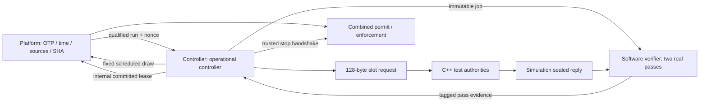

# Lease, round, request and quorum controller

The operational controller owns ARM/RENEW rounds, exact slot requests, distinct votes, committed leases and cancellation. It targets N=3, Q=2 and enforces checked fixed issue/deadline/expiry arithmetic. Run and job generations are internal bookkeeping, never wire session fields. Component tests use a software verifier; the complete device connects the real two-pass hardware internally.

The [v0.3 PDF](REINS-Hardware-Specification-v0.3.pdf) is normative. See the
[test guide](TESTING.md) for suite selection and [BUILD_NOTES.md](../BUILD_NOTES.md)
for historical build steps, source versions and measured run snapshots.

## Components and ownership

| Source | Responsibility |
|---|---|
| [`reins_round_schedule.sv`](../rtl/device/reins_round_schedule.sv) | Full 128-bit product and carry-checked 64-bit I/B/E/next-issue arithmetic |
| [`reins_lease_check.sv`](../rtl/device/reins_lease_check.sv) | Independent age-based remaining time, complemented issue/remaining checks and strict permit predicates |
| [`reins_controller.sv`](../rtl/device/reins_controller.sv) | Operational FSM, one mirrored pending context, exact requests, immutable jobs, distinct votes, committed lease, down-counter and cancellation |
| [`reins_device_control.sv`](../rtl/device/reins_device_control.sv) | Actual platform configuration/time/entropy plus controller composition; lease inputs are wired internally, not supplied by a host |
| [`controller_unit_top.sv`](../rtl/test/controller_unit_top.sv) | Simulation-only qualified-platform and software-verifier boundary; separate narrow overflow instances and arithmetic/checker probes |
| [`controller_integration_top.sv`](../rtl/test/controller_integration_top.sv) | Simulation-only actual platform/controller composition with retained logical OTP |
| [`controller_test_support.h`](../sim/include/reins/controller_test_support.h) | Public batched test corpus, actual two-pass software verifier adapter, immutable pin capture and retained evidence |
| [`controller_unit_tests.cc`](../sim/tests/controller_unit_tests.cc) | Directed fast controller tests, C++ semantic comparisons and seeded stateful traffic |
| [`controller_integration_tests.cc`](../sim/tests/controller_integration_tests.cc) | Real OTP/source/SHA/time startup, ARM/RENEW, hold/expiry, alarms and cold recovery |



`reins_device_control` is an internal production composition. In the complete
`reins_device`, its verification and stop interfaces are wired internally to the
real two-pass verifier and endpoint enforcement. Separate component tops expose
those boundaries to C++ for fast control tests. Configuration hashing and nonce
conditioning execute in RTL in the controller integration tests.

## Operational state machine and stop boundary

State codes have pairwise Hamming distance at least four and a complemented
stored copy. They are diagnostics, not new public status protocol encodings:

| State | Code | Behavior |
|---|---|---|
| UNPROVISIONED | `0x0f` | Off; waiting for retained closed configuration |
| CLOSED_INIT | `0x33` | Off; physical stop acknowledgement required before platform startup |
| WAIT_ARM | `0x55` | Qualified run; publish fresh ARM rounds and collect distinct votes |
| RUNNING | `0x66` | Healthy committed lease permits execution; scheduled rounds use RENEW |
| STOPPING | `0x99` | Off; discard work and await trusted completed stop |
| STOPPED | `0xaa` | Off; permit a separate qualified restart after stop acknowledgement |
| FAULT | `0xcc` | Off; warm reset cannot clear; trusted cold requalification required |

On actual power reset, pending/runtime authorization is cleared and the physical
stop is initially unacknowledged. `stop_ack_i` belongs to trusted enforcement;
the production composition also requires `stopped_i` when accepting it. An ack
before the stop begins cannot pre-authorize a future restart. Reset, faults and
expiry dominate a simultaneous ack/commit. Repeated `startup_i` requests while
stopping cannot start platform or publish ARM. Stop completion never grants execution:
platform rechecks configuration, clocks and sources and produces a fresh first nonce.

Reference's software reset abstracts physical isolation and immediately enters its
closed-init state. The comparison driver therefore delays its subsequent startup
until RTL's trusted stop handshake completes; it does not require identical
startup microstates. platform retained cold recognition versus actual retention loss
continues to follow the [platform profile](PLATFORM.md).

## One pending context and coherent requests

The single packed context stores round, I, B, E, run identity, kind, nonce and
C_cfg. A complemented copy is checked before publication/admission/vote. Pending,
publication and distinct-vote state are cleared on round close. The run also owns
an immutable complete public OTP snapshot and timing values. Changes to checked
configuration/digest/timing while active cause a general fault.

For each scheduled round r:

```text
I = (r - 1) * P
B = I + W
E = I + L
next_issue = I + P
```

Round zero, product overflow, addition carry, invalid `0<W<=P<L` ordering, and
counter exhaustion fail off. Round 1 always has I=0. Traffic, nonce delay, job
backpressure, partial votes and signature processing never change these values.
At each next issue the previous context/job is invalidated. The next kind depends
only on whether an ARM quorum has committed: ARM while WAIT_ARM, RENEW while
RUNNING. A fast quorum closes its round; it cannot start another round early.

Subsequent platform draw requests use these exact internally computed I/r values. A
conditioned result is captured only when its round, issue and generation match
the live context, it is still before B, and entropy is healthy. All slots read
one nonce/kind/round snapshot:

| Request bytes | Contents |
|---|---|
| 0..3 | ASCII `REIN` |
| 4..7 | Wire 2, type 1 ARM or 3 RENEW, fixed slot 0..2, zero |
| 8..23 / 24..39 | Device D / policy C from checked OTP |
| 40..71 | Reserved zero, no session |
| 72..79 | Big-endian round |
| 80..111 | Fresh conditioned nonce |
| 112..127 | Reserved zero |

`request_o` is one complete 1,024-bit vector; byte zero is most significant.
`request_valid_o` is false for an invalid slot, unqualified/unpublished/closed
context, hold, reset, fault or elapsed window. Invalid output is zero. Atomic
SPI read transactions will snapshot this interface in SPI.

## Trusted tick and equal-edge priority

The core receives current `now_i` **before the monitor edge** and `tick_i` saying
whether the independent platform reference advances it on that edge. It uses checked
`now_i + tick_i` for final admission, nonce publication, cancellation, expiry and
commit. Thus a result at B or the old lease expiry cannot slip through using the
previous tick. The run checks observed time progression and fails off on a jump,
backward step or overflow. Time is never clocked by SPI or verifier progress.

The platform conditioner includes this same advancing-edge information when
rejecting an unfinished draw at B. Its existing cold hold cannot clear on a
conditioner result that becomes available exactly at the deadline.

The priority is: recognized cold reset / active general fault / logic reset,
then committed expiry, qualified new run, entropy hold, round/window
cancellation, matching abort, job admission/transfer, and finally matching pass
evidence/vote/commit. Cold recognition only initiates off-state requalification;
a still-active alarm continues to mask permit. Valid cancellation wins over an
equal-edge second pass. Wrong-token abort is ignored.

## Verification boundary and distinct votes

controller admits a sealed job only for a live published slot with no current owner.
It allocates a nonzero 64-bit token unique within the powered context and advances
a protected internal job epoch. Its immutable job descriptor contains the exact
local request, configuration digest, run, round, epoch and selected slot. Complete
OTP is retained with the run. Job-valid and payload remain stable under verifier
backpressure. The command and response interfaces use valid/ready at rising edges.

The simulation adapter captures **actual job port bytes**, associates the actual
untrusted reply, prints the full request, and submits that immutable input to
`VerifierService`. Each pass independently reconstructs the grant/Merkle root and
performs pure, empty-context SLH-DSA verification under the actual selected key.
It does not use a cached verdict or fixture label as success. Test authorities
batch many individually approved public grants to avoid repeating expensive
signing during fuzzing; every verification pass still runs.

Each returned pass echoes token, run, round, job epoch, slot, request and C_cfg.
These are internal simulation/verifier metadata, not received wire fields.
Pass 1 success is sparse code `0x96`; pass 2 success is `0x69`. Pass 2 cannot vote
without a preceding pass 1 for this job. A failed first pass still requires pass
2 before normal completion. Every other success code is rejected. Stale or
mismatched echoes are drained without releasing a newer owner. Both successful
passes plus current context/hold/deadline/old-expiry checks are required to vote.

Only the selected slot's bit is set. A duplicate successful signer cannot add a
second vote. Any of the three two-slot pairs forms a quorum; votes from different
nonces, kinds, rounds, slots/keys, configurations, runs or epochs cannot combine.
A quorum closes the approval round. Matching abort cancels its uncommitted job
and preserves earlier independent votes. Round/window close, stop, reset and
hold cancel all pending work. Cancellation advances the job epoch before reuse.

controller's sealed-job boundary allocates tokens at admission. SPI must connect token
ownership to RX_BEGIN and preserve it through sealing, with actual SRAM/chunk,
absolute receive-budget and transaction-watchdog enforcement. This PR does not
claim those receive mechanisms already exist.

## Committed lease and redundant checks

The Qth valid grant commits **I_c=I and E_c=I+L**. It initializes the down-counter
as `R=L-(now-I_c)`, including an advancing tick on the commit edge. It never loads
L relative to response arrival. Each qualified tick decrements positive R and
increments its complemented encoding; zero saturates.

A separate combinational checker computes age and age-based remaining time. It
continuously requires `I_c<=now`, carry-free `I_c+L==E_c`, `R<=L`, valid complemented
I_c/R, and agreement of the age and down-counter results within one tick. Both
strict age expiry and positive remaining are required for permission. Mismatch
alarms immediately; ordinary age expiry or zero R withdraws permit and starts
stop. Tests probe the checker independently, including inconsistent inputs and
the allowed one-tick tolerance, without adding production fault-injection ports.

Entropy hold cancels pending work and blocks new grants but leaves a healthy old
lease and its down-counter intact. An integrity/timing/sensor alarm removes permit
immediately. The production permit is the conjunction of controller's lease checks and
platform's configuration/startup/general-health/time gate. Neither can extend expiry.

Run/token/job counters survive warm and recognized cold resets. Actual power loss
clears them. Fresh nonce qualification supplies cross-power replay protection;
internal counters do not. Counter maxima are checked before reuse/wrap, and cannot
be repaired by resetting authorization alone. The normal instances use full
64-bit identities/time; only separate simulation instances reduce limits to
exercise exhaustion practically. Full-width arithmetic boundary tests remain
independent of those reduced instances.

The captured run identity is platform's strictly increasing powered generation. platform
can increment it and then be reset before controller samples the run-start event; gaps
are therefore allowed, while duplicate/backward/overflow identities fail off.
An integration regression interrupts precisely this one-clock boundary and
requires fresh cold qualification and trusted stop completion before recovery.

## Build, replay and retained evidence

Use the root prerequisites and GNU Make:

```sh
make build
make quick-tests
make tests
make sanitize-tests JOBS=2
REINS_CONTROLLER_SEED=12345 make tests
REINS_CONTROLLER_TRACE=1 make RTL_TRACE=1 quick-tests
```

Normal build includes `controller-unit/reins-controller-unit-tests` and
`controller-integration/reins-controller-integration-tests` under `build/<configuration>/`.
Results identify **fast-control** or **rtl-controller-platform** mode. Both contain real
controller RTL and software signature verification. Only the latter also contains real
platform configuration/source/time/SHA startup; fast tests supply qualified platform
inputs. Neither is full RTL cryptographic verification.

The full fast suite adds 24 seeded stateful trials with up to 160 actions each:
real signed jobs, delays, invalid signatures, withholding, duplicates, aborts,
round rollover, holds and resets. The driver compares requests, votes, rounds,
permit, committed issue/expiry and remaining against `reference::Device` after
settling each tick's events. Internal microstates/backend IDs are deliberately
excluded. Directed cases cover every pair, wrong signed contexts and completion
echoes, ordering/backpressure, before/at/after B and old expiry, late nonce
publication, stale results during a newer job, warm/cold/power reset, trusted
stop completion and checked arithmetic/counter limits.

Every run retains `controller-unit/` and `controller-integration/` groups:

| Artifact | Contents |
|---|---|
| `output.log`, `test-output.log` | Cases/assertions and complete requests before actual verification |
| `events.jsonl` | Exact public OTP/job request/reply bytes and delays, actual RTL transitions, comparison checkpoints and fuzz action stream |
| `performance.json` | Mode, actual tool/backend versions, seed, monitor clocks/models, backend jobs/real pass counts, ownership balance, wall time and throughput |
| `coverage/bench-*.dat` | Per-model Verilator line coverage |
| `controller.fst` / `controller-integration.fst` | Optional bounded first-model waveforms, first 4,096 clocks |

`real_pass_evaluations` counts the RTL adapter's actual software evaluations; the
independent reference comparison performs additional real verification. Completed
and canceled adapter ownership must balance admitted jobs, including explicit
model-teardown cancellation. Canceled events may still compute and return for
stale-result tests. Seeds replay semantic inputs/outcomes; ephemeral test keys
and signatures change between processes. Private keys are never serialized.
Failed runs remain inspectable; only explicit clean targets delete results.

## Independent captures and lease certificate

Nonce handoff has a later audit capture: the primary nonce is captured first;
`nonce_audit_i` is captured on the next monitor edge, and only then is the pending
request published. platform supplies this input from its second dedicated conditioner.
Component tops explicitly model the qualified platform boundary. The controller also
checks a per-run repeat history; platform retains the powered history across resets.

A separate schedule instance reads encoded timing/round stores, audit requests
are serialized from encoded context/configuration, and a separately updated sparse
lease ledger records the independently admitted issue/expiry. A primary coherent
lease substitution or a permissive commit in either path is denied. The existing
high-priority fault, cancellation, expiry and stop behavior is retained.
