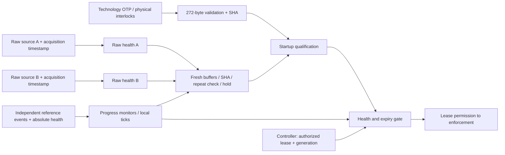

# Configuration, reset, trusted time and entropy

The platform subsystem validates the 272-byte public OTP image, controls startup/reset, monitors trusted-time progress and health, and conditions fresh source samples. It implements digital profile 1 for the fixed N=3, Q=2 configuration. Technology inputs require physical implementations; the deterministic simulation sources do not establish entropy or clock-floor evidence. The controller consumes these qualified internal outputs.

The [v0.3 PDF](REINS-Hardware-Specification-v0.3.pdf) is normative. See the
[test guide](TESTING.md) for suite selection and [BUILD_NOTES.md](../BUILD_NOTES.md)
for historical build steps, source versions and measured run snapshots.

## Implementation and trust boundary

| File | Responsibility |
|---|---|
| [`reins_config.sv`](../rtl/device/reins_config.sv) | Read/check all logical OTP bytes, validate fixed fields and distinct identities/keys, hash the complete image, admit physically enabled programming/closure |
| [`reins_trusted_time.sv`](../rtl/device/reins_trusted_time.sv) | Independent reference progress, startup qualification, missing-edge alarm and nonwrapping local time |
| [`reins_source_health.sv`](../rtl/device/reins_source_health.sv) | One source's availability, startup samples, repetition-count test, reference-symbol adaptive-proportion test and required-sample gap |
| [`reins_entropy.sv`](../rtl/device/reins_entropy.sv) | Fresh two-source acquisition, fixed conditioner serialization, real SHA-256, retained previous nonce, sticky hold and cancellation |
| [`reins_platform_control.sv`](../rtl/device/reins_platform_control.sv) | Startup sequencing and reset/health/time gates; trusted internal boundary for controller lease and scheduled-round inputs |
| [`reins_otp_model.sv`](../rtl/test/reins_otp_model.sv) | Simulation-only nonvolatile wrapper model, including incomplete closure |
| [`platform_unit_top.sv`](../rtl/test/platform_unit_top.sv) | Simulation-only integration, passive SHA pin observations and isolated health/time boundary probes |
| [`platform_unit_tests.cc`](../sim/tests/platform_unit_tests.cc) | Clock driver, independent C++ configuration/health/hash oracles, real authority/reference-model lease examples and seeded timelines |



All production modules use the independent always-on monitor clock `clk_i`.
SPI, host clocks and cryptographic completion cannot pause trusted time or
withdrawal. Configuration hashing has its own SHA engine; fresh nonce generation
uses two dedicated conditioners with independent frame construction and captures.

`lease_valid_i`, `lease_expiry_i` and `lease_generation_i` are trusted internal
controller inputs. The complete device wires them to the actual lease controller;
only the isolated platform harness supplies model-authorized leases at this
boundary. The platform block checks increasing round/issue, `W>0`, checked `I+W`
and `now<I+W`; the operational controller independently establishes the exact
`I=(r-1)*P` schedule and invalidates old authorization on reset/context loss.

## Public OTP schema and lifecycle

All integers are unsigned big-endian. There are exactly **272 logical bytes**:

| Offset | Bytes | Meaning / fixed-profile validation |
|---:|---:|---|
| 0 | 4 | ASCII `RNOP` |
| 4 | 2 | Schema version 2 |
| 6 | 1 | Wire version 2 |
| 7 | 1 | Authority profile 2: SLH-DSA-SHA2-128s, pure, empty context |
| 8 | 1 | N=3 |
| 9 | 1 | Q=2 |
| 10 | 2 | Zero |
| 12 | 4 | Simulation platform profile 1 |
| 16 | 16 | Device identifier D |
| 32 | 16 | Policy identifier C |
| 48 | 8 | Lease length L |
| 56 | 8 | Period P |
| 64 | 8 | Window W; require `0<W<=P<L` |
| 72 | 4 | Nominal tick rate |
| 76 | 4 | Declared floor; positive and no greater than nominal |
| 80 | 4 | Declared missing-edge bound in microseconds; 1..1,000 |
| 84 | 4 | Declared actuation bound in microseconds; 1..2,000 |
| 88 | 4 | Quantization allowance, exactly 1 tick |
| 92 | 36 | Reserved zero |
| 128+48s | 16 | Authority identifier, slots s=0,1,2; pairwise distinct |
| 144+48s | 32 | Authority public key; pairwise distinct |

There is no invented prohibition on zero device/policy identifiers or individual
key bytes. Distinctness and the specification's field predicates are checked;
key/signature algorithm validity belongs to verification. `C_cfg` is the real RTL
SHA-256 of **exactly all 272 logical bytes**, including the reserved bytes and
all three authority records; it requires five compressions with SHA padding.

The wrapper supplies logical bytes, completeness and sensing/integrity status.
The checker snapshots bytes sequentially while blocking writes. Programming is
admitted only when the lifecycle is open, actual execution is stopped, physical
enable is asserted, the macro is healthy, validation is idle, and address is
0..271. Writes invalidate an earlier check/hash. Closure additionally requires
a successful complete check, and conflicting write/check/close requests cannot
program the macro.

| Lifecycle | Meaning |
|---|---|
| `00` | Open; never execution-enabled; physically interlocked commissioning allowed |
| `11` | Permanently closed; no further programming or commissioning checks; startup re-reads and re-hashes the image |
| `01`, `10` | Ambiguous/incomplete closure; permanently invalid and off |

The simulation wrapper has **no reset input**: closed/invalid lifecycle and bytes
survive every modeled logic and power reset. A first-clock-only factory preload
lets tests construct already-provisioned devices. Partial-close controls exist
only in this simulation wrapper. It models logical programming/closure, not fuse
polarity, programming pulses, analog sensing or ECC. Destroying the entire DUT
object represents a different modeled device unless its OTP is reloaded.

## Reset, startup and retained state

Reset inputs are trusted technology events, sampled at rising edges. Permission
is also masked immediately while power/reset/run-end inputs are asserted. The
wrapper must hold reset through a monitor edge and synchronize its release.
These signals are not exposed as new runtime protocol commands.

| Event | Runtime state / permission | Entropy hold | Previous nonce |
|---|---|---|---|
| Real power loss (`por_ni=0`) | Cancel jobs, invalidate context, clear generation/time, off | Assert; permit cold qualification | Lost |
| Independently recognized cold reset | Cancel jobs, invalidate context, off; full startup required | Assert; permit cold qualification, never clear immediately | Retained if its power domain survives |
| Warm/logic reset | Cancel jobs, invalidate context, off; recheck configuration/time/sources | Retain; interrupt any in-progress cold clearing | Retained |
| Completed stop / context loss | Cancel pending work, off | Retain; interrupt cold clearing | Retained |
| Entropy failure | Invalidate pending work and block new grants | Sticky | Retained |
| General timing/sensor/integrity failure | Immediate off, sticky general fault | No new authorization | Retained until actual power loss |

The normative PDF explicitly requires a repeat check “where history survives.”
Accordingly, a recognized cold event and actual loss of retention are separate
inputs here. The earlier Reference `Device::reset(Reset::cold)` models power loss and
clears its history; it does not model a retained cold-recognition event. This
distinction refines the platform boundary without changing any wire field.

Startup is `STOPPED -> CHECKING -> RUN`. It requires a closed valid configuration,
healthy macro/environment, both progressing references, and both source startup
tests. Only then does it establish local tick zero, increment the volatile run
generation without wrapping, and start **round 1, I=0**. Entering RUN is not
startup completion: permission/new grants stay off until the complete fresh
first-round nonce passes the conditioner and retained-repeat check. Only this
successful cold sequence clears hold. Failure, warm reset or stop during that
sequence requires a newly recognized cold event. A healthy ordinary warm restart
also needs fresh qualification and a fresh first-round nonce.

Concurrent source failure and warm reset still latch hold. A concurrent general
alarm and warm reset still latch the general fault. Returning health pins to
normal or issuing another startup request cannot clear these stored failures.
Cold reset can initiate general-fault requalification; a still-active alarm
continues to keep permission off.

## Trusted time and technology inputs

The digital profile uses two synchronized one-monitor-cycle reference events.
Each must supply four startup events. A increments the 64-bit local tick counter
after run start; B independently supplies progress evidence. Missing either
reference asserts an alarm within **16 monitor clocks** of its last event.
Attempting to advance past `UINT64_MAX` alarms and leaves time saturated. A
separate 8-bit test instance exercises the identical wrap logic practically.
The harness normally supplies A every four and B every five monitor clocks.

These synthetic ratios exercise digital control; monitor clocks are not claimed
to be physical microseconds, and the short legal test leases are not deployed
lease settings. OTP nominal/floor/latency fields are validated and hash-bound,
but storing them does **not** establish those frequencies or physical bounds.
The selected platform must relate its monitor period/reference rate to the OTP
floor and missing-edge declaration, and provide independently assessed absolute
health via `timing_healthy_i`. Relative progress alone cannot detect common-mode
slowing. This profile does not measure fast/slow oscillator ratios or implement
an analog frequency monitor. `sensor_healthy_i`, `integrity_alarm_i` and the OTP
integrity input are trusted wrapper observations with immediate fail-off gates.

Technology replacement obligations are explicit:

| Wrapper boundary | Inputs the platform must establish |
|---|---|
| OTP and commissioning | Genuine retained storage/lifecycle, irreversible closure, sensing/ECC validity, physical enable and actual stopped state |
| Reset/retention | Independent cold recognition, actual retention-loss indication, synchronized reset release and fail-off during brownout |
| Timing | Always-on independent monitor clock, dissimilar local references, synchronized event transfer, physical absolute-floor/environment monitoring |
| Raw sources | Two independently designed physical sources, fresh event transfer, trustworthy acquisition timestamps, source availability and assessed profiles |
| Sensors/integrity | Real environmental/sensing/integrity alarms and their measured detection latency |
| Enforcement | controller committed lease/context and later on-die guards/actuation; platform output alone is not physical enforcement |

The flat production ports are these wrapper interfaces; no unimplemented physical
macro is disguised as synthesizable trusted hardware. The OTP wrapper is the one
explicit behavioral SystemVerilog replacement supplied here. C++ supplies the
deterministic clock, source, reset and sensor stimuli in simulation. CDC,
metastability, four-state startup, physical entropy and absolute timing remain
platform qualification work.

## Source profile, acquisition and conditioner framing

Profile 1's values are **digital research settings**, not SP 800-90B assessed
parameters or an estimate of min-entropy:

| Parameter | Per-source simulation value |
|---|---:|
| Startup valid samples | 64 |
| Repetition-count rejection | Run length >=32 |
| Adaptive-proportion window | 64 valid samples; first sample is the reference symbol |
| Adaptive-proportion rejection | Reference-symbol occurrences >=56, including the first |
| Required-sample absence | Failure within 1,024 monitor clocks |
| Fresh raw bits per nonce | 384 from A **and** 384 from B |
| Assessed joint conditional min-entropy | **Unknown**, reported as JSON `null` |

RCT/APT state advances on raw valid events, including samples observed outside
active nonce acquisition, and resets only for startup/reset qualification.
The APT window restarts after 64 accepted healthy events; cutoffs are inclusive.
Availability failures and offending raw events mask new grants immediately and
latch failure at a monitor edge. Missing-sample checks apply while startup or
fresh acquisition requests that source. Extra healthy samples do not become a
pool or gain entropy credit. Timestamp-rejected samples can still be observed
by raw health tests but cannot increment either nonce buffer's accepted count.

At a draw, both fresh buffers/counts are cleared. The scheduler waits for `now>=I`
and records actual acquisition start. A bit is admitted only while that source
is requested, its count is below 384, and its trusted acquisition tick is within
`[actual_start, now]`. Thus pre-issue/pre-acquisition and future-stamped events
cannot contribute. No startup samples, completed earlier draw, precomputed pool
or DRBG state contributes. Wrappers must not relabel queued samples as fresh;
the timestamps and event pins are trusted physical acquisition interfaces.

Bits enter each buffer MSB first. After both counts equal 384, the conditioner
hashes this exact **124-byte** message, without a NUL terminator:

```text
ASCII("REINS-ENTROPY-v1")[16]
|| BE32(platform_profile=1)
|| BE32(A_raw_bit_count=384)
|| BE32(B_raw_bit_count=384)
|| A_raw_bits[48 bytes]
|| B_raw_bits[48 bytes]
```

SHA-256 adds standard SHA-256 padding, requiring **three compressions**. There is no
host-supplied nonce/digest shortcut. Round, generation and timestamps accompany
the response but are deliberately absent from the hash frame: repeated raw
payloads must produce the same candidate so the retained nonce check can catch
them across rounds and runs. This conditioner framing is a documented local
implementation choice; it changes no REINS request, signature or OTP schema.

Candidate equality with the immediately preceding sampled nonce latches hold.
Retained response-valid supports consumer backpressure; output is invalidated on
reset, cancellation, new draw, hold or the fixed `B=I+W` boundary. A previously
published nonce expiring unused simply loses validity; it does not itself signal
a raw-source failure. This profile conservatively treats a draw still unfinished
at B as acquisition failure and latches hold. It never shifts I/B or permits a
late nonce. A candidate cannot win over a simultaneous source failure/deadline.
Other platforms may select different assessed sample counts/cutoffs only with
matching framing/profile documentation and renewed qualification/tests.

Deterministic test bytes are balanced nibble/complement patterns derived from a
recorded public seed. They deliberately pass these digital tests while being
predictable: **768 raw bits do not imply 768 or 384 bits of entropy**. The
specification's >=384 assessed joint conditional min-entropy requirement remains
unfulfilled by simulation. No physical source independence, prediction resistance,
restart entropy or entropy-credit claim is made.

## Hold versus immediate withdrawal

The platform gate permits an already committed healthy lease while:

```text
startup_complete && !general_fault && lease_valid
&& lease_generation == current_generation && now < original_expiry
```

Entropy hold is deliberately absent from that expression. It disables
`new_grants_o`, suppresses nonce publication, and pulses pending-work invalidation;
it cannot extend expiry. Time continues independently. General clock, sensor,
OTP/integrity alarms, reset or context loss mask permission immediately. These
gates are integrated with controller vote/commit acceptance and local enforcement;
there is no platform armed-state register or host-authorizable lease input in a chip.

## Tests, replay and saved results

Use the root Makefile and the [normal prerequisites](../README.md):

```sh
make build
make quick-tests
make tests
make sanitize-tests JOBS=2
REINS_PLATFORM_SEED=12345 make tests
REINS_PLATFORM_TRACE=1 make RTL_TRACE=1 quick-tests
```

Normal builds include `build/<configuration>/platform-unit/reins-platform-unit-tests`. The quick
suite runs bounded directed cases, including real host-signed quorum examples;
the full suite adds 24 seeded acquisition/reset timelines with random channel
gaps and malformed OTP mutations. No physical entropy source or private fixture
keys are needed. The software authority examples generate ephemeral independent
test keys and print complete requests before both verification passes.

The `platform-unit` result group retains:

| Artifact | Contents |
|---|---|
| `output.log`, `test-output.log` | Test names/assertions, request contents, expected/actual semantic outcomes |
| `conditioner-events.jsonl` | Actual accepted 124-byte hash frames and resulting nonces; independently checked against software SHA-256 |
| `performance.json` | Mode `rtl-platform`, tool/backend versions, profile, seed, actual monitor clocks, independent SHA starts/completions/cancellations, ownership balance, wall time, throughput and unknown assessed entropy |
| `coverage/bench-*.dat` | Per-model Verilator line coverage |
| `platform.fst` | Optional first model's first 4,096 clocks when trace build/runtime flags are both enabled |

Independent passive taps observe real SHA valid/ready transfers and resets;
hash-job starts must balance completions plus reset/model-teardown cancellations.
Configuration hashes match the C++ parser/OpenSSL oracle. Raw health is checked
against a separate scalar oracle, including exact RCT/APT/startup/gap boundaries.
Time progresses while hashing and while entropy hold is active. Signed ARM
examples compare the platform lease gate against `reference::Device` through original
expiry and after each immediate fault. Full tests also retain the original
Python cryptographic cross-check and baseline validation.

Directed cases cover permanent closure through all reset kinds, every reserved
OTP byte and duplicate key/ID pair, invalid timing/profile fields, missing/stuck
startup sources, fresh-first-nonce qualification, stale/future raw timestamps,
warm/cold/power repeat history, repeated raw payloads across rounds, partial and
in-flight SHA cancellation, simultaneous reset/fault and source/completion races,
both missing timing references, overflow and nonce/deadline boundaries.

Coverage is execution evidence, not an assertion of full coverage or synthesis
qualification. Protected-state tests cover encodings, replicas and selected internal faults.
Physical stopping remains a platform qualification item.
The production modules are linted separately with assertions and `SYNTHESIS`;
this is not post-synthesis, CDC, timing, area or fault-resistance evidence.

## Independent captures and conditioning

The entropy controller runs two dedicated SHA-256 message engines. The
primary frame reads primary raw samples; the second independently builds the
same 124-byte frame from complemented raw stores and its own cursor. This does
not double the entropy credit: each source still contributes exactly 384 fresh
samples to the same documented source profile. Both digests must agree.

The first digest is captured before the audit digest, on separate monitor
clocks. `nonce_audit_o` is the complemented independently captured result and
flows internally to controller. Warm/cold history retention and actual-power-loss
history loss are unchanged. Integrity corruption is a general alarm; a genuine
source health/repeat failure remains entropy hold and preserves an existing
healthy lease only to its original expiry. Deterministic sources demonstrate
digital behavior and supply no physical entropy assessment.

Configuration validation similarly rereads each OTP byte on a later edge,
checks a separately decoded inverse-image schema and captures a held digest on
a later clock. Startup takes additional monitor clocks before local issue zero.
