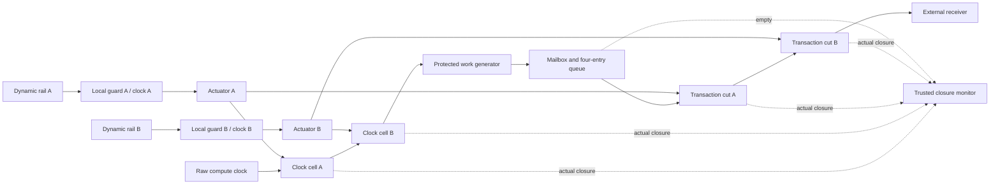

# R08 dynamic permit and endpoint enforcement

The normative source is the [v0.3 PDF](REINS-Hardware-Specification-v0.3.pdf),
particularly §§12.3 and 13. This is a digital research implementation of its
transition-based permission and local stop behavior. Wire/SPI/schema profile 2,
N=3/Q=2, fixed lease timing, signatures and withholding semantics are unchanged.
The limits below are explicit simulation-platform assumptions requiring physical
qualification. Deterministic Verilator clocks supply no physical evidence.

## Composition and independent paths

[`reins_device_enforced`](../rtl/device/reins_device_enforced.sv) is the complete current
composition. It wraps the actual R05/R06/R07 device and derives its stop
acknowledgement internally. It has **no host stop-acknowledgement input**.
`reins_device_spi` remains a reusable lower-level component with a trusted
acknowledgement interface; instantiate the enforced wrapper for these endpoints.

There are three representative endpoints: CPU (0), accelerator (1), and DMA/bus
master (2). Each counts useful work and generates tagged outbound transactions.
Each has **two independent local guard/actuator paths**, six guard clock branches
in total. Each path owns one serial clock-isolation cell and one serial outbound
transaction cut. Both cuts follow **all** queue storage; nothing is queued between
or after them inside the protected boundary.



The two rails normally transition every **500 qualified trusted ticks**. Source A
uses R06's checked permit. Source B separately checks RUNNING state, health/reset,
checked `committed_issue + L`, the committed expiry, current time and nonzero
remaining time; it does not consume the primary permit. The source uses separate
up/down counters and complements. A shared run-sequencing bit alone cannot
produce either stream without its authorization qualification. Withdrawal freezes
each rail at its last level; it does not create a final reset-to-zero transition.
A new trusted ARM toggles an internal epoch; this is not a wire/session field.

Guard A uses an up-counter and sparse healthy/denied codes `0x96`/`0x69`; guard B
uses a down-counter and different codes `0xa5`/`0x5a`. Each owns its synchronizers,
counters, complements and epoch state. A new epoch needs **two fresh correctly
spaced transitions** before opening. A static high or low level cannot qualify.
Too-fast edges, a missing edge or invalid local state lock that guard off until
a new epoch. A timeout dominates an edge on its exact watchdog boundary.

There is no common final `A && B` enable driving one isolation cell. The shared
producer reset and queue admission controls help containment but are **not** the
final barriers. Tests force them permissive while the independent serial cells
still stop actual protected clocks and outbound handshakes. A stuck-permissive
local guard likewise leaves the other path able to stop its endpoint.

## Real-time simulation profile

All values are real-time bounds, not compiler wall time. Verilator uses a 1 ns
timebase and independently schedules guard edges without rounding them to the
controller clock. The always-on monitor/queue clock is 4 MHz (250 ns period).

| Quantity | Modeled profile |
|---|---|
| Qualified source progress | Nominal 1 MHz, 800 kHz minimum, 1.2 MHz maximum |
| Transition period | 500 ticks: at least 416.25 and at most 625 microseconds, including source quantization |
| Guard A clock period | 900–1,100 ns, watchdog 800 cycles, minimum spacing 320 cycles |
| Guard B clock period | 720–880 ns, watchdog 1,000 cycles, minimum spacing 400 cycles |
| Fan-out route delay | 0–40,000 ns per transition and endpoint; skew/jitter may vary over this range |
| Synchronizer/observation allowance | Three slowest A cycles: 3,300 ns |
| Guard budget | 950 microseconds, including route and observation |
| Actuator clock-clamp delay | 100 A or 125 B cycles, at most about 110 microseconds |
| Actuation/completion budget | 150 microseconds, including closure synchronization and queue containment |
| Overall stop bound | **1,100 microseconds (1.1 ms)** from source withdrawal |

The conservative integer checks are executable in the independent
[`EnforcementProfile`](../sim/src/reference_enforcement.cc):

- Latest observed legal spacing: `625000 + 40000 + 3300 = 668300 ns`.
- Fastest timeout: `800*900 = 1000*720 = 720000 ns`.
  Thus `668300 < 720000` strictly; the availability margin is 51,700 ns.
- Earliest observed spacing: at least `416250 - 40000 - 3300 = 372950 ns`.
  This exceeds the strictest spacing filter, `320*1100 = 400*880 = 352000 ns`.
- Latest guard response: `40000 + 800*1100 + 3300 = 923300 ns < 950000 ns`.
- Actuation plus quiet observation: conservatively
  `101*1100 + 6*250 = 112600 ns < 150000 ns`.

The fast test source uses a 3/3/4 controller-cycle enable pattern (1.2 MHz
average); the minimum-spacing calculation includes a conservative 250 ns source
quantization allowance. Per-cycle jitter must stay within each declared clock-period interval. The route
allowance bounds inter-edge variation as well as absolute delivery delay. It is
not an unbounded transport queue. Metastability is represented by the stated
synchronizer allowance; actual MTBF and CDC implementation require separate work.
An over-fast source fails off rather than creating unbounded authorization.

R05 accepts the broader normative public OTP schema. R08's additional
[`reins_enforcement_profile`](../rtl/device/reins_enforcement_profile.sv) rejects a checked
configuration that this particular platform cannot honor: platform ID must be
1, nominal frequency 1,000,000, minimum 800,000, tick quantum 1, guard promise
950–1,000 microseconds, and actuation promise 150–2,000 microseconds. The existing
1,000/2,000 microsecond fixture promises remain supported. A schema-valid 500
microsecond guard promise fails off. These are platform limitations, not protocol
changes or an assertion that arbitrary physical clocks meet them.

## Queues, stop ordering and rearm

Every generator uses a one-outstanding bundled-data request/acknowledge toggle.
The producer holds its 136-bit bundle (`generation[64] || sequence[64] ||
endpoint[8]`) while the always-on four-entry queue captures it. The queue owns
protected count/head/tail metadata. Backpressure cannot extend permission.
When either local path denies, final outbound effects are immediately blocked
by that path's cut; the queue is purged using its always-on clock, producer reset
is asserted, and the two local actuators independently complete clock clamping.
Both final cuts also check the current run tag using different expressions, so
a shared reset stuck permissive cannot release an old mailbox on a fresh ARM.

Closing cannot be canceled by renewed wire edges or late good codes. The stop
monitor synchronizes **actual modeled cell readbacks**, completed actuation and
empty-queue feedback, then requires four consecutive quiet monitor samples. A separate protected
50 microsecond source-quiet counter must also complete. It runs in parallel
with normal closure and exceeds the 40 microsecond route delay plus local
synchronization/opening and closure-observation delay. This prevents a transition
already in flight from qualifying and opening an initially closed actuator after
an early certificate. It also drains old epoch/transition history before rearm.
A production simulation assertion checks every certificate against actual cells,
queues, clocks and outbound effects. The settling interval does not extend a
lease or increase the declared normal guard/actuation bound.
Only that certificate reaches R06's stop acknowledgement and commissioning
interlock. An attempted authorization before closure latches a fault and does
not advance the epoch. A permissive guard can prevent the certificate forever;
this is loss of availability, not permission to rearm. A queue purge stuck
permissive can likewise withhold the certificate until repair; the final cuts
still contain all outbound effects.

The monitor allows 16 microseconds for old epoch alarms to cross and clear on a
fresh ARM; this diagnostic grace cannot open a guard. All guards must open within
2.048 ms or the bank fails off. Unexpected local guard loss during a licensed run
raises a sticky enforcement integrity alarm. Normal watchdog closure after
withdrawal is part of stopping and does not itself make normal expiry a fault.
For a single fan-out fault the affected endpoint's deadline begins at that
fault; other endpoints remain licensed until trusted revocation/alarm detection.
The oracle tracks these deadlines separately rather than granting an extra
interval to the affected endpoint.

Warm/retained cold reset withdraw source transitions but **preserve the real
closure ledger and epoch**. They cannot synthesize an acknowledgement or erase
an unfinished stop. A trusted cold clear can clear the bank's sticky fault only
at an already completed stop with healthy protected state. Other corrupted
component state may require actual power loss. `por_ni` is the recognized monitor
power reset; separately distributed `endpoint_por_ni` asynchronously clamps the
local paths. Actual power loss asserts both. Unpowered cell indications are never
a valid stop certificate. In a physical platform these resets must not be
controllable by protected software or the external relay.

## Management path and physical boundary

The always-on SPI/configuration/time/entropy/controller logic stays live when
protected clocks stop. The untrusted **external C++ host relay** can still read
status and receive state, then read every public OTP chunk and obtain fresh
requests after trusted startup. Stop invalidates R05's checked configuration
snapshot, so OTP reads return UNAVAILABLE until requalification. The relay can
then upload authority responses while protected work remains stopped. This is an external relay, not a new on-die
management CPU. It cannot drive protected outbound generators, override a local
cut, create a stop certificate, or initiate a runtime KILL command.

The production composition currently shares its 4 MHz source/monitor clock.
Freezing it also stalls management and certificate sampling, but the separately
clocked local guards and actuators still clamp all endpoints. A completed-stop
certificate requires a live qualified monitor; a stalled monitor may withhold it
indefinitely. The isolated tests freeze the source while the monitor continues to
separate missing transitions from stopped clock observation. No CPU cooperation
is required in either case.

The modeled bound assumes independently qualified local oscillators continue at
their stated floors, reset and isolation controls/readbacks are protected,
actuators work within the stated delay, and all protected clocks and effect paths
cross both cells. The two cells and their controls must survive synthesis/layout
as distinct physical paths. `dont_touch`/`keep_hierarchy` attributes express this
intent; they are not evidence of placement, independence or fault resistance.
The technology clock wrapper requires qualified glitch behavior, pulse widths,
asynchronous assertion, falling-edge release, reset-before-gating order and
readback. A real endpoint must contain all pending transactions, including any
bus fabric buffers; this model has no hidden post-cut buffers. An already accepted
external effect cannot be retracted. Shorts bypassing all final on-die isolation,
arbitrary multi-point corruption, four-state behavior, analog timing, physical
entropy and R03's general protected-primitive campaign remain outside this PR's
digital evidence.

## Build, tests and saved evidence

Use the prerequisites in the [root README](../README.md), then:

```sh
make r08-tests
make r08-unit-tests
REINS_R08_SEED=12345 make r08-unit-tests
make SANITIZE=1 r08-unit-tests
REINS_R08_TRACE=1 make RTL_TRACE=1 r08-tests
```

`r08-unit-tests` runs the multi-clock enforcement, fault and 96-episode stateful
fuzz suite. `r08-tests` also runs the actual R05/R06/R07/R08 composition with real
signed responses and two memory-backed host verification passes per vote.
Normal `quick-tests` includes the directed R08 cases and complete-device tests;
`tests` also includes the extended clock/fault fuzz. Signing remains host software,
with no assertion that the future hardware verifier has these timings.

The independent C++ oracle accepts semantic ARM/withdraw/stop events and observes
actual protected clock edges and final receiver handshakes. It rejects activity
at or beyond an immutable stop deadline, stale generation/sequence effects and
unjustified stop completion; negative tests check the checker itself. It does
not reproduce guard counters or RTL microstates.

Each Make run prints its unique `test-results/` directory. `r08-rtl/` and
`r08-integration/` contain logs, `events.jsonl`, `performance.json`, and per-bench
line coverage. Events record clock profiles, seeds, route ties, withdrawals,
actual closure, work/effect totals and full-device stop latency. Signed cases
print the actual request before uploading even intentionally rejected evidence.
Optional FST is bounded to the first fast bench's first 2.6 ms and the first
integration bench's first 16,384 monitor clocks. Keep logs from failed runs too;
only explicit clean targets delete results. None of these tests prove physical
stop timing; they establish the declared digital platform behavior.

## Validation snapshot (2026-10-22)

The local suite contains **13 C++ cases**, 223 independently instantiated
multi-clock models, and a **96-episode** stateful fault/clock stream. It passed on
Verilator **5.032 and 5.008**. The two complete-device cases passed on both
versions, including four actual signed response jobs and eight independently
computed verification passes per integration run. An 82-point cancellation sweep covers both immediate and maximum-delay routes
through initial guard qualification; it reproduced a premature-certificate race
before the settling fix. A separate source-flight cancellation case withdraws
before the final qualifying transition reaches the local guards, checking that
late opening cannot follow a stop certificate. The alternate seed `12345`
passed all local cases with a bounded FST. All 13 local cases also passed
AddressSanitizer, UndefinedBehaviorSanitizer and LeakSanitizer. Production RTL lint passed with fatal
warnings, both with assertions and with `SYNTHESIS` defined, on both versions.

Ordinary corner stop certificates were observed 554.625–785.125 microseconds
after withdrawal. The deliberately late in-flight transition cases observed
854.375, 1,034.375 and **1,034.875 microseconds**, below the declared 1,100
microsecond bound. The signed complete-device expiry case observed completed
stop/restart-readiness propagation in 867.75 microseconds. These are observations
of this model, not a replacement for the conservative inequalities or physical
qualification. An intentionally stuck queue purge may delay the certificate
until the injected fault is removed; activity remains contained by the cuts.

All original ten baseline artifacts remain hash-identical. Test runs retain
versions, seeds, counts and measured throughput; concurrent builds/simulations
make wall-clock throughput machine/load dependent. The optional 5.032 upstream
FST runtime emits GCC's existing `varType` maybe-uninitialized warning in
`verilated_fst_c.cpp`; first-party RTL fatal-warning lint and ordinary builds are
clean. That third-party runtime is unmodified.

The final `make tests` run passed all **134 C++ cases**, **30 Python tool
regressions**, production lint, pinned baseline/corpus cross-checks and CLI
replays. The sanitizer checks cover the local enforcement suite, including the
qualification sweep and source-flight regression; complete-device signature
transfers were validated in release mode on both Verilator versions.
