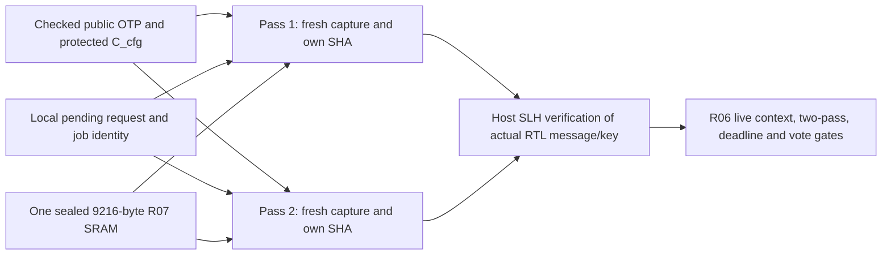

# R09 expected grants and Merkle evidence

R09 implements the v0.3 PDF §§5, 6.1 and 9.2–9.5 in SystemVerilog, using the
real R04 SHA-256 datapath. Each verification pass constructs its own expected
grant, rehashes the complete public OTP and reads the sealed R07 proof afresh.
The source of truth remains the [pinned PDF](REINS-Hardware-Specification-v0.3.pdf).
There are no changes to its wire format or to the supplied validation material.

A successful R09 response means **a candidate root was reconstructed**, not that
the signature is valid or that execution is authorized. R10a/b implement SLH-DSA
hardware; R10c implements the complete protected two-pass acceptance join. For
now, integration tests verify the actual RTL-produced message and selected key
with independent host software before submitting either completion to R06.

## Data flow and ownership



| File | Responsibility |
|---|---|
| [`reins_expected_grant.sv`](../rtl/device/reins_expected_grant.sv) | Complete grant construction from typed local identity, request kind, slot, round and nonce |
| [`reins_merkle_pass.sv`](../rtl/device/reins_merkle_pass.sv) | Fresh capture, configuration binding, canonical parsing, leaf/node hashing, protected intermediate hand-offs and response |
| [`reins_merkle_pair.sv`](../rtl/device/reins_merkle_pair.sv) | Two distinct pass instances and SHA cores; mutually exclusive sealed-memory reader; protected lane selection |
| [`r09_test_top.sv`](../rtl/test/r09_test_top.sv) | Exact production pair/SRAM, passive physical SHA observations and explicit simulation-only fault probes |
| [`r09_integration_top.sv`](../rtl/test/r09_integration_top.sv) | Actual R05–R08 device, retained OTP and the R09 pair on its sealed-memory read port |
| [`r09_test_support.h`](../sim/include/reins/r09_test_support.h) | Independent OpenSSL byte/block oracle, memory driver, provenance/count checks and retained evidence |
| [`r09_rtl_tests.cc`](../sim/tests/r09_rtl_tests.cc) | Nine directed/fault/fuzz cases, supplied/R02 corpus and all proof depths |
| [`r09_integration_tests.cc`](../sim/tests/r09_integration_tests.cc) | Signed ARM/RENEW through SPI, real Merkle hardware, host signatures, local enforcement and cancellation |

The pair serializes the shared memory port, but does not share SHA state, grants,
configuration hashes, intermediate roots or cached success between passes. Each
lane captures the live inputs again on its own request handshake and erases its
scratch on cancellation, reset and response consumption. R05's checked OTP and
R06's protected pending context are trusted inputs to both lanes. This digital
separation does not establish physical independence or replace deferred R03 work.

## Exact construction and framing

All multi-byte integers below are big endian. The 128-byte local request is
validated against fresh OTP identity, protected round/slot and canonical reserved
bytes. A separate constructor builds all 128 grant bytes from typed local fields:

```text
REIN[4] | 02 | grant_kind[1] | slot[1] | 00
D[16] | C[16] | zero[32] | round[8] | nonce[32] | zero[16]
```

Only ARM_REQUEST=1 and RENEW_REQUEST=3 map to grant kinds 2 and 4. Slots are 0–2;
round zero is invalid. The received reply has no grant body, identity, nonce or
configuration to trust. A separate request-based byte audit checks the grant
constructor's output while it enters SHA, including labels, type and nonce.

```text
C_cfg = SHA256(all 272 public OTP bytes)
leaf  = SHA256(00 || ASCII("REINS-AUTH-v2") || grant[128] || C_cfg[32])
node  = SHA256(01 || left[32] || right[32])
message_to_verify = ASCII("REINS-BATCH-v2") || reconstructed_root[32]
```

Labels have no terminating NUL. These are 272-, 174-, 65- and 46-byte values
respectively. The signature interface uses **pure SLH-DSA-SHA2-128s with empty
context**. Its internal FIPS 205 prefix belongs to the signature implementation,
not the R09 application message. The Merkle batch root is separate from the
selected public key's SLH-DSA root.

Each lane compares its freshly calculated `C_cfg` with protected R05 `C_cfg`.
It returns the selected 32-byte public key directly from that same fresh OTP
capture, at byte offset `144 + 48*slot`. Changing even an unselected key changes
the configuration hash and leaf. Full field/key-distinctness provisioning checks
remain R05's responsibility; R09 also checks the supported OTP header.

## Canonical proofs and last-leaf padding

The only reply layout is:

```text
signature[7856] | leaf_index_be32[4] | sibling[32] repeated d times
T = 7860 + 32*d, 0 <= d <= 20, T <= 8500
```

Depth comes only from the actual sealed length. Nonintegral lengths, too few
bytes, depths above 20 and index bits above depth fail format checking. At depth
zero the sole legal index is zero and the leaf is already the root. Proof bytes
are read sequentially from address 7856, with each byte sampled twice before use.
There is no second reply-sized memory and no signature copy in this stage.

Siblings are bottom up. At level `l`, index bit `l` selects whether the current
value is the left or right child. Every parent uses a fresh real SHA message.
For an authority batch of `m` grants, the authority repeats the **last leaf** to
fill `2^ceil(log2(m))` leaves. The reply carries neither `m` nor a padding flag:
membership at a padded index is consequently valid. Changing a low index bit
can remain valid when both branches contain identical leaves.

A missing/extra *whole sibling* can still describe another canonical depth.
A changed/swapped sibling, low index bit or legal context can likewise produce a
well-formed but different root. These cases fail the original root signature;
R09 cannot independently label them invalid without that signature. Tests check
both reconstruction and the real signature outcome. The component has no
received or host-supplied "expected root" acceptance input.

## Interfaces, checks and priority

`req_valid/req_ready` starts lane 1 or 2 with checked OTP, protected configuration
digest, local request, run/round/slot/token/epoch and actual sealed length.
`read_valid`, 14-bit address and its complement drive R07's protected read port.
Only owner-, seal-, ECC- and address-checked return bytes enter the engine.
`rsp_valid/rsp_ready` holds evidence and provenance until consumed:

| Error | Meaning | Local integrity alarm |
|---|---|---|
| 0 | Candidate root/message/key constructed | No; signature still required |
| 1 | Unsupported/malformed length, index or local context | No |
| 2 | Fresh configuration hash differs from protected `C_cfg` | Sticky |
| 3 | Internal/control/read integrity or read-progress failure | Sticky |

These are internal R09 stage codes, not additional SPI result codes.

State/stage, captured context, counters and hash intermediates have complementary
checks. The node framer is audited through independently selected child bytes.
Each hash uses a stage/level/pass tag, accepted-byte counts and independently
observed physical compression starts/completions. Expected counts are five for
OTP, three for a leaf and two for each node: **8 + 2*d per pass**. A separate
commit state compares the captured SHA hand-off with the still-held response
before advancing the Merkle chain. Both lane and shared read router check
address intent, including coherently altered address/complement pairs.

Cancellation, loss/change of live context and reset invalidate a held response
and erase scratch; cancellation dominates a simultaneous response handshake.
The SHA wrapper is held reset outside active work to prevent reuse of residues.
Cancellation does not clear a sticky local integrity alarm. Trusted component
reset clears it; system fault/reset recovery remains subject to R05 qualification.
Response backpressure cannot change its message or provenance.

At most 1,024 consecutive missing read responses are allowed. The caller must
cancel on the independent R06/R07 absolute job/round deadlines: a Merkle start,
read, signature calculation or poll never restarts the 5,000,000-tick job budget.
The standalone engine does not replace that system budget with a hash watchdog.

In the simulation integration top, the current OTP and protected R06 job feed
R09 directly, and R09 alarms feed R05 integrity. A registered context observation
breaks a combinational read/alarm loop; R06's live acceptance gate and cancellation
still dominate any stale completion. Production replacement of the entire host
signature boundary remains R10c. No software verifier bypass is added to
production RTL.

## Running and inspecting the tests

Use the root Makefile and [normal prerequisites](../README.md#what-do-i-need-installed):

```sh
make r09-unit-tests
make r09-tests
REINS_R09_SEED=12345 make r09-unit-tests
make SANITIZE=1 r09-unit-tests
REINS_R09_TRACE=1 make RTL_TRACE=1 r09-unit-tests
make tests
```

`r09-unit-tests` includes extended seeded fuzz; `quick-tests` omits that extended
case and retains all directed/fault cases plus both integration cases. The
integration suite clocks real SPI transfers of complete signatures, so it is
slower. The inherited independent-clock driver still observes actual protected
effects and stop completion. A failed pass is followed by pass 2 before a new
receive, as required by R06 ownership; no test manually releases a failed job.

Directed tests cover supplied leaf/root values and signatures, all committed R02
records in both lanes, signed depths 0–20, batches of 3/5/6/9/17 grants, actual
and padded membership, zero-padding mistakes, canonical-length/index boundaries,
mutated paths, type/label/context/configuration errors and independent-pass
backpressure/cancellation/reset. An additional 160-action seeded campaign
randomizes paths, indices, contexts, read stalls and cancellation timing.

Thirty construction/hand-off fault cases apply fifteen sites in each lane:
grant type/nonce; leaf domain/label; node domain/child; coherently corrupted SHA
capture/complement; stream position; read sample; SHA tag; omitted completion;
extra start; coherent physical address substitution; root-message label; and an
intermediate Merkle value. These are bounded digital tests, not a complete R03
or post-synthesis/physical fault campaign.

Every run retains `summary.json`, JUnit and build/test logs. Under `r09-rtl/`, the
complete actual request is printed **before** every signed candidate, including
expected failures. `events.jsonl` saves public OTP/request/reply inputs, actual
physical starts and per-result cycles/read counts/leaf/root. `performance.json`
records seed, clock count and host throughput; `coverage/` saves each model's
line coverage. Optional `r09.fst` records a bounded first-bench waveform.
`r09-integration/` separately retains signed inputs, real signature calls,
measurements and coverage. No private test key is logged. Earlier and failed
runs remain until an explicit clean target.

## Measured digital timing

With Verilator 5.032, OpenSSL 3.5.7 and an unstalled SRAM, a pass measured:

| Proof depth | Actual compressions | Accepted proof-byte samples | Request-to-result clocks |
|---|---:|---:|---:|
| 0 | 8 | 8 | 993 |
| 1 | 10 | 72 | 1,258 |
| 2 | 12 | 136 | 1,523 |
| 20 | 48 | 1,288 | 6,293 |

These clocks exclude uploading/sealing the reply, consuming the result and host
SLH verification. Random memory stalls add clocks without changing hashes or
accepted-byte/operation counts. One nine-case run simulated 3,382,088 clocks in
20.60 seconds (about 164,000 clocks/second); host load changes throughput. The
per-run JSON, rather than these example measurements, records the actual result.
None of these counts estimates complete SLH hardware timing or a physical stop
bound.
