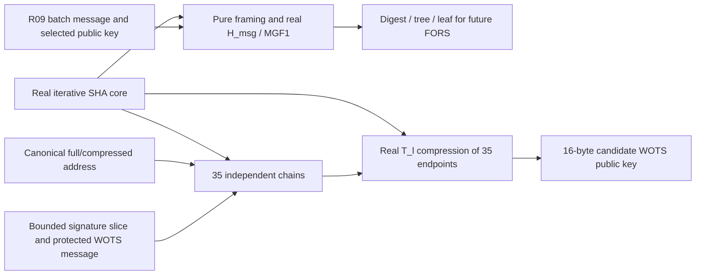

# R10a: SLH-DSA addressing, message hashing and WOTS+

R10a implements real SystemVerilog components for **SLH-DSA-SHA2-128s** using
the iterative R04 compression core. The normative algorithm is
[FIPS 205](https://doi.org/10.6028/NIST.FIPS.205), referenced by the
[v0.3 REINS PDF](REINS-Hardware-Specification-v0.3.pdf). The selected parameters
are `n=16`, `h=63`, `d=7`, `h'=9`, `a=12`, `k=14`, `lg(w)=4`, and WOTS length 35.
The public key has 32 bytes and the signature has exactly 7,856 bytes.

These components return **candidate cryptographic intermediates**. R10b still
owns FORS, all XMSS authentication paths, the hypertree and comparison against
the expected 16-byte public-key root. R10c owns complete independent two-pass
integration and protected acceptance. No R10a output awards a vote or execution
lease. The existing complete-device tests continue using their explicit host
signature boundary.

## Source map and data flow

| File | Responsibility |
|---|---|
| [`slh_address.sv`](../rtl/slh_address.sv) | Full ADRS, compressed ADRSc, selected-profile bounds and canonical unused fields |
| [`slh_wots_digits.sv`](../rtl/slh_wots_digits.sv) | All 32 message nibbles, checksum and three checksum nibbles |
| [`slh_sha256_stream.sv`](../rtl/slh_sha256_stream.sv) | Bounded real SHA, raw public-seed compression and continuation after that prefix |
| [`slh_hash_transaction.sv`](../rtl/slh_hash_transaction.sv) | Independent byte audit, physical operation counts, tags and checked digest hand-off |
| [`slh_message_hash.sv`](../rtl/slh_message_hash.sv) | Production pure/empty-context framing, H_msg, bounded standalone MGF1, digest/tree/leaf extraction |
| [`slh_wots.sv`](../rtl/slh_wots.sv) | Bounded single chain or all 35 verification chains plus WOTS public-key compression |
| [`r10a_test_top.sv`](../sim/rtl/r10a_test_top.sv) | Exact production components, passive physical SHA taps, standalone backend and simulation-only fault probes |
| [`r10a_test_support.h`](../sim/include/reins/r10a_test_support.h) | Independent C++/OpenSSL byte/block/state oracle, memory driver and retained observations |
| [`r10a_rtl_tests.cc`](../sim/tests/r10a_rtl_tests.cc) | Twelve directed, boundary, intermediate, fault and seeded fuzz cases |
| [`prepare_slh_vectors.py`](../tools/prepare_slh_vectors.py) | Build-only expected intermediates observed from the unchanged pinned Python verifier |
| [`check_slh_report.py`](../tools/check_slh_report.py) | Parses actual saved JSONL, measurements and oracle provenance after component tests |



The diagram shows reusable SHA computation, not a shared instance between passes.
Message hashing and WOTS currently each own a real core. Within a WOTS request,
one backend sequences the prefix, all chain steps and final public-key hash.

## Canonical addresses

The 32-byte ADRS is eight big-endian words:

```text
layer[4] | tree[12] | type[4] | keypair[4] | word6[4] | word7[4]
```

For SHA2-128s, the compressed 22-byte representation is:

```text
layer[1] | tree[8] | type[1] | keypair[4] | word6[4] | word7[4]
```

Construction assigns every word on every evaluation. A type change cannot retain
old chain/hash words. `valid_o` rejects high-word truncation aliases, layers above
6, tree bits outside that layer's remaining tree space, invalid keypair/chain/
height/index ranges and nonzero type-specific unused words. Callers must gate
work on `valid_o`; an invalid compressed output is not usable evidence.

Types 0/1/2/3/4 are WOTS_HASH, WOTS_PK, TREE, FORS_TREE and FORS_ROOTS. The
constructor also encodes canonical PRF address types 5/6; this does not add a
private-key input, device signing key or signing implementation. WOTS public-key
compression clears both final words; TREE clears the keypair word. A chain hash
uses hash indices 0–14. Index 15 is a valid terminal chain position and never an
additional F evaluation.

## Pure framing, H_msg and MGF1

The production H_msg entry requires profile 2, pure mode, empty context, exact
signature length and the fixed 46-byte application message. It rejects other
contexts/modes/profiles and a wrong application label before hashing.

```text
M       = ASCII("REINS-BATCH-v2") || batch_root[32]       # 46 bytes
M_prime = 00 || 00 || M                                  # 48 bytes
inner   = SHA256(R[16] || PK.seed[16] || PK.root[16] || M_prime)
seed    = R[16] || PK.seed[16] || inner[32]                # 64 bytes
digest  = MGF1-SHA256(seed, 30)
```

Each MGF1 block hashes `seed || BE32(counter)`. H_msg needs counter zero only.
The bounded standalone MGF1 component entry supports masks of 0–64 bytes,
including the counter-one boundary. It is an algorithm component, not a wider
REINS signature gate. Unused output-mask bytes are zero.

The first 21 digest bytes become the FORS message. The next seven supply the
54-bit tree index; the final two supply the 9-bit leaf index. The extra high bits
are masked as FIPS 205 requires. The module exposes the actual pure framing,
inner digest, mask and separate expected `PK.root` for observation.

The **32-byte Merkle batch root is part of the signed message**. It is distinct
from the **16-byte expected SLH public-key root**, and from each **16-byte WOTS
public key**. R10a never compares these different objects as if they were equal.

## WOTS digits, chains and signature slices

The first 32 digits are the message's high/low nibbles in byte order. The checksum
is `sum(15-digit)`, shifted left four bits and encoded as two big-endian bytes.
Its first three nibbles form digits 32–34. Verification chain `i` starts at
`digit[i]` and performs exactly `15-digit[i]` F evaluations. A zero-length chain
copies its input without evaluating F. Single-chain requests reject starts above
15 or intervals ending above 15.

Full reconstruction reads exactly 560 bytes from:

```text
signature_offset = 16 + 2912 + layer*704 = 2928 + layer*704
704 = 35*16 WOTS bytes + 9*16 XMSS authentication bytes
```

Layers are 0–6. The signature extent must be 7,856, the sealed reply extent must
be canonical `7860+32*depth` with depth 0–20, and the slice must fit without
overflow. The component does not read the 144 authentication bytes after each
WOTS slice; those belong to R10b.

Every byte is read twice before use. Address/complement checks and independent
row/column decoding compare the actual read with the captured slice, chain and
byte position. This catches coherent address/complement substitution even when
all signature bytes happen to be identical. The test memory driver supplies
public bytes; integration with the already protected R07 SRAM remains R10b/c.
No additional 9,216-byte receive array is introduced. The 560-byte endpoint
workspace and its integrity copy are cleared on each request boundary.

## SHA state, counts and cancellation

The prefix state is one **raw compression** of `PK.seed || zero[48]` from the
standard IV. It is not the padded SHA digest of that 64-byte string. Continuation
adds the 64 prefix bytes to the final bit length. Each request computes its prefix
afresh, retains complementary integrity state and erases it on reset, cancellation
or response consumption. No prefix or success flag survives for another request.

| Operation | Body supplied after any cached prefix | Exact compressions |
|---|---:|---:|
| Public-seed state | Raw 64-byte block, no padding | 1 |
| H_msg inner | 96 bytes from the standard IV | 2 |
| One MGF1 counter | 68 bytes from the standard IV | 2 |
| F chain step | 22-byte ADRSc + 16-byte value | 1 after cached prefix |
| WOTS T_l | 22-byte ADRSc + 560 endpoint bytes | 10 after cached prefix |

Thus H_msg performs exactly four compressions. One chain performs `1+steps`.
Full WOTS performs `11+sum(15-digit[i])`, with a separately derived checksum/work
budget. The all-zero/all-FF message corners require 521/56 compressions.
The 4,100-per-pass specification ceiling is not an expected-operation count.

The hash adapter audits independently constructed bytes, accepted progress,
physical starts/completions, stage tags and a separate response-capture hand-off.
State, metadata, counters, cache and workspace use complementary checks.
Cancel/reset withdraw output immediately and erase working state; cancellation
dominates a held response. Integrity alarms remain sticky across cancel. A
persistent fault may suppress a response entirely; callers must use the alarm
and independent job deadline, never wait indefinitely for a completion.

Internal stage errors are 0=candidate, 1=malformed request, 2=WOTS read timeout,
3=integrity. These are not new SPI result codes. Consecutive missing WOTS bytes
are bounded at 1,024 clocks. The caller still owns the absolute R06/R07 job and
round deadlines; a read, hash or poll cannot restart them. Trusted reset of a
component does not replace R05 system qualification or clear a retained system
fault. R03 general/post-synthesis/physical fault qualification remains deferred.

## Tests and retained evidence

Run from the repository root with the normal [prerequisites](../README.md):

```sh
make r10a-tests
REINS_R10A_SEED=12345 make r10a-tests
REINS_R10A_TRACE=1 make RTL_TRACE=1 r10a-tests
make SANITIZE=1 r10a-tests
make tests
```

`quick-tests` keeps all directed and fault cases and excludes the extended fuzz
case. The twelve cases cover addresses, all checksum digits, raw/continued SHA
padding boundaries, both supplied H_msg intermediates, MGF1 truncation/counters,
unsupported framing, all 136 legal chain intervals, malformed slices, 42 WOTS
layer intermediates, fourteen semantic-stage fault sites and cancellation/hold/
timeout behavior. Extended fuzz adds 80 seeded WOTS requests, randomized memory
stalls, complete WOTS reconstruction and randomized H_msg inputs. Changing input
ports after capture cannot change an owned request.

The unchanged pinned Python verifier successfully verifies both supplied REINS
signatures and four valid official NIST cases. A wrapper observes their H_msg,
all seven WOTS input messages, every endpoint and compressed WOTS key. The
generator writes these public expected values only under `build/`, with version
and source/artifact hashes. The separate C++ oracle uses OpenSSL SHA operations
and independently constructs addresses, digits, chains and compression frames.
Every physical core input block and chaining state is compared, including
intermediate chain endpoints. No old fixture private key is needed.

Official internal/nonempty-context cases contribute **WOTS component** expected
values through the Python algorithm interface. They do not broaden the RTL
production H_msg gate. The other official signature outcomes, complete FORS/
hypertree and full RTL signature acceptance remain R10b/c.

Each run retains `r10a-rtl/output.log`, request diagnostics, `events.jsonl`,
`performance.json`, per-model `coverage/`, `oracle-index.txt` and
`oracle-provenance.json`, plus all public binary oracle inputs/expected values
under `oracle/`. Their hashes are checked against the retained manifest.
Physical compression records include actual blocks,
states and stage identifiers; result records include digests, keys, clocks,
counts and read samples. Supplied signed-response tests print the actual REINS
request before processing, including expected failures. Optional `r10a.fst` is
bounded to a useful first crypto bench. The `r10a-evidence` group parses the
actual saved reports to catch malformed evidence as well as failed hardware.
Results, including failed runs, remain until an explicit clean target.

Fourteen fault sites exercise message-prefix bytes, coherent digest capture,
MGF counter ordering, suppressed completion pulses, coherent work-count changes,
compressed addresses, seed framing, WOTS hand-offs, returned tags, decoded digits,
coherent physical read addresses, chain position and repeated-read samples.
The tests require an alarm and no usable candidate; an alarm by itself is not
reported as a successful cryptographic result.

## Example measured cycles

An unstalled Verilator 5.032 run measured the following request-to-result clocks:

| Request | Actual compressions | Clocks |
|---|---:|---:|
| Production H_msg | 4 | 444 |
| Zero-step chain, including fresh prefix | 1 | 140 |
| Fifteen-step chain, including fresh prefix | 16 | 1,805 |
| Full WOTS, all-FF message | 56 | 7,572 |
| Full WOTS, all-zero message | 521 | 59,187 |

One twelve-case run advanced 1,883,897 clocks in 2.19 host seconds, about 858,000
clocks/second. Actual host load changes throughput; each report records its own
measurements. These are component cycles, not complete signature verification,
physical clock-rate qualification or a whole-device authorization latency.
