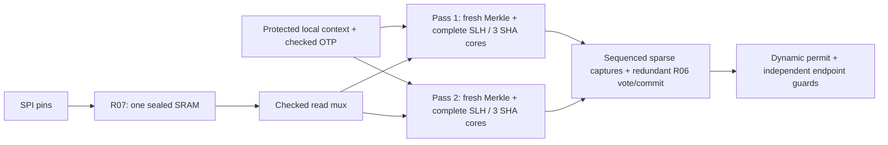

# R10c: independent two-pass acceptance and the full RTL device

`rtl/reins_device.sv` is the production authorization top. A signed reply travels
from SPI pins into the sole protected 9,216-byte receive SRAM, through two complete
Merkle/SLH-DSA passes, and into the lease/quorum controller. Local endpoint guards
then enforce the dynamic permit. No host result, hash, accept code, read driver or
stop acknowledgement is an input to this top. C++ creates authority signatures,
drives platform inputs and pins, and observes the hardware.

The target remains N=3, Q=2 and the exact v0.3 profile 2, pure
SLH-DSA-SHA2-128s with empty context. No wire fields, commands or normative
validation files change. R03 general fault campaigns and physical qualification
remain deferred; the fault evidence here covers the declared digital sites.

## Build and run

Install the prerequisites in the [root README](../README.md), then run from the
repository root:

```sh
make build
make software-tests
make r10c-unit-tests
make r10c-integration-tests
make r10c-tests
make quick-tests
make tests
```

`r10c-unit-tests` clocks the actual controller, verifier and sealed SRAM at a
qualified-platform component boundary. `r10c-integration-tests` runs the exact
production top with real R05 startup/entropy/time, pin transport and R08 endpoint
guards. `r10c-tests` runs both. Full integration includes all three quorum pairs,
withholding/expiry and a stalled second pass. Pair 1/2 uses maximum 8,500-byte,
depth-20 replies for its second ARM and RENEW votes. Quick tests retain pair 0/1 and the
unit suite's all-pair coverage; they exclude cases named `extended`.

A focused run still retains every output:

```sh
make r10c-unit-tests TEST_FILTER='*capture*,*redundant*'
make r10c-integration-tests TEST_FILTER='*pair 0 1*'
REINS_R10C_SEED=0xc10c make r10c-unit-tests TEST_FILTER='*extended seeded*'
REINS_R10C_TRACE=1 make RTL_TRACE=1 r10c-unit-tests TEST_FILTER='*complete independent*'
make SANITIZE=1 r10c-unit-tests TEST_FILTER='*complete independent*,*abort reset*'
```

The optional unit FST contains both clock phases for the first 100,000 monitor
clocks of the first model. Integration uses the existing bounded pin/guard trace.
Tracing changes build settings and causes incremental rebuilding. Use a different
`BUILD_DIR` and a matching recursive Make wrapper if running different builds
concurrently; do not let two builds generate the same Verilator output directory.

## Source map and ownership

| File | Purpose |
|---|---|
| [`reins_device.sv`](../rtl/reins_device.sv) | Production top; internal verifier wiring, immediate health/deadline gating, and R05–R08 composition |
| [`reins_verifier.sv`](../rtl/reins_verifier.sv) | Two-lane sequencer, protected identity/code capture, exclusive physical read mux and final live completion gate |
| [`reins_verifier_pass.sv`](../rtl/reins_verifier_pass.sv) | One complete fresh grant/config/Merkle/SLH pass, independent operation/stage/read observations and root comparison |
| [`reins_controller.sv`](../rtl/reins_controller.sv) | Existing fixed-issue lease controller, now with protected pass-one evidence, separate per-slot vote certificates/tokens and secondary vote/commit checks |
| [`slh_verify_reins.sv`](../rtl/slh_verify_reins.sv) | Strict production SLH gate; optional held-source audit enabled by the full verifier parent |
| [`slh_verify.sv`](../rtl/slh_verify.sv) | Complete R10b signature parser; passive chain and physical SHA events added for the independent parent observer |
| [`r10c_test_top.sv`](../sim/rtl/r10c_test_top.sv) | Component composition and explicit simulation-only fault probes |
| [`r10c_integration_top.sv`](../sim/rtl/r10c_integration_top.sv) | Exact production top, public OTP model, passive SHA taps, external effect sinks and declared simulation-only stall probes |
| [`r10c_test_support.h`](../sim/include/reins/r10c_test_support.h) | Sealed-memory driver, two independent oracle reconstructions, address/block/state/stage checks and semantic replay |
| [`r10c_integration_support.h`](../sim/include/reins/r10c_integration_support.h) | Real SPI/clock driver, test authority signing, all-core observations, semantic replay and end-to-end latency measurements |
| [`slh_test_oracle.h`](../sim/include/reins/slh_test_oracle.h) | R10b's independent C++/OpenSSL block/state/stage oracle, factored for reuse |
| [`verifier_test_oracle.h`](../sim/include/reins/verifier_test_oracle.h) | Independently frames OTP/grant/leaf/proof and combines their SHA expectations with the SLH oracle |
| [`r10c_rtl_tests.cc`](../sim/tests/r10c_rtl_tests.cc), [`r10c_integration_tests.cc`](../sim/tests/r10c_integration_tests.cc) | Directed, mutation, cancellation, stall, fault and seeded unit tests; all-pair full SPI ARM/RENEW and stop tests |
| [`check_two_pass_report.py`](../tools/check_two_pass_report.py) | Validates actual public replay bytes/hashes, physical counts/stages, code evidence, job budgets and the production input boundary |

The older `reins_device_control`, `reins_device_spi` and
`reins_device_enforced` compositions retain their documented internal verifier
boundary for fast controller regression. They are components of the new top,
not alternative production authorization configurations. Simulation fault
selectors and hierarchy probes exist only under `sim/rtl`.

## Two complete passes




The bank sequence is `IDLE(0f) → START1(33) → WAIT1(55) → OUT1(69) →
START2(96) → WAIT2(aa) → OUT2(cc)`. Request/response transfers use ready/valid.
A held response is checked against its originating lane before delivery. Sparse
read ownership is lane 1=`3`, lane 2=`c`, idle=`0`.

Each pass independently captures run, round, token, epoch, slot, exact request,
reply length and configuration digest with complementary storage. It obtains the
checked public OTP directly from the platform, recomputes its five-compression
SHA-256 digest, constructs the expected local grant, hashes its leaf, and reads
the index/proof from sealed memory. Each then reads all 7,856 signature bytes and
performs real H_msg, FORS and seven WOTS+/XMSS layers. Both stages sample each
byte twice. The reply contains no grant body.

Each lane has its own Merkle SHA, main SLH SHA and WOTS SHA: **six separate
compression datapaths** in the verifier bank (in addition to R05 hashing). SHA state, digests, scratch, decoded address and
chain controls, leaf/batch root, signature root and success state do not pass
between lanes. The bank shares only protected source provenance and the checked
physical SRAM read port. Consuming a pass invalidates its scratch before a later
job can reuse it. Cancel/reset invalidate both lanes; sticky integrity failure
survives cancellation.

The Merkle result is held throughout SLH work. The pass checks its captured key,
leaf, root and labeled message against that held source. It constructs the SLH
message locally from its own protected batch root. The SLH wrapper's
`CHECK_LIVE_INPUTS=1` additionally checks its snapshot against the parent's held
source throughout the owned job. The default remains snapshot-only for the
standalone R10b component API.

The 32-byte **batch Merkle root**, 16-byte **reconstructed signature root** and
16-byte configured **PK.root** remain separate. Pass one uses full-width root
equality; pass two counts sixteen zero byte-wise XOR differences. A child's
`verified` Boolean is never the parent's acceptance evidence. Only a complete
matching pass emits `96` for lane one or `69` for lane two; a completed mismatch
emits zero. Format rejection cannot become an accepting code.

## Exact work and protected reads

For canonical proof depth `d` and the independently decoded 35 WOTS digits
`digit[layer][chain]` in each of seven layers:

```text
Merkle:                  5 OTP + 3 leaf + 2*d parents = 8 + 2*d
SLH fixed work:          4 H_msg + 187 FORS + 63 XMSS + 77 WOTS overhead = 331
WOTS variable work:      sum(15 - digit[layer][chain])
Complete pass:           339 + 2*d + sum(15 - digit[layer][chain])
```

The 4,100 bound is only a maximum budget. A success requires exact equality of
independently observed starts, completions and the calculated count. Both
physical SLH SHA cores and the Merkle core are observed separately. One-hot
activity and stage ownership are checked; starts/completions under the wrong
owner fail off. The independent stage observer requires fourteen FORS trees,
FORS_ROOTS and seven ordered WOTS/TREE pairs: **29 stage values**, **245 chains**.
It derives its own checksum/digits from protected stage messages and checks chain
index, digit and layer against the decoder's observations.

The lane derives the expected sequential address independently from accepted
samples. The bank compares the actual mux output and inverse against that lane's
intended address, covering coherent corruption after lane selection. Each pass
expects `2*(reply_length-7856)` proof/index samples followed by exactly 15,712
signature samples. R07 checks SRAM owner token, seal, address/control coding,
per-row identity and ECC. All writes remain inhibited during either pass.

The C++ oracle independently reconstructs each lane's entire work list. The
harness compares **every actual SHA block and initial state**, not just output
hashes or totals, and all 29 stage outputs. R10b's 28 official cases and the
supplied Python verifier remain independent algorithm anchors in the full suite.
Ordinary valid/mutation cases check all those values. Internal fault cases may
suspend the C++ equality scoreboard when corruption is intentional; raw events
are still retained and authorization must fail. A completion's `checked` field
distinguishes those records. No oracle value drives an acceptance input.

## Final vote, lease and cancellation

R06 independently checks each returned tuple against the captured job and current
run/context. Its secondary identity path uses XOR reduction of complemented
stores rather than the primary equality chain. Pass-one sparse code and
seen/valid state have independent complementary records.

A distinct slot vote also records a slot-specific sparse certificate and unique
job token with complements. The secondary quorum path reconstructs its bitmap
from those separate records, validates token uniqueness and compares it with the
primary bitmap. A coherent primary bitmap/complement corruption cannot invent a
second signer. Separate slot/count/deadline/issue/expiry checks gate final commit.
Fault, expiry, abort, reset and stop priority remain above completion.

For round `r`, `I=(r-1)*P`, `B=I+W`, `E=I+L` remain immutable. SPI polls, chunks,
partial votes, entropy wait and crypto never extend them. The 5,000,000-tick
receive-job budget starts at RX_BEGIN; the 100,000-tick transaction timeout still
runs through the same controller. An immediate live gate masks a late result;
registered cancellation then clears ownership and all old work. An unexpected
identity mismatch while the original context is still live raises integrity
failure, including a coherent capture/inverse change; legitimate invalidation
cancels without an alarm. Neither a stalled
hash nor downstream backpressure pauses time.

Endpoint permit rails, local guards, queues and trusted stop completion are the
actual R08 implementation. A fresh ARM still requires completed enforcement
stop, and the management path remains available while protected clocks/outbound
traffic are stopped.

## Declared fault domains

These are targeted RTL injections, not a claim of exhaustive physical coverage.
All fault assertions check authorization/effects in addition to alarm behavior.

| Domain | Detection/tolerance and executed cases |
|---|---|
| Common input/provenance | Complementary bank/lane snapshots, live identity comparison, fresh OTP hashing; corrupted bank token, coherent bank/lane identity+inverse changes and configuration/key/leaf construction cases |
| Sole receive memory | R07 exhaustive ECC/row/owner/seal/control tests; R10c physically attempts forbidden writes during each pass |
| Common read data | Persistent zero substitution on the shared bus after SRAM checks affects both complete passes; neither accepts |
| Common read mux | Coherent address plus inverse substitution after mux; compared with independent intended address |
| Lane sequencer/accounting | Illegal bank state, start count corruption, coherent expected-step corruption, wrong chain digit and suppressed stage event |
| Construction/handoff | Local leaf frame corruption, selected public key corruption, coherent Merkle handoff, labeled message corruption and coherent post-capture batch-root corruption |
| Root comparisons | Invalid signature with either comparator forced permissive; the other complete pass still rejects |
| Common result capture/join | Coherent accepting code/capture inverse against a still-held rejecting lane; pass-one flag corruption and primary identity match forced with wrong token |
| Final vote/commit | Primary quorum result, coherent bitmap+inverse and secondary commit gate faults; independent certificates/identity/count checks prevent authorization |
| Lifetime/time | Abort/reset before and between passes, cancellation races, real SHA stalls and immutable deadlines; late released work cannot vote |
| Enforcement | Existing R08 ties/frozen source/permissive guard/clock-profile campaigns; full R10c withholding/stall expiry checks actual stop and outbound effects |

The component selector IDs map to these exact sites. Each selection/release is
recorded with its clock, tick, bank and lane state; a selection persists until
changed/released or that model is destroyed.

| ID | Injected site | ID | Injected site |
|---|---|---|---|
| 1 | Bank sequencer | 13 | Primary quorum bitmap result |
| 2 | Bank token capture | 14 | Secondary commit gate |
| 3 | Physical read address plus inverse | 15 | Lane-one real SHA ready stalled |
| 4 | Result capture plus inverse | 16 | Local expected-leaf frame |
| 5 | Lane-one observed starts | 17 | Lane-two Merkle handoff plus inverse |
| 6 | Lane-two chain-step total plus inverse | 18 | Primary identity match plus wrong returned token |
| 7 | Decoded chain digit | 19 | Labeled Merkle-to-SLH message |
| 8 | Suppressed stage observation | 20 | Batch-root capture plus inverse after SLH capture |
| 9 | Selected key capture | 21 | Primary stored votes plus inverse |
| 10 | Permissive lane-one root comparison | 22 | Shared SRAM read-data bus |
| 11 | Permissive lane-two root comparison | 23 | Bank token plus inverse |
| 12 | Stored pass-one success | 24 | Lane identity token plus inverse |

All 24 component selectors are exercised. The integration top uses a separate
numbering: 1/2 stall the real first/second-lane main SHA. Its optional capture/mux
selectors 3/4 are diagnostic probes; the automated capture/mux evidence comes
from the component composition, not those two integration probes.

Persistent faults at a shared site are a common domain, even though passes run
sequentially. Separate cores do not remove shared input, reset, memory, mux,
capture, controller or enforcement assumptions. Complementary registers are
logical protection only; synthesis can merge common logic. Technology reset,
OTP/SRAM macros, independent clocks/sensors/entropy, placement, routing,
CDC/four-state behavior and a qualified physical stop bound need subsequent
platform evidence. R03/PR11 remain responsible for broader fault campaigns.

## Timing profile and measurements

The pin-level profile uses a 4 MHz monitor clock, trusted A progress at 1 MHz,
independent B progress at 800 kHz, SPI at 100 kHz (20 monitor clocks per half
phase), three independent 1 MHz A guards and three 1.25 MHz B guards with
staggered 17 ns phases. Every monitor and guard edge is simulated. Time never
jumps across active hardware work. Deterministic entropy stimulus exercises the
digital source interfaces and supplies no assessed entropy claim.

The public test OTP uses `L=8,000,000`, `P=3,000,000`, `W=2,500,000` ticks.
Each authority response assumes 20,000 ticks for batching/relay plus 80,000 for
signing, with two responses served sequentially. Real host signing wall time is
recorded separately in `authority_relay` events: it is not calibrated hardware
signing latency and is not silently counted as zero in the stated assumptions.
If a deployed signer takes longer, include that additional delay before selecting
W/P/L. This profile is an example under its declared service assumptions, not an
authority-service throughput qualification.

Per-job `full_result` events measure both complete passes, receive transport and
ownership from RX_BEGIN. `arm_latency` measures from the first round's issue to
quorum commit and then actual opening of all endpoint guards. These include
public request reads, modeled signing/relay delays, all SPI envelopes/chunks,
sealing, fresh configuration/Merkle checks, signature work and final acceptance.
Status/management transactions advance the same clocks. Expiry waits use the
driver's monotonic trusted-progress timeline: the DUT intentionally resets its
run-relative counter after a completed run. Callers still check actual hardware
permit, cancellation, guard and outbound outputs at those boundaries.

`timing-summary.json` collects every pass, job and ARM measurement, with explicit
response-window and per-job margins. Raw signing wall durations and assumed
authority/relay ticks remain side by side. At the end of each R10c Make run, the
console also summarizes exact SHA work, two-pass cycles, receive-job ownership and
margin, each ARM's commit/guard timing and margins, host signing versus modeled
service delay, and simulator throughput. That console summary is retained in
`runner.log` and `r10c-evidence/output.log` as well.
The saved final run records the actual ranges; host/compiler/simulator versions,
wall seconds and monitor clocks/second are in its build/performance reports.
Re-run on your machine rather than treating host simulation speed as a device
frequency. The fixed 4,100 budget is never reported as a measured work count.

The final Verilator 5.032 / OpenSSL 3.5.7 run was
`20261023T162900.617298Z-r10c-release-_g8hxsyk` (GCC 14.2, default seed).
All 11 component cases and 5 complete-device cases passed. The unit group
executed 54 jobs with 57 pass completions, including expected faults and
cancellations. Full integration executed 19 jobs: 18 completed and one stalled
job canceled; all 37 returned complete passes matched the independent oracle.
Input hashes, work traces, ownership and timing-summary checks passed.

| Measurement | Observed | Comparison |
|---|---|---|
| Real compressions per complete integration pass | 2,098–2,439 | Exact per-job formula; below the 4,100 maximum |
| Complete two-pass vote computation | 508,498–584,028 monitor clocks | 127.1245–146.007 ms at 4 MHz; includes fresh grant/config/Merkle work |
| Completed receive-job ownership | 990,357–1,067,903 trusted ticks | At least 3,932,097 ticks below the 5,000,000-tick job limit |
| Pair 0/1 ARM commit / all guards open | 2,215,772 / 2,216,776 ticks | Commit margin 284,228 against W=2,500,000 |
| Pair 0/2 ARM commit / all guards open | 2,209,112 / 2,210,116 ticks | Commit margin 290,888 |
| Pair 1/2 ARM commit / all guards open, maximum reply | 2,292,722 / 2,293,726 ticks | Commit margin 207,278 |
| Post-commit guard opening | 4,012–4,014 monitor clocks | Measured at all six independent guards |
| Stalled second-pass release | Run-relative deadline 5,500,000; driver tick 5,500,290 | Original run origin 285; buffer canceled, no second code/vote, old lease retained to 8,000,000 |
| Unit throughput / wall time | 127,995 monitor clocks/s / 134.901 s | Instrumented simulation, 47 model instances |
| Full-device throughput / wall time | 81,018.5 monitor clocks/s / 1,569.23 s | 127,137,000 monitor clocks, including every SPI/guard edge |

Actual host signing took 0.275–0.367 seconds per response in that run, versus the
**80 ms assumed signing service**. Substituting this host's measured signing
cost into the same serial ARM schedule gives approximately 2.67–2.77 million
ticks for the three pairs, exceeding W=2.5 million. Thus the measured RTL schedule
fits the stated service assumptions; this host does not establish that service
capacity. A deployment using similar software signers needs a larger W/P profile,
parallel independent approval requests, or a qualified faster transport/service,
and must repeat the budget checks. The hardware's fixed issue/deadline/expiry
rules do not adapt to slow responses.

Focused ASan/UBSan positive/fault/abort checks, an alternate-seed bounded FST run,
and Verilator 5.008 unit/fault compatibility checks passed. Production lint with
assertions and `SYNTHESIS` passed on both 5.008 and 5.032. The independent software
suite passed 32 C++ cases, 30 Python regressions, corpus/Python cross-checks and
CLI reports. Existing R04–R10b component/integration groups passed 134 C++ cases.
Earlier development runs interrupted to correct the test's run-clock expiry
wait remain on disk; the final complete R10c run above passed without interruption.

## Retained evidence and replay

Each Make invocation prints its unique `test-results/<run>/` directory. Within a
full run:

| Path | Contents |
|---|---|
| `r10c-rtl/output.log`, `test-output.log` | Complete requests and expected/actual directed/fault/fuzz outcomes |
| `r10c-integration/output.log`, `test-output.log` | Pin-level full-device tests and ARM timing |
| Either group's `inputs/*-{otp,request,reply}.bin` | Exact public replay bytes; transient private test keys are unnecessary |
| `events.jsonl` | Public input hashes, every actual compression block/state, stage outputs, sparse completions and measured job/ARM timing |
| `timing-summary.json` | Compact per-pass, whole-job and ARM measurements, budget margins and authority/relay assumptions |
| `performance.json` | Actual mode, seed, tools, clock totals, evaluated passes, wall time and throughput |
| `coverage/*.dat` | Per-model Verilator line coverage |
| `r10c-evidence/output.log` | Checks of actual saved input hashes, work traces and authorizing codes |
| `summary.json`, `junit.xml`, `runner.log` | Full command/status/count/timing records, including failures |

The default fuzz seed is `0x5245494e5310c`; override `REINS_R10C_SEED` to replay
the action selection. Fresh test authorities use newly generated keys, so a new
run need not produce byte-identical signatures. Saved public binary inputs and
hashes identify the exact previous crypto workload; C++ reconstructs them without
private keys. Full-device tests compare semantic request, vote, permit and fixed
lease events with the independent C++ model using measured RTL completion times;
they do not require its software scheduler to reproduce hardware microstates.

Only explicit `make clean-results` or `make clean` removes these outputs.
