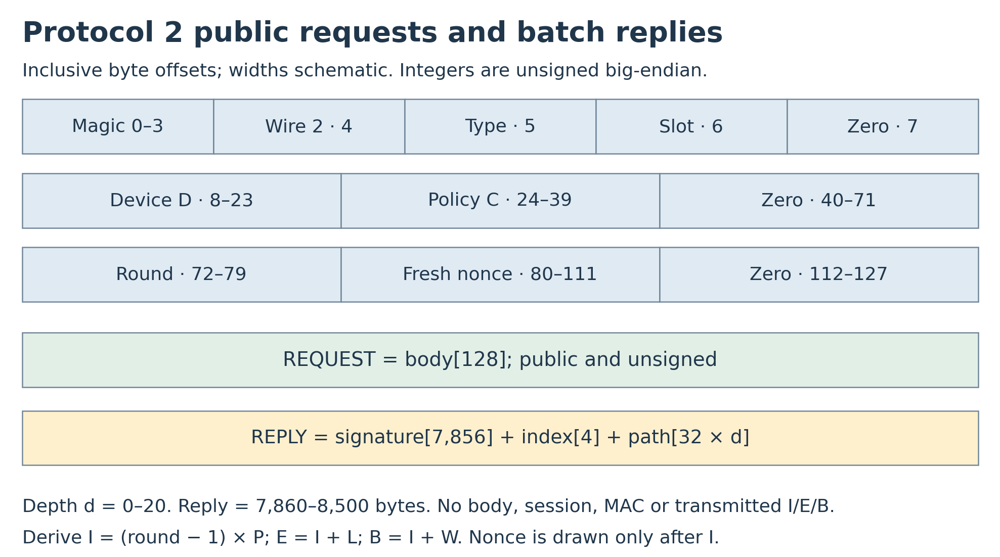
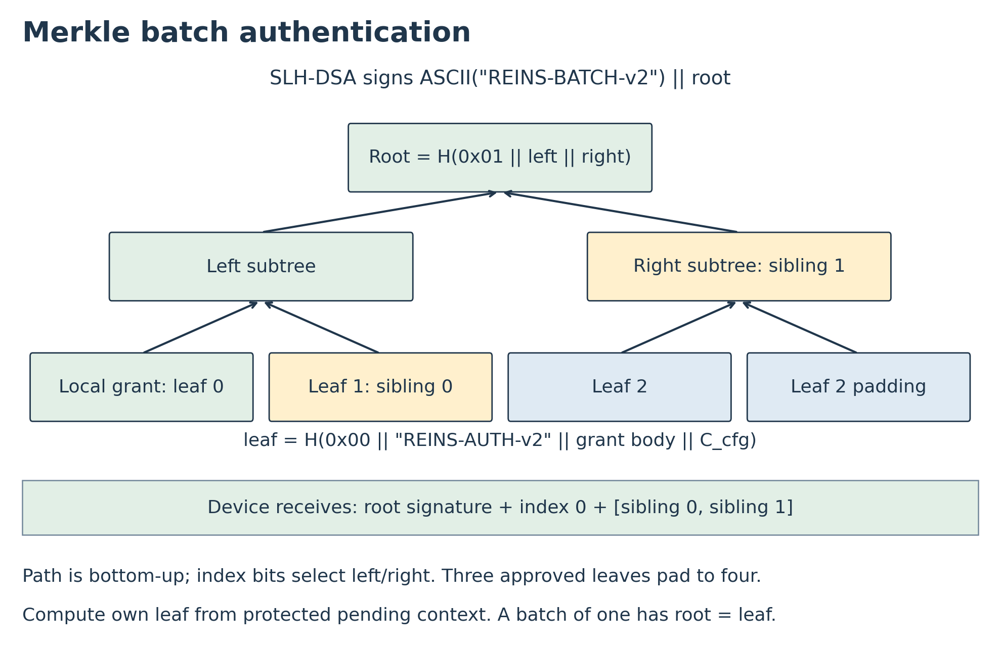
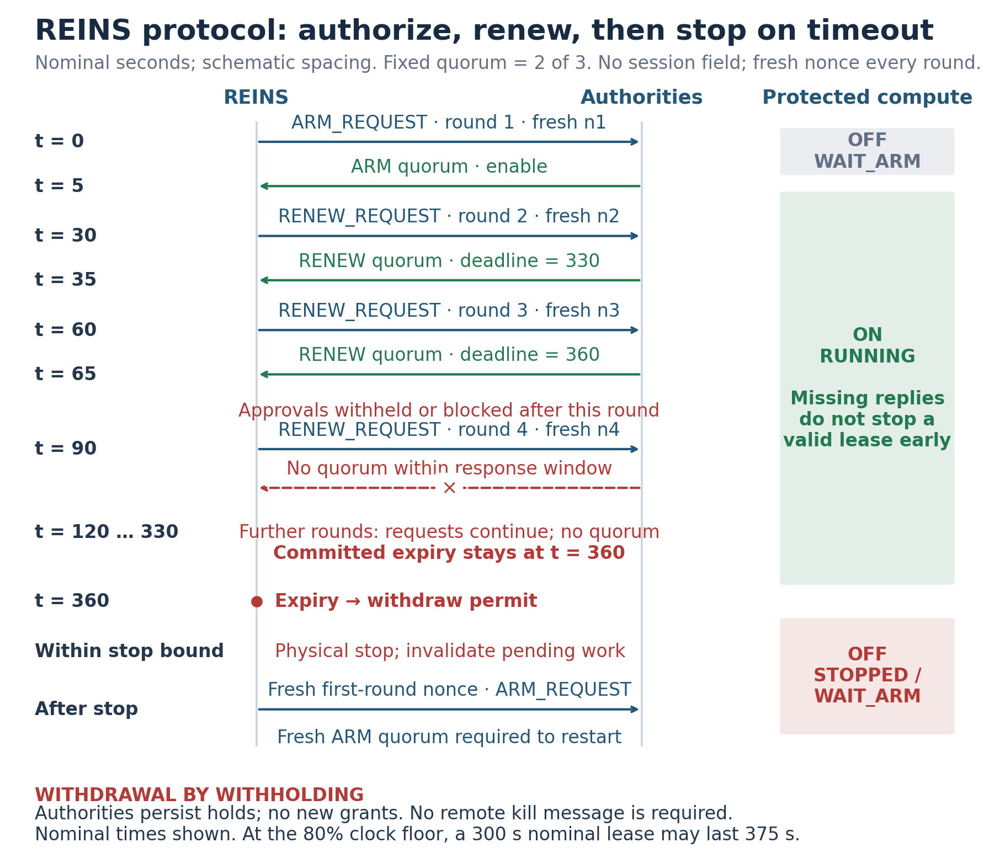
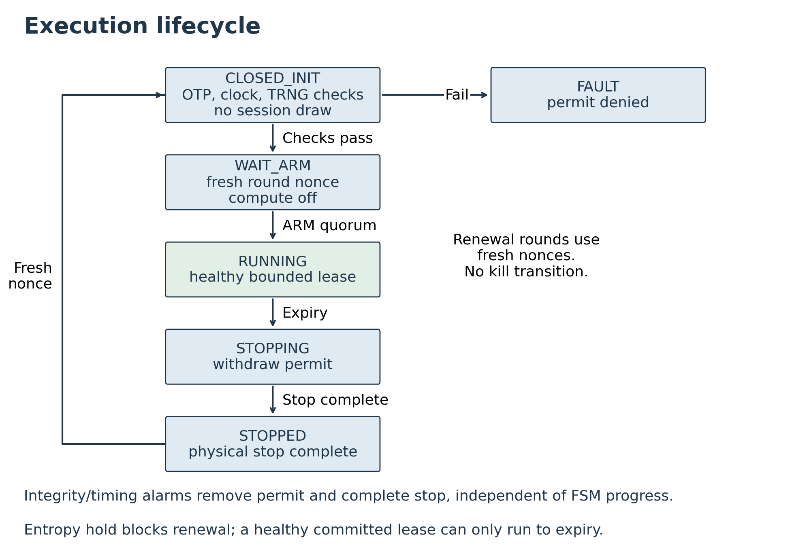
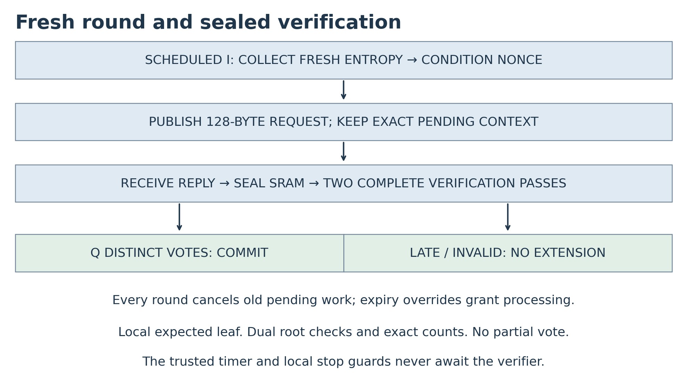
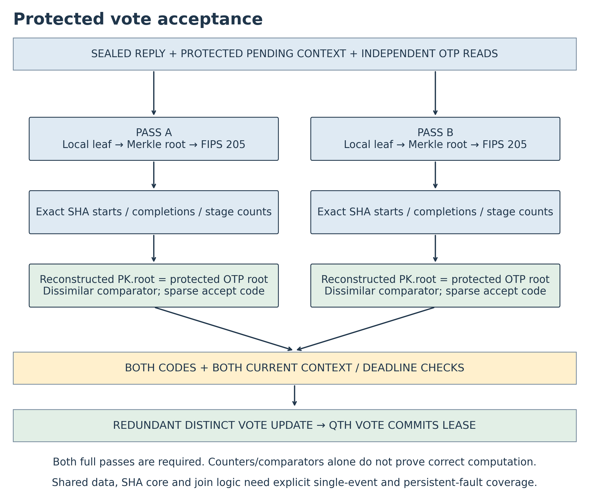
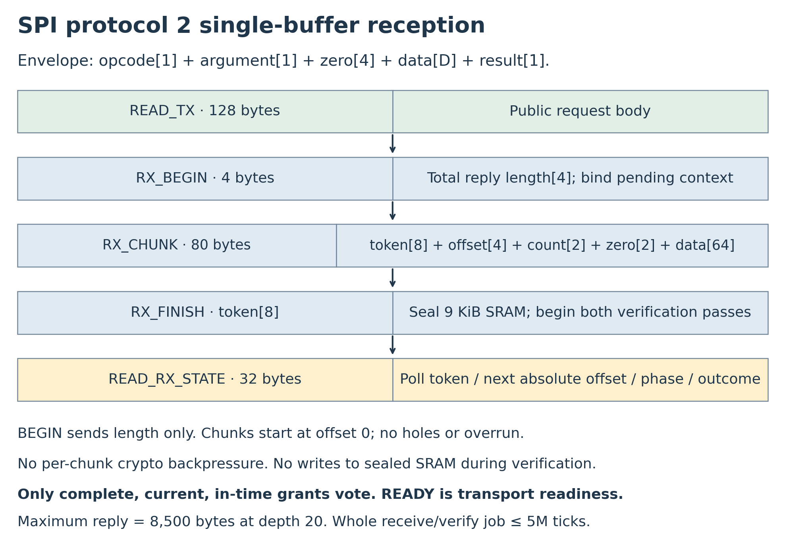
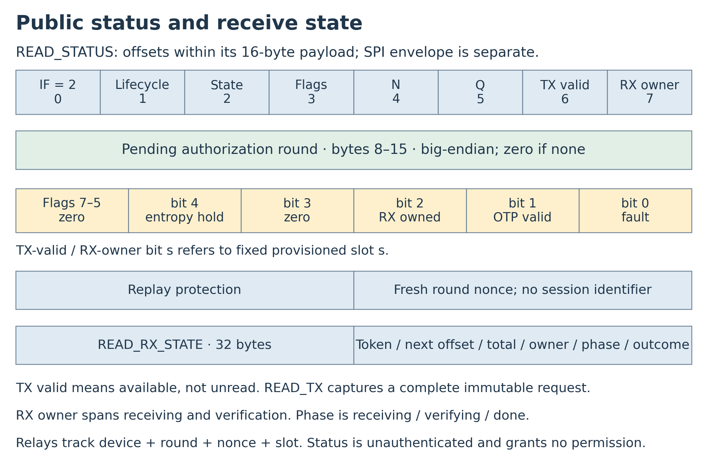

# REINS Hardware Specification

**Revocable Execution through Independent Networked Supervision**

**Status:** Initial development research specification  
**Wire protocol:** 2  
**Date:** October 19, 2026  
**Implementation status:** Proposed design; no RTL, physical qualification, synthesis, or certification is claimed.

## Executive summary

REINS is a fixed-function hardware controller that permits protected computation only under a current lease approved by independent authorities. The reference deployment requires two of three permanently provisioned authorities to ARM or RENEW execution. A nominal five-minute lease is requested every 30 seconds with a 30-second response window. Authorities withdraw permission by withholding signatures; REINS stops when the last committed lease expires. A relay that drops all communication cannot extend execution. There is no remote kill command or device-side enrollment exchange.

**Fresh authorization.** Every round begins with a new 256-bit nonce drawn from fresh physical entropy collected after that round starts. REINS publishes a 128-byte public request containing device, policy, round, slot, and nonce. Each authority independently applies policy, batches approved grant bodies into a Merkle tree, and signs its root using stateless SLH-DSA-SHA2-128s at NIST security category 1. A reply carries only the root signature, leaf index, and sibling path. REINS reconstructs the expected grant body from its own protected pending context, computes its leaf locally, and verifies membership and the root signature. There is no received-body comparison or session identifier. The Qth distinct valid vote commits a lease measured from the round's scheduled issue tick.

**Fault-safe acceptance.** The fault model applies to each event and includes repeated transient events over time. No single event may create a vote. The acceptance path includes context and OTP reads, leaf and Merkle hand-off, SHA-256 computation, signature sequencing, final root comparisons, completion-time checks, and vote update. Two independently sequenced verification passes, dissimilar root comparators, sparse accept codewords, independent operation accounting, and redundant final checks are required. Their isolation and fault coverage remain verification obligations; duplicated decisions alone do not prove safety.

**Trust and storage.** REINS holds no secrets. OTP contains only immutable public keys and policy; all runtime state is volatile. Authority keys and quorum remain fixed for life, so provisioning must budget for cumulative key compromise and service loss. Independent operators persist withholding holds across device and authority restarts. Authorities allow at most four distinct candidates per device and round in a rolling lease-length window as defense in depth. No writable non-volatile device storage, runtime revocation list, session counter, or signing-index state is required.

**Hardware.** SHA-256 serves signature verification, Merkle proofs, configuration hashing, and entropy conditioning. One 9 KiB SRAM buffer receives a reply before RX_FINISH seals it for verification. The maximum reply is 8,500 bytes at depth 20. Two dissimilar on-die timing references and monitored physical entropy sources address owner-controlled voltage, temperature, and EM disturbance. Dynamic permits reach local guards at every protected isolation point on the protected die. Entropy hold blocks new grants and clears only through a cold reset and successful full startup qualification.

**Bounds and limits.** With L=300,000,000 ticks, a qualified 800,000 Hz clock floor, local missing-edge detection within 1 ms, and actuation within 2 ms, the rounded withholding bound is 375.004 seconds. The clock floor and physical fault coverage require qualification. Nonce prediction within a run or across resets defeats the withdrawal bound; retryable startup health tests and admission caps do not replace source-design evidence. Invasive rework, controller replacement, overlapping coordinated faults, and common-cause defeat of independent guards remain outside the conditional guarantee.

## 1. Purpose and scope

REINS enforces bounded revocable execution; authorities decide permission and hardware enforces its duration. It has no instruction fetch, trusted firmware, writable control program, trusted network stack, device signing key, or request-authentication secret. A malicious owner may read all device state and control every host/management program and transport. Safety rests on fresh round challenges, authority signature unforgeability, a fixed quorum, qualified local enforcement, and physical integration.

The reference N=3,Q=2 deployment tolerates one combined compromised-or-unavailable authority; provisioning supports 1 <= Q <= N <= 8. All programmed public keys remain eligible for life. Long-life deployments SHOULD evaluate N=5,Q=3 using Section 9.6. The design does not stop copies on unprotected machines or retract external commands already delivered.

MUST, MUST NOT, SHOULD, and MAY express requirements, prohibitions, recommendations, and permitted choices. Requirement identifiers identify groups of acceptance obligations; Section 21 maps them to checks. Initial development identifiers are wire/schema/profile selectors, not a revision history.

## 2. Security objective and trust model

### 2.1 Authorization and withdrawal

**SAFE-01.** Protected execution MUST imply closed valid provisioning, healthy enforcement, Q distinct valid grants for the current committed round, and an unexpired committed lease. If fewer than Q provisioned authorities sign further relevant grants after real time t_w, protected computation and external effects MUST cease within Section 14's bound under its assumptions. Reading any stored device value MUST NOT permit authorization to exceed that bound. A valid signature for a predictable future request is insufficient: each grant must bind an unpredictable nonce generated no earlier than its own round start.

### 2.2 Trusted components and quorum assumptions

The local TCB includes public OTP integrity/lifecycle, fixed parsers, SHA-256 and SLH-DSA verifier, Merkle verification, entropy acquisition/conditioning/health logic, timers and integrity replicas, vote/commit state, SRAM sealing/integrity, sensors, local permit guards, and complete physical stop boundary. Authorities are independently trusted for signing policy and private-key custody. Their transport and received request contents are untrusted. No device data needs secrecy; integrity of public keys and enforcement state remains essential.

For c compromised keys and u additional unavailable services, preventing authorization by compromised keys alone requires c < Q; availability despite withholding requires Q <= N−c−u plus timely cooperative delivery. Withholding by N−Q+1 authorities blocks all possible quorums. A compromised quorum can authorize harmful execution. A malicious relay may cause denial of service. Membership is immutable, so no distributed membership-consensus protocol is required.

### 2.3 Owner adversary and fault coverage

The attacker may read every OTP/SRAM/register value, replay/reorder/delay/drop/inject public traffic, request signatures on arbitrary apparent device requests, flood SPI, cycle power, bias entropy sources, disturb clocks through voltage/temperature/EM, and inject a transient or persistent bit/whole-register/control-path fault in a declared fault domain. Source independence, conditional entropy, timing floors, sensor coverage, and physical separation require measured evidence over the declared attack envelope.

**FAULT-01.** The fault model applies per event, not once over the device's life. Any number of temporally separated single transient events is in scope, including a glitch in every successive round or verification attempt. A single event may affect one declared location and its propagation cone; it MUST NOT create a vote, combine stale work into a quorum, or extend a lease. Cover persistent single faults as well. Invalid encodings, replica disagreement, integrity failure, or loss of qualified timing withdraw permit. Restore or invalidate fault-affected state before another acceptance attempt; unchecked latent effects cannot accumulate across attempts.

The covered acceptance path includes pending-context construction/reads, slot and public-key selection, configuration digest and local leaf, Merkle root hand-off, SHA-256 datapath and completion signals, signature parser/sequencer, final root comparison and accept encoding, final now < B/current-expiry checks, generation/hold checks, and redundant vote/commit update. Timer, lease, nonce, FSM, receive sealing/length/address controls, and every permit fan-out branch/local guard are also covered. A fault in one common hand-off or enable must not bypass both checked paths. Section 12.2 defines the acceptance contract and Section 19.1 the required injection targets.

Each isolation endpoint has independently checked local dynamic guards so one permissive guard/checker fault is defeated by the healthy path. Both the REINS controller and the permit guards/isolation gates MUST sit on the protected die for the owner-adversarial claim. A board-level controller is weaker because rewiring can bypass it. Multi-die coverage needs a separately specified protected link/attestation boundary.

The per-event claim requires fault containment and recovery between events. It does not cover multiple faults whose effects overlap across otherwise independent checks, coordinated injection into both paths during one job, malicious fabrication, invasive rewiring, controller/public-key-store replacement, or common-cause defeat of all timing references/final isolation gates. These exclusions cannot be used to omit repeated isolated glitches or a persistent single shared-path fault from analysis.

## 3. Baseline parameters

| Parameter | Reference value | Contract |
|---|---:|---|
| Provisioned N / quorum Q | 3 / 2 | Fixed for life; provisioning range 1 <= Q <= N <= 8 |
| Wire / SPI / OTP schema | 2 / 2 / 2 | Exact canonical identifiers |
| Authority profile | 2 | SLH-DSA-SHA2-128s only, FIPS 205 category 1 |
| Signature parameters | n=16,h=63,d=7,h'=9,a=12,k=14,lg w=4,m=30 | Pure SLH-DSA, empty context |
| Public / private key | 32 / 64 bytes | Only public key enters REINS |
| Authority signature | 7,856 bytes | R=16, FORS=2,912, hypertree=4,928 |
| Request / semantic body | 128 bytes | Public, unsigned; no MAC suffix |
| Batch path depth | 0 through 20 | Profile constant; maximum 2^20 padded leaves |
| Logical reply | 7,860 + 32d bytes | Signature + BE32 leaf index + d siblings; no body |
| Maximum reply / RX SRAM | 8,500 / 9,216 bytes | One sealed-at-finish buffer, ECC additional |
| Round nonce | 32 bytes | Fresh conditioned TRNG draw after each scheduled issue tick |
| Acceptance passes | 2 per vote | Independent sequencing, comparisons and operation accounting |
| Authority candidate cap | 4 per device and round | Rolling window at least 375.004 s; not a safety premise |
| Trusted tick / nominal rate | 64 bits / 1 MHz | One count per qualified clock tick; no wrap |
| Clock floor f_min | 800,000 Hz | Planning floor; qualify under attack envelope |
| L / P / W | 300M / 30M / 30M ticks | Five-minute nominal lease; fixed issue schedule |
| Permit interval / local missing timeout | 500 µs / <=1 ms | Independent endpoint timing, qualified in real time |
| Endpoint actuation delta_act | <=2 ms | After local guard denial to stopped boundary |
| SPI reference | Mode 0, MSB first, <=100 kHz | Higher limits require electrical qualification |
| Transaction / receive-job timeout | 100 ms / 5 s nominal | Deadline never extends execution |
| Chunk capacity | 64 bytes | Buffer receives sequential offsets; no per-chunk crypto |
| Authority batch window | <=1 s policy target | Signing/queueing/transport must still fit B and expiry |

The clock floor and physical delays are requirements to validate, not measured oscillator specifications. Stateless signatures remove one-time-index hazards, not private-key theft. No other signature profile is enabled. Future SHA2 category 3/5 profiles need SHA-512 support and SHAKE profiles need Keccak; profile identifiers must distinguish them.

## 4. Hardware architecture

| Block | Function |
|---|---|
| Public OTP and lifecycle | Immutable keys, N/Q, timing and platform policy, permanent closure |
| Dual entropy path | Fresh raw sampling after draw start, SHA-256 conditioning, raw health tests |
| Request generator | Exact 128-byte slot body, locally derived grant leaf, redundant pending nonce/context |
| Signature verifier | Two independently sequenced passes of pure SLH-DSA-SHA2-128s |
| Acceptance checker | Independent operation counts, dissimilar root comparisons, sparse accept codes |
| Batch proof checker | Domain-separated leaf/node hashes, bounded index/path parsing |
| Receive SRAM | One 9 KiB logical buffer, integrity protection, write sealing |
| Vote and lease logic | Distinct grant bitmap, fixed-issue bounded lease, redundant checks |
| Timing and sensors | Dissimilar on-die references, frequency and environmental checks |
| Local permit guards | Dynamic edge detection at every protected isolation endpoint |

A SHA-256 core MAY serve verification, Merkle hashing, configuration digest, and entropy conditioning with bounded arbitration only if its shared datapath and control satisfy Section 12.2 fault coverage. Temporal repetition alone is not coverage for a persistent shared-core fault. RNG/raw tests, timers, and stop logic cannot be starved by incoming traffic. No device HMAC, signing engine, or writable NV block is present. All control is fixed hardware; public input still requires integrity and immutable snapshots.

## 5. Immutable public configuration and volatile runtime state

### 5.1 OTP schema

**CFG-01.** OTP is a 128-byte header followed by N records of 48 bytes. Its entire logical image is public and C_cfg = SHA-256(OTP_image). At N=3 it is 272 bytes. ECC, locks, sensing, programming and physical padding are additional. Integers are unsigned big-endian; all reserved bytes are zero. All authority IDs and public keys are distinct.

| Offset | Bytes | Field |
|---:|---:|---|
| 0 | 4 | ASCII RNOP |
| 4 / 6 / 7 | 2 / 1 / 1 | Schema 2 / wire 2 / authority profile 2 |
| 8 / 9 | 1 each | N / Q |
| 10 / 11 | 1 each | Reserved zero; depth 20 is a profile constant |
| 12 | 4 | Platform profile identifier |
| 16 / 32 | 16 each | Device D / policy identifier C |
| 48 / 56 / 64 | 8 each | L / P / W in trusted ticks |
| 72 / 76 | 4 each | Nominal / qualified minimum tick frequency |
| 80 / 84 | 4 each | Local missing-edge / endpoint actuation bounds in µs |
| 88 | 4 | Lease-check quantization allowance, 1 tick |
| 92 | 36 | Reserved zero |
| 128+48s | 16 | Authority identifier A[s], registration metadata |
| 144+48s | 32 | Public key PK.seed[16] followed by PK.root[16] |

No OTP field is secret. Public reads expose the whole logical image. Debug and scan closure remain necessary to prevent writes, permit bypass, or control-state corruption; confidentiality exclusions for a device key are unnecessary.

### 5.2 Runtime and closure

Every nonce, round, tick, lease, vote, token, verifier buffer, and job generation is volatile. There is no session identifier or session draw. There is no persistent restart count, runtime OTP write, revocation state, or authority-state recovery exchange. Power loss withdraws permit and discards authorization. Closure encoding is 00 open, 11 closed, 01/10 invalid/off. Only physical trusted commissioning may program open OTP. COMMIT_CLOSE requires valid complete OTP, physical stop, and commissioning enable; it has no enrollment-ack prerequisite. After closure, permanently reject configuration/key writes and bypass-capable debug/test. Partial or ambiguous closure never reopens provisioning.

Hardware checks 1 <= Q <= N <= 8, the supported profile, exact encodings, 0 < W <= P < L, frequency/delay bounds, reserved zeros, and distinct identities/keys. The profile fixes the depth cap at 20. OTP integrity failure stays off. Authorities retain protected private keys, durable registration and withholding policy outside REINS; they need no per-signature index state.

## 6. Signature and batch authentication

### 6.1 Exact signature interface

**SIG-01.** Use FIPS 205 SLH-DSA-SHA2-128s with 32-byte public keys, exactly 7,856 signature bytes, pure external slh_sign/slh_verify, and an empty context string [R1]. Hedged signing is recommended; authority RNG and key custody remain authority obligations. Device verification is SHA-256-only for this parameter set. Cache the SHA-256 midstate after PK.seed[16] || zero[48] where mathematically equivalent to FIPS 205; the cached state is public and integrity protected. It does not replace the standard address or message hashing.

    M_auth = ASCII("REINS-AUTH-v2") || grant_body[128] || C_cfg[32]
    leaf   = SHA-256(0x00 || M_auth)
    node   = SHA-256(0x01 || left[32] || right[32])
    M_root = ASCII("REINS-BATCH-v2") || root[32]
    sig    = slh_sign(M_root, context="", SK_s)

REINS calls external slh_verify(M_root,sig,"",PK_s). Pure SLH-DSA internally prepends 0x00 || U8(context_length) || context; for the empty context the internal message is 0x00 || 0x00 || M_root. Do not omit that prefix or substitute HashSLH-DSA/prehash. The REINS label is application domain separation, not a replacement for FIPS framing. Reject malformed/short/overlong signatures and unsupported profiles before any vote.

### 6.2 Public requests

Requests have no MAC, signature, or secret suffix. Authorities cannot infer genuine hardware presence or authenticated telemetry from a request. The body becomes useful to REINS only after a quorum signs grant bodies matching its unpredictable pending challenge. Anyone may submit apparent requests, causing load or denial of service; authority admission controls must not be used to prove the withdrawal bound. Optional transport authentication for network-only attackers is outside this hardware protocol and cannot alter acceptance or add a device secret requirement.

### 6.3 Authority custody and batching

Each authority batches only individually approved grant bodies, potentially for many devices/configurations, over a bounded window. It recomputes each leaf from the registered configuration digest, checks policy/holds, and signs the Merkle root once. It must never sign a relay-supplied root without approving every leaf. Stateless private keys may be backed up or replicated under custody policy without one-time-index allocation; compromise of any copy still permanently consumes the fixed-set compromise budget.

A batch of one is valid and still uses the root-signing construction. A maximum-depth-20 batch accommodates at most 2^20 leaves; larger loads require separate roots/windows or sharding. Batching amortizes signing, not policy evaluation, tree construction, bandwidth, or unlimited fleet capacity. A one-second collection target bounds only collection delay; key service latency, queueing and delivery must also fit the device deadlines. No raw-body direct-signature fallback is accepted.

## 7. Commissioning and off-device registration

**PROV-01.** A trusted physical appliance provisions genuine public keys and verifies registration while protected compute/I/O remain stopped. Authorities generate their private keys independently; the appliance receives only public material.

1. Verify device identity, open lifecycle, platform stop wiring, intended on-die integration, and independent authority identities.
2. Select N/Q and any offline reserve keys using Section 9.6, program the exact public OTP image, read it through READ_PUBLIC_CONFIG, and compare every field/key with the intended records.
3. Each authority registers D, C, exact public image/C_cfg and its own slot/key. It supplies a signed out-of-band registration record binding C_cfg and an appliance-chosen fresh test challenge under a separate registration label.
4. The appliance verifies each authority's fresh test signature off the device, compares the registered public key with OTP, and retains the signed registration record. This is not a REINS message type or execution permission.
5. COMMIT_CLOSE after valid provisioning and stop checks. Verify permanent closure and absence of bypass paths. The first operational ARM exercises REINS's verifier; no test signature enables execution.

There are no ENROLL_REQUEST/ENROLL_ACK messages or in-device enrollment bitmaps. Interrupting open commissioning requires rechecking the complete image and registration; ambiguous locks remain off. Offline reserve services are registered and tested before being taken offline; they are already eligible keys, not dynamically activated members.

## 8. Volatile run and entropy generation

### 8.1 Run scope

**FRESH-01.** After reset or completed stop, verify OTP, timing and source health while compute remains off. Start trusted ticks at zero and round 1 at issue tick 0, clear votes/mailboxes/jobs, and advance the protected local run/job generation. This generation is volatile internal bookkeeping, never a wire field or a replay credential. A completed stop/reset/state loss invalidates all pending work before a new ARM attempt. There is no session identifier or startup session draw; fresh per-round nonces supply replay protection across runs. Checked tick/round/token/generation overflow fails off.

### 8.2 Fresh round challenges

**FRESH-02.** For round r, scheduled I=(r-1)P, collect fresh physical samples only at or after I, condition a new nonce n_r[32], and publish requests only when the draw and integrity checks complete. E=I+L and B=I+W remain measured from I, not nonce completion or response arrival. Do not pre-generate a nonce queue, accumulate its entropy pool during earlier rounds, or rely on an extractable long-lived DRBG state. Each slot uses the same n_r for that round. Reject a nonce equal to the preceding sampled nonce, including across runs while that value remains in volatile state. A repeat latches entropy_hold. Comparison history is lost on power failure; physical source qualification must establish cross-reset freshness.

### 8.3 Physical entropy and failures

**ENT-01.** Use two independently designed noise sources, such as ring-oscillator jitter and metastability, combined through a SHA-256 conditioner [R2]. Each 256-bit nonce must use at least 384 conservatively estimated bits of joint conditional min-entropy acquired after its draw starts. Raw sample counts depend on measured source entropy under voltage, temperature, EM, reset and observation conditions. Do not add nominal entropy estimates for correlated sources or treat SHA-256 as creating entropy.

Run source-specific startup and continuous repetition-count/adaptive-proportion tests on raw samples with assessed cutoffs and false-alarm rates following SP 800-90B. Publish source independence, conditional min-entropy justification, startup/sample behavior, conditioner construction and the attack envelope. If a DRBG is used at all, reseed on every draw with freshly assessed entropy and prediction resistance [R3]. Source design and physical qualification must establish unpredictability given all prior device readout and attacker influence.

Health tests detect selected failures; they do not prove unpredictability under adversarial bias. Startup tests can be retried by repeated power cycles because REINS has no persistent state. Their false-negative probability on one startup is not a security bound over repeated attempts. Passing statistical/software tests or a startup test is not evidence that the withdrawal guarantee survives a biased or predictable source. Nonce predictability within one run, as well as repetition/prediction across resets, defeats the withdrawal bound by permitting future-grant stockpiling. The authority cap in Section 15.2 is only defense in depth.

On source unavailability, failed raw tests, or repeated nonce, latch entropy_hold, invalidate pending votes/receive jobs, and publish no requests. An existing healthy committed lease may run only to its existing expiry; no response may renew it. If unarmed, remain off. Entropy_hold persists through round rollover, completed stop, warm/logic reset, and every SPI command. Only an independently recognized cold power-on reset may initiate clearing: keep permit off and the effective hold asserted until both sources complete all qualified startup/restart tests, timing/OTP checks pass, and a fresh first-round nonce passes integrity/repeat checks where history survives. Failure keeps the hold asserted. A general integrity/sensor/timing alarm removes permit immediately. No host command, apparent reboot claim, or authority reply clears the hold.

## 9. Authority protocol

### 9.1 Framing

Requests are exactly body[128]. An authority reply is:

    signature[7856] || BE32(leaf_index) || siblings[32*d]

For depth d the total T=7,860 + 32d bytes. Require 0 <= d <= 20, exact canonical T, and index < 2^d. The profile fixes the depth cap; OTP has no depth field. There is no returned body, session, epoch, kill, enrollment, request-authentication suffix, or direct-signature alternative. RX_BEGIN selects the slot and length against the live pending context. A wrong slot, nonce, run, or round results in a different local leaf and cannot verify under an unaffected acceptance path. Figure 1 shows the public body and body-free reply.

### 9.2 Body layout

**Figure 1. Public request and batched authority reply.** The nonce is generated after the round starts. Bytes 40-71 are zero. The reply omits the body; REINS constructs its expected grant locally. I, E, B, N/Q and authority identity are derived or bound by C_cfg.

| Offset | Bytes | Field |
|---:|---:|---|
| 0 | 4 | ASCII REIN |
| 4 / 5 / 6 / 7 | 1 each | Wire 2 / type / fixed slot s / reserved zero |
| 8 / 24 | 16 each | Device D / policy C |
| 40 | 32 | Reserved zero; no session identifier |
| 72 | 8 | Round r, starting at 1 |
| 80 | 32 | Fresh per-round nonce n_r |
| 112 | 16 | Reserved zero |

All integers are big-endian. Derive I=(r−1)P, E=I+L, B=I+W with checked 64-bit arithmetic; zero/overflow round or arithmetic failure cannot authorize. Authorities validate request fields and reserved zeros. REINS constructs the expected grant using its protected pending round and nonce; there is no received reply body to compare. Time is local elapsed ticks, not wall-clock time.

### 9.3 Message types

| Type | Name | Producer | Meaning |
|---:|---|---|---|
| 0x01 / 0x02 | ARM_REQUEST / ARM_GRANT | Device / authority | Initial lease after a completed stop |
| 0x03 / 0x04 | RENEW_REQUEST / RENEW_GRANT | Device / authority | Extend by a bounded issued-round lease |

Only these four semantic types exist in request/grant construction. Authorities reject every other request type; REINS accepts no alternate reply format. An authority copies the request body and changes only type 0x01→0x02 or 0x03→0x04 before adding it to its approved batch. Its slot byte stays fixed. Denial and emergency holds are withholding decisions, not wire commands. Signatures from administratively blocked provisioned keys remain eligible if delivered.

### 9.4 Acceptance

**VOTE-01.** Only closed WAIT_ARM/RUNNING with a live pending ARM/RENEW context may receive a vote. From protected local context construct the complete 128-byte expected grant body for slot s, substituting only ARM_GRANT or RENEW_GRANT for its request type. Its D, C, round, nonce and reserved zeros are local values. Compute leaf = SHA-256(0x00 || REINS-AUTH-v2 || expected_grant || C_cfg). There is no reply-body parser or body-equality decision. Check reply length, depth, index, path extent and slot ownership, reconstruct the batch root, and verify the pure/empty-context SLH-DSA signature under PK_s [R1]. A misrouted, stale or altered proof/signature fails this check because the expected local leaf differs.

**ACCEPT-01.** A vote requires both independent verification passes and the full protected acceptance gate in Section 12.2. The Merkle batch root is the message input, not PK.root: SLH-DSA reconstructs a separate 16-byte public-key root, which must match the provisioned PK.root in both dissimilar comparators. Sparse per-pass accept codewords, independently checked exact SHA-256 invocation counts, complete sequencing and current-context checks must all agree before redundant vote bits change. A root equality alone, an invocation count alone, or duplicated comparators fed by one unprotected computed value is insufficient.

At the final vote-update boundary, independently recheck pending kind, nonce/round/run/job generation, selected slot/key, entropy_hold, state, now < B, and, when already RUNNING, now < current expiry. The expected-grant leaf must still belong to that exact pending generation. Because W <= P < L implies B < E, a separate now < E predicate is unnecessary; deriving E still uses checked arithmetic. Fault/expiry/cancellation dominates a simultaneous vote. Duplicates never add votes; no partial signature, transport READY, or proof result alone authorizes execution.

All quorum votes belong to one protected pending round/nonce/kind; slot is the only per-authority body difference. Count distinct provisioned slots in a redundant bitmap. Cancel all stale work and accept codewords on rollover, stop, reset, timeout or entropy hold. A reply that begins on time but completes its second pass at B or current expiry is too late.

### 9.5 Canonical Merkle batches

**BATCH-01.** Compute leaf and node hashes as Section 6.1. For m approved leaves in a batch, use d=ceil(log2(m)), preserve authority-selected leaf order, and repeat the final approved leaf until exactly 2^d leaves are present. For m=1, d=0 and root=leaf. Empty batches produce no reply. The wire carries no leaf count; membership in this full padded tree is the authorization claim, not a claim about how many distinct requests exist.

Siblings are 32-byte hashes ordered bottom-up. Set x=leaf. At level j, use SHA-256(0x01||x||sibling_j) when bit j of leaf_index is zero, otherwise SHA-256(0x01||sibling_j||x). After d levels x is the root signed under the sender's key and REINS-BATCH-v2 label. Infer d from T; reject nonmultiples, excessive depth, unused high index bits, missing/extra siblings, or trailing bytes. A root signature without a valid path to the exact pending body is insufficient. Figure 2 illustrates this relationship.

**Figure 2. One root signature authenticates many separately approved grants.** The device constructs its own expected grant body and receives only the common root signature, leaf index and sibling path. Slot, nonce and C_cfg are bound inside each locally computed leaf; batches can span devices without mixing their votes.

### 9.6 Fixed authority trust and operational revocation guidance

There is no runtime key revocation, authority replacement, membership epoch, or threshold adjustment. Once provisioning closes, every programmed public key remains valid for the hardware's lifetime. Operationally retiring an authority means disabling its signing service, protecting or destroying key material where possible, and blocking its network access through independently managed infrastructure. These actions reduce exposure but do not cause REINS to reject its signatures. A copied key can sign through any relay; host-controlled filtering is outside the authorization trust boundary. Never treat a blocked or allegedly destroyed compromised key as cryptographically removed.

On suspected compromise, notify the other authority operators through independent management, stop the affected signer and isolate it, and place device holds at enough remaining trustworthy authorities to prevent unintended ARM/RENEW. The protocol has no remote early-stop command. Withholding by at least N−Q+1 provisioned authorities guarantees timeout despite all other keys signing. If compromise or loss prevents establishing the required blocking coalition or future honest quorum, take the protected platform out of service through trusted physical controls. Network blocking alone is not evidence that execution authorization has been withdrawn.

Before provisioning, choose a lifetime compromise budget c_max and an additional unavailable-service budget u_max. Require:

    c_max < Q <= N - c_max - u_max

For a combined budget f of compromised-or-unavailable authorities, N = 2f+1 and Q = f+1 is a simple choice. The budget is cumulative: suspected exposed keys remain counted for life, even after the service is turned off. An unavailable service with an unexposed key consumes availability budget; an exposed key consumes compromise budget and may also withhold service.

| N / Q | Combined faulty services tolerated | Keys sufficient to authorize alone | Services whose withholding prevents renewal |
|---|---:|---:|---:|
| 3 / 2 | 1 | 2 | 2 |
| 5 / 3 | 2 | 3 | 3 |
| 7 / 4 | 3 | 4 | 4 |

These bounds assume independent credentials/operators and timely communication from cooperating services. Merely adding keys while leaving Q unchanged increases the possible compromised coalitions. Q is fixed in OTP and MUST NOT be lowered automatically based on reachable services. Select N/Q and transport capacity together; Section 16 gives per-authority traffic scaling.

An optional offline reserve is an already provisioned, registered, eligible key whose signing service is held offline until needed. Bringing it online requires no hardware activation or membership message. Reserve keys count in N and the trust budget from the start; enough nonreserve services must be online to meet Q at initial startup. Protect reserve custody separately from operating services, and rehearse reserve startup under independent key custody. Increasing N consumes OTP/mailbox capacity and may increase operational effort and traffic.

The deployment record MUST identify operators and independent failure domains, c_max/u_max, initial online count, reserve custody, compromise reporting, withholding/hold procedures, and retirement criteria. Once compromise reaches Q, signatures alone can no longer enforce the desired authorization policy. Once fewer than Q trustworthy cooperating services remain, safe availability cannot be guaranteed. Restoration beyond these budgets requires trusted platform service or replacement of the provisioned controller; no remote rekey or reopening of closed OTP is defined.

## 10. Lease and request algorithm

### 10.1 Scheduled issue and collection

**LEASE-01.** At I=(r−1)P begin fresh entropy acquisition. Fix E=I+L and B=I+W with checked arithmetic. While WAIT_ARM/RUNNING, schedule rounds every P ticks, never earlier because grants arrived quickly. Cancel the preceding uncommitted context at the next round start. Maintain one pending request, nonce, kind and grant bitmap. Publish coherent 128-byte slot bodies only after the new nonce is ready and now<B; otherwise skip that round without extending time. W<=P prevents overlapping approval windows. A late nonce does not shift I/E/B.

### 10.2 Commit

On a valid Qth ARM grant enter RUNNING; on RENEW update only before the current lease expires. Store committed issue tick I_c and initialize saturating remaining R=L−(now−I_c), not L at response arrival. Require 0<=now−I_c<L. Clear/close that approval round. Independently check issue age and R using Section 12. No partial approval, duplicate, incoming traffic, entropy delay, batch wait, signature work, or reset may add lease time.

### 10.3 Tick and priority

Each qualified tick increments now and decrements positive R, saturating at zero. Age>=L or R=0 starts stop. Fault and expiry dominate simultaneous grant commit. Stop invalidates run and pending work immediately, completes physical isolation, and only then permits a fresh nonce and ARM attempt. There is no received kill transition. All jobs carry volatile run/round/nonce/generation identity and cannot affect a later context.

### 10.4 Timing example

An ARM round at nominal t=0 with completion at t=5 expires at 300. RENEW rounds at 30 and 60 with completions at 35 and 65 move expiry to 330 and 360. Each has a different nonce generated at its own issue time. Withholding after the last quorum leaves expiry at 360; future proposed deadlines are not permissions. Figure 3 uses nominal seconds; the real-time bound accounts for the qualified clock floor and physical delays.

**Figure 3. Fresh round challenges and bounded execution.** Logical messages pass through an untrusted relay. Batch collection, signing, upload and verification complete before deadlines. Missing quorums cause timeout; no early-kill message is assumed deliverable. Restart requires stop completion and a fresh first-round nonce.

## 11. Operational state machine

| State | Execution | Progress |
|---|---|---|
| UNPROVISIONED | Off | Physical commissioning; no protocol enrollment |
| CLOSED_INIT | Off | OTP/timing/source startup checks; no session draw |
| WAIT_ARM | Off | Fresh round nonce and ARM collection |
| RUNNING | Lease and health dependent | Fresh nonce each renewal round |
| STOPPING | Permit withdrawn | Finish stop; invalidate run/jobs |
| STOPPED | Off | Remain off on entropy hold until cold qualification, otherwise reinitialize |
| FAULT | Off | Defined cold requalification/service only |

**Figure 4. Execution states.** Only a valid ARM quorum enters RUNNING. Expiry and general integrity/timing/sensor faults withdraw permit independently of FSM progress. Entropy hold forbids new grants; an existing healthy lease may expire normally before restart is blocked.

**Figure 5. Round and verifier lifecycle.** Every scheduled round begins a new nonce and cancels old work. Reception finishes before a sealed buffer is verified; only complete, current, in-time distinct grants count. A failed round preserves only the already committed lease.

## 12. Time entropy and lease integrity

### 12.1 Clock floor and independent progress

**TIME-01.** Trusted ticks and all stop/permit functions operate independently of host DVFS, sleep, management software, SPI and receive/crypto activity. Cross-check two dissimilar on-die oscillators and environmental monitors; an owner-swappable external crystal is not the sole trusted reference. Publish a qualified f_min over the declared voltage/temperature/EM envelope and detection latencies for excursions. Relative cross-checking alone cannot detect common-mode slowing; establish an absolute floor physically or exclude such conditions with fail-off monitors.

The reference floor is 80% of the 1 MHz nominal rate. It is not a measured guarantee. A chosen implementation must validate it, use a justified lower floor in OTP and bound calculations, or shorten L to meet its required stop time. If low-power state loses timing or volatile context, withdraw permission and reinitialize. No synchronized wall clock, calendar clock or writable NV is needed.

### 12.2 Redundant safety state and acceptance logic

**FAULT-02.** Now, R, I_c, pending nonce/round/kind, slot/key selection, vote/commit enable, receive lengths/seal/addresses, local run/job generation, and FSM state use dissimilar redundant encodings and independent comparison/update paths. A single register or fan-out corruption must not set a predictable nonce into all healthy copies. Cover nonce construction/load/checking, not just storage. Separate capture/update phases, physical isolation and synthesis constraints must prevent merged replicas, comparators or shared permissive enables.

Continuously enforce R <= L, I_c <= now, checked E_c=I_c+L, and agreement of age-based remaining time with bounded R within one tick. Independent expiry implementations compare issue age and subtract/zero/saturation state; disagreement denies permit. Sparse FSM and verifier-sequencer encodings have minimum Hamming distance at least four. SRAM uses assessed ECC/parity and address/length/control protection. No write port can change sealed bytes while either verification pass reads them.

**FAULT-03.** The reference acceptance implementation performs two complete, independently sequenced verification passes over the same sealed reply. Each pass independently reads protected pending context and public OTP, constructs the expected grant/leaf and Merkle root, executes FIPS 205 verification, and checks its reconstructed public-key root. Clear scratch state between passes; do not reuse an unchecked leaf, root, digest, cached-prefix result, decoded control or success flag from the first pass. Integrity-protected read-only caches may be shared only with explicit single-fault coverage. Both reconstructed roots and their provenance must be protected through comparison and vote update.

Use two dissimilar equality circuits, for example true-data comparison and complemented-data comparison against independently read protected OTP copies. Each emits a sparse accept codeword, not a bare Boolean; require both correct codewords and independent completion/context conditions before either redundant vote bit is set. Protect the codeword decoder, joining logic, slot/bitmap update, and final commit. An invalid codeword or disagreement latches an integrity fault and withdraws permit. Both checks at the vote boundary must still see now < B and, while RUNNING, now < current expiry; a stored early in-time flag cannot authorize a late completion.

Independently count actual SHA-256 compression starts and completions, with stage accounting for leaf, Merkle path, message hashing, FORS, WOTS+ and hypertree work. An independent checker derives expected counts from depth, standard framing and each layer's decoded WOTS+ chain lengths. The checker cannot copy the sequencer's terminal count or trust its done signal. Compare exact starts, completions and expected stage totals before each sparse accept codeword is valid; the 4,100 ceiling is a budget, not the expected count. Also verify stage order, addresses and data integrity: matching a total count alone does not prove correct work.

One SHA-256 engine may be reused only if fault analysis proves a transient in either pass cannot corrupt both results and persistent shared datapath/control faults are detected before acceptance. Two passes on one unprotected core, or two comparators on one unprotected result, do not establish this. Use checked computation or independently fault-contained datapaths where needed. A second event must not exploit unchecked residue from an earlier event. These are implementation acceptance obligations, not claims that a particular RTL has already met them. Section 19.1 requires repeated-event and persistent-fault testing.

**Figure 6. Protected vote acceptance.** Each pass derives the expected leaf locally and independently verifies the sealed reply. Root checks, exact operation accounting, current deadlines and protected vote update are all in the fault domain. Shared hardware needs explicit fault coverage; duplicated arrows alone do not establish independence.

### 12.3 Distributed dynamic permit

**STOP-01.** Emit permit transitions at nominal 500 µs intervals only while authorization/integrity/health agree. Route the changing permit to every on-die isolation point, not just to one central supervisor followed by a static enable. Each endpoint uses independently checked local missing-edge guards or qualified AC-coupled dynamic enables; a stuck high, stuck low, tied static fan-out segment, or a single permissive checker fault cannot hold its gate open after source transitions stop. Require healthy independent guard paths before release. Software and unprotected pins cannot synthesize the permit.

At the 800 kHz floor, a nominal 500-tick permit interval lasts 625 microseconds. The nominal 1 ms timeout has an ideal zero-jitter fast-clock limit of 1.6 times nominal: equality leaves no operating margin. Qualification MUST establish T_edge,max + jitter/skew margin < T_guard,min and T_guard,max <= 1 ms across both local-guard fast and slow corners. Select actual thresholds from those inequalities; do not treat 1.6 as an allowed tolerance or ignore a slow guard that would miss the stop bound.

Qualify at most 1 ms real time from the last valid transition to local denial and at most 2 ms further to completed endpoint stop. These bounds apply at worst qualified conditions, not nominal tick conversions. A static wire bypass after all final guards or invasive short of the isolation device remains outside the physical threat boundary. Sensor/timing/integrity alarms explicitly inhibit transitions; timers and local guards continue during buffer/crypto stalls.

## 13. Platform shutdown contract

The platform profile defines exactly what “stopped” means and which domains it covers. A controller without a verified enforcement connection to all claimed domains is not a conforming whole-system implementation.

At lease expiry, or fail-off:

1. Block new externally effective transactions from protected initiators and discard or contain queued outbound work that would otherwise escape.
2. Assert reset/isolation for the relevant compute and I/O engines.
3. Gate clocks or sequence power removal as required for a stable platform stop.

The required bounded property is cessation of the specified computation and external effects. A later power-rail discharge may take longer and must be reported separately.

Coverage must include, where present: CPU cores, GPUs/NPUs, programmable accelerators, DMA engines, storage controllers, smart NICs, bus masters, and management processors capable of useful ungoverned computation or control. Exempt support circuitry must have narrowly specified functions and no route to replace the protected compute.

The SPI mailbox and the management channel needed for authorization may remain powered. Hardware MUST prevent that channel from releasing protected reset/isolation, changing REINS timing or policy, accessing secrets, or driving protected external effects without authorization. Existing BMC power, debug, DMA, console, and boot-control paths require explicit review; firmware access rules alone do not establish this boundary. The relay's own execution is outside the protected compute boundary and MUST be identified as such. An untrusted general-purpose BMC is not literally incapable of computation; a claim that all programmable computation stops requires a fixed-function relay or a separately enforced management boundary.

Graceful OS shutdown may be attempted before expiry, but the stop bound must not depend on OS cooperation, acknowledgment, cache flushing, or software-controlled power sequencing.

Cutting only a CPU clock is insufficient when DMA, accelerators, NICs, or other engines remain active. Conversely, platforms with a complete, non-bypassable hardware power/isolation boundary may use a single actuation point under this trusted-hardware threat model.

Previously delivered external commands and external devices are outside REINS’s stop guarantee unless included in the physical enforcement boundary.

## 14. Authorization withdrawal and fault bounds

**BOUND-01.** Let t_w be the real time after which fewer than Q provisioned authorities sign any further relevant grant, L the lease ticks, f_min the qualified minimum rate, delta_guard the local missing-edge bound, and delta_act the endpoint actuation bound. Subject to signature/Merkle security, fresh nonce entropy generated no earlier than I, fault-safe enforcement and qualified physical timing:

    t_stop - t_w <= (L + 1)/f_min + delta_guard + delta_act
    (300000000 + 1)/800000 + 0.001 + 0.002
      = 375.00300125 seconds

The rounded reference bound is 375.004 seconds. Any quorum completing after t_w must include a grant signed no later than t_w. That grant binds the current unpredictable round nonce, which could not be known before the scheduled I; therefore I predates t_w except with negligible nonce-guess/collision probability. Expiry is fixed to I, never response arrival. Readout of already stored public state cannot reveal future fresh physical entropy. This argument does not depend on request authentication or advisory drift checks.

The bound also covers a reset after t_w: a fresh first-round nonce prevents earlier grants from rearming the device. Nonce prediction within a run or prediction/repetition across resets, a compromised signing quorum, or defeat of all local timing/guards invalidates its premises. Entropy acquisition, batching, receive buffering, proof depth and verification latency cannot add time; late results are rejected.

If a deployment requires a real-time bound T_req, choose L so (L+1)/f_min+delta_guard+delta_act<=T_req. At 800 kHz, keeping a nominal five-minute L yields about 375 seconds; a roughly 240M-tick lease is about four nominal minutes and about 300 seconds before physical-delay margin. Publish the exact chosen arithmetic. Single-fault residual lease duration is <=one L-span while a healthy qualified timing/guard path remains; mismatch detection normally stops earlier. No delivery guarantee, human-decision latency bound, or proof of authenticated remote monitoring is claimed.

## 15. Authority service requirements

### 15.1 Policy and stateless signing

**AUTH-01.** Each authority maintains genuine device/key registration, C_cfg, policy, durable administrative holds, and private-key custody. Before adding a grant to a batch, check its device policy, known C_cfg, slot, canonical body, plausible round, and ARM versus RENEW permission. Ignore arbitrary relay-supplied configuration digests. Every leaf must be independently approved; signer keys never enter installers or REINS. Audit batch roots and approved leaf sets. Persist a withdrawal hold before withholding and consult it across authority/device restarts until policy explicitly releases it.

There is no one-time signing index, rollback-sensitive signature allocation, per-tree exhaustion, or device signer-state protocol. Backups/failover still require access control and audit; key theft remains permanent without hardware revocation. Confirm SLH-DSA support and batch-rate capacity on actual HSM/software infrastructure rather than inferring it from algorithm selection. Signing multiple roots per window is allowed when bounded batches/shards require it; device deadlines still govern.

Temporary unauthorized use of a signing service cannot pre-authorize unissued unpredictable nonces. It can still sign any current exposed challenge during access; such grants may be saved and delivered later within their original fixed issue/response/expiry limits. Revoking service access does not recall those grants. Extraction of the private key remains permanent under fixed membership. These statements depend on fresh entropy and do not provide protection against a fully predictable source.

### 15.2 Unauthenticated monitoring and admission

Requests provide advisory observations only. Any attacker can fabricate rounds, status, apparent progress, or silence. Drift/silence anomaly checks and fleet logs may trigger human review or withholding, but MUST NOT be premises of the withdrawal proof or evidence of genuine enforcing hardware. Registration and physical integration establish intended device association; a public request is not attestation.

**ADMIT-01.** At each authority, approve at most c_admit=4 distinct canonical candidate grant bodies for a given registered device D and round r during any rolling interval of at least 375.004 seconds, or a longer provisioned withdrawal bound. Count ARM and RENEW candidates together, including across claimed restarts, batches, replicas and signing-service failover. Reissuing the identical approved body/proof does not consume a new candidate. Enforce the aggregate cap atomically with durable authority-side admission state and a trustworthy authority clock; REINS needs no NV storage. A fabricated reboot, nonce or round-type change cannot clear a bucket. Clean up buckets only after their full retention interval.

Use fair queues and operator-controlled admission. A junk request can consume this small budget and cause denial of service; do not promise genuine-request availability against a flooding owner. No session identifier authenticates restarts or groups requests. Keep holds and broader device policy independent of admission buckets. Rejections or silence are advisory observations, not proof of hardware state.

The cap is defense in depth, never a premise of BOUND-01. For a nonce uniform over K values, c distinct guesses have success at most c/K only if c bounds all guesses accumulated for that challenge. A rolling window permits additional approvals over time and therefore does not by itself establish that lifetime bound; use the total relevant guess count in any probability estimate. With correlated or predictable nonces, the estimate may not apply. Never sign a future predictable placeholder assuming drift checks will make it safe. Fresh local-leaf construction enforces relevance when a reply returns. Optional network authentication cannot silently change the hardware format or become a safety premise.

### 15.3 Withdrawal and lifetime trust

To withdraw permission, persist holds at least N−Q+1 provisioned authorities, stop approving new leaves, and cancel unsent approvals where possible. Previously released roots cannot be recalled, but their nonce-bound grants expire from their original issue rounds. There is no KILL_VOTE or hash-secret early-stop mechanism in this profile. Apply Section 9.6 for isolation, reserve custody and retirement. Network blocking of a stolen key never changes hardware eligibility.

## 16. SPI mailbox and receive interface

### 16.1 Electrical boundary

SCLK, CS_N, MOSI and MISO use mode 0, MSB-first 8-bit bytes, <=100 kHz, high/low phases >=5 µs, CS_N setup >=5 µs and high gaps >=10 µs. Qualify voltage, ESD/loading and clock crossings. MISO is high impedance while deselected. Polling needs no interrupt pin. SPI never clocks enforcement time or blocks stop. A higher electrical limit may be selected only through platform qualification and explicit timing specification.

### 16.2 Envelope and commands

    opcode[1] || argument[1] || zero_turnaround[4] || fixed_data[D] || result[1]

MOSI supplies header/turnaround; MISO is zero there. For reads MOSI data/result are zero and MISO returns payload/result; for writes MISO data are zero and MOSI result is zero. CS_N rises after exactly D+7 bytes. Reject extra/short bytes, partial bits, invalid zeros and transactions exceeding 100,000 trusted ticks. READY does not mean a valid signature or vote. Only complete transactions advance accepted offsets or publish metadata; partial unsealed writes cannot make incomplete data verifiable.

| Opcode | Command | Argument | Data bytes | Effect |
|---:|---|---|---:|---|
| 0x01 | READ_STATUS | 0 | 16 | Atomic basic status |
| 0x02 | READ_PUBLIC_CONFIG | 16-byte chunk index | 16 | Whole public OTP image |
| 0x04 | READ_RX_STATE | 0 | 32 | Token, next absolute offset, phase/outcome |
| 0x10 | READ_TX | Slot | 128 | Atomic public request body |
| 0x20 | RX_BEGIN | Slot | 4 | BE32(total_reply_bytes); bind protected pending context |
| 0x21 | RX_CHUNK | Slot | 80 | Token/offset/count/zeros plus data[64] |
| 0x22 | RX_FINISH | Slot | 8 | Token; seal whole buffer and start verification |
| 0x23 | RX_ABORT | Slot | 8 | Token; cancel matching uncommitted job |

Results are 0 READY, 1 BUSY, 2 UNAVAILABLE, 3 BAD_COMMAND, 4 BAD_ARGUMENT, 5 LIFECYCLE_DENIED, 6 STALE_CONTEXT. Opcode 0x03 is unsupported and returns BAD_COMMAND; it has no READ_SESSION semantics. Defined read errors return zeros. BUSY may deny a new BEGIN while the one buffer is owned/sealed; there is no per-chunk buffer-full flow control or ping-pong handshake. A receiving job accepts each well-formed in-range chunk without crypto-consumer backpressure. Unknown commands/types never affect configuration or timing.

**Figure 7. Receive then seal then verify.** RX_BEGIN carries only total length; sequential chunks carry the entire body-free signature/index/path from offset zero. RX_FINISH seals the complete buffer before both verification passes. No streaming or child-key preface is enabled.

### 16.3 Buffer ownership lengths and scheduling

**RX-01.** RX_BEGIN carries BE32(T), checks canonical T=7,860 + 32d with 0 <= d <= 20, and checks a live pending context for the argument slot before owning the one buffer. Bind protected slot/round/nonce/kind/run/job generation internally, set next accepted absolute offset=0, and allocate a nonzero 64-bit token unique within the powered context. No body arrives in BEGIN. Reset invalidates jobs; the fresh nonce and locally constructed leaf supply cross-reset replay protection. Maximum T is 8,500 bytes; 9,216-byte SRAM excludes ECC/control/workspace overhead.

RX_CHUNK is token[8] || BE32(offset)[4] || BE16(count)[2] || zero[2] || data[64]. Require count 1-64, exact next offset, no overrun of T, and zero payload padding after count. Advance the accepted offset only at the valid transaction boundary. Short/invalid transactions never advance it; retry overwrites their uncommitted range. Before FINISH, bytes remain mutable/untrusted and are not being hashed concurrently. No holes or offset wrap are allowed.

RX_FINISH requires next offset=T, seals every byte, inhibits every write port and starts both verification passes. Signature occupies offsets 0-7,855, index 7,856-7,859 and path 7,860 onward. READ_RX_STATE reports the asynchronous outcome. New BEGIN/CHUNK cannot mutate a sealed buffer. Abort first invalidates generation and both accept codewords before releasing ownership. Timeout, stop, rollover, reset or entropy hold cancels both passes and stale output without pausing the lease. A job has an absolute 5,000,000-tick budget from accepted BEGIN, including reception and both passes; chunks/polls do not restart it. Completed outcome persists until next BEGIN/reset.

For a 100,000-leaf batch, d=17 and T=8,404: 132 chunks, final count 20. At N=3 one READ_TX and upload per authority gives 3 x (135-byte READ_TX + 11-byte BEGIN + 132 x 87-byte CHUNK + 15-byte FINISH)=34,935 SPI bytes, or 2.7948 clocked seconds at 100 kHz. At depth 20 it is T=8,500, 133 chunks, final count 52, 35,196 bytes and 2.81568 seconds. At depth 0 it is T=7,860, 123 chunks, final count 52, 32,586 bytes and 2.60688 seconds. A bare signature alone would end with 48 bytes; the reply also includes its four-byte index. Status/RX polls, gaps, retries, both verification passes and signing add latency. Service Q cooperating authorities as policy permits; demonstrate fairness/throughput for the selected N/Q and depth.

### 16.4 Public status

READ_STATUS is an atomic 16-byte payload. Only provisioned slots may set bitmap bits. Status is unauthenticated and grants no execution permission.

| Offset | Bytes | Field |
|---:|---:|---|
| 0 | 1 | Interface identifier 2 |
| 1 | 1 | Lifecycle: 0 open, 1 closed, 2 invalid |
| 2 | 1 | State: 0 UNPROVISIONED, 1 CLOSED_INIT, 2 WAIT_ARM, 3 RUNNING, 4 STOPPING, 5 STOPPED, 6 FAULT |
| 3 | 1 | Flags: bit 0 fault, bit 1 OTP valid, bit 2 RX owned, bit 4 entropy hold; bit 3 and bits 5-7 zero |
| 4 / 5 | 1 each | N / Q |
| 6 / 7 | 1 each | TX-valid bitmap / RX-owner bitmap |
| 8 | 8 | Pending round, big-endian; zero if none |

READ_RX_STATE is an atomic 32-byte payload:

| Offset | Bytes | Field |
|---:|---:|---|
| 0 | 8 | Token; zero if no job |
| 8 / 12 | 4 each | Next absolute offset / total reply bytes |
| 16 | 1 | Owner slot; 0xFF if none |
| 17 | 1 | Phase: 0 idle, 1 receiving, 2 verifying, 3 done |
| 18 | 1 | Outcome: 0 pending/none, 1 accepted vote, 2 rejected |
| 19 | 1 | Reason: 0 none, 1 format, 2 signature/proof, 3 stale, 4 timeout, 5 duplicate, 6 integrity |
| 20 | 12 | Reserved zero |

An accepted below-quorum vote is not execution permission. There is no READ_SESSION operation or session-valid flag; bit 3 stays zero. Separate status/TX reads may race a publication, so the coherent READ_TX body defines the outgoing request. TX-valid means available, not unread, and READ_TX does not consume it. Relays track D, round, nonce and slot; a reset cannot be authenticated from advisory status. Public-config indices 0 through 7 + 3N cover all 16-byte chunks.

**Figure 8. Public status.** RX owner spans reception and both verification passes, not acceptance. Session metadata is absent; flags bit 3 is reserved zero. Hosts tolerate UNAVAILABLE after pending-context changes.

### 16.5 Access while protected compute is off

REINS is an SPI slave, not a network endpoint. Select and document an always-powered path: an existing BMC, a dedicated management MCU, a rack/shared gateway, an attached USB-to-SPI service appliance, or a hardware-isolated on-die management island. OpenBMC interfaces illustrate the management-network option [R4]. Support power, bus ownership, recovery and the protected-compute boundary must be explicit. A disabled main CPU cannot act as its own startup relay.

A programmable relay is a declared support-domain exception. Its hardware cannot release protected isolation, change REINS timing/keys, access bypass-capable debug/DMA, or drive protected external effects while stopped. Firmware privilege rules alone do not prove that boundary. A claim covering all programmable computation needs a fixed-function relay or a separately enforced management boundary. Host software may relay while RUNNING but needs one of the independent paths for ARM/recovery. No unrestricted bootstrap window or reset grace is allowed. Multiple masters require electrical arbitration/isolation; its failure may deny service but cannot bypass enforcement. Network transport may be UDP/TCP/HTTPS or another carrier; confidentiality is policy-dependent, while grant authenticity is end-to-end. Relays receive no authority private keys.

Commissioning commands in 0x80–0xFF require physical enable and open lifecycle. Runtime commands cannot write keys/configuration, arbitrary time/deadlines, authority sets, or an execution-enable register. The support path remains live after timeout; restart still requires a fresh nonce and ARM.

## 17. Failure behavior and attack handling

| Event | Required behavior |
|---|---|
| Public request forged or spammed | Policy/admission may deny service; no vote without current exact nonce match |
| Future round number guessed | Unissued nonce cannot match; no stored future approval fallback |
| Device state read out | Reveals public context, not future physical entropy or authority keys |
| Wrong type/profile/slot/length/path/index | Reject before vote |
| R/FORS/hypertree signature corruption | Verification fails; no partial vote |
| Partial/reordered/extra chunk | No accepted-offset advance; FINISH cannot seal incomplete data |
| Write attempted while verifying | Reject; sealed SRAM remains immutable |
| Suppressed messages or stalled crypto | Current lease still expires; independent guards progress |
| Grant completes at B/current expiry | Reject; equality is too late |
| Duplicate/mixed run/round/nonce votes | Never combine into quorum |
| Acceptance comparator/sequencer/counter/hand-off fault | No new vote; detect, invalidate and fail off; repeat-event coverage required |
| Source health failure/repeated nonce | Latched hold; no new grant; cold reset and full startup qualification required |
| Single safety register or guard fault | Fail off or satisfy declared one-L residual bound |
| Static-tied permit branch | Local dynamic guards deny its isolation endpoint |
| Clock-floor/sensor violation | Qualified detection and guard/actuation stop |
| Reset/brownout | Permit off; discard runtime authorization; fresh entropy before ARM |
| Blocked provisioned key signs | Still eligible; consumes lifetime compromise budget |
| Compromised quorum or invasive bypass | Outside recoverable protocol guarantee |

## 18. Hardware resources and performance

### 18.1 Storage and area accounting

| Resource | Reference quantity | Qualification |
|---|---:|---|
| Public OTP | 128+48N=272 bytes | ECC/locks/programming overhead additional |
| TX mailboxes plus snapshot | 128(N+1)=512 bytes at N=3 | Can use SRAM; integrity/control additional |
| RX buffer | 9,216 bytes | One SRAM; max active payload 8,500; ECC additional |
| Pending nonce | 32 volatile bytes | Previous nonce and dissimilar replicas additional; no session state |
| Acceptance protection | Two passes, protected roots/counters/codewords | Independent control/read/check paths and shared-core coverage additional |
| Signature/proof workspace | Architecture-dependent, hundreds of bytes target | Count actual contexts, addresses, accumulators and stack |
| Controller and endpoint guards | Platform-dependent | Duplicated checks, oscillators, sensors and distributed isolation |

Do not price the RX buffer as flip-flops. Its 73,728 data bits would correspond to 368.6–516.1 kGE under a 5–7 GE/bit flip-flop assumption, which is not an SRAM area estimate. Obtain actual compiled memory, ECC and minimum-macro footprint; a suitable foundry macro may be larger than the logical 9 KiB. No defensible total kGE/mm² figure exists before selecting SRAM, SHA architecture, TRNG, monitors, references and endpoint count. Report synthesized logic separately from memory/OTP/analog macros and stop wiring. A process-node name does not specify those areas.

### 18.2 Signature and proof work

The signature has 16 bytes R, 14 x (12+1) x 16=2,912 FORS bytes, and 7 x (35+9) x 16=4,928 hypertree bytes. One verification pass performs at most 7 x 35 x 15=3,675 WOTS+ chain F calls, 63 hypertree H calls, and 14 x (1+12)=182 FORS F/H calls. With the cached PK.seed block, F/H cost one SHA-256 compression each. Seven WOTS public-key compressions need 10 further compressions each; FORS-root compression needs 4; message/MGF1 work adds 4 and prefix setup 1. The conservative root-signature ceiling is 3,999 compressions for the 46-byte root message. The local body leaf needs 3 and a depth-20 path needs 40. Reserve 4,100 per pass, or 8,200 per complete two-pass vote, as a planning allowance. Exact per-pass operation checking still uses signature-derived counts, not this ceiling.

At 64 cycles/compression, 8,200 invocations take 524.8 ms at 1 MHz or 656 ms at 800 kHz before parsing/ECC/checker/arbitration/control. Three votes take about 1.968 s at the floor for hash work alone. The depth-17 N=3 transport example adds 2.7948 clocked seconds plus collection/signing/queueing/polls. These arithmetic budgets fit nominal W=30 s and the per-job budget on paper; measure actual end-to-end completion and shared-core checking overhead. No area or timing claim assumes acceptance protection is free. Timers and stop never await verification.

### 18.3 Authority scaling

One batch-root signature amortizes signing across its approved leaves; policy evaluation and Merkle construction still scale with request count. At 100,000 devices / 30 s, average load is about 3,333 requests/s per authority before retries; synchronization and bursts can be larger. Size collection windows, bounded trees/shards, HSM rate, queues and output links for real peaks. No CPU-core or signing-latency claim is made without measurements of the actual SLH-DSA implementation. Stateless backup improves operational recovery but does not reduce the number of independent authorities required.

## 19. Verification and evidence

### 19.1 Protocol and fault properties

Establish SAFE-01, FRESH-01/02, VOTE-01, ACCEPT-01, FAULT-01/02/03, BATCH-01 and LEASE-01 for every supported N/Q, timing boundary, and nonce/job transition. In particular, reproduce the future-grant stockpiling attack against predictable rounds, then show that arbitrary forged requests and all earlier approvals cannot match a fresh unissued nonce. Test readout of all stored state without revealing a precomputed future challenge. Treat physical entropy unpredictability as a required evidence premise, not a theorem from statistical tests.

Inject each declared transient and persistent bit/whole-register/control-path fault into nonce construction/load/copies, pending round/kind, local run/job generation, timer/lease, slot/key/OTP reads, C_cfg/local leaf construction, Merkle hand-off, hash input/output/datapath, cached state, verifier sequencer and skip-to-accept paths, reconstructed/expected roots and both dissimilar comparators. Cover sparse codewords/decoders, independent SHA starts/completions/expected stage counts, both final time/context/hold checks, and redundant vote/commit updates. Test a root register being replaced by PK.root, one comparator forced true, a skipped stage with a forged done signal, correct totals with wrong stage/data, and completion exactly at B or current expiry.

Repeat isolated glitches across consecutive attempts and rounds, including one surviving genuine signer with the other authorities withholding and one compromised signer with the other two withholding. No single event may add a forged/stale vote; demonstrate cleanup prevents latent corruption accumulating into later acceptance. Test persistent shared-core/control faults as single faults, not as two independent pass faults. Separate-event testing is not a claim about overlapping coordinated multi-fault attacks. An abstract software gate test is not a substitute for implementation-level injection or formal proof.

Exercise SRAM seal/address/length controls, writes during both passes, abort/rollover/reset between passes, and stale success after cancellation. Exercise static permit ties, stuck-at faults and each local isolation endpoint. Prove no fresh authorization and the residual lease bound, not merely a mismatch alarm. Brownout/reset during reception/verification/commit discards authorization; warm reset cannot clear entropy_hold. Test repeated cold-start attempts and qualified source-startup failures. Demonstrate the absolute clock floor and both fast/slow guard thresholds, including jitter and propagation margin, under the environmental attack envelope.

### 19.2 Signature and integration vectors

Use official NIST ACVP SLH-DSA-SHA2-128s verification vectors with independent expected outcomes [R5]. Keep internal-interface and nonempty-context algorithm tests separate from the production pure/empty-context gate. Add valid and invalid empty-context root signatures on actual REINS batches, mutations in R/FORS/each of seven hypertree layers, wrong keys/contexts/labels, and length errors. Test leaf/node domain separation, depth 0, non-power-of-two padding, depth cap, index high bits, swapped/missing/extra paths, and proof/signature disagreement.

Exercise request type/reserved-zero construction, local-grant type substitution, wrong slot/key/nonce/round/configuration, round-derived overflow, nonce repeat, cold-only entropy-hold clearing, simultaneous expiry/Qth vote, duplicate and mixed-context signers, zero-based offsets/partial write/retry, extra bytes, FINISH sealing, writes during either pass, abort/cancellation races, timeouts, stale tokens across resets, removed opcode 0x03, reserved status bit 3, and all public reads. Exercise aggregate rolling-window admission across replicas, restarts and expiry of old buckets. Confirm no kill, enrollment, device MAC or runtime key-update path exists. Appendix A and the validation record identify software checks actually performed; they do not claim RTL or physical qualification.

### 19.3 Measurement limits

Qualify actual entropy sources, conditioner's assessed input entropy, source independence, startup and raw-test thresholds, dual-clock floor, local guards, final physical isolation and attack envelope. Measure memory/logic/analog area, power, batch signing, total proof/verification traffic and latency, and fault coverage. Software known-answer tests do not prove hardware safety, min-entropy, on-die placement or tamper resistance. Passing standard algorithms is not certification of the overall system.

## 20. Limitations and open engineering work

Public OTP and fixed lifetime N/Q/keys mean no remote revocation/rekey or threshold degradation. Administrative isolation of a copied private key is not hardware removal. Cumulative compromise and unavailable-service budgets can require trusted platform service/retirement. Long-life deployments should examine five or more independent authorities rather than assuming the reference three-service budget is durable enough.

The guarantee is conditional on nonce unpredictability when every round starts, including within one run and across resets, and physical enforcement over the declared per-event fault/environment envelope. Without writable persistent state, loss of fresh entropy across resets can permit replay. TRNG tests and two references reduce selected failure risks; they do not establish immunity to arbitrary owner attacks or shared physical causes. A production oscillator/entropy/SRAM/guard implementation has not been selected or measured here.

The session field and its draw are absent; request bytes 40-71 are reserved zero. Round nonces provide freshness. The single SRAM buffer remains the receive architecture; path-first streaming is not enabled because it requires additional flow control and complicates two-pass immutable-input verification. No authenticated telemetry, remote proof of enforcing hardware, faster guaranteed network kill, optional hash-chain token profile, fuse boot-counter fallback, alternate signature profile, or multi-die attestation mechanism is enabled. Adding any such feature requires explicit formats, fault/physical assumptions and tests. A stronger real-time target must change the validated clock/lease/delay budget, not rely on cooperative relays.

## 21. Acceptance traceability

| Requirement | Acceptance evidence |
|---|---|
| SAFE-01 / BOUND-01 | Withdrawal proof with fresh challenges, reset cases, exact clock/guard/actuation arithmetic |
| CFG-01 / PROV-01 | Full public OTP readback, genuine keys, signed off-device registration, permanent closure |
| SIG-01 | FIPS 205 selected-profile ACVP and actual pure/empty-context REINS root vectors |
| FRESH-01 / FRESH-02 | Per-run/per-round draw timing, no future pool/queue, repeat handling, reset behavior |
| ENT-01 | Assessed conditional entropy, independent sources, raw health tests, physical attack qualification |
| VOTE-01 / BATCH-01 | Local expected-grant leaf, distinct voters, canonical bounded Merkle paths, wrong-context/late rejection |
| ACCEPT-01 / FAULT-03 | Independent passes, root comparators, sparse codes, exact operation accounting, repeated/persistent acceptance-path faults |
| LEASE-01 / TIME-01 | Fixed schedule, no banking, all timing boundaries, measured floor and independent progress |
| RX-01 / FAULT-02 | Sealed SRAM immutability/ECC/control, offsets/aborts/races, full declared fault analysis |
| STOP-01 / FAULT-01 | On-die endpoint coverage, local guard delays, static permit ties and isolated checker faults |
| AUTH-01 / ADMIT-01 | Independent custody, durable holds, approved leaf audits, aggregate four-candidate rolling cap and capacity evidence |

## 22. References

[R1] NIST FIPS 205, Stateless Hash-Based Digital Signature Standard, August 2024. Normative signature functions, pure-context framing, SHA2 instantiations and parameter sets. https://doi.org/10.6028/NIST.FIPS.205

[R2] NIST SP 800-90B, Recommendation for the Entropy Sources Used for Random Bit Generation, January 2018. Entropy assessment, conditioning and source health tests. https://csrc.nist.gov/pubs/sp/800/90/b/final

[R3] NIST SP 800-90A Rev. 1, Recommendation for Random Number Generation Using Deterministic Random Bit Generators, June 2015. Prediction resistance and reseeding. https://csrc.nist.gov/pubs/sp/800/90/a/r1/final

[R4] OpenBMC interface overview. Management transport integration context. https://github.com/openbmc/docs/blob/master/architecture/interface-overview.md

[R5] NIST ACVP-Server SLH-DSA-sigVer-FIPS 205 sample vectors. Official verification input/expected outcomes; pinned blob identifiers are in the accompanying fixture provenance. https://github.com/usnistgov/ACVP-Server/tree/master/gen-val/json-files/SLH-DSA-sigVer-FIPS205

## Appendix A. Encoding and validation fixtures

### A.1 Scope

All fixture keys, random strings and signatures are public test material and MUST NOT be provisioned in deployed equipment. REINS_validation_vectors.json includes exact OTP/body/Merkle/transport fixtures, selected official ACVP cases and software outcomes. Official algorithm vectors can use contexts/messages outside the production profile and are kept separate from the pure/empty-context REINS acceptance gate.

### A.2 Computed fixtures

The complete public OTP and two valid pure/empty-context body-free REINS batch replies are in REINS_signed_batch_fixtures.json. The reference verifier matched 28 official NIST SHA2-128s cases. Generated root signatures are public test material, not official known-answer signatures. Each reply is verified twice by the acceptance model.

**Configuration digest:** `a5930a66da931b6dfc3b6a77f9de7dd7b0e5166a256d442eeb705c65c16269c1`

**Round nonce:** `808182838485868788898a8b8c8d8e8f909192939495969798999a9b9c9d9e9f`

**Slot 0 locally constructed leaf:** `b6ef8ac89a3b0dc3a2029585b3341ecaef384fe2dc4c3086e81e326f264da0bf`

**Slot 0 batch root:** `f466482e198360bf28f88dd9514c8f062f732adf361f0f62cefbf7147849893c`

The exact unsigned 128-byte RENEW_REQUEST body, with bytes 40-71 zero, is:

    5245494e02030000101112131415161718191a1b1c1d1e1f2021222324252627
    28292a2b2c2d2e2f000000000000000000000000000000000000000000000000
    00000000000000000000000000000003808182838485868788898a8b8c8d8e8f
    909192939495969798999a9b9c9d9e9f00000000000000000000000000000000

Round 3 gives I=60,000,000, E=360,000,000 and B=90,000,000 ticks. The three-candidate example pads to four leaves, depth 2; its reply is 7,924 bytes and omits the grant body. At depth 17 a reply is 8,404 bytes in 132 zero-based chunks. The N=3 READ_TX/upload example is 34,935 SPI bytes. The depth-20 maximum is 8,500 bytes. Exact provenance, actual checks and limitations are in the accompanying validation files. Abstract acceptance tests do not establish RTL or physical fault resistance.
