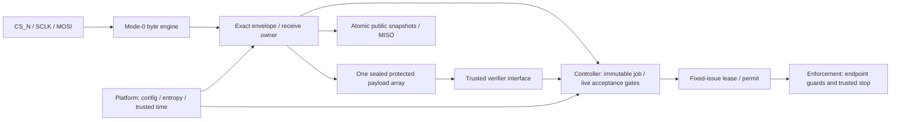

# SPI mailbox and sealed receive memory

The mode-0 SPI transport exposes exact public envelopes and coherent snapshots, and owns one 9,216-byte sealed receive memory. It handles sequential chunks, unique tokens, finish/abort, asynchronous outcomes and native time budgets. The complete device feeds sealed bytes to the real verifier. Isolated transport tests use an explicitly bounded software signature-verification interface.

The [v0.3 PDF](REINS-Hardware-Specification-v0.3.pdf) is normative. See the
[test guide](TESTING.md) for suite selection and [BUILD_NOTES.md](../BUILD_NOTES.md)
for historical build steps, source versions and measured run snapshots.

## Implementation decisions

- A public read snapshots all its bytes together when the argument byte has been
  received. READ_TX remains a coherent, non-consuming snapshot if its round
  expires during the transaction. Subsequent writes must still pass live-context
  checks. Defined read errors return an all-zero payload.
- Unknown opcodes, including 0x03, use a zero-length data field and BAD_COMMAND:
  their complete envelope is seven bytes. There is no READ_SESSION command.
- The result byte precedes CS deassertion. READY is consequently provisional:
  extra clocks, a nonzero incoming result byte, or an incomplete final byte can
  still invalidate the exchange. Only a valid CS boundary commits receive
  metadata. A malformed transaction never advances the accepted offset.
- The result code is frozen after receiving the data field, before its first
  transmitted bit. Both that reported code and the current CS-boundary checks
  must permit a write. An asynchronous BUSY-to-READY transition cannot tear a
  result byte or admit an operation that reported BUSY. A malformed read can
  already have shifted snapshot bytes before a later invalid MOSI byte is known;
  decode-time read errors return zeros, and later malformed framing never commits.
- Unsealed chunk bytes may be written before that boundary. Invalid/partial
  chunks leave only uncommitted bytes, which a retry overwrites. There is no
  second reply buffer and no consumer backpressure during reception.
- RX_BEGIN owns a transport token and immutable context. FINISH compares that
  context again before admitting a separate internal controller verifier token. Host
  tokens and internal verifier identities are distinct namespaces. Neither is
  a session or a signed wire field; both invalidate on real power loss, and
  transport tokens survive warm/cold logic resets without reuse.
- Rejection priority is malformed command/argument, lifecycle, existing owner,
  and stale/unavailable context. Wrong owner tokens/slots return STALE_CONTEXT;
  attempting a new upload against a sealed owner returns BUSY. A duplicate
  successful verification reports rejected/duplicate and cannot create a vote.
- A receive job expires at age 5,000,000 trusted ticks, including reception and
  both passes. A transaction of exactly 100,000 ticks is permitted; greater ages
  are invalid. Neither counter depends on SCLK, polling, traffic, or host time.
  Cancellation, reset, integrity failure and deadline loss dominate FINISH and
  completion. Transaction timeout invalidates that exchange; the owned job
  remains retryable until its original job/context deadline.

The simulation platform oversamples pins on the independent monitor clock.
The intended 4 MHz monitor / nominal 1 MHz trusted-reference profile uses at
least 20 monitor clocks per SCLK phase/setup and 40 between selections (100 kHz
maximum). Synchronizers and digital timing checks require subsequent CDC and
electrical qualification. The pad wrapper uses separate MISO data and output
enable; MISO is high impedance whenever CS_N is high.

## Protection boundary

The payload capacity is exactly 9,216 bytes. ECC/address/owner tags are additional
storage, as allowed by the specification. Each 32-bit payload word carries its
12-bit row address and full 64-bit owner token inside a 116-bit extended Hamming
code (108 payload/tag bits, seven Hamming checks and overall parity). The wrapper
detects all single/double codeword errors and rejects them; it never repairs
an input silently. Checking the stored row/owner also detects wrong-row reads
and stale rows from a previous owner. The RTL has one payload array and one write
port, with no host/debug write bypass.

Write enable requires independently checked receiving ownership, an unsealed
memory codeword, matching complemented address/token controls, and a canonical
write-enable code. Both verification passes use the sealed read interface.
Internal state/complement checks and ECC are digital research protections;
synthesis/layout preservation of independent paths and memory-macro qualification
remain necessary before any physical fault-resistance claim.

The exact storage calculation is 2,304 × 116 bits = **33,408 codeword bytes**:
9,216 bytes of payload and 24,192 bytes of ECC/address/owner overhead. Full owner
tags deliberately avoid truncated-generation collisions within a powered context.
Replacing the portable array with an efficient technology macro requires an
equivalent, reviewed protection scheme; no area or timing qualification is claimed.

## Files and integration

| Source | Role |
|---|---|
| `rtl/device/reins_spi_slave.sv` | Two-stage pin synchronization, mode-0 sampling, registered MISO bits, phase/setup/gap checks, protected bit/byte/transaction-age counters |
| `rtl/device/reins_spi_mailbox.sv` | Command decoding, atomic public snapshots, frozen result bytes, protected receive context, token/offset/budget ownership, sealing, cancellation and asynchronous outcomes |
| `rtl/device/reins_receive_sram.sv` | One payload array, extended Hamming code, row/full-owner tags, coded controls, checked addresses and independent write seal |
| `rtl/device/reins_spi_control.sv` | Qualified-platform controller/SPI composition for isolated controller testing |
| `rtl/device/reins_device_spi.sv` | Actual platform/controller/SPI composition; receive alarms enter the general fail-off path |
| `sim/include/reins/spi.h`, `sim/src/reference_spi.cc` | Independent C++ byte-transaction oracle using the event-driven software device |
| `sim/include/reins/spi_driver.h` | GPIO-only mode-0 host driver, including fresh deselected gaps after reset |
| `sim/include/reins/spi_test_support.h` | Isolated/full-platform pin harness, transcript scoreboard, actual-memory software verifier adapter and retained evidence |
| `sim/tests/spi_unit_tests.cc` | Basic public reads, framing and signed-response examples; controller test entry point |
| `sim/tests/spi_receive_tests.cc` | Quorum pairs, duplicates, withholding, canonical lengths, chunks/padding, rejection and both-pass write inhibition |
| `sim/tests/spi_lifecycle_tests.cc` | Native budgets, result/abort/deadline/reset races, old completions, counter/control faults |
| `sim/tests/spi_snapshot_tests.cc` | Atomic reads across state changes, all unsupported opcodes and lifecycle read/write errors |
| `sim/tests/spi_fuzz_tests.cc` | Seeded stateful byte mutations with a real signed corpus and complete receive jobs |
| `sim/tests/spi_integration_tests.cc` | Actual platform startup/configuration/time/entropy with pin-level ARM/RENEW, OTP/reset and sensor alarm |
| `sim/tests/receive_memory_unit_tests.cc` | Exact production memory wrapper, isolated exhaustive ECC and address/owner/seal/control fault cases |

All RTL is first-party code under the repository license. There is no imported
SPI core, new external cryptographic dependency, second payload buffer or CMake
build. The three new simulation tops isolate the controller, compose the actual
platform, and probe the exact memory wrapper respectively. The isolated memory
probe is not another receive buffer in the device.



`reins_device_spi` remains an internal device component. Physical pads, OTP/SRAM
macros, entropy sources and trusted enforcement are technology boundaries. Its
verifier ports must connect to protected hardware in a deployed design. No SPI
opcode reaches those ports or supplies a signature-verdict code. Only the
simulation tops expose them to the C++ adapter.

## SPI envelopes and public fields

Each transaction is `opcode || argument || zero[4] || data[D] || result` and
contains exactly **D+7 complete MSB-first bytes**. Incoming turnaround and result
bytes are zero. Reads also require zero incoming data bytes. MISO is zero during
the header/turnaround and write data; reads return the frozen payload and result.
CS_N rising is the only metadata commit boundary. A READY result is not a vote,
a grant, or execution permission.

| Opcode | Command | Argument | D |
|---|---|---|---:|
| `01` | READ_STATUS | 0 | 16 |
| `02` | READ_PUBLIC_CONFIG | Chunk 0..16 | 16 |
| `04` | READ_RX_STATE | 0 | 32 |
| `10` | READ_TX | Slot 0..2 | 128 |
| `20` | RX_BEGIN | Slot 0..2 | 4 |
| `21` | RX_CHUNK | Slot 0..2 | 80 |
| `22` | RX_FINISH | Slot 0..2 | 8 |
| `23` | RX_ABORT | Slot 0..2 | 8 |

All numbers in the opcode column are hexadecimal. Every other opcode, including
`03`, is unsupported. A checked public configuration must be available for
READ_PUBLIC_CONFIG; otherwise it returns UNAVAILABLE with a zero payload.

| Result | Code | Meaning |
|---|---:|---|
| READY | 0 | Exchange can complete, subject to its final CS/framing/live checks |
| BUSY | 1 | The one buffer is owned, or a sealed owner cannot accept a chunk/FINISH |
| UNAVAILABLE | 2 | No eligible request/context or checked public image is available |
| BAD_COMMAND | 3 | Unsupported opcode, with D=0 |
| BAD_ARGUMENT | 4 | Invalid argument/length/chunk/zeros/padding |
| LIFECYCLE_DENIED | 5 | Receive/request operation is not available in this lifecycle/configuration view |
| STALE_CONTEXT | 6 | Wrong/no owner, wrong token/slot, canceled or expired context |

READ_STATUS has the exact section-16.4 layout: interface=2, lifecycle 0/1/2,
state 0..6, flags, N/Q, TX-valid and RX-owner bitmaps, then a BE64 pending round.
Flags bit 0 is general fault, bit 1 checked OTP, bit 2 receive ownership and bit 4
entropy hold. **Bit 3 and bits 5–7 are always zero.** N/Q and bitmap bits are
limited to the checked fixed 3/2 profile. Public state uses the specification's
enum, not controller's internal sparse codewords.

READ_RX_STATE returns BE64 token, BE32 accepted offset, BE32 total, owner slot,
phase, outcome, reason, and twelve zero bytes. Public phases are idle=0,
receiving=1, verifying=2 and done=3. Outcome is pending/none=0, accepted vote=1,
rejected=2; reasons are none=0, format=1, signature/proof=2, stale=3, timeout=4,
duplicate=5 and integrity=6. An idle slot is `FF`. DONE retains token/total/offset
and outcome until the next accepted BEGIN or reset; ownership and its bitmap
are cleared. A below-quorum accepted vote still leaves execution disabled.

For example, an argument-1 depth-zero BEGIN sends
`20 01 00 00 00 00 00 00 1e b4 00`: four data bytes encode total 7,860,
not a child key, grant body, signature prefix or session. Poll READ_RX_STATE for
the allocated token. READ_TX does not consume a request; relays must tolerate
a coherent old snapshot and a later STALE_CONTEXT after rollover or expiry.

## Receive state and memory operation

The mailbox owns `owner_q` and its complemented copy: sparse phase, nonzero SPI
token, slot, run/round/job context, exact request, C_cfg, total, accepted offset,
and completed outcome/reason. `next_token_q` and its complement retain powered
identity across logic resets. Zero/exhausted/inconsistent counters fail off;
they never wrap into a reused live token. Age has its own complemented counter.

1. A complete valid BEGIN validates `T=7860+32d`, `0<=d<=20`, captures the live
   context and owns the single buffer. The reply carries signature[7856], BE32
   leaf index, then exactly d proof nodes. T ranges from 7,860 to 8,500 bytes.
2. CHUNK carries BE64 token, BE32 absolute offset, BE16 count, zero[2], data[64].
   Count is 1..64; offset is exactly next; addition must not wrap or exceed T;
   all padding beyond count is zero. Uncommitted bytes can be written as they
   arrive, but only a valid final CS advances the accepted offset. A retry
   preserves the accepted prefix and overwrites its uncommitted suffix.
3. FINISH requires all T bytes and the original live context at the final edge.
   It seals the entire array and admits controller's separately identified internal job.
   The seal remains across and between both complete passes, without streaming
   hashing concurrent with reception.
4. The verifier reads checked byte addresses through `read_valid_i`,
   `read_address_i` and its complement. `read_valid_o`/`read_data_o` form a
   combinational checked response in this portable profile; the adapter consumes
   one byte per monitor clock. Unsealed, out-of-range, corrupt, wrong-row and
   wrong-owner reads yield no valid data and fail off when they reach this port.
   A technology macro with registered reads needs a reviewed bounded adapter.
5. controller accepts only its own full immutable completion identity, correct pass
   ordering and codes, current context, strict deadline and a previously unvoted
   slot. SPI maps its asynchronous result to the exact public outcome. A valid
   repeated slot reports duplicate instead of a new vote.
6. Abort, expiry, entropy hold, reset, stop and faults invalidate work before
   ownership reuse. SPI drives matching internal cancellation into controller before
   a competing commit edge. Late old completions cannot release a new owner.

The write port independently requires receiving state, valid complementary
address/owner controls and the exact internal `C3` write code. Its address check
uses separate arithmetic on complemented accepted-offset and captured byte-counter
state. A word's first byte initializes its uncommitted row; later bytes check
and update the existing codeword while preserving accepted bytes. Stored row and
full owner tags reject substituted/stale codewords within the powered context.
Real power loss can reuse volatile identities; fresh platform nonce qualification and
the full local request remain essential for cross-power replay rejection.

The SRAM is not scrubbed on reset. Data is public, and stale contents cannot
supply a complete new job through the protected receive protocol. Simulation-only
`public_flat_rw` annotations expose selected storage to fault tests, not to any
production pad, host/debug port or synthesizable write bypass.

## Time and reset priority

Transaction age begins at synchronized selection. The 100,000-tick limit is
inclusive; native counter tests place CS completion at that limit and the first
rejected tick. Partial bits, extra/short bytes, wrong zeros, invalid clock polarity
or timing violations prevent commit. After timeout the slave ignores the rest of
that selection until CS returns high.

Job age begins at the accepted BEGIN edge and expires at **5,000,000 ticks**.
Receiving, first pass, second pass, stalls, polls and chunks all consume the same
budget. FINISH, polls and new chunks cannot restart it. Context deadline/rollover
can cancel sooner. The integration supplies trusted reference-A events even when
compute is stopped; SCLK never advances or gates enforcement time.

Fault, cancellation and timeout dominate FINISH and verification. A final good
pass at the job deadline is rejected. Warm/retained cold reset invalidates public
receive state, both pass ownerships and the seal, but retains SPI-token uniqueness.
Warm reset also invalidates platform's cached configuration check until startup
requalification; it does not rewrite closed OTP or clear entropy hold. Only
trusted cold qualification can clear the general integrity latch. There is no
host reset/stop acknowledgement/hold-clear opcode.

An entropy hold cancels receive work and new grants while preserving a previously
healthy controller lease only to its original expiry. General integrity/timing/sensor
faults withdraw permit immediately. SPI reads remain advisory even when a
coherent status snapshot describes a state that has since changed.

## Build, tests and retained results

Use the prerequisites and Make workflow in the [root README](../README.md):

```sh
make build
make quick-tests
make tests
make spi-tests
make spi-tests TEST_FILTER='*atomic*,*budget*'
REINS_SPI_SEED=12345 make spi-tests
REINS_SPI_TRACE=1 make RTL_TRACE=1 spi-tests
make sanitize-tests
```

`spi-tests` selects only the three new test groups, with the same disk collector
as normal testing. Its filter affects controller cases; integration and memory
checks still run. Zero selected cases fail. `quick-tests` omits the extended
1,000-action byte fuzz case but retains native budgets, all quorum pairs,
integration and exhaustive ECC. These are actual pin/clock simulations; directed
tests can take several minutes and signature computations run on the host CPU.
The collector allows twenty minutes for a build and each release controller/
integration group. ASan/UBSan also instrument the generated simulator, so those
groups allow two hours under sanitizers. A focused run such as
`make SANITIZE=1 spi-tests TEST_FILTER='*atomic*,*signed*'` limits controller
cases while retaining all integration/memory checks. Hardware tick deadlines
are unchanged. Per-group limits still detect hangs; diagnostics remain on disk.
The mailbox uses clocked immediate assertions to retain its pre-update checks on
Verilator 5.008 without its large packed-struct concurrent-assertion sampling
code-generation defect. No assertions or warning classes are disabled for
compatibility.

| Group | Evidence |
|---|---|
| `spi-unit` | Public reads/configuration and all seven results; eight legal commands and all 248 unsupported opcodes; full signed uploads and every quorum pair; duplicates/withholding; lengths/chunks/padding; both-pass write inhibition; native budgets and at/after limits; reset/abort/rollover/result races; atomic snapshots; counter/control faults; seeded byte fuzz |
| `spi-integration` | Actual platform OTP/hash/source-health/conditioning/time connected to controller/SPI; pin-level ARM and RENEW; warm requalification preserves closed OTP and rejects old tokens; sensor fault withdraws permit during a selected exchange |
| `receive-memory-unit` | Every one-bit and distinct two-bit codeword corruption; wrong-row and stale-owner substitutions; read/write address complements, bounds and write codes; sealed write inhibition and corrupted seal state |

Each run creates a unique `test-results/<UTC>-<suite>-<configuration>-*/`.
`summary.json` and `junit.xml` retain group commands/counts/status/timing;
`build/output.log` retains compiler output. Each SPI group keeps `output.log`,
`test-output.log`, `performance.json`, `events.jsonl` and coverage files.
The controller/integration trace option writes a bounded first-model `spi.fst`
covering 16,384 monitor clocks. Private test signing keys are never serialized.

SPI JSONL records retain complete MOSI/MISO, partial-bit counts, timestamps and
accepted offsets. The fuzz corpus record includes public OTP/request/reply data,
seed and final action counts, so the exact public mutation input can be replayed
without original private keys. Signed requests are printed before upload and
again before each actual memory-backed verification, including negative cases.
The isolated memory log records 116 single-bit and 6,670 distinct double-bit
cases explicitly. Outputs are removed only by an explicit clean target.

`performance.json` records the actual Verilator/OpenSSL versions, replay seed,
monitor clocks/models, admitted/completed/canceled verifier ownership, adapter
pass evaluations and host wall throughput. The independent software oracle also
performs its own verifications. These measurements do not estimate full-RTL
SLH-DSA timing or a physical clock floor. No signing/verifying private keys for
the supplied original fixtures are assumed or generated into the checkout.
