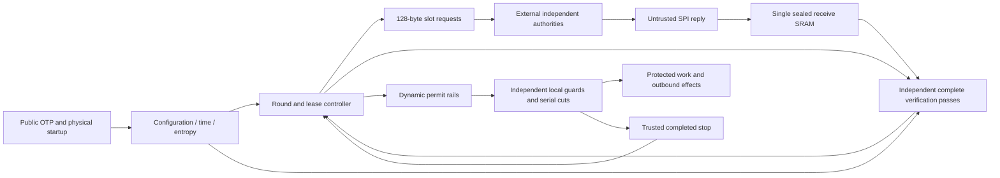

# REINS hardware architecture

The complete device is [`reins_device.sv`](device/reins_device.sv). It connects
configuration/startup, trusted time and fresh entropy, SPI/sealed reception,
independent two-pass signature verification, lease/quorum control and local
endpoint enforcement. Authorization is computed in hardware; the production top
has no software-verdict or host stop-acknowledgement input.

The fixed profile is **N=3, Q=2**, wire/SPI/schema version 2,
**SLH-DSA-SHA2-128s, pure mode, empty context**. The
[normative PDF](../docs/REINS-Hardware-Specification-v0.3.pdf) defines the protocol.

## Source organization

| Directory/file | Role |
|---|---|
| [`device/`](device) | Device implementation and reusable hardware components |
| [`device/files.f`](device/files.f) | Explicit device-only source list, with paths relative to the repository root |
| [`test/`](test/README.md) | Unit/integration tops, behavioral OTP model, fault declarations and reset testbench |
| [`test/formal/`](test/formal) | Scoped symbolic harnesses over actual implementation state |
| [`sim/`](../sim/README.md) | C++ drivers, independent expected results, scoreboards, test cases and public fixtures |

Intermediate composition modules expose trusted component interfaces. Only
`reins_device` is the complete production authorization boundary. Bare-device
build/lint consume `device/files.f`; simulation models and fault injectors are
excluded. Baseline/lint checks audit the source split and coverage counts only
`rtl/device/` points.

## Data and control flow



## Device source map

| Sources in `device/` | Responsibility | Detailed guide |
|---|---|---|
| `reins_device.sv` | Complete production composition and live final acceptance gates | [Two-pass/device verification](../docs/TWO_PASS_VERIFIER.md) |
| `reins_config.sv` | Public OTP schema, field/key distinctness, configuration hash and commissioning/closure checks | [Platform](../docs/PLATFORM.md) |
| `reins_trusted_time.sv`, `reins_source_health.sv`, `reins_entropy.sv`, `reins_platform_control.sv` | Trusted progress, digital source health, fresh dual conditioning, repeat history, sticky hold and startup/reset | [Platform](../docs/PLATFORM.md) |
| `reins_round_schedule.sv`, `reins_lease_check.sv`, `reins_controller.sv`, `reins_device_control.sv` | Checked schedules, one pending context, exact requests, distinct votes, fixed-issue leases and cancellation | [Controller](../docs/CONTROLLER.md) |
| `reins_spi_slave.sv`, `reins_spi_mailbox.sv`, `reins_receive_sram.sv`, `reins_spi_control.sv`, `reins_device_spi.sv` | Mode-0 pins, exact envelopes/snapshots, tokens/chunks/timeouts and one sealed ECC/address-protected receive memory | [SPI and memory](../docs/SPI.md) |
| `reins_expected_grant.sv`, `reins_merkle_pass.sv`, `reins_merkle_pair.sv` | Locally constructed grants, configuration binding, canonical proofs and independent batch-root reconstruction | [Merkle](../docs/MERKLE.md) |
| `sha256_compress.sv`, `sha256_message.sv` | Iterative compression, arbitrary chaining state, message framing/padding and bounded completion | [SHA-256](../docs/SHA256.md) |
| `slh_address.sv`, `slh_wots_digits.sv`, `slh_sha256_stream.sv`, `slh_hash_transaction.sv`, `slh_message_hash.sv`, `slh_wots.sv` | FIPS addressing, pure framing, H_msg/MGF1, protected hashing and WOTS+ digits/checksum/chains | [SLH components](../docs/SLH_COMPONENTS.md) |
| `slh_verify.sv`, `slh_verify_reins.sv` | FORS, seven hypertree layers, scratch/read accounting, reconstructed PK.root and strict production profile | [Single-pass signature verifier](../docs/SIGNATURE_VERIFIER.md) |
| `reins_verifier_pass.sv`, `reins_verifier.sv` | Independent complete passes, exact work/stage/address observations, separate captures and protected acceptance join | [Two-pass verifier](../docs/TWO_PASS_VERIFIER.md) |
| `reins_permit_source.sv`, `reins_permit_guard_a.sv`, `reins_permit_guard_b.sv`, `reins_endpoint_actuator.sv` | Dynamic authorization rails and dissimilar local watchdog/actuation paths | [Enforcement](../docs/ENFORCEMENT.md) |
| `reins_clock_isolation.sv`, `reins_transaction_isolation.sv`, `reins_endpoint_queue.sv`, `reins_protected_endpoint.sv` | Serial local cuts, contained queues and representative CPU/accelerator/DMA work/transaction generators | [Enforcement](../docs/ENFORCEMENT.md) |
| `reins_enforcement_bank.sv`, `reins_enforcement_profile.sv`, `reins_device_enforced.sv` | Endpoint composition, clock/bound compatibility, trusted stop certificate and management availability | [Enforcement](../docs/ENFORCEMENT.md) |

## Interfaces and ownership

All authorization context is locally constructed and checked. The reply carries
only the signature, leaf index and siblings. The batch root authenticated by the
signature is distinct from the reconstructed SLH public-key root.

There is one **9,216-byte logical receive SRAM**. A receive job owns it from
BEGIN through both verification passes or cancellation. Complete bytes must be
sealed before verification; all payload writes are inhibited during either pass.
Each pass reconstructs its own configuration binding, expected grant, proof root
and signature result. No unchecked digest, decoded control or scratch success
crosses between passes.

The controller fixes `I=(r-1)*P`, `B=I+W`, `E=I+L`. Entropy delay, chunks, polls,
partial votes and cryptographic work cannot move those values. Faults, expiry
and cancellation dominate simultaneous commit. Two distinct authority slots are
required; duplicate votes cannot make a quorum.

Protected state uses checked arithmetic, dissimilar redundant stores/updates,
separate capture phases and sparse encodings. The
[protected-state guide](../docs/PROTECTED_STATE.md) describes the fault domains,
minimum Hamming-distance audit and boundaries that need physical preservation.

## Clocks, reset and technology boundaries

Always-on time/enforcement must continue while protected compute stops. Local
guards use independent timing paths and two serial isolation paths at each
modeled endpoint. Stop completion is derived from actual local closure and empty
queues, rather than from a host command.

The digital platform consumes technology OTP, raw entropy events, reference
progress and health/sensor inputs. Cold, warm and actual power-loss behavior
have separate retention rules. Deterministic simulation source bits do not supply
physical entropy. Target SRAM/OTP macros, real clocks/sensors, reset distribution,
CDC/RDC, physical separation and stop timing require platform qualification.

## Build and test

Use the root Makefile with **Verilator 5.008** selected:

```sh
make build
make unit-tests
make integration-tests
make rtl-lint
make production-tests
```

`make help` and the [test guide](../docs/TESTING.md) identify individual units.
`production-tests` builds the bare top and an external SPI harness without
assertion/coverage/trace instrumentation, audits generated commands and exercises
real ARM/RENEW signatures. Functional protection logic remains hardware in both
instrumented and normal builds.

`formal-checks` exercises scoped properties over arithmetic, trusted time, sealing,
controller cancellation/commit priority and local guards. `synthesis-checks` runs
generic component synthesis; `reset-checks` uses Icarus for local four-state
checks. `cdc-review` produces an inventory marked for manual review. These are
separate evidence categories, not whole-device physical signoff.

Current limits are in [REMAINING_WORK.md](../docs/REMAINING_WORK.md).
Intermediate build stages and historical measurements are preserved in
[BUILD_NOTES.md](../BUILD_NOTES.md).
