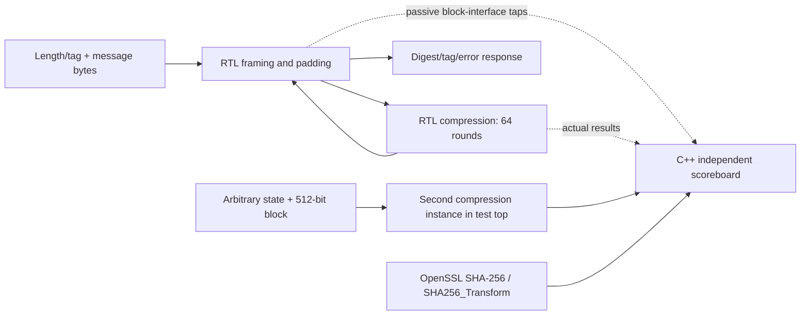

# REINS RTL: hashing and platform control

R04 supplies real SystemVerilog SHA-256 hardware and C++ tests on Verilator.
R03 protected primitives and general fault-injection infrastructure are deferred.
R05 uses that hashing core for public OTP validation and fresh two-source entropy
conditioning, with configuration lifecycle, reset/startup, independent trusted
time and a health/expiry gate. The [R05 profile](../docs/R05_PLATFORM_PROFILE.md)
fully documents its technology interfaces, raw sample counts/cutoffs and framing.
R06 now supplies the actual operational quorum/lease controller and connects that
R05 gate internally. Its [controller guide](../docs/R06_CONTROLLER.md) describes
the exact request/job interfaces, tick priority, mirrored state and independent
age/remaining checks. Signature verification is software-backed in these tests;
real verifier hardware and R03 physical protections remain later work.
R07 adds [mode-0 SPI and sealed receive memory](../docs/R07_SPI_RECEIVE.md), with
an independent C++ byte oracle, native transaction/job budgets, protected ownership
and memory-backed verification tests. R08 wraps it in the complete current
[`reins_device_enforced.sv`](reins_device_enforced.sv), with independently enforcing
local guards, representative work/transaction generators and trusted stop
completion derived from actual modeled cells and queues. See the
[R08 enforcement profile](../docs/R08_ENDPOINT_ENFORCEMENT.md).
R09 adds independent expected-grant/configuration/Merkle stages, each with its own
real SHA core and fresh sealed-memory proof reads. The
[R09 guide](../docs/R09_MERKLE.md) defines exact framing, evidence/provenance,
construction and hand-off checks, and the software SLH signature boundary.
R10a now supplies real SLH addresses, production pure framing, H_msg/MGF1 and
WOTS+ chains/public-key reconstruction. Its [component guide](../docs/R10A_SLH_COMPONENTS.md)
documents interfaces, prefix state, exact counts and independent intermediates.
R10b completes single-pass SLH verification with FORS, all seven hypertree layers
and a strict REINS gate; see the [verifier guide](../docs/R10B_SLH_VERIFIER.md).

## Files and architecture

| File | Purpose |
|---|---|
| [sha256_compress.sv](sha256_compress.sv) | One SHA-256 compression from an arbitrary chaining state and one 512-bit block |
| [sha256_message.sv](sha256_message.sv) | Bounded byte-stream input, standard IV, block chaining, padding and message completion |
| [sha256_test_top.sv](../sim/rtl/sha256_test_top.sv) | Simulation-only top exposing both public interfaces and passive internal block-interface taps |
| [sha256_rtl_tests.cc](../sim/tests/sha256_rtl_tests.cc) | Clock driver, independent pin scoreboard, OpenSSL oracle, directed tests, seeded fuzz, logs and measurements |
| [SHA core selection review](../third_party/sha256-core-review.md) | License, behavior and integration review of a reusable candidate; reason for a first-party implementation |



The production modules implement the equations in
[FIPS 180-4](https://nvlpubs.nist.gov/nistpubs/FIPS/NIST.FIPS.180-4.pdf). No third-party
RTL is imported, and the modules use the repository's [license](../LICENSE).
The host never supplies computed results to the RTL. The message wrapper uses
one compression instance; the test top has another for independent block tests.

## Clock, reset and transfer rules

Both modules use a rising-edge clock and **synchronous active-low reset**. Holding
`rst_ni=0` at a rising edge cancels pending work, discards retained output and
clears volatile data/tag registers. Reset is required before the first request.
Request-ready is low during reset. There is no reset acknowledgement or persistent
job state; the caller must invalidate its own outstanding transaction on reset.

Every transfer requires **valid and ready at the same rising edge**. A producer
holds valid and payload stable until acceptance; a consumer can apply
backpressure by withholding response-ready. Each module admits one outstanding
request. Valid asserted while ready is low does not start extra work. Results and
their metadata remain stable until acknowledged; no new request is accepted on
the edge consuming the old response. Tags are opaque 32-bit caller identities,
not protected generations or REINS wire fields.

### Compression interface

| Ports | Contract |
|---|---|
| `req_valid_i`, `req_ready_o` | Accept one complete state/block/tag atomically |
| `req_state_i[255:0]` | Eight input chaining words: H0 in bits 255:224 through H7 in bits 31:0 |
| `req_block_i[511:0]` | Exactly 64 bytes, first byte in bits 511:504; no automatic padding |
| `req_tag_i[31:0]` | Identity captured with the state and block |
| `rsp_valid_o`, `rsp_ready_i` | Retain and acknowledge one completed compression |
| `rsp_state_o[255:0]`, `rsp_tag_o[31:0]` | Feed-forward result and captured identity |
| `start_o`, `complete_o` | One-cycle diagnostic pulses for acceptance and first result production; not fault protection |

The core captures input on edge 0 and performs rounds 0..63 on edges 1..64.
The first valid result appears just after edge **64**, including feed-forward
addition. With response-ready already high, consumption occurs on edge 65 and
another request can be accepted on edge 66. Backpressure lengthens transaction
occupancy but does not change the 64-cycle computation latency.

`base_q` retains the original eight state words. `work_q` holds a..h, `round_q`
selects the round constant, and `window_q` is a 16-word sliding message schedule.
`rsp_state_o` is retained independently of changes on request pins. The harness
checks arbitrary states through OpenSSL's compression-only `SHA256_Transform`;
it never substitutes a whole-message hash for this operation.

### Message interface and bounds

| Ports / parameters | Contract |
|---|---|
| `req_valid_i`, `req_ready_o` | Capture length and tag before accepting bytes |
| `req_length_i[31:0]`, `req_tag_i[31:0]` | Byte count and response identity; zero length hashes an empty message |
| `byte_valid_i`, `byte_ready_o`, `byte_i[7:0]` | Exactly the declared number of bytes, in order; ready is low while compressing/padding |
| `rsp_valid_o`, `rsp_ready_i` | Retained message completion, including failures |
| `rsp_digest_o[255:0]`, `rsp_tag_o[31:0]` | Big-endian digest and captured tag; digest is zero on an error |
| `rsp_error_o[1:0]` | 0 success; 1 excessive length; 2 missing-byte timeout; 3 invalid control state fallback |
| `compression_start_o`, `compression_complete_o` | Passive physical compression acceptance/completion pulses; R09 audits actual work independently of message completion |
| `MAX_MESSAGE_BYTES` | Default 9,216; a transaction bound, not a receive-SRAM implementation |
| `MAX_INPUT_STALL` | Default 1,024 consecutive clocks awaiting a byte; must be positive |

The wrapper captures length/tag, initializes the SHA-256 IV and receives bytes
into one 512-bit register. It compresses full blocks and chains the results. At
the end it inserts `0x80`, zero filling and a 64-bit big-endian **bit length**.
Remainders 0..55 require one padding block; remainders 56..63 require two.
An exact multiple of 64 still needs a padding block. Length is extended to 64
bits before multiplying by eight. Only byte-aligned SHA-256 messages are supported.

A length above the bound produces an error immediately after header acceptance,
consumes no bytes and starts no compression. Missing-byte timeout counts only
LOAD clocks without an accepted byte. A byte accepted on the 1,024th such edge
takes precedence over timeout; 1,024 consecutive missing-byte edges return error
2. The counter resets after each byte and does not advance during compression.
This bounds active processing when a producer disappears. Output can remain
pending indefinitely under consumer backpressure; no module can force a consumer
to acknowledge. Extra bytes while byte-ready is low are not accepted.

After acknowledging an error, a new message begins with clean IV, block, byte
count and padding state. The wrapper is intended for bounded REINS submessages;
the compression interface remains available for other framing or longer streams.

## Build, tests and retained artifacts

From the repository root, install the prerequisites in the [root README](../README.md),
including **Verilator 5+**; the tested baseline is **5.032**. Use GNU Make:

```sh
make build
make quick-tests
make tests
make sanitize-tests JOBS=2
```

`make rtl-build` builds all thirteen SHA and R05–R10b component/integration test executables, including the C++ oracle
objects needed by R05; `make software-build` builds the independent software
simulator. Normal build includes all of them. Builds
enable SystemVerilog assertions, fatal RTL lint warnings and line coverage.
The `rtl-lint` group separately checks production modules with assertions and
with `SYNTHESIS` defined, excluding both the test top and simulation assertions.
This is elaboration/lint evidence, not an area/timing or technology-mapping result.
The Make test collector retains every run, including build failures. The
`sha256-rtl` group contains:

| Artifact | Contents |
|---|---|
| `output.log`, `test-output.log` | doctest cases/assertions, known-answer expectations and actual performance |
| `transactions.jsonl` | Public compression state/block inputs, result/latency records, message inputs and response metadata |
| `performance.json` | `rtl-sha256` mode, tool/oracle versions, seed, actual cycle counts, observed starts/results/consumptions/cancellations, ownership balance, wall time and cycles/second |
| `coverage/bench-*.dat` | Line coverage for each separately constructed Verilated model |
| `sha256.fst` | Optional bounded waveform when explicitly enabled |

No automatic cleanup deletes old runs. Use explicit `make clean-results` or
`make clean` when ready to remove them. Direct executable runs also create a
retained `test-results/manual-sha256-*` directory, but Make is the normal interface.

The default seed is fixed and recorded. Replay another deterministic fuzz stream:

```sh
REINS_SHA_SEED=12345 make tests
```

To save an FST trace of the first model's first 4,096 clocks:

```sh
REINS_SHA_TRACE=1 make RTL_TRACE=1 quick-tests
```

`RTL_TRACE=1` enables trace code at build time; `REINS_SHA_TRACE=1` enables dumping
at runtime. Later models do not open new waveforms. Return to an ordinary build
by running Make without those settings; build configuration changes trigger a
rebuild. A trace request against a non-trace build fails explicitly.

## Evidence and limits

Directed cases check published empty/abc/56-byte/112-byte answers, every length
0..193, longer multi-block messages through 9,216 bytes, fixed and walking-bit
chaining states/blocks, immutable capture, retained output, invalid lengths, exact stall
boundaries, busy/valid glitches and reset in receive/computation/output phases.
The full suite adds 2,048 random state/block cases and 256 random bounded messages
with randomized input gaps and output backpressure. Seeds and inputs are retained.

The C++ scoreboard independently observes valid/ready pin transfers. It checks
every accepted block against the independent oracle and checks first result
visibility at 64 clocks. Separate passive taps observe the wrapper's actual
compression requests, payloads, chaining states and completions; expected padded
blocks are constructed independently in C++. A diagnostic pulse alone cannot
satisfy these checks. Resets cancel observed ownership explicitly.
The report separately counts first results and response consumption; a result
held under backpressure is not a second completion. Across the full run, accepted
starts must equal consumed responses plus reset-cancelled ownership for both
compression and message interfaces, or the harness fails.

Input corruption is compared with both the modified-input oracle and the original
digest. Output corruption changes sampled digest bits, tag and first-result timing
and exercises the same independent validator used by the pin scoreboard,
including its specific rejection outcomes. Control cases perturb actual interface
valid/ready/reset pins. These are interface-corruption tests, not internal
register fault injection or hardware error-detection guarantees: an ordinary
hash core correctly hashes corrupted accepted input. Sparse/redundant encodings,
protected counters/storage, stable internal injection sites and persistent-fault
campaigns remain in deferred R03. The error-3 fallback is not a complete control
integrity scheme.

The performance report measures real simulated edges, not a configured latency.
Its throughput includes the host oracle, assertions, coverage, test driver and
artifact logging; it is not a silicon frequency or end-to-end SLH-DSA measurement.
R04 alone does not establish safe SHA sharing between verification passes,
independent acceptance paths, a REINS controller, physical enforcement or safe
platform integration.

## R05 configuration, reset, time and entropy control

[`reins_platform_control.sv`](reins_platform_control.sv) integrates four component
types. The production port comments specify each input/output; the
[platform profile](../docs/R05_PLATFORM_PROFILE.md) gives the complete schema,
reset matrix, source framing, sample accounting and wrapper obligations.

| Module | State and role |
|---|---|
| [`reins_config.sv`](reins_config.sv) | Checked 272-byte snapshot and digest; fixed N=3/Q=2/schema/profile/timing/distinctness checks; physically enabled programming and permanent-close requests |
| [`reins_trusted_time.sv`](reins_trusted_time.sv) | Two reference progress monitors, startup qualification and nonwrapping 64-bit local ticks independent of crypto/host |
| [`reins_source_health.sv`](reins_source_health.sv) | Per-source startup/availability, binary repetition and proportion tests, required-event timeout |
| [`reins_entropy.sv`](reins_entropy.sv) | Per-draw fresh buffers, dedicated SHA conditioning, retained previous nonce and sticky hold |
| [`reins_platform_control.sv`](reins_platform_control.sv) | Startup sequencing, generation, immediate general-fault gate and original-expiry gate on R06's trusted internal lease |
| [`reins_otp_model.sv`](../sim/rtl/reins_otp_model.sv) | Simulation-only retained logical OTP/lifecycle wrapper |
| [`r05_test_top.sv`](../sim/rtl/r05_test_top.sv) | Simulation-only integration and passive actual-SHA observations |
| [`r05_rtl_tests.cc`](../sim/tests/r05_rtl_tests.cc) | Independent parser/health/hash checks, signed reference leases, directed and seeded timeline tests |

The controller starts off and stays off for open/invalid OTP. It checks all bytes
of closed OTP, both timing references and both raw sources before starting local
time and collecting a fresh first nonce. Recognized cold reset only permits this
qualification sequence; it never grants execution by itself. Warm reset cancels
work and removes permission but cannot clear hold or retained repeat history.
Actual power loss loses that volatile history while preserving the modeled OTP.

An **entropy hold** blocks fresh authorization and invalidates pending work while
letting a previously healthy lease expire at its original deadline. General
timing, sensor or integrity alarms withdraw permission immediately. R05's lease
ports are an internal interface connected to the R06 vote/commit controller; they
are not an authorization command or a host bypass. The R05 component cannot
authorize execution on its own.

Tests count real accepted SHA transfers and compare exact conditioner/configuration
bytes and digests against independent host code. `r05-rtl/` retains its own logs,
`conditioner-events.jsonl`, `performance.json`, line coverage and optional FST.
Replay seeded timelines with `REINS_R05_SEED=12345 make tests`; save a bounded
waveform with `REINS_R05_TRACE=1 make RTL_TRACE=1 quick-tests`. Both RTL groups
always run through `make quick-tests`/`make tests`; only extended fuzz is omitted
from quick tests.

Two predictable test sources each contribute 384 raw bits to a documented
124-byte SHA frame. These counts and health thresholds are **unassessed digital
settings**: passing tests supplies no evidence of physical entropy, source
independence, clock floor or actual stop latency. Production integration must
replace/qualify the physical OTP, reset, reference, source, sensor and enforcement
interfaces. R03 protected replicas/internal fault campaigns remain deferred.

## R06 operational controller and R05 composition

| Module | State and role |
|---|---|
| [`reins_round_schedule.sv`](reins_round_schedule.sv) | Exact checked `(r-1)*P`, I+W, I+L and next issue |
| [`reins_lease_check.sv`](reins_lease_check.sv) | Independent age/remaining consistency, complemented values and strict expiry |
| [`reins_controller.sv`](reins_controller.sv) | Sparse operational FSM, mirrored pending/job contexts, 128-byte requests, distinct bitmap, fixed-issue commits, down-counter and cancellation |
| [`reins_device_control.sv`](reins_device_control.sv) | Production R05/R06 composition with internally owned lease, scheduled draws and trusted completed-stop restart |

The simulation-only [`r06_test_top.sv`](../sim/rtl/r06_test_top.sv) drives qualified
platform inputs and the internal software-verifier boundary. The separate
[`r06_integration_top.sv`](../sim/rtl/r06_integration_top.sv) exercises real R05
configuration/source/time/SHA startup plus R06. Their C++ drivers submit actual
immutable job bytes to two independently computed software verification passes;
the real controller checks full identity, hold, current deadline/expiry and
distinct votes at the final boundary. Only a valid second distinct vote commits.

An advancing trusted tick is included in the edge's deadline/expiry checks.
Nonce delay, partial votes and verifier backpressure cannot move I/B/E. A completed
trusted stop precedes every fresh run; a host startup request cannot acknowledge
physical stopping. Pending work is canceled before ownership can be reused, and
stale completions cannot release a new job or add votes. Actual power loss may
reuse internal IDs, so fresh nonce qualification remains essential.

Run `make tests` for directed tests plus 24 seeded stateful trials comparing the
real controller to C++ requests/votes/leases. `REINS_R06_SEED=12345 make tests`
replays another stream; `REINS_R06_TRACE=1 make RTL_TRACE=1 quick-tests` saves
bounded FST traces. Both groups retain public job inputs, event/replay records,
coverage, tool/mode/seed and ownership/performance measurements.

The [R06 guide](../docs/R06_CONTROLLER.md) documents all interfaces and evidence
limits. Digital mirrors and sparse encodings do not establish synthesis-preserved
independent replicas, common fan-out fault containment or physical enforcement.
R03 remains deferred; signature hardware and guards remain later milestones.
These production components are not a finished chip top.

## R07 SPI and sealed receive memory

| File | Responsibility |
|---|---|
| [`reins_spi_slave.sv`](reins_spi_slave.sv) | Mode-0 synchronized pad sampling, MSB-first bytes, timing/framing checks and the independent 100,000-tick transaction limit |
| [`reins_spi_mailbox.sv`](reins_spi_mailbox.sv) | Exact eight-command table, frozen public/result snapshots, BEGIN/token/context ownership, sequential chunks, FINISH/ABORT, asynchronous outcomes and absolute 5,000,000-tick budget |
| [`reins_receive_sram.sv`](reins_receive_sram.sv) | One 9,216-byte payload, SECDED-protected row/owner tags, checked address/control interfaces and independent seal/write inhibition |
| [`reins_spi_control.sv`](reins_spi_control.sv) | Qualified-platform R06/R07 composition used by isolated pin tests |
| [`reins_device_spi.sv`](reins_device_spi.sv) | Actual R05/R06/R07 composition; receive integrity feeds the general fail-off path |

The pad wrapper must use `miso_o` and `miso_oe_o` to drive high impedance whenever
CS_N is high. At the nominal simulation assignment of 4 MHz monitor / 1 MHz
trusted reference, use at least 20 monitor clocks per phase/setup and 40 between
selections. Physical electrical/CDC qualification remains external work.

No SPI command reaches a verifier completion or acknowledges physical stop.
Only a complete, live FINISH seals the entire reply and admits an internal R06
job. Every accepted vote still requires two independently computed verification
passes and R06's live context/time/distinctness checks. The SPI token is a separate
powered-context namespace from R06's internal verifier token. Invalid or partial
transactions cannot advance the committed byte offset; the uncommitted tail is
overwritten on retry. Sealing blocks the sole payload write port between and
during both passes.

The [R07 guide](../docs/R07_SPI_RECEIVE.md) includes every command/result layout,
state and token ownership, the 33,408-byte protected-codeword storage calculation,
native timeout boundaries, error/snapshot decisions and the test evidence.
Run `make r07-tests`; each group retains logs, public replay data, coverage and
measurements. The isolated memory group exhausts all 116 single-bit and 6,670
distinct double-bit codeword faults. GPIO tests add byte fuzzing, cancellation/
reset/rollover races, seal/address/control faults and every quorum pair.
These declared digital checks do not establish deferred R03 physical independence,
synthesis preservation, a qualified SRAM macro or a silicon stopping bound.

## R08 dynamic permit and endpoint enforcement

| File | Interface and state |
|---|---|
| [`reins_permit_source.sv`](reins_permit_source.sv) | Two independently qualified 500-tick transition rails; separate up/down counters and complements; withdrawal holds levels |
| [`reins_permit_guard_a.sv`](reins_permit_guard_a.sv) | Local two-edge qualification, up-counter missing/fast-edge detector, sparse code 96/69 |
| [`reins_permit_guard_b.sv`](reins_permit_guard_b.sv) | Separate synchronizers and down-counter detector on independent local clock; code a5/5a |
| [`reins_endpoint_actuator.sv`](reins_endpoint_actuator.sv) | One path's protected OPEN/CLOSING/CLOSED state; isolate/reset before clock clamp; no reopening during closing |
| [`reins_clock_isolation.sv`](reins_clock_isolation.sv) | Technology wrapper: fail-off clamp, falling-edge release, actual modeled gate readback; two serial instances per endpoint |
| [`reins_transaction_isolation.sv`](reins_transaction_isolation.sv) | One independent final outbound cut and fresh-generation check; no downstream queue storage |
| [`reins_endpoint_queue.sv`](reins_endpoint_queue.sv) | One-outstanding bundled mailbox and four-entry always-on queue, complementary metadata, independent purge |
| [`reins_protected_endpoint.sv`](reins_protected_endpoint.sv) | Representative CPU/accelerator/DMA generator with two serial clock cells and two final outbound cuts |
| [`reins_enforcement_bank.sv`](reins_enforcement_bank.sv) | Three endpoints/six local guards, fresh ARM epochs, synchronized closure/empty readback, four-sample trusted stop certificate and sticky fault |
| [`reins_enforcement_profile.sv`](reins_enforcement_profile.sv) | Checked OTP compatibility with actual platform frequency/guard/actuation promises |
| [`reins_device_enforced.sv`](reins_device_enforced.sv) | Complete R05/R06/R07/R08 composition; independent secondary expiry authorization; internal stop acknowledgement, live management interfaces |

`guard_clock_a_i[2:0]` and `guard_clock_b_i[2:0]` are six independent protected
always-on clocks; `raw_clock_i[2:0]` are the stoppable compute clocks. Separate
`endpoint_por_ni` supplies asynchronous physical fail-off; `por_ni` resets the
monitor domain. Both assert at actual power loss, while warm/cold logic events
withdraw the source and preserve closure history. Outbound ready inputs may apply
backpressure but cannot extend a lease or bypass either final cut. Production
interfaces have no simulation fault-injection ports or host stop-ACK port.

Run `make r08-tests` for local multi-clock plus full-device tests, or
`make r08-unit-tests` for local directed/fault/fuzz checks. These are also included
in normal builds/tests. The [R08 guide](../docs/R08_ENDPOINT_ENFORCEMENT.md) gives
exact timing inequalities, OTP limitations, reset/rearm ordering, management
boundary, fault scope and physical qualification requirements. The RTL models
local enforcement; it does not establish real oscillator independence, physical
stop delays or synthesis preservation.

## R09 expected-grant and Merkle stages

| Production file | Interface and ownership |
|---|---|
| [`reins_expected_grant.sv`](reins_expected_grant.sv) | Combinational 128-byte grant from local typed D/C, request kind, slot, round and nonce; no received-body input |
| [`reins_merkle_pass.sv`](reins_merkle_pass.sv) | Fresh OTP/context capture, own real SHA, configuration binding, proof parsing, leaf/node construction and tagged root/message/key evidence |
| [`reins_merkle_pair.sv`](reins_merkle_pair.sv) | Two independent engines; protected lane selection and exclusive read ownership over the one R07 sealed SRAM |

Each start captures the current checked 272-byte OTP and local immutable request.
The selected lane recomputes `C_cfg`, constructs the complete local grant and
hashes `00 || REINS-AUTH-v2 || grant || C_cfg`. It reads the four-byte index and
bottom-up siblings at addresses 7856 onward, sampling every byte twice, then
hashes each `01 || left || right` parent. Actual sealed length alone determines
depth 0–20; unused index bits must be zero. Last-leaf padding is an authority-side
tree rule; the wire carries no batch count and padded membership is valid.

Each engine has its own SHA wrapper/core, complementary state/metadata,
independent byte/operation audits and a separately checked SHA-result hand-off.
The output is `REINS-BATCH-v2 || root`, selected OTP public key and full job
provenance. It is **candidate evidence**, not a vote. Cancellation/context change
invalidates held results and scrubs scratch. Integrity alarms are sticky across
cancel; the R05/R06 caller retains system reset, timeout and acceptance ownership.

Run `make r09-unit-tests` for vectors, faults and seeded fuzz; `make r09-tests`
also clocks real signed ARM/RENEW through the complete device. Both are included
in normal builds/tests. The integration adapter verifies actual RTL outputs with
host SLH-DSA. R10b implements complete single-pass signature hardware; R10c
will integrate independent two-pass acceptance.
See [R09_MERKLE.md](../docs/R09_MERKLE.md) for every port/code, exact framing,
pass independence, saved reports, timing measurements and remaining limits.

## R10a SLH-DSA components

| File | Interface and ownership |
|---|---|
| [`slh_address.sv`](slh_address.sv) | Stateless 32-byte ADRS/22-byte ADRSc construction, canonical unused fields and selected-profile bounds |
| [`slh_wots_digits.sv`](slh_wots_digits.sv) | Thirty-two message nibbles and three correctly shifted checksum nibbles |
| [`slh_sha256_stream.sv`](slh_sha256_stream.sv) | Standard SHA, continuation after one public-seed block, or raw seed-state compression; one real R04 core |
| [`slh_hash_transaction.sv`](slh_hash_transaction.sv) | Independent byte audit, complementary descriptors/counts, physical events, tag and digest hand-off checks |
| [`slh_message_hash.sv`](slh_message_hash.sv) | Pure/empty-context H_msg gate, bounded standalone MGF1, actual mask/tree/leaf and separate expected PK.root |
| [`slh_wots.sv`](slh_wots.sv) | One bounded chain or 35-chain reconstruction/T_l; fresh prefix, canonical signature read port and endpoint scratch |

H_msg computes the actual `00 || 00 || application_message` framing and uses four
compressions. The WOTS prefix is the raw compression of `PK.seed || zero[48]`;
F uses one further compression per step and T_l uses ten. Full WOTS therefore
requires exactly `11 + sum(15-digit[i])`, checked independently of completion
intent. It reads 560 bytes at `2928+704*layer`, twice per byte, without introducing
a second receive array. Coherent address/complement substitution is checked by
independent row/byte decoding as well as complementary controls.

Ready/valid requests capture immutable metadata. Responses hold candidate values
until consumed; cancel/reset invalidate and erase work. Integrity alarms survive
cancellation. Stage/chain/hash-index and physical start/completion ports permit
independent observation; test tops add passive actual block/state taps and fault
probes. No production module accepts a software SHA result or emits a vote.
The 32-byte batch root in the signed message, expected 16-byte SLH root and
candidate 16-byte WOTS key remain separate objects.

Run `make r10a-tests` for directed/independent-intermediate/fault/fuzz checks and
saved-evidence validation. They also run through normal Make suites, including
fatal-warning assertion/synthesis lint. See the [R10a guide](../docs/R10A_SLH_COMPONENTS.md)
for exact ports, work formulas, trusted memory/reset boundaries and retained
artifacts. Complete single-pass FORS/hypertree verification is now in R10b;
independent two-pass acceptance remains R10c;
R03 general physical fault qualification remains deferred.


## R10b complete single-pass verification

`slh_verify.sv` sequences real H_msg, fourteen FORS trees, FORS_ROOTS, seven
WOTS public-key reconstructions and all 63 XMSS authentication hashes. It parses
exactly 7,856 signature bytes through the sealed-memory read boundary, checks
complementary sequencer/scratch state and independently accounts for actual SHA
starts/completions. Its final 16-byte reconstructed root is compared with the
captured public-key root. A completed mismatch is distinct from a malformed
request or integrity alarm.

`slh_verify_reins.sv` captures and protects the exact public message/key/job.
Its production ports require profile 2, pure mode, empty context, the fixed batch
label, exact signature size and canonical reply extent. It has no internal FIPS
interface selector. The generic algorithm component separately supports bounded
long messages and contexts needed by the selected official cases.

There is one real SHA engine for H_msg/FORS/XMSS and one in WOTS, with exclusive
sequenced ownership. The signature stays in the sole R07 receive SRAM; bounded
FORS/WOTS workspaces are erased at request boundaries. Cancel suppresses reads
and acceptance immediately and preserves sticky failure. A valid single pass
awards no vote or lease; R10c still owns complete independent two-pass integration.

Run `make r10b-tests` for all 28 official outcomes, supplied REINS signatures,
29 section mutations, twelve fault sites, gate/lifecycle checks and seeded fuzz.
The C++ harness checks every real core block/state and 29 independent stages;
`r10b-evidence` validates saved traces, hashes and exact replay input binaries.
`make tests` and `make quick-tests` include this group and production lint.
The [R10b guide](../docs/R10B_SLH_VERIFIER.md) supplies detailed ports, parser
ranges, work formulas and measurements.
