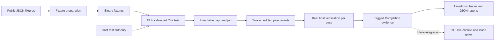

# Simulator source guide

The REINS simulator provides executable software evidence for the fixed **N=3,
Q=2** implementation. Its current **reference mode** performs real cryptographic
verification on the host computer and delivers results through an event-driven
verification service. It is the foundation for a C++ reference model and future
Verilator integration.

This directory contains the simulator: `src/` holds implementation files,
`include/reins/` holds interfaces, and `tests/` holds C++ tests. All commands below
run from the **repository root**.

For installation prerequisites and certificate troubleshooting, start with the
[root README](../README.md). The [v0.3 PDF](../docs/REINS-Hardware-Specification-v0.3.pdf)
is the normative protocol source; this guide describes the code's current behavior.

## Goals and current scope

The simulator has four immediate goals:

1. Check REINS request binding, Merkle proofs and actual SLH-DSA signatures against
   independently expected results.
2. Model when verification evidence becomes available, including two passes,
   cancellation, stalls and late results.
3. Provide a reusable boundary between test drivers, software cryptography and a
   future RTL controller.
4. Produce inspectable inputs, outcomes and timing reports for local PR review.

The REINS path uses **SLH-DSA-SHA2-128s, pure mode, empty context**, through OpenSSL
3.5 or later. Software hashing and signature verification execute directly on the
host CPU. Configured event delays control simulated completion times; the program
does not simulate each instruction or hardware clock cycle of that computation.

The current CLI replays two supplied **RENEW round-3** replies for slots 0 and 1.
The directed tests also generate fresh host-signed ARM replies for all three slots.
A verified signature is cryptographic evidence only: the current code does not
count votes, commit leases or drive an execution permit. A complete device model,
SPI driver, SystemVerilog controller and Verilator wrapper are later milestones.
See the [implementation plan](../docs/IMPLEMENTATION_PLAN.md) and
[simulation strategy](../docs/SIMULATION_STRATEGY.md).

## Source map

These are all seven current C++ source/header files in `sim/`:

| File | Responsibility | Main entry points |
|---|---|---|
| [`sim/include/reins/simulation.h`](include/reins/simulation.h) | Public data types and APIs shared by the CLI, tests and future simulation drivers | `VerificationInput`, `JobTag`, `Verdict`, `Latency`, `Completion`, `VerifierService`, `TestAuthority` |
| [`sim/src/crypto.cc`](src/crypto.cc) | Fixed-profile framing, grant construction, SHA-256, Merkle reconstruction, host SLH-DSA verification and test signing | `verify_reply`, `expected_batch_root`, `root_message`, `sha256`, `backend_version`, `TestAuthority`, `algorithm_test::verify` |
| [`sim/src/verifier_service.cc`](src/verifier_service.cc) | Immutable job capture, single live ownership, scheduled passes, cancellation and event delivery | `submit`, `advance_to`, `cancel`, `busy`, `now`, `verification_calls` |
| [`sim/src/main.cc`](src/main.cc) | Command-line parsing, sequential fixture replay, optional diagnostics, JSON reporting and exit status | `main`; local tick parser and JSON string helper |
| [`sim/include/reins/fixture_io.h`](include/reins/fixture_io.h) | Bounded binary fixture loading and per-slot request/tag preparation | `fixture::read`, `fixture::load` |
| [`sim/include/reins/diagnostics.h`](include/reins/diagnostics.h) | Readable request dumps, cryptographic verdict names and completion timelines | `diagnostic::write_input`, `write_completions`, `verdict_name`, `hex` |
| [`sim/tests/verifier_tests.cc`](tests/verifier_tests.cc) | Directed C++ checks and illustrative test logging, using doctest | NIST, REINS proof/signature, mutation, scheduling, cancellation, stall, overflow and host-signing cases |

`crypto.cc` and `verifier_service.cc` are linked into both programs:

```text
build/<configuration>/reins-sim         CLI, with main.cc
build/<configuration>/reins-sim-tests   C++ tests, with verifier_tests.cc
```

The configuration is `release` or `sanitize`. The two small I/O/diagnostic headers
contain inline helpers. Neither the cryptographic verifier nor the event service
depends on doctest; doctest is the C++ test framework used by the test executable.

### Supporting repository files

| File or directory | How it supports the simulator |
|---|---|
| [`Makefile`](../Makefile) | Compiles C++20 sources, finds OpenSSL through pkg-config, prepares fixtures and invokes logged test suites |
| [`tools/prepare_sim_fixtures.py`](../tools/prepare_sim_fixtures.py) | Verifies baseline pins and converts public JSON fixtures into binary test inputs |
| [`tools/check_baseline.py`](../tools/check_baseline.py) | Checks source hashes and the fixed profile; optionally runs the supplied review validator on isolated copies |
| [`tools/run_tests.py`](../tools/run_tests.py) | Runs build/test groups and retains raw output, statuses, revision/build settings, JSON and JUnit reports |
| [`tools/test_sim_report.py`](../tools/test_sim_report.py) | Exercises the actual CLI, JSON reports, request traces, deterministic event times and failure statuses |
| [`tools/fetch_doctest.py`](../tools/fetch_doctest.py) | Downloads or reuses the pinned C++ test dependency with TLS and SHA-256 checks |
| [`tools/write_build_config.py`](../tools/write_build_config.py) | Records compiler/flag settings and triggers rebuilding when they change |
| [`tools/tests/`](../tools/tests/) | Python regressions for the baseline checker, result collector and HTTPS dependency download |
| [`docs/validation/`](../docs/validation/) | Original public REINS fixtures, selected official NIST cases and supplied Python review code |
| [`docs/implementation_baseline.json`](../docs/implementation_baseline.json) | Pinned source hashes and implementation profile |
| [`third_party/README.md`](../third_party/README.md) | Dependency versions, integrity checks and license information |

## Architecture



The responsibilities are separate: the driver supplies bytes and advances time,
the service owns job identity and scheduling, and the cryptographic code checks
the captured bytes. Diagnostic decoding describes input without accepting,
repairing or substituting it.

### Data passed between components

| Type | Meaning |
|---|---|
| `Bytes` | Variable-length byte buffer used for OTP, requests, replies and messages |
| `Hash` / `PublicKey` | Fixed 32-byte SHA-256 digest / SLH-DSA public key |
| `Tick` | Unsigned 64-bit simulated time; no fixed mapping to host CPU cycles |
| `JobTag` | Captured local `run_generation`, `round` and `slot`; generation is simulator metadata, not a wire session field |
| `VerificationInput` | Tag plus the complete OTP, request and reply byte buffers |
| `Latency` | Delay to pass 1, additional delay to pass 2, and a test-only never-complete option; defaults are 100/100 ticks |
| `Verdict` | `verified`, `format_error` or `signature_error` |
| `Completion` | Token, captured tag, pass number, finish tick, verdict, cancellation diagnostic and measured host verification time |

## How cryptographic verification works

`verify_reply(input)` follows this path:

1. **Check framing and captured context.** OTP must be 272 bytes with the supported
   header, including N=3/Q=2. The request must be 128 bytes, wire version 2, with a
   supported ARM/RENEW request type, slot and reserved zeros. Device/policy must
   match OTP, and the captured round/slot must match the request.
2. **Check reply shape.** The reply is
   `signature[7856] || BE32(leaf_index) || siblings[32 * depth]`. Its length must be
   exactly `7860 + 32 * depth`, with depth 0 through 20 and index below `2^depth`.
   The largest supported reply is 8,500 bytes.
3. **Construct the expected grant locally.** Copy the captured request and change
   only its type: ARM_REQUEST to ARM_GRANT, or RENEW_REQUEST to RENEW_GRANT. The
   reply contains no returned request/grant body.
4. **Bind the grant to the configuration.** Calculate `C_cfg = SHA256(OTP)`, then
   the leaf:

   ```text
   SHA256(0x00 || "REINS-AUTH-v2" || expected_grant[128] || C_cfg[32])
   ```

5. **Reconstruct the batch root.** Walk the supplied sibling path. Each level
   hashes `0x01 || left[32] || right[32]`; successive leaf-index bits determine
   which side contains the current node.
6. **Verify the root signature.** Select the captured slot's public key from OTP
   and verify the signature over `"REINS-BATCH-v2" || root[32]`, using pure
   SLH-DSA-SHA2-128s with an empty context.

`||` means byte concatenation; the quoted domain strings do not include a NUL
terminator. A framing failure returns `format_error`; a well-framed signature
that does not verify returns `signature_error`. Unexpected crypto-library failures
raise exceptions rather than being reported as successful evidence.

`expected_batch_root` exposes the same grant/Merkle construction for independent
root comparisons and test signing. It throws on invalid framing.

The framing checks do not implement complete OTP provisioning/policy validation
or live lease/state/health checks. Those remain with the full device model and
controller milestones.

`TestAuthority` generates ephemeral host keypairs and signs roots for tests.
Private keys remain in host memory and are not serialized or printed. The separate
`algorithm_test::verify` API supports the official NIST vectors' internal-interface
and nonempty-context cases; those settings do not extend the REINS verifier's
accepted profile.

## How the event service operates

`VerifierService` allows one live job at a time. This models the ownership
boundary for the planned single-buffer backend; the C++ snapshots and event queue
are ordinary host memory, not an implementation of the 9,216-byte receive SRAM.

### Submit and deliver a job

1. `submit(input, latency)` checks ownership and scheduling overflow, copies the
   entire input, assigns a token unique within this service instance, and queues
   pass 1 at `now + first_pass_ticks` and pass 2 at that tick plus
   `second_pass_ticks`. It performs no signature verification at submission.
2. Caller changes to the original buffers cannot change the captured job.
3. `advance_to(target)` processes due events in tick/token/pass order, performing
   a complete host verification at each delivered pass. There is no cached-success
   shortcut between passes. An ordinary invalid verdict does not skip pass 2.
4. The method returns the due `Completion` records and sets simulated time to
   `target`. Advancing through idle time requires no per-tick loop.
5. Pass 1 leaves ownership live. Pass 2 releases ownership if that same job is
   still the owner. `verification_calls()` counts actual pass evaluations.

Zero-delay passes are delivered in pass order at the same tick. Backwards time
raises an error. A `never_complete` job retains ownership without queuing pass
events; time can still advance and the job can be cancelled.

For a job submitted at tick 0 with delays 7 and 11:

| Advance to tick | Delivered evidence | Ownership |
|---:|---|---|
| 6 | None | Busy |
| 7 | Pass 1 | Busy |
| 17 | None | Busy |
| 18 | Pass 2 | Released |

These times describe when evidence becomes visible to the simulation. Actual
cryptography runs on the host during `advance_to`; its measured duration does not
add simulated ticks.

### Cancellation and stale evidence

`cancel(token)` succeeds only for the live owner's token. It marks that job
cancelled and releases live ownership, allowing another job to be submitted.
Queued events can still hold references to the old snapshot.

The default `CancelledDelivery::drop` policy discards cancelled events without
verifying them. The explicit `deliver_for_stale_testing` policy instead evaluates
and delivers them with their old token/tag and `cancelled=true`. An old event can
never release a new job's ownership.

This test policy supports a future controller's independent identity checks. A
consumer must check its own live state, round, nonce, generation, deadline and
lease conditions before counting evidence. The service can deliver valid
cryptographic evidence exactly at or after a deadline; it does not authorize that
late result.

## Fixtures and the CLI replay

A **fixture** is a reusable input with a known expected answer.
`tools/prepare_sim_fixtures.py` checks baseline hashes before producing:

| Generated input | Used for |
|---|---|
| `otp.bin` | Public provisioned configuration and authority keys |
| `request.bin` | Supplied round-3 RENEW request |
| `reply-0.bin`, `reply-1.bin` | Signed replies for the two supplied slots |
| `root-0.bin`, `root-1.bin` | Independently expected roots for directed comparisons |
| `nist-index.txt`, `nist-*-*.bin` | Expected outcomes, interfaces and inputs for the 28 selected NIST algorithm cases |
| `ready.stamp` | Make's fixture-preparation completion marker |

The inputs live under `build/<configuration>/fixtures/`; original JSON and source
pins remain unchanged. `fixture::load(directory, slot)` selects that slot's reply,
sets the request's slot byte, decodes the request round and captures generation 1.
It requires a corresponding reply file: the supplied corpus has slots 0 and 1;
the C++ host-signing tests construct slot-2 evidence separately.

`main.cc` loads and submits slot 0, advances through its two passes, then repeats
for slot 1. With delays 7/11, the completion ticks are `[7, 18, 25, 36]`. The two
replies are checked cryptographically; there is no implemented quorum/lease commit.

## Build and run

Use the root Makefile and the prerequisites in the [root README](../README.md):

```sh
make build
make quick-tests
make tests
make sanitize-tests
```

There is no simulator-local Makefile. Verilator is not required for the current
software implementation. Address/undefined-behavior sanitizers instrument this
project's C++, not the installed OpenSSL library.

To run a CLI replay while retaining both output streams in a new directory:

```sh
mkdir -p test-results
reins_replay_dir=$(mktemp -d test-results/manual-replay.XXXXXXXX)
build/release/reins-sim \
  --fixtures build/release/fixtures \
  --mode reference \
  --first-pass-ticks 7 \
  --second-pass-ticks 11 \
  --trace-inputs \
  --output "$reins_replay_dir/report.json" \
  >"$reins_replay_dir/stdout.log" 2>"$reins_replay_dir/stderr.log"
reins_replay_status=$?
printf 'Exit status: %s\nResults: %s\n' "$reins_replay_status" "$reins_replay_dir"
```

`report.json` and `stdout.log` contain the same JSON. `stderr.log` contains the
request/event trace and any error diagnostics. The output directory must already
exist when using `--output`.

| CLI option | Behavior |
|---|---|
| `--fixtures DIR` | Required directory containing the generated public inputs |
| `--mode reference` | The only implemented mode; other modes fail explicitly |
| `--first-pass-ticks N` | Unsigned delay to pass 1; default 100 |
| `--second-pass-ticks N` | Additional unsigned delay to pass 2; default 100 |
| `--trace-inputs` | Flush readable requests before verification, then print completions, on stderr |
| `--output FILE` | Also write the JSON report to FILE |
| `--help` | Print usage and exit successfully |

Exit 0 means the replay verified both passes for both jobs, or help was requested.
Exit 1 means invalid evidence or a runtime failure such as unreadable fixtures,
scheduling overflow or a crypto-library error. Exit 2 means invalid CLI
configuration, including unsupported modes or invalid tick arguments.

### Reading the JSON report

| Fields | Interpretation |
|---|---|
| `report_version`, `mode`, `scenario`, `backend` | Report format, reference mode, supplied renewal scenario and runtime OpenSSL version |
| `jobs`, `verification_calls`, `completion_ticks` | Two jobs, four actual pass evaluations and their simulated finish ticks |
| `simulated_elapsed_ticks` | Final simulated time; 36 for the 7/11 example |
| `host_wall_ns` | Measured host replay time, including fixture I/O and optional trace output |
| `host_verification_ns` | Sum of measured host pass-evaluation times |
| `all_verified` | All four completions verified and were not cancelled |
| `authorization_checked` | Always false in the current CLI |
| `rtl_cycles`, `rtl_cycles_per_second`, `peak_rss_bytes` | Currently unmeasured and reported as null |

Simulated ticks are configured delays. Host nanoseconds measure software work.
Neither value is a measured RTL cycle count.

## Tests and saved evidence

`verifier_tests.cc` covers these behaviors:

- All 28 selected NIST outcomes: four acceptances and 24 expected rejections.
- Supplied REINS roots/signatures, signature and proof mutations, request/OTP/key
  binding, wrong captured identity, malformed request/reply lengths and indices.
- Immutable capture, two-pass timing, single ownership, cancellation, stale
  delivery, stalls, zero-delay ordering, deadline-boundary delivery and time errors.
- Fresh host-signed ARM replies for slots 0, 1 and 2 at proof depths 0 and 20.

Before each signed-response check, diagnostic helpers print the complete request,
decoded fields, scenario and expectation, including cases expected to fail.
Actual verdicts follow. Truncated fields are marked unavailable. Timeline and
cancellation messages show how evidence and ownership evolve. A rejection is a
passing result when the test deliberately supplies invalid evidence.

Every Make test invocation creates a unique directory under `test-results/`.
For the full `make tests` suite, the main paths are:

| Result path within that directory | Contents |
|---|---|
| `summary.json`, `runner.log`, `junit.xml` | Group status, commands, timing, revision and aggregate evidence |
| `build/output.log`, `build/build-config.json` | Build diagnostics and compiler settings |
| `sim-directed/output.log` | C++ assertions, complete requests and illustrative timelines |
| `sim-report/output.log` | CLI scenario expectations and observed status |
| `sim-report/cli-artifacts/` | Individual CLI stdout/stderr, command records, JSON and negative-case inputs |
| `baseline/`, `tool-regressions/` | Source/fixture review and test-infrastructure results |

The quick suite skips fresh-key signing and some slower/infrastructure checks;
the full suite includes them. To select one C++ example while retaining the other
full-suite groups, use `make tests TEST_FILTER='*cancellation*'`. A zero-match C++
selection fails.

Saved results remain until explicit `make clean-results` or `make clean`.
`make clean` also removes build outputs but keeps the `.deps/` download cache;
`make clean-deps` removes only that cache. No test target automatically removes
previous runs. Repository-wide test coverage is documented in the
[root README](../README.md#what-are-the-tests-checking).

## Extending the simulator

Start with `simulation.h` for the boundary, `main.cc` for a complete driver,
`crypto.cc` for byte-level verification, and `verifier_service.cc` for event
lifetime/ownership. Use the existing directed cases as examples of valid and
deliberately invalid inputs.

A future Verilator driver can submit the captured job and consume completions
while advancing the RTL simulation. The RTL must independently enforce the live
acceptance conditions before voting. Full SHA/Merkle/SLH-DSA RTL and physical
qualification remain separate development work; fuzz and RTL fault campaigns
are also pending. The software mutation/stale/stall cases establish only their
declared software behaviors.

Follow [AGENTS.md](../AGENTS.md): use `.cc`/`.h`, give each new or modified
function a short purpose/parameter comment, use the Make test interface and retain
outputs. Add new generated evidence outside the pinned validation sources.
